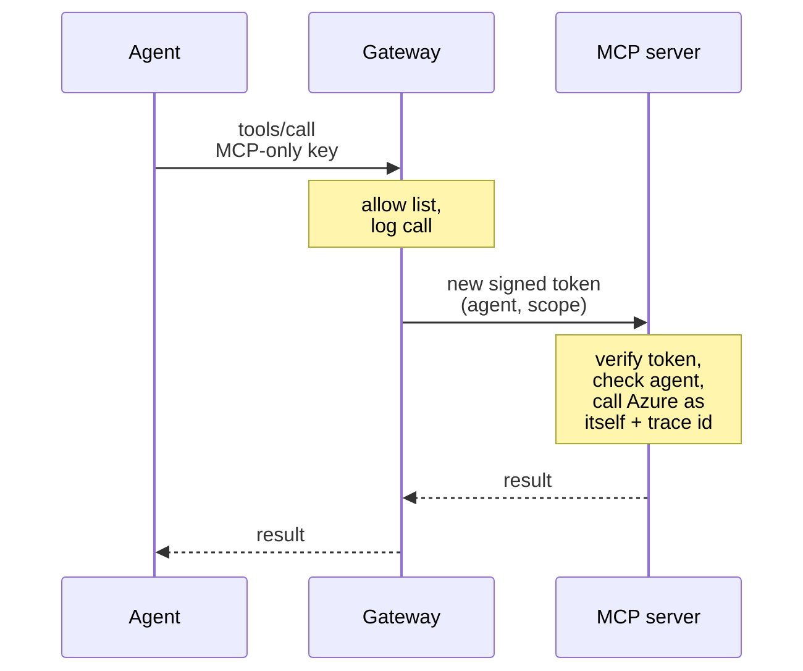

If an AI agent changes something in Azure through an MCP server, whose name ends up in the audit log? The agent's? The MCP server's? The person who started the run? Nobody's? I had to answer that question for real this month, and the honest first answer was "it depends, and mostly not the agent's".

This post walks through how I worked it out for Platform Wardens, our multi-agent framework (SRE, DevOps and DBA agents) that runs on the homelab and targets Azure. You'll see what the MCP spec and the big gateways say about tool-call identity, the four ways an MCP server can reach a backend and what each one leaves in the logs, the design we picked, why the homelab gateway is LiteLLM rather than agentgateway, and the test that showed a gap I hadn't expected.

<!-- more -->

## Why this came up

Our agents already reach models only through a gateway: LiteLLM on the homelab, the Azure API Management (APIM) AI gateway in Azure. Tool calls were the missing half. The trigger was a change-correlator agent whose job is to find who changed an Azure resource. We tested Microsoft's Azure MCP server (`@azure/mcp` 3.0.0) on a real deletion, and it fell over on deleted resources: its activity-log tool resolves the resource name to a live resource first, and a deleted resource isn't live any more. So for now the agent uses its own Activity Log and Resource Graph tools.

That detour made the identity question concrete. An agent that investigates changes is, sooner or later, going to be asked about changes made by agents. If every agent's tool call shows up in Azure as the same service principal, the agent can't answer the one question it exists for.

If you're new to how agents call tools at all, my earlier post on [the architecture of an AI agent](/posts/agenticai/ai-agent-architecture/) covers the loop and where MCP fits. This one assumes you know that and asks: who is the caller?

## What the spec and the industry say

Here's what the specs and the vendor docs say.

**The spec forbids the easy answer.** The MCP security best practices (spec revision 2025-11-25) say: "MCP servers MUST NOT accept any tokens that were not explicitly issued for the MCP server." That kills token passthrough, where the agent hands its own token to the server and the server forwards it to the backend. Downstream calls use the server's own credential or a token exchange (RFC 8693, or Entra on-behalf-of in Microsoft land). Tokens are audience-bound to one server with RFC 8707 resource indicators.

**Gateways are the usual control point.** The main options I looked at:

- **Azure API Management** has had MCP support generally available since November 2025. It can expose a REST API as an MCP server or proxy an existing one. Policies apply to all tools of a server, not per tool, and only tools are supported (no resources or prompts). Its credential manager handles outbound OAuth.
- **AWS AgentCore Gateway** takes inbound JWT or IAM, and outbound uses IAM or an OAuth token or API key from the AgentCore Identity vault.
- **agentgateway** (a Linux Foundation project) does per-tool authorization with CEL expressions, and in July 2026 added token exchange, including Entra on-behalf-of.

**They don't agree on where the exchange happens.** AgentCore and agentgateway exchange tokens in the gateway. Traefik's MCP gateway guidance does the exchange in the MCP server and keeps the gateway for policy. Both are defensible; it's a question of which component you want holding downstream credentials.

**The common practices are boring and right:**

- A short-lived identity per agent.
- Deny-by-default, per tool.
- Tool definitions pinned by hash, against tool poisoning and "rug pulls" (MCP03 in the OWASP MCP Top 10, still in beta).
- Every call logged with agent, person, tool and a correlation id (the CoSAI guidance).

One more thing that cleared up a lot of my confusion: products are often shared between model traffic and tool traffic. The APIM AI gateway does both. What the standards require is separate tokens and audiences, not separate products. That turned out to matter a lot for the LiteLLM decision.

## Four ways an MCP server can reach a backend

Take Azure as the backend. The MCP server has to authenticate to Azure somehow, and whatever it uses is the name Azure records. There are four options.

| Option | How the server calls Azure | What the logs show |
|---|---|---|
| **A. Forward the agent's token** | Passes through whatever the agent sent | Forbidden by the spec, so it doesn't matter |
| **B. Shared server, its own identity** | One managed identity per server | Entra sign-in logs and the Activity Log name the server for every agent; the gateway and server logs name the agent and tool |
| **C. Token exchange (on-behalf-of)** | Swaps the incoming token for one for Azure | Logs name the person. Entra OBO only accepts user tokens, not app-only tokens, so it doesn't work for unattended agents |
| **D. Per-agent server running as the agent** | One server instance per agent, each with the agent's identity | Every log names the agent; costs one server per agent per backend |

Option C looks like the clean answer until you notice that most of our runs are unattended. An alert fires, the SRE agent investigates, nobody is signed in. On-behalf-of has no "behalf" to act on. Option D is the most precise, and also the one that multiplies your deployments.

> The Azure Activity Log records only writes, deletes and actions, never reads. A read-only agent leaves no Activity Log entry whichever option you pick. Reads only show in the Entra sign-in logs and in your gateway and server logs. If you planned to audit agent reads from the Activity Log, you can't.
{: .prompt-warning }

That gotcha shifted my thinking. If the backend's own audit can't name the agent for reads in any option, then the gateway and server logs are the audit trail, and what matters most is that they can be joined to Azure's records for the writes.

## Our design: terminate the agent at the gateway

The design is written up in our ADR (status: Proposed). The short version: the agent's identity stops at the gateway, and nothing downstream ever sees a token the agent holds.

1. The agent signs in to the MCP gateway with a credential used only for MCP, never its model credential.
2. The gateway checks a deny-by-default, per-agent allow list of servers and tools. The list is generated from the agent's manifest, including pinned tool-definition hashes. Tools the agent can't call are hidden from `tools/list`, and every call is logged.
3. The gateway calls the MCP server with a **new** token issued for the server, saying which agent is calling.
4. The server verifies that token itself (signature, issuer, audience), checks the agent against its own allow list, and refuses calls that don't carry agent, run and trace context. The gateway is not the only check.
5. The server calls the backend with whatever credential mode the tool declares.



### Credential modes

Every MCP tool in an agent's manifest declares how the server reaches the backend:

- `credential: server` (the default, option B): one shared MCP server per backend with its own identity.
- `credential: agent` (option D): a per-agent server. Used when only one agent may hold a permission, or when a control requires the backend's own audit to name the agent.
- `credential: person` (option C): on-behalf-of, when a person started the call.

The shared identity in the default mode is the obvious weakness, so it comes with mitigations. Read and act tools run as separate deployments with separate identities. Roles are limited to the scopes the manifest declares. And act tools are still only called from deterministic stages, after guardrails or approval, never directly from a model's free choice.

### Attribution with one trace id

The piece that makes option B workable is a single trace id required on every call. It goes into the gateway log, the server log, the run record, and Azure's `x-ms-correlation-request-id` header, which shows up as the Activity Log event's correlation id.

So to find which agent made an Azure change: take the correlation id from the Activity Log event, search the gateway log for it. You get the agent, the run, the tool and the arguments. Azure names the server; our logs name the agent; the correlation id joins them.

### Where the gateway runs

- **Azure:** APIM, with MCP as its own API and product and its own token audience, allowed on the same instance as the AI gateway. APIM sets the agent and run headers from the validated token's claims, and the server trusts those headers only on a request authenticated as the gateway.
- **Homelab:** the existing LiteLLM, the same instance that serves models. agentgateway is the fallback.
- **Outside the clusters** (running agents directly with `uv run` on the Spark or the home PC): there's no gateway. An in-process stage check enforces the allow list and logs every call.

## LiteLLM vs agentgateway

This is where I changed my mind, so I'll show the reasoning rather than just the verdict.

Our first draft picked agentgateway. It's built for exactly this, has per-tool CEL policies and does real token exchange. My argument against LiteLLM was that "tool credentials would sit in a shared platform service". Then the design moved credentials into the MCP servers, and that argument quietly stopped being true. LiteLLM never needs to hold an Azure credential in this design.

With that out of the way, the comparison looks like this:

| | LiteLLM (free) | agentgateway |
|---|---|---|
| Per-tool authorization at the gateway | Yes, allow lists per key, team or org | Yes, CEL per tool |
| Verifiable caller identity for the server | `mcp_jwt_signer` guardrail signs each call with a short-lived RS256 JWT, verified against LiteLLM's JWKS | Token exchange with the agent in the `act` claim |
| How the agent proves itself to the gateway | Long-lived virtual key (inbound JWT auth is enterprise-only; an unlicensed proxy returns 403) | The pod's short-lived Kubernetes service-account token |
| Token bound to one server | No, one `audience` for the whole guardrail | Yes, per-server tokens |
| Already running on our homelab | Yes | No |

Both can enforce per-tool policy, and both can give the server a caller identity it can verify. The real difference is the first hop: how the agent proves itself to the gateway. agentgateway takes a short-lived service-account token the pod already has. Free LiteLLM takes a long-lived virtual key.

We already accept virtual keys for model calls, so we accept them for MCP too, with compensating controls: rotation, a separate MCP-only key per agent, and one LiteLLM team per agent (the team name becomes the agent identity in the signed token).

### Why not a second LiteLLM instance?

I considered running a separate LiteLLM just for MCP. I didn't, for three reasons. Separate keys already separate model credentials from tool credentials, which is what the standards ask for. In Azure, the single APIM instance accepts the same shared-outage risk, so the homelab would be stricter than production for no clear reason. And if we want isolation later, the step is agentgateway, not a second copy of LiteLLM.

The honest risk: a LiteLLM admin, with the master key or the UI, could make a tool call look like any agent's. That's the same power they already have over every agent's model budget. Admin stays with the platform owner, and the signing key lives in its own secret path.

## Testing it: what the server actually sees

Docs describe intent; I wanted to see the tokens. On 2026-11-06 I ran LiteLLM v1.103.1 from PyPI with Postgres, outside the clusters, not against the live instance. Setup:

- `mcp_jwt_signer` guardrail with the signing key from `MCP_JWT_SIGNING_KEY`.
- Two FastMCP servers, `azure_reader` and `other_server`, both verifying with `JWTVerifier` against LiteLLM's JWKS (issuer `http://127.0.0.1:4000`, audience `mcp`).
- A LiteLLM team called `change-correlator` and an MCP-only key in it, granted `azure_reader` only.

| Test | Result |
|---|---|
| Agent key → LiteLLM → `azure_reader` | Allowed. The server saw `act.sub` = `change-correlator`, `sub` = `apikey:<hash>`, `scope` = `mcp:tools/call mcp:tools/whoami:call`, `exp` 60 s after `iat`. A forwarded `x-wardens-run` header arrived too |
| Same key → `other_server` (not granted) | Denied by LiteLLM: "User not allowed to call this tool". The tool wasn't even in the tool list |
| Direct call to the server, no token | Refused |
| Direct call with the agent's LiteLLM virtual key as bearer | Refused |
| Token signed for `azure_reader`, replayed directly to `other_server` | **Accepted** |

The first four are what you'd hope for. The fifth is the gap.

> Every server behind the guardrail trusts `aud: mcp`, because `audience` is one setting for the whole guardrail, not per server. A token captured from one server's traffic is valid at every other server for its lifetime. That's exactly what RFC 8707 audience binding is meant to prevent.
{: .prompt-danger }

The mitigations we applied:

- `ttl_seconds: 60`, so a captured token is useful for a minute, not five (the default is 300).
- Tool names unique across servers.
- Each server rejects a token whose `scope` doesn't name one of its own tools. The scope says `mcp:tools/whoami:call`; `other_server` has no `whoami`, so it refuses.
- If a server ever needs a token bound to it alone, that server moves behind agentgateway, which issues per-server tokens.

### Other things the test showed

- **Claims come only from the caller's LiteLLM account** (user, team, org, email) plus static `add_claims` / `set_claims`. You can't put a run id in a signed claim. Run and trace ids travel as unsigned forwarded headers. I'm fine with that because they only join logs and never decide access.
- **Set `MCP_JWT_SIGNING_KEY`.** Without it, LiteLLM generates a key in memory that changes on every restart. In-flight tokens break, and multiple replicas each sign with a different key.
- **No licence check.** The guardrail's code in v1.103.1 doesn't check for an enterprise licence, unlike inbound JWT auth.
- **The other LiteLLM MCP auth methods don't identify the agent:**
  - Static auth (`bearer_token`, `api_key`, basic, `static_headers`) sends one credential for all callers.
  - `extra_headers` and `x-mcp-*` forward headers nobody verified.
  - Per-user credentials are keyed by user, not by key or team.
  - On-behalf-of (`oauth2_token_exchange`, the `entra_obo` profile) needs a user token and has no client-credentials fallback.

## The config

Here's the shape of it. URLs are placeholders.

### LiteLLM

```yaml
# config.yaml
mcp_servers:
  azure_reader:
    url: https://azure-reader.example.com/mcp
    transport: http
    # forwarded as-is to the server; used to join logs, never for access
    extra_headers: ["x-wardens-run", "x-wardens-trace"]

guardrails:
  - guardrail_name: mcp-jwt-signer
    litellm_params:
      guardrail: mcp_jwt_signer
      mode: pre_mcp_call
      default_on: true
      issuer: https://litellm.example.com
      audience: mcp
      ttl_seconds: 60
```

The signing key comes from the environment, from its own secret path (we keep it in OpenBao, separate from the master key):

```bash
# PEM contents or a file:// path
export MCP_JWT_SIGNING_KEY="file:///run/secrets/mcp-jwt-signing-key.pem"
```

The servers fetch the public key from `https://litellm.example.com/.well-known/jwks.json`.

### The MCP server

A minimal FastMCP server that verifies the token, checks the agent against its own allow list and checks that the scope names one of its own tools:

```python
from fastmcp import FastMCP
from fastmcp.server.auth.providers.jwt import JWTVerifier
from fastmcp.server.dependencies import get_access_token, get_http_headers

auth = JWTVerifier(
    jwks_uri="https://litellm.example.com/.well-known/jwks.json",
    issuer="https://litellm.example.com",
    audience="mcp",
    algorithm="RS256",
)

mcp = FastMCP("azure_reader", auth=auth)

ALLOWED_AGENTS = {"change-correlator"}   # the server's own allow list
MY_TOOLS = {"whoami", "activity_log_query"}


def require_caller(tool: str) -> dict:
    claims = get_access_token().claims
    agent = (claims.get("act") or {}).get("sub")
    if agent not in ALLOWED_AGENTS:
        raise PermissionError(f"agent {agent!r} not allowed on this server")

    scopes = set(claims.get("scope", "").split())
    if f"mcp:tools/{tool}:call" not in scopes or tool not in MY_TOOLS:
        raise PermissionError("token was not issued for this tool")

    run = get_http_headers().get("x-wardens-run")
    if not run:
        raise PermissionError("missing run context")
    return {"agent": agent, "run": run}


@mcp.tool
def whoami() -> dict:
    """Return the verified caller, for testing."""
    return require_caller("whoami")


if __name__ == "__main__":
    mcp.run(transport="http", port=8000)
```

The scope check is what closes most of the replay gap: a token minted for another server's tool doesn't name any tool this server owns. In a real server the run and trace ids also go on the outbound Azure call as `x-ms-correlation-request-id`, so the Activity Log entry can be traced back.

## What I got wrong, and pitfalls to watch

- **I argued against LiteLLM for a reason the design had already removed.** "Tool credentials in a shared platform service" was true of an earlier sketch. Once servers held their own credentials, the gateway only needed to authorize and sign. Re-check your objections after the design changes.
- **I assumed the backend's audit would name somebody useful.** For reads in Azure, the Activity Log names nobody. Plan your audit trail around your own logs and a correlation id.
- **On-behalf-of is not an agent identity.** It's a person's identity. For an unattended agent, Entra OBO has nothing to exchange.
- **"Audience: mcp" is not audience binding.** One audience for every server means one token works everywhere it's still valid. Check this before you assume RFC 8707 behaviour.
- **Don't let the signing key default.** An in-memory key works on a laptop and fails the first time a pod restarts or you scale to two replicas.
- **Unsigned headers are fine for joining logs and nothing else.** The moment a forwarded header decides access, anyone who can reach the server can set it.

## Conclusion

The answer to "whose name is in the audit log?" is, in our design, mostly the MCP server's, and that's acceptable because our own logs name the agent and one trace id ties them to Azure's records. The agent's identity stops at the gateway, the server gets a fresh token it verifies itself, and nothing forwards a token anywhere.

LiteLLM won on the homelab because it's already there, it already does per-tool allow lists, and its JWT signer gives servers a verifiable caller. It loses on two points, a long-lived inbound key and a single audience for all servers, and agentgateway is the step if either becomes unacceptable. The ADR is still Proposed. The next step is wiring the signer into the live LiteLLM and putting the change-correlator's own Activity Log tools behind it.

If you run agents with MCP today, try the replay test on your own setup: take a token from one server's traffic and send it to another. It's a quick test, and it tells you whether your audiences mean anything.

## References

- [MCP specification 2025-11-25: Security Best Practices](https://modelcontextprotocol.io/specification/2025-11-25/basic/security_best_practices)
- [Azure API Management: MCP server overview](https://learn.microsoft.com/en-us/azure/api-management/mcp-server-overview)
- [Azure API Management: Secure access to MCP servers](https://learn.microsoft.com/en-us/azure/api-management/secure-mcp-servers)
- [AWS Bedrock AgentCore Gateway: outbound authorization](https://docs.aws.amazon.com/bedrock-agentcore/latest/devguide/gateway-outbound-auth.html)
- [agentgateway: token exchange, JWT assertion and Entra OBO](https://agentgateway.dev/blog/2026-07-12-agentgateway-token-exchange-jwt-assertion-entra-obo/)
- [Traefik Hub: MCP gateway best practices](https://doc.traefik.io/traefik-hub/mcp-gateway/guides/mcp-gateway-best-practices)
- [CoSAI: Securing the AI agent revolution, a practical guide to MCP security](https://coalitionforsecureai.org/securing-the-ai-agent-revolution-a-practical-guide-to-mcp-security)
- [LiteLLM: MCP zero trust (JWT signer)](https://docs.litellm.ai/docs/mcp_zero_trust)
- [LiteLLM: MCP authentication](https://docs.litellm.ai/docs/mcp_authentication)
- [LiteLLM: MCP per-user auth](https://docs.litellm.ai/docs/mcp_per_user_auth)
- [LiteLLM: MCP on-behalf-of auth](https://docs.litellm.ai/docs/mcp_obo_auth)
- [LiteLLM: Authentication overview](https://docs.litellm.ai/docs/auth_overview)
