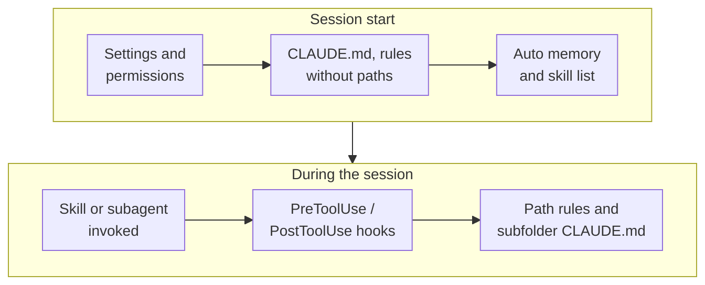

Claude keeps running `npm test` when your project uses `pnpm`, asks permission for the same command forty
times a day, and forgets the deployment checklist you explained yesterday. Each of those problems has a
specific fix in Claude Code's configuration, and each fix lives in a different file. `CLAUDE.md` for the first,
`settings.json` for the second, a skill for the third. This post walks through everything Claude Code reads from
your project's `.claude/` folder, the project root and your home directory: what each piece is for, how they
differ, where scripts go, and exactly when each one loads or runs.

<!-- more -->

There's a companion post for GitHub Copilot:
[the .github folder for GitHub Copilot](/posts/aicodingtools/github%20copilot/github-copilot-folder-structure/).
For day-to-day usage tips, see [Claude Code tips](/posts/aicodingtools/claude%20code/claude-code-tips/).

## The full map

```text
your-project/
├── CLAUDE.md                    # project instructions, loaded every session (committed)
├── CLAUDE.local.md              # your personal project notes (gitignore it)
├── .mcp.json                    # project MCP servers (committed)
├── .worktreeinclude             # gitignored files to copy into new worktrees
└── .claude/
    ├── settings.json            # permissions, hooks, env, model (committed)
    ├── settings.local.json      # your overrides (gitignored)
    ├── rules/                   # topic rules, optionally scoped by file path
    │   ├── testing.md
    │   └── frontend/
    │       └── react.md
    ├── skills/                  # reusable procedures: /name or auto-invoked
    │   └── release-notes/
    │       ├── SKILL.md
    │       ├── reference.md
    │       └── scripts/
    │           └── collect.sh
    ├── commands/                # older single-file commands (still work)
    │   └── fix-issue.md
    ├── agents/                  # subagents with their own context window
    │   └── code-reviewer.md
    ├── hooks/                   # convention: scripts referenced by settings.json
    │   └── block-rm.sh
    ├── output-styles/           # alternative response styles
    ├── workflows/               # dynamic workflow scripts (each becomes /name)
    └── agent-memory/            # subagent memory (MEMORY.md per agent)
```

And in your home directory:

```text
~/
├── .claude.json                 # app state and UI preferences
└── .claude/
    ├── CLAUDE.md                # your instructions for every project
    ├── settings.json            # your default settings
    ├── keybindings.json         # keyboard shortcuts
    ├── rules/  skills/  commands/  agents/  output-styles/  workflows/
    ├── themes/                  # custom colour themes
    └── projects/<project>/memory/
        ├── MEMORY.md            # auto memory Claude writes itself
        └── debugging.md         # topic files split out of MEMORY.md
```

Almost everything in the project folder is meant to be committed so the team shares it. The exceptions are
`settings.local.json` and `CLAUDE.local.md`, which are yours alone. Everything under `~/.claude/` stays on
your machine.

## Guidance versus enforcement

Before going folder by folder, one distinction explains most of the design:

- **Guidance** is text Claude reads and usually follows: `CLAUDE.md`, rules, skills, subagent prompts and output styles. The more specific and concise it is, the more reliably it's followed, but it's never guaranteed.
- **Enforcement** is applied by Claude Code whatever the model decides: permissions and hooks in `settings.json`, and managed settings from your organisation.

So "please don't touch `.env`" goes in `CLAUDE.md` if it's a preference, and in a `permissions.deny` rule or a
`PreToolUse` hook if it must never happen.

## CLAUDE.md: the instructions Claude reads every session

`CLAUDE.md` is your project briefing: the build and test commands, architecture notes, conventions and things to
avoid. It loads into context at the start of every session. Run `/init` and Claude will draft one by analysing the
codebase (or suggest improvements if you already have one).

```markdown
# Project notes

- Package manager is pnpm. Run tests with `pnpm test`, lint with `pnpm lint`.
- API routes live in `src/api/`; each route has a matching test in `tests/api/`.
- Use Zod schemas for all request validation.
- Don't edit generated files in `src/gen/`; regenerate with `pnpm codegen`.

@docs/architecture.md
```

The details that matter:

| Location | Scope |
|---|---|
| Managed policy file (e.g. `/etc/claude-code/CLAUDE.md` on Linux) | Organisation-wide, set by IT |
| `~/.claude/CLAUDE.md` | You, every project |
| `./CLAUDE.md` or `./.claude/CLAUDE.md` | The team, this project |
| `./CLAUDE.local.md` | You, this project (add to `.gitignore`) |

- **Loading order**: Claude Code loads `CLAUDE.md` and `CLAUDE.local.md` from your working directory and every directory above it, concatenated from the top down, so the file closest to you is read last. Files in **subdirectories** load on demand, the first time Claude reads or edits something in that folder.
- **Imports**: `@path/to/file` pulls another file in at launch (up to four hops deep). It helps you organise a long file, but doesn't reduce the context cost.
- **Size**: aim for under 200 lines per file. Longer files cost context and get followed less reliably. Move narrow rules into `.claude/rules/` and procedures into skills.
- **AGENTS.md**: if a repository has an `AGENTS.md` and no `CLAUDE.md` (or `CLAUDE.local.md`), Claude Code reads the `AGENTS.md` instead (v2.1.277+). If both exist, it reads only `CLAUDE.md`, unless your `CLAUDE.md` imports `@AGENTS.md`. That import is the simplest way to share one instruction file with Copilot and other tools.

> Adding a personal `CLAUDE.local.md` to a project that relies on `AGENTS.md` stops Claude from reading the
> `AGENTS.md` for you, because `CLAUDE.local.md` counts as a CLAUDE file. Import `@AGENTS.md` from it, or change
> the project-instructions setting.
{: .prompt-warning }

## .claude/rules/: topic rules, optionally scoped to paths

Rules split instructions into topic files. A rule **without** frontmatter loads at session start, just like
`CLAUDE.md`. A rule **with** a `paths` field loads only when Claude reads, writes or edits a matching file, so
your API conventions don't take up context while Claude is working on CSS.

```markdown
---
paths:
  - "src/api/**/*.ts"
  - "tests/api/**"
---

# API rules

- Every handler validates input with a Zod schema.
- Return errors as `{ error: { code, message } }` with the right HTTP status.
```

Subfolders are discovered automatically (`.claude/rules/frontend/react.md`), and `~/.claude/rules/` holds
personal rules that apply to every project. VS Code's Copilot also reads `.claude/rules`, using the `paths` field
in place of Copilot's `applyTo`.

## settings.json: permissions, hooks, environment and model

Settings are the enforcement layer. They're JSON, and several scopes merge, with higher ones winning when the
same key is set twice:

1. Managed settings (your organisation)
2. Command-line flags (`claude --settings ...`)
3. `.claude/settings.local.json` (you, this project, gitignored)
4. `.claude/settings.json` (the team, committed)
5. `~/.claude/settings.json` (you, every project)

```json
{
  "permissions": {
    "allow": ["Bash(pnpm test *)", "Bash(pnpm lint *)", "Bash(git status)"],
    "ask": ["Bash(git push *)"],
    "deny": ["Read(./.env)", "Read(./secrets/**)", "Bash(rm -rf *)"]
  },
  "env": {
    "NODE_ENV": "development"
  },
  "model": "sonnet",
  "hooks": {
    "PostToolUse": [
      {
        "matcher": "Edit|Write",
        "hooks": [
          { "type": "command", "command": "${CLAUDE_PROJECT_DIR}/.claude/hooks/format.sh" }
        ]
      }
    ]
  }
}
```

The `permissions` block is what stops the forty prompts a day: `allow` pre-approves commands, `ask` always
confirms, and `deny` blocks outright. Put team-wide rules in `settings.json` and your personal "yes, I trust this
command" rules in `settings.local.json`.

## .claude/skills/: procedures Claude or you can invoke

A skill is a folder with a `SKILL.md` and any supporting files. Use one when you keep pasting the same
instructions or checklist into chat, or when a section of `CLAUDE.md` has turned into a procedure.

```markdown
---
name: release-notes
description: Draft release notes from merged PRs since the last tag. Use when asked for release notes, a changelog or what shipped.
argument-hint: "[since-tag]"
allowed-tools: Bash(${CLAUDE_SKILL_DIR}/scripts/collect.sh *) Bash(git log *)
---

## Commits since $ARGUMENTS
!`git log --oneline $ARGUMENTS..HEAD`

1. Run `${CLAUDE_SKILL_DIR}/scripts/collect.sh $ARGUMENTS` for PR titles and labels.
2. Group them using the categories in [reference.md](reference.md).
3. Put breaking changes first.
```

Skills load progressively, which is why you can have dozens without filling the context window:

1. **Always**: each skill's `name` and `description`, so Claude knows what's available.
2. **On invocation**: the full `SKILL.md` enters the conversation and stays there.
3. **On demand**: supporting files (`reference.md`, examples) load only when Claude opens them. Scripts are executed, not read into context.

### Who invokes a skill

| Frontmatter | You can run `/name` | Claude invokes it automatically |
|---|---|---|
| (default) | Yes | Yes, when the request matches `description` |
| `disable-model-invocation: true` | Yes | No. Use this for anything with side effects, like deploys |
| `user-invocable: false` | No (hidden from the `/` menu) | Yes |

Other frontmatter worth knowing:

- `allowed-tools` pre-approves tools for the turn that invokes the skill.
- `paths` limits automatic activation to matching files.
- `context: fork` runs the skill in an isolated subagent (choose the type with `agent`).
- `model` and `effort` override those settings while the skill is active.
- `hooks` registers hooks while the skill is active.

In the body, `$ARGUMENTS` (or `$0`, `$1`, or named `arguments`) receives what you typed after `/name`,
`` !`command` `` injects a command's output before Claude sees the prompt, and `${CLAUDE_SKILL_DIR}` points at the
skill's own folder so bundled scripts work from any directory.

Skills live in `.claude/skills/` (project), `~/.claude/skills/` (personal), nested `.claude/skills/` folders in
subdirectories of a monorepo, or inside plugins (as `/plugin-name:skill-name`). When names clash, enterprise beats
personal, which beats project.

### Skills versus .claude/commands/

Custom commands have been **merged into skills**. `.claude/commands/deploy.md` and
`.claude/skills/deploy/SKILL.md` both create `/deploy`, and old command files keep working. If both exist with the
same name, the skill wins. A nested command file such as `commands/frontend/component.md` becomes
`/frontend:component`. For anything new, write a skill. You get a folder for supporting files, plus the
invocation controls.

## .claude/agents/: subagents with their own context

A subagent is a specialised assistant defined in a Markdown file. It runs in its **own context window** with its
own system prompt, tools and optionally model, and returns only a summary to your main conversation. That keeps
noisy work (searching a huge codebase, running a long test suite, reviewing a diff) from flooding your main
context.

```markdown
---
name: code-reviewer
description: Reviews code changes for bugs, security issues and missing tests. Use proactively after code changes.
tools: Read, Glob, Grep, Bash
model: sonnet
memory: project
---

You are a senior code reviewer. Inspect the current diff, find correctness and
security problems, and report each with file, line and a suggested fix. Never edit files.
```

Only `name` and `description` are required. Useful extras include `tools` / `disallowedTools`, `model`,
`permissionMode`, `skills` (preloaded), `hooks`, `mcpServers`, `memory` (persistent notes in `agent-memory/`),
and `isolation: worktree` to work in a temporary git worktree.

Subagents get invoked in four ways:

- **Automatic delegation**: Claude matches the task to the `description`. Phrases like "use proactively" encourage it.
- **By name**: "use the code-reviewer subagent on my changes".
- **@-mention**: type `@` and pick the agent, which guarantees it runs.
- **For the whole session**: `claude --agent code-reviewer`, or `"agent"` in settings.

Claude Code also ships built-in subagents: **Explore** (fast, read-only search), **Plan** (read-only research in
plan mode) and **general-purpose**. Project agents in `.claude/agents/` override personal ones in
`~/.claude/agents/` with the same name.

## Hooks: scripts on lifecycle events

Hooks run your code at specific moments: before a tool call, after a file edit, when Claude finishes, at session
start and many more. They're configured in a `hooks` block in any `settings.json` scope (or in skill, subagent and
plugin definitions). By convention, the scripts live in `.claude/hooks/` and are referenced through
`${CLAUDE_PROJECT_DIR}` so they work from any working directory.

```bash
#!/bin/bash
# .claude/hooks/block-rm.sh: wired to PreToolUse with matcher "Bash"
COMMAND=$(jq -r '.tool_input.command')
if echo "$COMMAND" | grep -q 'rm -rf'; then
  echo "Destructive command blocked by project hook" >&2
  exit 2
fi
exit 0
```

What you need to know:

- **Events**: `SessionStart`, `UserPromptSubmit`, `PreToolUse`, `PermissionRequest`, `PostToolUse`, `Stop`, `SubagentStart` / `SubagentStop`, `PreCompact`, `Notification`, `SessionEnd`, plus newer ones such as `InstructionsLoaded`, `FileChanged` and `WorktreeCreate`.
- **Matchers**: for tool events, the matcher is the tool name (`Bash`, `Edit|Write`, or a regex like `mcp__github__.*`).
- **Exit codes**: `0` means success, and on some events stdout is added as context for Claude. `2` blocks the action, and stderr goes back to Claude as the reason. Any other code is a non-blocking error, so `exit 1` does **not** block.
- **Handler types**: besides `command`, a hook can be `http` (POST the event to a URL), `prompt` (a quick model yes/no decision), `mcp_tool` or `agent` (experimental).
- Make scripts executable (`chmod +x`), and install `jq` if you parse the JSON input in bash.

## The other folders and files

**`.mcp.json`** (project root) declares MCP servers for the project: GitHub, a database, a browser, an internal
API. It's committed so the team shares the same tools, and Claude Code asks for approval before using project
servers the first time. Personal servers can be added at user scope with `claude mcp add`.

**`.claude/output-styles/`** holds alternative response styles: Markdown files with a name, a description and
instructions that change how Claude responds (more explanation for learning, terser for experts). You choose one
with `outputStyle`, and it applies to every response.

**`.claude/workflows/`** holds dynamic workflow scripts that orchestrate many subagents for audits, large
migrations or cross-checked research. Each file becomes a `/name` command.

**`.claude/agent-memory/`** is where subagents with a `memory` setting keep their own `MEMORY.md`, separate from
your main session's memory.

**Auto memory** lives in `~/.claude/projects/<project>/memory/`. Claude writes `MEMORY.md` itself as it learns
your preferences and corrections. The first 200 lines (capped at 25 KB) load at session start, and topic files
load when relevant. You can edit or delete it, but you don't write it.

**`.worktreeinclude`** lists gitignored files (such as `.env`) to copy into new git worktrees, which start as
clean checkouts.

**Plugins** package skills, agents, hooks, commands and MCP servers into one installable unit (with a manifest in
`.claude-plugin/plugin.json`), shared through plugin marketplaces. Plugin skills are namespaced as
`/plugin-name:skill-name`, so they never clash with yours.

## Where do scripts go?

| Script type | Put it in | Run by |
|---|---|---|
| Helper used by a procedure | `.claude/skills/<skill>/scripts/`, called via `${CLAUDE_SKILL_DIR}` | Claude, when the skill tells it to |
| Policy or automation on events | `.claude/hooks/`, wired up in `settings.json` | Claude Code, automatically |
| Context to inject into a prompt | `` !`command` `` lines inside a skill | Claude Code, before the skill is sent |
| Scripts shipped with a plugin | `<plugin>/scripts/`, via `${CLAUDE_PLUGIN_ROOT}` | Plugin hooks and skills |
| Project tooling | Your normal `scripts/` or Makefile, documented in `CLAUDE.md` | Humans and Claude |

## What loads when



| Piece | Loaded or run |
|---|---|
| `settings*.json` | At startup; permissions and hooks apply to every action |
| `CLAUDE.md`, `CLAUDE.local.md` (cwd and above), rules without `paths` | Session start, every session |
| `MEMORY.md` (auto memory) | Session start (first 200 lines or 25 KB) |
| Skill names and descriptions | Session start; full body on invocation |
| Subdirectory `CLAUDE.md`, rules with `paths` | When Claude reads or edits a matching file |
| Subagents | When delegated, @-mentioned or requested; each in its own context |
| Hooks | On their events: session start, each prompt, before and after each tool, on stop |
| Output style | Every response, once selected |

Because `CLAUDE.md` loads at session start, edits to it don't apply until your next session.

## How it lines up with GitHub Copilot

| Claude Code | GitHub Copilot equivalent | Cross-compatibility |
|---|---|---|
| `CLAUDE.md` | `.github/copilot-instructions.md` | Copilot can read `CLAUDE.md`; both read `AGENTS.md` |
| `.claude/rules/*.md` (`paths`) | `.github/instructions/*.instructions.md` (`applyTo`) | VS Code reads `.claude/rules` |
| `.claude/skills/` | `.github/skills/` | VS Code and Copilot read `.claude/skills/` too |
| `.claude/agents/` | `.github/agents/*.agent.md` | VS Code reads `.claude/agents` |
| Hooks in `settings.json` | `.github/hooks/*.json` | VS Code can read Claude hooks (`chat.useClaudeHooks`) |
| `.claude/commands/` (legacy) | `.github/prompts/*.prompt.md` | Both are being folded into skills |

If your team uses both tools, a practical setup is shared guidance in `AGENTS.md`, skills in `.claude/skills/`
(which both read), and each tool's enforcement (hooks, permissions) in its own config.

## Common pitfalls

- **Treating CLAUDE.md as a policy engine.** It's guidance. Use `permissions.deny` or a `PreToolUse` hook for hard rules.
- **`exit 1` in a blocking hook.** Only exit code `2` blocks. Everything else lets the action through with a notice.
- **A 500-line CLAUDE.md.** Adherence drops as the file grows. Split into path-scoped rules and skills.
- **Side-effect skills without `disable-model-invocation`.** Claude may decide your "deploy" skill fits the conversation. Make deploys manual-only.
- **Committing personal settings.** Your personal allow-lists belong in `settings.local.json`, which Claude Code gitignores when it writes there.
- **Hooks with relative paths.** The working directory changes. Reference scripts with `${CLAUDE_PROJECT_DIR}`.
- **Duplicate command and skill names.** The skill silently wins. Delete the old command file when you migrate it.

## Conclusion

Use `CLAUDE.md` for what Claude should know, rules for what applies to specific files, skills for procedures (with
their scripts beside them), subagents for focused work in a separate context, and `settings.json` permissions and
hooks for what must be enforced. Start small: run `/init`, trim the result to under 200 lines, add the three
commands you approve most often to `permissions.allow`, and turn your most-pasted checklist into a skill. The
[GitHub Copilot companion post](/posts/aicodingtools/github%20copilot/github-copilot-folder-structure/) maps the
same ideas onto `.github`.

## References

- [Explore the .claude directory](https://code.claude.com/docs/en/claude-directory)
- [Settings files and precedence](https://code.claude.com/docs/en/settings)
- [How Claude remembers your project (CLAUDE.md, rules, auto memory)](https://code.claude.com/docs/en/memory)
- [Extend Claude with skills](https://code.claude.com/docs/en/skills)
- [Create custom subagents](https://code.claude.com/docs/en/sub-agents)
- [Hooks reference](https://code.claude.com/docs/en/hooks)
- [Connect Claude Code to tools via MCP](https://code.claude.com/docs/en/mcp)
- [VS Code: custom instructions (CLAUDE.md and .claude/rules support)](https://code.visualstudio.com/docs/agent-customization/custom-instructions)
