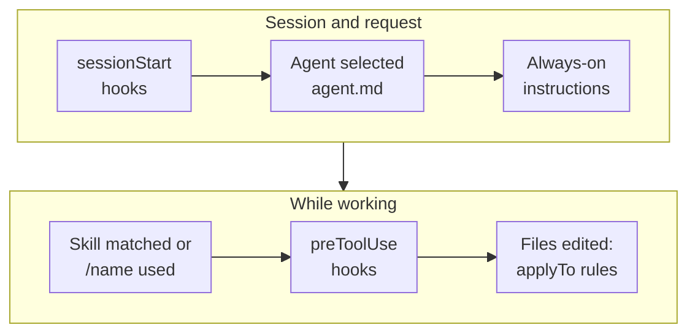

You wrote a careful `copilot-instructions.md`, and Copilot still ignores your test conventions half the time.
Or you added a prompt file and nobody on the team can find it. Most of the time the content is fine. It's in
the wrong place, aimed at the wrong Copilot surface, or written as an always-on instruction when it should
have been a skill. Copilot now reads half a dozen kinds of customization from your repository, each loaded at
a different moment. This post maps the whole `.github` folder as Copilot sees it: what goes in each folder, how
the files differ, where scripts belong, and exactly when each one kicks in.

<!-- more -->

There's a companion post for Claude Code:
[the .claude folder for Claude Code](/posts/aicodingtools/claude%20code/claude-folder-structure/). The two
ecosystems overlap more than you'd expect, and I'll point out where.

## The full map

Here's everything Copilot can pick up from a repository today. You don't need all of it. Most teams start
with one instructions file and add the rest as needs appear.

```text
your-repo/
├── AGENTS.md                         # agent instructions, shared with other AI tools
├── .github/
│   ├── copilot-instructions.md       # repository-wide instructions (always on)
│   ├── instructions/                 # targeted instructions
│   │   ├── python.instructions.md    #   applyTo: "**/*.py"
│   │   └── frontend/
│   │       └── react.instructions.md
│   ├── prompts/                      # reusable prompts you run with /name
│   │   └── review-pr.prompt.md
│   ├── agents/                       # custom agents (formerly "chat modes")
│   │   └── reviewer.agent.md
│   ├── skills/                       # agent skills: instructions plus files
│   │   └── release-notes/
│   │       ├── SKILL.md
│   │       ├── template.md
│   │       └── scripts/
│   │           └── collect-commits.sh
│   ├── hooks/                        # commands that run on agent events
│   │   ├── guardrails.json
│   │   └── scripts/
│   │       └── block-secrets.sh
│   ├── copilot/
│   │   └── settings.json             # Copilot CLI settings (can hold hooks)
│   └── workflows/
│       └── copilot-setup-steps.yml   # environment for the cloud agent
└── .vscode/
    └── mcp.json                      # MCP servers for VS Code
```

And outside the repository:

| Location | What it holds |
|---|---|
| `~/.copilot/` | Your personal `copilot-instructions.md`, `instructions/`, `agents/`, `skills/` and `hooks/`, used across every repository (CLI and VS Code agent sessions) |
| VS Code profile | User-level instructions, prompt files and agents created through the Agent Customizations editor |
| GitHub organization settings | Organization-wide instructions and custom agents, managed by admins |

## What each folder is for

| File or folder | What it is | Who triggers it | When it loads |
|---|---|---|---|
| `copilot-instructions.md` | Project-wide guidance | Automatic | Every request in the repository |
| `AGENTS.md` | Agent guidance in an open format | Automatic | Every agent request (nearest file wins on GitHub.com) |
| `instructions/*.instructions.md` | Guidance for part of the codebase | Automatic by glob, or by the model from `description` | When the agent creates or edits a matching file, or the task matches |
| `prompts/*.prompt.md` | A saved prompt template | You | When you type `/name` or run it |
| `agents/*.agent.md` | A persona with its own tools, model and instructions | You (agent picker), another agent (subagent), or a handoff | For the whole conversation while selected |
| `skills/<name>/SKILL.md` | A capability: instructions plus templates and scripts | The model (description match) or you (`/name`) | Name and description always; body on match; files on reference |
| `hooks/*.json` | Commands run at lifecycle events | The agent runtime | On events such as session start or before a tool runs |
| `workflows/copilot-setup-steps.yml` | Environment preparation | GitHub, before the cloud agent starts | At the start of each cloud agent job |

The single most useful distinction is between **guidance** and **enforcement**. Instructions, prompts, agents
and skills are text the model reads and usually follows. Hooks and setup steps are code that runs whatever the
model thinks. If something must never happen, like committing a secret, it belongs in a hook, not in an
instructions file.

## Instructions: copilot-instructions.md, AGENTS.md and instructions/

### .github/copilot-instructions.md

This is the always-on file. Copilot adds it to every request in the repository's context: chat, agent mode,
the cloud agent and code review. Put the things you'd tell a new teammate on day one here: the tech stack, how
to build and test, naming conventions, and things to avoid.

```markdown
# Project guidelines

- Python 3.12 service using FastAPI and SQLAlchemy 2.0; run tests with `uv run pytest`.
- Use type hints everywhere and Pydantic models for request and response bodies.
- Never edit files under `migrations/` by hand; generate them with `alembic revision --autogenerate`.
- Prefer small functions and early returns over deep nesting.
```

Keep it short. Every line costs context on every request, and long files get followed less consistently,
not more.

### AGENTS.md

`AGENTS.md` is an open format that several AI coding tools read, including Copilot, Claude Code and others. On
GitHub.com you can place it anywhere in the repo, and the **nearest** `AGENTS.md` in the directory tree takes
precedence. That's handy for monorepos, where `services/payments/AGENTS.md` can override the root. GitHub also
accepts a single `CLAUDE.md` or `GEMINI.md` at the root as agent instructions.

In VS Code, `AGENTS.md` at the workspace root is supported (setting `chat.useAgentsMdFile`). Nested ones in
subfolders are experimental and off by default (`chat.useNestedAgentsMdFiles`).

> If your team uses more than one AI tool, put the shared guidance in `AGENTS.md` and keep
> `copilot-instructions.md` for Copilot-specific notes. One source of truth beats three copies drifting apart.
{: .prompt-tip }

### .github/instructions/*.instructions.md

Targeted instructions apply only to part of the codebase. Each file has optional YAML frontmatter, and
subfolders are searched recursively:

```markdown
---
name: Python standards
description: Conventions for Python source and tests
applyTo: "**/*.py"
---

- Use `pathlib.Path`, never `os.path`.
- Tests use pytest fixtures, not unittest classes.
- Log with `logging.getLogger(__name__)`; no print statements.
```

How a file gets attached depends on its frontmatter:

- **`applyTo`**: a glob (comma-separated for several, e.g. `"**/*.ts,**/*.tsx"`). The file is attached when the agent **creates or modifies** a matching file. It isn't about what you're chatting about, it's about which files are being touched.
- **`description`**: in VS Code, the agent can load the file on demand when the description matches the task, even without a glob match.
- **Neither**: in VS Code, the file is only used when you attach it to a request manually.
- **`excludeAgent`** (GitHub.com): set to `"code-review"` or `"cloud-agent"` to hide the file from one of those surfaces. For example, you might want review-only rules that the cloud agent shouldn't follow while writing code.

On GitHub.com, path-specific instructions are currently used by the Copilot cloud agent and Copilot code review.
In VS Code they work in chat and agent mode. Custom instructions aren't used for inline completions as you type.

## Prompt files: .github/prompts/

A prompt file is a saved, parameterised prompt you run on purpose. Think "slash command for your team": review a
PR, scaffold a component, write a migration.

```markdown
---
name: review-pr
description: Review the current changes against our checklist
agent: agent
model: GPT-5
tools: ['search', 'githubRepo']
argument-hint: "[focus area]"
---

Review the current changes. Focus on ${input:focus:security, tests or performance}.

Check against [our review checklist](../../docs/review-checklist.md) and report
findings grouped by severity.
```

You invoke it by typing `/review-pr` in chat (with optional arguments), running **Chat: Run Prompt** from the
Command Palette, or pressing the play button while the file is open. Frontmatter can set the `agent` (`ask`,
`agent`, `plan` or a custom agent), the `model` and the allowed `tools`. In the body you can reference files with
Markdown links or `#file:`, tools with `#tool:`, and ask for input with `${input:name}`.

> VS Code now marks prompt files as deprecated for Agent Host sessions and recommends migrating them to agent
> skills, which can also be invoked with `/name`. They still work with the local agent. For anything new, I'd write
> a skill.
{: .prompt-warning }

## Custom agents: .github/agents/

Custom agents (called **custom chat modes** until recently, so rename any `.chatmode.md` to `.agent.md`) are
personas. Each one bundles a system prompt, a tool list, an optional model and optional handoffs, and stays in
effect for the whole conversation while it's selected.

```markdown
---
name: reviewer
description: Read-only reviewer that finds bugs and risky changes
tools: ['search', 'usages', 'githubRepo']
model: Claude Sonnet 4.5
handoffs:
  - label: Fix the findings
    agent: agent
    prompt: Fix the issues listed in the review above.
---

You are a senior reviewer. Never edit files. Look for correctness bugs, missing
tests, security problems and breaking API changes. Cite file and line for each finding.
```

The useful frontmatter fields:

| Field | What it does |
|---|---|
| `description` | Shown in the chat input; also how other agents decide to delegate |
| `tools` | Restricts what the agent can do. `server/*` includes every tool from an MCP server |
| `model` | One model, or a prioritised list |
| `agents` | Which subagents this agent can call (`*` for all, `[]` for none) |
| `handoffs` | Buttons after a response that switch to another agent with a pre-filled prompt |
| `user-invocable` / `disable-model-invocation` | Hide it from the picker, or stop other agents using it as a subagent |
| `target` | `vscode` or `github-copilot` (the cloud agent) |

You pick an agent from the **Agent** dropdown in VS Code. Other agents can call it as a subagent, and handoffs
chain agents into a workflow (plan, then implement, then review). VS Code also reads Claude-format agents from
`.claude/agents/`.

## Agent skills: .github/skills/

Skills are the newest and, I think, the most useful piece. A skill is a **folder** with a `SKILL.md` plus any
supporting files: templates, examples, reference docs and scripts. Copilot loads them in layers, so a library
of twenty skills costs almost nothing until one is needed:

1. **Discovery**: only each skill's `name` and `description` are visible to the model.
2. **Instructions**: the `SKILL.md` body loads when the request matches the description, or when you type `/skill-name`.
3. **Resources**: files in the skill folder load only when the instructions reference them.

```markdown
---
name: release-notes
description: Draft release notes from merged PRs since the last tag. Use when the user asks for release notes, a changelog or a summary of what shipped.
argument-hint: "[since-tag]"
---

1. Run `scripts/collect-commits.sh <since-tag>` to list merged PRs.
2. Group them using the categories in [template.md](template.md).
3. Write the notes in the template's format; flag breaking changes first.
```

The rules that trip people up:

- `name` must be lowercase letters, numbers and hyphens, and it **must match the folder name**. If it doesn't, the skill silently fails to load.
- `description` (up to 1,024 characters) is the trigger. Say what the skill does *and* when to use it, in the words users actually type.
- Every supporting file has to be referenced from `SKILL.md`, or the agent won't know it exists.
- `disable-model-invocation: true` makes it manual-only (`/name`); `user-invocable: false` hides it from the menu so only the model uses it.
- `context: fork` (experimental) runs the skill in a subagent and returns only its result.

Project skills can live in `.github/skills/`, `.claude/skills/` or `.agents/skills/`. Personal ones go in
`~/.copilot/skills/`, `~/.claude/skills/` or `~/.agents/skills/`. Skills are supported by the cloud agent and the
Copilot CLI as well as VS Code, and Copilot code review reads instructions and skills from the pull request's head
branch.

### How skills differ from instructions, prompts and agents

| | Instructions | Prompt file | Skill | Custom agent |
|---|---|---|---|---|
| Purpose | Standing rules | One task, run on demand | A capability with know-how and tools | A persona for a whole conversation |
| Triggered by | Always, or a file glob | You (`/name`) | The model (description) or you (`/name`) | You (picker), handoffs, other agents |
| Can bundle files and scripts | No | Links only | Yes, that's the point | No |
| Context cost | Every matching request | Only when run | Tiny until used | Every turn while selected |
| Typical example | "Use pathlib, not os.path" | "Review this PR against the checklist" | "Generate release notes using our template and script" | "Read-only security reviewer" |

My rule of thumb: if it's a **rule**, it's an instruction. If it's a **procedure** you'd otherwise paste into
chat, it's a skill. If it changes **who** Copilot is for a while (tools, tone, model), it's an agent.

## Hooks: .github/hooks/

Hooks run your own commands at points in the agent's lifecycle. They're for logging, policy checks, injecting
context, or blocking dangerous tool calls. Repository hooks live in `.github/hooks/*.json`, and personal ones in
`~/.copilot/hooks/`. The Copilot CLI and the cloud agent read them, and VS Code supports hooks in preview, subject
to Workspace Trust.

```json
{
  "version": 1,
  "hooks": {
    "preToolUse": [
      {
        "type": "command",
        "bash": "./.github/hooks/scripts/block-secrets.sh",
        "powershell": "./.github/hooks/scripts/block-secrets.ps1",
        "cwd": ".",
        "timeoutSec": 30
      }
    ]
  }
}
```

The documented events include `sessionStart`, `sessionEnd`, `userPromptSubmitted`, `preToolUse`, `postToolUse`,
`postToolUseFailure`, `agentStop`, `subagentStart`, `subagentStop`, `errorOccurred` and `preCompact`. A few
(`permissionRequest`, `notification`) are CLI only, and the cloud agent supports a subset. The hook receives the
event as JSON on stdin. A `preToolUse` hook can print `{"permissionDecision": "deny", "permissionDecisionReason":
"..."}` to block a call, and exiting with code `2` also denies it. Timeouts fail open, so don't rely on a slow hook
as your only safety net.

## The cloud agent's environment: copilot-setup-steps.yml

When you assign an issue to the Copilot cloud agent, it works in a fresh GitHub Actions environment. Without help,
it spends time (and often fails) working out how to install your toolchain.
`.github/workflows/copilot-setup-steps.yml` fixes that by preinstalling everything before Copilot starts:

```yaml
name: "Copilot Setup Steps"
on: workflow_dispatch

jobs:
  copilot-setup-steps:          # this exact job name is required
    runs-on: ubuntu-latest
    timeout-minutes: 30         # maximum 59
    permissions:
      contents: read
    steps:
      - uses: actions/checkout@v5
      - uses: actions/setup-python@v6
        with:
          python-version: "3.12"
      - run: pip install uv && uv sync --frozen
```

The gotchas: the file only takes effect on the **default branch**, the job must be named exactly
`copilot-setup-steps`, and only a few keys are honoured (`steps`, `permissions`, `runs-on`, `services`,
`snapshot`, `timeout-minutes`). If a step fails, Copilot skips the rest and starts anyway. Copilot code review
reuses this file by default.

## Where do scripts go?

Instructions, prompts and agent files are Markdown the model reads. They can't run anything. Scripts belong
with the thing that runs them:

| Script type | Put it in | Run by |
|---|---|---|
| Helper the agent calls as part of a task | `.github/skills/<skill>/scripts/` | The agent, when `SKILL.md` tells it to |
| Policy or automation on agent events | `.github/hooks/scripts/` (referenced from `hooks/*.json`) | The Copilot runtime, automatically |
| Environment setup for the cloud agent | Steps in `copilot-setup-steps.yml` (or scripts it calls) | GitHub Actions, before the agent starts |
| Project tooling everyone uses | Your normal `scripts/` folder or Makefile, documented in `copilot-instructions.md` | Humans and the agent alike |

## What gets invoked when

Putting it together, this is roughly what happens during a single agent request:



1. Hooks for `sessionStart` run and can inject context.
2. The selected custom agent (or the default one) sets the persona, tools and model.
3. `copilot-instructions.md`, `AGENTS.md` and your personal and organization instructions are added.
4. The model sees skill names and descriptions, and loads a skill's body if it matches (or you typed `/skill-name` or `/prompt-name`).
5. Before each tool call, `preToolUse` hooks can allow, deny or modify it.
6. When the agent touches a file matching an `applyTo` glob, those instructions are attached.

All applicable instruction sources are additive. Copilot doesn't promise an order that resolves conflicts, so
don't write instructions that contradict each other and hope one wins. On GitHub.com, personal instructions rank
above repository ones, which rank above organization ones.

## Which Copilot surface reads what

| Customization | VS Code chat and agent | Cloud agent | Code review | Copilot CLI |
|---|---|---|---|---|
| `copilot-instructions.md` | ✓ | ✓ | ✓ | ✓ |
| `AGENTS.md` | ✓ | ✓ | | ✓ |
| `instructions/*.instructions.md` | ✓ | ✓ | ✓ | check docs |
| `prompts/*.prompt.md` | ✓ | | | |
| `agents/*.agent.md` | ✓ | ✓ | | ✓ |
| `skills/` | ✓ | ✓ | ✓ | ✓ |
| `hooks/*.json` | Preview | ✓ (subset of events) | | ✓ |
| `copilot-setup-steps.yml` | | ✓ | ✓ (reused) | |

Support moves quickly, so treat blanks as "not documented when I wrote this" rather than "never". The official
"support for different types of custom instructions" page is the place to check.

## Common pitfalls

- **Skill silently missing.** The `name` doesn't match the folder name, or it contains capitals or underscores. Nothing errors; the skill just never appears. Type `/skills` in VS Code to see what loaded.
- **Expecting `applyTo` to match the conversation.** It matches files the agent creates or edits, not the topic you mention.
- **Giant always-on instructions.** A 600-line `copilot-instructions.md` buries the rules that matter. Move file-type rules into `instructions/` and procedures into skills.
- **Setup steps that never run.** The workflow is on a feature branch, or the job isn't named `copilot-setup-steps`.
- **Using instructions for enforcement.** "Never commit `.env` files" in Markdown is a request. A `preToolUse` hook that blocks it is a guarantee.
- **Old chat mode files.** `.chatmode.md` files need renaming to `.agent.md` and moving to `.github/agents/`.
- **Conflicting sources.** Organization, repository, personal, `AGENTS.md` and path-specific instructions all apply together. Contradictions produce inconsistent behaviour, not a clear winner.

## Conclusion

Think of `.github` as layers. `copilot-instructions.md` and `AGENTS.md` hold the rules everyone needs.
`instructions/` holds rules for specific files. Skills hold procedures and the scripts that go with them, agents
hold personas, hooks hold the things that must be enforced, and `copilot-setup-steps.yml` gets the cloud agent a
working environment. A sensible starting point: write a 20-line `copilot-instructions.md`, turn the prompt you
paste most often into a skill, and add one `preToolUse` hook for the mistake you most want to prevent. The
[Claude Code companion post](/posts/aicodingtools/claude%20code/claude-folder-structure/) covers the same ideas
from the `.claude` side.

## References

- [VS Code: customization overview](https://code.visualstudio.com/docs/copilot/customization/overview)
- [VS Code: custom instructions](https://code.visualstudio.com/docs/agent-customization/custom-instructions)
- [VS Code: prompt files](https://code.visualstudio.com/docs/agent-customization/prompt-files)
- [VS Code: custom agents](https://code.visualstudio.com/docs/agent-customization/custom-agents)
- [VS Code: agent skills](https://code.visualstudio.com/docs/agent-customization/agent-skills)
- [VS Code: hooks](https://code.visualstudio.com/docs/agent-customization/hooks)
- [GitHub Docs: adding repository custom instructions](https://docs.github.com/en/copilot/how-tos/configure-custom-instructions/add-repository-instructions)
- [GitHub Docs: customizing the cloud agent's environment](https://docs.github.com/en/copilot/how-tos/use-copilot-agents/coding-agent/customize-the-agent-environment)
- [GitHub Docs: hooks reference](https://docs.github.com/en/copilot/reference/hooks-reference)
