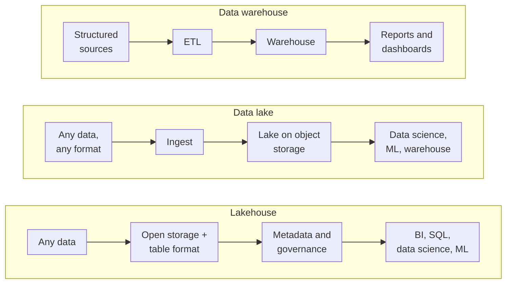
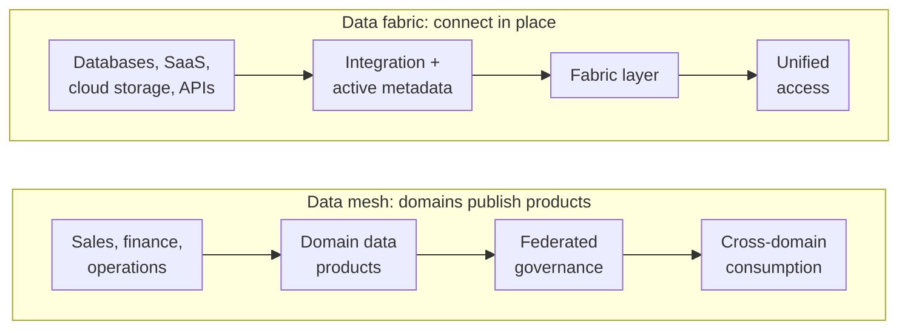

"Should we build a lakehouse or a data mesh?" comes up in architecture reviews as if the two were rival products. They aren't even the same kind of thing. A lakehouse is a way to **store and serve** data; a mesh is a way to **organise the people** who own it. Mix those up and you end up buying a platform to fix an org-chart problem, or reorganising teams to fix a storage problem.

This post walks through the five patterns you'll hear about: data warehouse, data lake, lakehouse, data fabric and data mesh. For each one I'll cover how data flows, who owns it, how it's governed and who consumes it, then give a straight answer on when to use which.

<!-- more -->

## Two different questions

Before the patterns, it helps to split them by the question they answer:

| Question | Patterns that answer it |
|---|---|
| Where does the data live, and in what shape? | Warehouse, lake, lakehouse |
| How do distributed data and the teams around it fit together? | Fabric, mesh |

The first three are **storage and processing architectures**. They evolved one from another as data volumes grew and machine learning arrived. The last two are **integration and operating models** that sit on top of whatever storage you already have. A data mesh is very often built on lakehouses; a data fabric often spans a warehouse, a lake and a dozen SaaS apps at once.

So the real choice usually looks like "lakehouse storage, with a mesh-style ownership model", not "lakehouse vs mesh".

## The storage patterns



### Data warehouse

A **data warehouse** centralises **structured** data for reporting and analytics. Data is extracted from operational systems, cleaned and reshaped (ETL, or ELT when the transformation runs inside the warehouse), and loaded into modelled tables, typically star schemas with facts and dimensions. Business users query it with SQL and BI tools.

The defining trait is **schema-on-write**: data has to fit the model before it gets in. That's what makes a warehouse fast, consistent and trustworthy for reporting, and also what makes it slow to change. Adding a new source means modelling it first.

- **Owner:** a central data or BI team.
- **Governance:** centralised and strong. One model, one set of definitions.
- **Consumers:** analysts, finance, management dashboards.
- **Products:** Snowflake, Google BigQuery, Amazon Redshift, Azure Synapse and Microsoft Fabric's warehouse.

It's still the right answer when most of your data is structured and the main job is reliable reporting. Plenty of companies don't need anything more.

### Data lake

A **data lake** stores **raw** data of every kind (structured tables, semi-structured JSON and logs, unstructured images and documents) cheaply at scale on object storage such as Amazon S3, Azure Data Lake Storage or Google Cloud Storage. Nothing is modelled up front: this is **schema-on-read**, where structure is applied when someone queries the data.

That flexibility is why lakes became the home of data science and machine learning: you can keep everything, including data nobody has a use for yet. In practice many lakes also feed a warehouse downstream, with curated subsets loaded for reporting.

- **Owner:** usually a central data engineering team.
- **Governance:** weak by default. This is the pattern's well-known failure mode.
- **Consumers:** data scientists, ML engineers, data engineers.

Here's the honest catch. Without cataloguing, ownership and quality checks, a lake turns into a **data swamp**: thousands of files nobody can find, trust or delete. Plain lakes also lack transactions, so two jobs writing the same folder can corrupt it, and updating or deleting a single record (say, for a GDPR erasure request) means rewriting files by hand.

### Data lakehouse

The **lakehouse** keeps the lake's cheap, open storage and adds the warehouse features lakes were missing. The key ingredient is an **open table format**: Apache Iceberg, Delta Lake or Apache Hudi. These put a metadata layer over Parquet files on object storage, which gives you:

- **ACID transactions**, so concurrent writers don't corrupt tables;
- **updates, deletes and merges** on lake data;
- **schema enforcement and evolution**;
- **time travel** to query a table as it was at an earlier point;
- fast SQL through statistics, partitioning and file pruning.

Here's what that looks like in Spark SQL with an Iceberg catalog:

```sql
CREATE TABLE lake.sales.orders (
  order_id    BIGINT,
  customer_id BIGINT,
  amount      DECIMAL(12, 2),
  order_ts    TIMESTAMP
)
USING iceberg
PARTITIONED BY (days(order_ts));

-- Upsert late-arriving changes without rewriting the table by hand
MERGE INTO lake.sales.orders t
USING staging.order_updates s
ON t.order_id = s.order_id
WHEN MATCHED THEN UPDATE SET *
WHEN NOT MATCHED THEN INSERT *;

-- Query the table as it looked on 1 October
SELECT count(*) FROM lake.sales.orders TIMESTAMP AS OF '2026-10-01 00:00:00';
```

On top of the tables sits a **catalog** that handles discovery, permissions and lineage: Databricks Unity Catalog, AWS Glue, Snowflake Horizon or Apache Polaris. Most lakehouses organise data in **medallion layers**: bronze (raw), silver (cleaned and conformed) and gold (business-ready).

- **Owner:** typically a central platform team, though it suits decentralised ownership well.
- **Governance:** strong, through the catalog.
- **Consumers:** everyone. BI, SQL analysts, data science and ML all use the same copy of the data.
- **Products:** Databricks (Delta Lake), Microsoft Fabric (OneLake, built on Delta), Snowflake and BigQuery with Iceberg tables, and open engines such as Spark, Trino and DuckDB.

The format war has largely settled into coexistence. Iceberg has become the common interchange format across vendors, and Delta can expose tables to Iceberg readers, so choosing one no longer locks you out of the other ecosystem the way it did a few years ago.

For a new analytics platform today, I'd start with a lakehouse unless there's a clear reason not to. You avoid running and paying for two copies of the data (lake *and* warehouse), and ML and BI teams stop arguing over which one is the truth.

## The integration and operating patterns



### Data fabric

A **data fabric** is a unified layer that connects, governs and orchestrates data **where it already lives**, across databases, SaaS applications, cloud storage and APIs, instead of copying everything onto one platform first.

Its core is **metadata**. A fabric catalogs every source, tracks lineage, classifies sensitive data, and uses that knowledge to automate integration: data virtualisation for querying in place, pipelines where copying is needed, and consistent access policies across all of it. Consumers get one place to find and query data, whether it physically sits in Salesforce, an on-premises Oracle database or a lakehouse.

- **Owner:** a central data or integration team that runs the fabric.
- **Governance:** centralised, and largely automated through metadata.
- **Consumers:** analysts, applications and operational processes that need data from many systems.
- **Products:** this is a category more than a single product. Look at data virtualisation and integration platforms such as Denodo, Informatica, IBM Cloud Pak for Data and Talend, and at metadata catalogs that drive policy across sources.

The fabric shines in large, heterogeneous estates, especially after mergers or with heavy SaaS use, where moving everything isn't practical or allowed. Its risk is performance and complexity. Querying ten systems live is never as fast as querying one curated table, and someone has to keep the metadata accurate or the automation makes confident mistakes.

### Data mesh

A **data mesh** is primarily an **organisational** pattern. Zhamak Dehghani defined it through four principles:

1. **Domain-oriented ownership:** the business domains that produce data (sales, finance, operations) own their analytical data too, instead of handing it to a central team.
2. **Data as a product:** each domain publishes data products with real consumers in mind: documented, discoverable, quality-checked and supported.
3. **Self-serve data platform:** a platform team provides the infrastructure so domain teams can build products without being data-infrastructure experts.
4. **Federated computational governance:** global rules (security, interoperability, naming, privacy) are agreed jointly and **enforced automatically by the platform**, while domains decide the rest.

What makes a data product a product is a contract. Here's an illustrative one for a finance domain:

```yaml
# Illustrative data product contract for the finance domain
product: finance.invoices_daily
owner: finance-data-team@example.com
description: One row per invoice, refreshed daily by 06:00 UTC.
output:
  format: iceberg
  location: catalog://finance/gold/invoices_daily
schema:
  - { name: invoice_id,  type: string,        required: true, unique: true }
  - { name: customer_id, type: string,        required: true }
  - { name: amount,      type: decimal(12,2), required: true }
  - { name: issued_at,   type: timestamp,     required: true }
quality:
  - "row_count > 0"
  - "amount >= 0"
sla:
  freshness: 24h
  support: "#finance-data on Slack"
classification: confidential
```

The platform reads contracts like this to publish the product in the catalog, run the quality checks, apply access policies by classification, and alert the owner when freshness slips.

- **Owner:** each domain, for its own data products.
- **Governance:** federated: global standards, local decisions.
- **Consumers:** other domains, self-serve analysts, domain-specific AI.

Mesh solves a scaling problem: a central data team that has become the bottleneck for every new dataset. It doesn't solve a technology problem, and it's expensive in people. Every domain needs data-capable engineers, and you need a strong platform team. For a company with one data team of eight people, a mesh mostly adds process.

## Side by side

| | Warehouse | Lake | Lakehouse | Fabric | Mesh |
|---|---|---|---|---|---|
| Kind of pattern | Storage | Storage | Storage | Integration | Organisation |
| Data types | Structured | All | All | All, in place | All |
| Schema | On write | On read | Enforced, evolvable | Per source | Per data product |
| Ownership | Central | Central | Central or domain | Central | Domains |
| Governance | Strong, central | Weak by default | Strong, via catalog | Automated, metadata-driven | Federated |
| Typical users | Analysts, BI | Data science, ML | Everyone | Analysts, apps, operations | Domain teams and their consumers |
| Main risk | Rigid, slow to change | Data swamp | Platform complexity | Performance, metadata quality | Org cost, inconsistent products |

## Which one should you pick?

Ask a few questions in order.

1. **What's your data?** Mostly structured tables for reporting? A **warehouse** is fine, and may be all you need. Lots of semi-structured or unstructured data, or serious ML? You need lake-style storage, which today means a **lakehouse**.
2. **Can you move the data?** If regulation, ownership or sheer number of systems means you can't centralise it, look at a **fabric** to connect it in place.
3. **Is the central team the bottleneck?** If dozens of teams wait on one data team for every dataset, and those teams have engineers who could own their data, consider **mesh** principles.
4. **How mature is your governance?** Mesh and fabric both assume you can define and enforce shared standards. Without that, decentralising just spreads the swamp around.

For most organisations, a sensible path looks like this: start with a lakehouse on an open table format, put a good catalog in front of it, and adopt mesh ideas gradually. Begin with clear data owners and contracts for your most important datasets, before reorganising anyone.

## Common pitfalls

- **Treating mesh as a product you can buy.** Vendors sell "data mesh platforms", but the hard part is ownership and incentives. No tool assigns a finance team responsibility for invoice data quality.
- **Building a lake without a catalog.** Every swamp started as a lake with good intentions. Put cataloguing, ownership and retention in place on day one.
- **Running a lake and a warehouse that disagree.** Two copies with two sets of business logic will give two answers to "what was revenue last month?". Pick one place where curated data lives.
- **Fabric as an excuse not to model.** Virtualising messy sources gives you fast access to messy data. Somebody still has to define what a "customer" is.
- **Ignoring cost models.** Lakehouse storage is cheap, but compute isn't. Unpartitioned tables, tiny files and forgotten clusters add up faster than storage ever will.

## Conclusion

Warehouse, lake and lakehouse answer where data lives and how it's processed; fabric and mesh answer how distributed data and teams fit together. The lakehouse has become the sensible default for storage, fabric earns its keep in sprawling estates you can't consolidate, and mesh is worth the organisational cost only when a central team has become the bottleneck.

If you're mapping these onto a specific cloud, [Cloud Analytics and Big Data Services](/posts/cloud/cloud-analytics-services/) compares the AWS, Azure and Google Cloud services behind each layer. For where data storage fits in the bigger picture of system design, see [System Design Fundamentals](/posts/architect/system%20design/system-design-fundamentals/).

The pattern overview and flows follow the "Data Architecture Patterns" infographic by Sumit Gupta (@sumonigupta); the diagrams here are redrawn.

## References

- [Martin Fowler: Data Mesh Principles and Logical Architecture (Zhamak Dehghani)](https://martinfowler.com/articles/data-mesh-principles.html)
- [Apache Iceberg documentation](https://iceberg.apache.org/docs/latest/)
- [Delta Lake documentation](https://docs.delta.io/latest/index.html)
- [RisingWave: Apache Iceberg vs Delta Lake vs Apache Hudi (2026)](https://risingwave.com/blog/apache-iceberg-vs-delta-lake-vs-hudi-2026/)
- [Data Lakehouse Hub: The Apache Iceberg market in mid-2026](https://datalakehousehub.com/blog/iceberg-market-2026)
