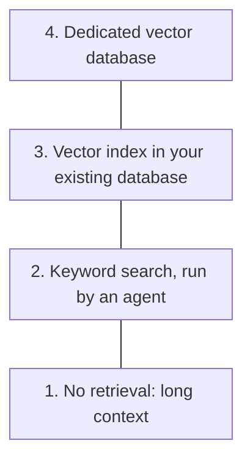
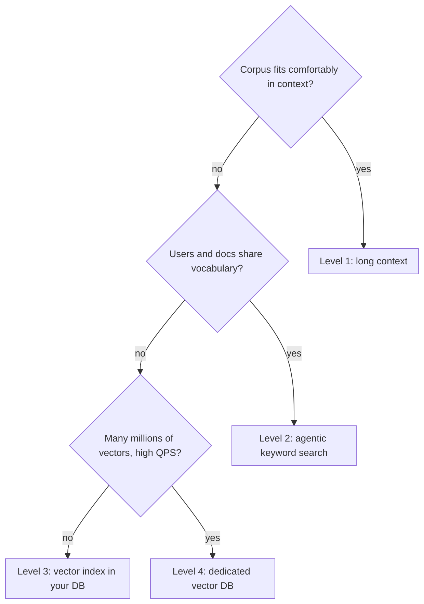

There's a popular argument online right now: teams are ripping vector databases out of their AI stacks and replacing
them with `grep`, a text search tool from 1973. They say the results got *better*. With no separate index there's
nothing to go stale, nothing to re-embed, and one less moving part to page someone at 2 a.m. So is the vector
database already a relic? I don't think it is, but it's no longer the default either. In this post I'll lay out
retrieval as a four-level pyramid, go through the three strongest arguments against vector databases, and then the
cases where you should still climb all the way to the top.

<!-- more -->

> This post expands on a short video explainer that framed the question as a retrieval pyramid. The structure is
> borrowed, and the examples, numbers and opinions are mine.
{: .prompt-info }

## First, what a vector database actually does

A vector database stores content like any other database, but it indexes each piece as an **embedding**: a list of
numbers (often 768, 1024 or 1536 of them) that places the text at a point in a high-dimensional space. The embedding
model is trained so that texts with similar *meaning* land near each other, even when they share no words.

At query time the database embeds your question with the same model and returns the nearest neighbours. Exact nearest
neighbour search over millions of points is too slow, so real systems use approximate indexes like HNSW or IVF. You
trade a little recall for a lot of speed.

The classic use is **retrieval-augmented generation (RAG)**: find the handful of chunks relevant to a question and
paste them into the prompt before the LLM answers. If you want a refresher on what the model does with that prompt,
see [Introduction to Large Language Models](/posts/artificialintelligence/largelanguagemodel/introduction-to-large-language-models/).

## The retrieval pyramid

Here's the mental model I find most useful. Four levels, cheapest and simplest at the bottom:



The rule is simple: **only move up a level when the workload forces you to.** Every level up adds an ingestion
pipeline, an index to keep fresh, a cost line and something new to debug. Climbing to the top just because it's the
"proper AI architecture" is how you end up maintaining a cluster to search 400 Markdown files.

## The case against vector databases

Three arguments come up again and again, and each one maps onto a level of the pyramid.

### 1. Long context: just don't retrieve

Frontier models now accept hundreds of thousands to millions of tokens in a single prompt, roughly a thousand times
more than the early GPT-3-era models. If your whole knowledge base is a product manual, a policy handbook or a
mid-sized codebase, you can often put all of it in the prompt and skip retrieval altogether.

That's level 1. There's no index, no chunking strategy and no stale embeddings. When a document changes, the next
request just sees the new version.

### 2. Agentic search: keyword search that gets to try again

Keyword search matches the literal words in a query, and that's exactly what `grep` does: it scans text for lines
that match a regular expression. On its own it's a blunt tool. If the words don't match, you get nothing.

The thing that changed is **who's running the search**. An AI agent doesn't need to get retrieval right in one shot.
It runs a search, reads what comes back, notices it got nothing useful, and tries again with different terms, a
broader pattern or a different directory. That's the agentic loop (I walk through it in
[Architecture of an AI Agent](/posts/agenticai/ai-agent-architecture/)), and it turns a dumb tool into a fairly
capable one.

A coding agent hunting for where sessions expire might run something like this over three turns:

```bash
# Turn 1: the obvious guess
grep -rn "session_timeout" src/
# (no results)

# Turn 2: widen the net with alternatives the model came up with
grep -rniE "session.*(expire|ttl|timeout)|idle_?timeout" src/ config/
# config/auth.yaml:14:  idle_ttl_seconds: 1800

# Turn 3: follow the key it just found
grep -rn "idle_ttl_seconds" src/
# src/auth/middleware.py:42:    ttl = settings.auth.idle_ttl_seconds
```

Nothing there was embedded, indexed or synced. The files on disk *are* the index, so it can never be out of date.
This is level 2, and it's why coding agents in particular lean so heavily on `grep` and file reads rather than RAG.

### 3. Embedding costs: and if you need vectors, you have them already

Semantic search has a cost that's easy to underestimate. Every document must be chunked and embedded on the way in.
Every query must be embedded too, because the question has to become a point in the space before it can have
neighbours. And if you switch embedding models (a better one ships every few months), vectors from different models
can't be compared, so **you re-embed the whole corpus**.

Even when semantic search is worth it, you may not need a *separate system*. PostgreSQL has pgvector, and MySQL,
SQL Server, Oracle, MongoDB, Elasticsearch/OpenSearch and Redis all have some form of vector search now. An
embedding is just another column of numbers next to the row it describes, and indexing columns is what databases do:

```sql
CREATE EXTENSION IF NOT EXISTS vector;

CREATE TABLE tickets (
  id         bigserial PRIMARY KEY,
  title      text NOT NULL,
  body       text NOT NULL,
  embedding  vector(1536)          -- lives next to the data it describes
);

CREATE INDEX ON tickets USING hnsw (embedding vector_cosine_ops);

-- $1 is the query embedding, computed by your app with the same model
SELECT id, title
FROM tickets
WHERE status = 'resolved'          -- ordinary filters, same transaction, same backups
ORDER BY embedding <=> $1
LIMIT 5;
```

That's level 3. You get the same backups, access control and transactions as the rest of your data, and there's no
second datastore to keep in sync. Honestly, the "no sync" part matters more to me than the cost.

## Where each argument breaks down

So that's the case against. But each argument has a limit, and once you hit it the workload pushes you up a level.

### Long context runs into context rot

A bigger context window means more tokens billed on every request. That hurts, but it's not the real problem. The
real problem is **accuracy**. Models don't attend evenly over a huge prompt. Research like *Lost in the Middle* and
more recent work on "context rot" shows that quality drops as the input grows and that facts buried mid-prompt get
missed. Filling the window with your whole knowledge base can give *worse* answers than handing the model the three
paragraphs that matter.

There's latency too. Prefill time grows with prompt length, so a 500k-token prompt is slow before the model writes a
single word.

> Long context is great when the corpus is small and stable. Once it's large, or most of it is irrelevant to any
> one question, retrieve.
{: .prompt-tip }

### Keyword search falls into the semantic gap

Picture an internal support assistant. A user types:

> how do I reset my password?

There's already a resolved ticket that answers exactly that. It's titled **"Credentials loop after update"**.

Those two strings don't share a single word. `grep` returns nothing. An agent can try synonyms ("password",
"login", "credential", "auth"), and a good one might eventually stumble onto "credentials". But it's guessing at
vocabulary it has never seen, and each guess costs a turn. In embedding space the two sentences are close neighbours
on the first try.

That's the **semantic gap**: the user and the content describe the same problem in different words. It's the problem
semantic search was built for. Support tickets, customer emails, research notes, multilingual content and anything
written by many different people all sit right in this gap. Codebases are kinder to `grep`, because identifiers are
consistent and the agent can follow them from file to file.

### A vector index starts to strain at scale

Each embedding is small. A 1536-dimension vector of 32-bit floats is about 6 KB. But HNSW indexes work best when
they fit in memory, and the numbers add up quickly:

| Vectors | Raw size (1536 × float32) | What it feels like |
|---|---|---|
| 100k | ~0.6 GB | Trivial for any database |
| 1M | ~6 GB | Fine in Postgres on a decent box |
| 10M | ~60 GB, plus index overhead | Your primary DB is now mostly a vector store |
| 1B | ~6 TB | Dedicated, sharded, probably quantized |

Somewhere in the millions, with constant query traffic and tight latency targets, a general-purpose database starts
competing with itself. Vector queries fight your transactional workload for RAM and CPU, index builds take hours,
and tuning gets fiddly. That's the point where a **dedicated vector database** earns its keep. Systems built for this
shard across nodes, quantize vectors to cut memory, filter on metadata during the search, and are designed to answer
over billions of vectors in milliseconds. That's level 4.

## Two questions, not one

"Do we need a vector database?" is really two questions:

1. **Do you need vector search at all?** Only if the semantic gap is real for your content and long context or
   keyword search can't close it.
2. **If you do, do you need a *dedicated* vector database?** Only if the volume and query load outgrow the vector
   index in the database you already run.

Most teams I'd talk to answer yes to the first and no to the second. Here's the whole decision as a flow:



## The option the pyramid hides: use both

The pyramid makes it look like you pick one level. In practice the best retrieval systems often combine levels 2
and 3. **Hybrid search** runs keyword search (usually BM25, a smarter cousin of `grep` that weighs rare terms more)
and vector search together, then merges the two ranked lists. A common merge is reciprocal rank fusion:

```python
def reciprocal_rank_fusion(keyword_hits: list[str], vector_hits: list[str], k: int = 60) -> list[str]:
    """Merge two ranked lists of document IDs. Documents ranked high in either list rise to the top."""
    scores: dict[str, float] = {}
    for hits in (keyword_hits, vector_hits):
        for rank, doc_id in enumerate(hits):
            scores[doc_id] = scores.get(doc_id, 0.0) + 1.0 / (k + rank + 1)
    return sorted(scores, key=scores.get, reverse=True)
```

Keyword search catches exact matches that embeddings blur: error codes, ticket IDs, product SKUs, function names.
Vector search catches paraphrases. Together they cover each other's blind spots, and an agent can still call either
one as a tool and refine as it goes.

## Common pitfalls

- **Building level 4 on day one.** A dedicated vector DB for a few thousand documents is a second datastore to
  secure, back up and keep in sync, for no measurable gain. Start lower and measure.
- **Forgetting that indexes go stale.** Every level above 2 needs an ingestion pipeline. If documents are edited and
  nothing re-embeds them, retrieval quietly serves old answers. Treat re-indexing as part of the write path, not a
  nightly cron you'll forget about.
- **Changing the embedding model without a migration plan.** Vectors from two models live in different spaces.
  Re-embed into a new column or index, switch reads over, then drop the old one.
- **Judging retrieval by vibes.** Put together 50 real questions with known good answers and measure recall at each
  level before and after a change. Otherwise "grep works better" and "vectors work better" are both just anecdotes.
- **Assuming long context means perfect recall.** A model that *accepts* a million tokens doesn't *use* them all
  equally. Test with the answer buried in the middle.

## Conclusion

Vector databases aren't dead, they've just stopped being the default. Use long context when the corpus is small. Let
an agent `grep` when the words in the questions match the words in the content. Add a vector index to the database
you already run when the semantic gap shows up. Reach for a dedicated vector database only when you're into many
millions of vectors under real query load.

As a next step, take one retrieval workload you own, write down its corpus size, vocabulary match and query volume,
and see which level of the pyramid it actually needs. There's a good chance it's lower than what you've built.

## References

- [pgvector: open-source vector similarity search for Postgres](https://github.com/pgvector/pgvector)
- [Lost in the Middle: How Language Models Use Long Contexts (Liu et al., 2023)](https://arxiv.org/abs/2307.03172)
- [Context Rot: How Increasing Input Tokens Impacts LLM Performance (Chroma Research)](https://research.trychroma.com/context-rot)
- [Reciprocal Rank Fusion outperforms Condorcet and individual Rank Learning Methods (Cormack et al., 2009)](https://plg.uwaterloo.ca/~gvcormac/cormacksigir09-rrf.pdf)
