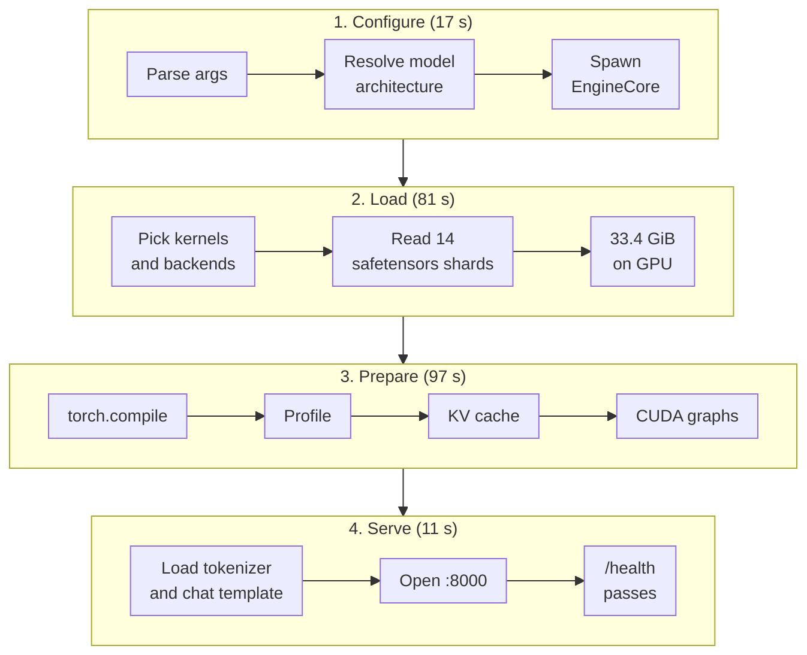

You apply a Deployment, the pod goes `Running`, and then nothing happens for three and a half minutes. The pod sits at `0/1 READY`, `kubectl logs` scrolls past a wall of progress bars and warnings, and you start to wonder whether it's stuck. It isn't. vLLM is doing a lot of work before it answers its first request, and almost all of it is written in that log if you know how to read it. In this post I walk through one real startup log, line by line, from a `vllm serve` pod running Qwen3.5-35B-A3B in FP8 on an NVIDIA GB10, and explain what each phase does, where the time goes, and which knobs change it.

<!-- more -->

## The setup behind this log

The log comes from a single-replica Deployment called `vllm-chat` in the `models` namespace of a k3d cluster called `k3d-gpu`. The node is the GB10 in a DGX Spark (the box from [my homelab tour](/posts/homelab/homelab-setup-3d-dgx-spark-home-pc/)), which has about 122 GiB of memory shared between the CPU and GPU. Here's the part of the pod spec that matters for startup:

```yaml
containers:
  - name: vllm
    image: nvcr.io/nvidia/vllm:26.07-py3
    command:
      - vllm
      - serve
      - Qwen/Qwen3.5-35B-A3B-FP8
      - --revision
      - 9d1823d2dee688a6b25e77009dc727688c44936e
      - --served-model-name
      - qwen3.5-35b-a3b
      - --language-model-only
      - --gpu-memory-utilization
      - "0.36"
      - --max-model-len
      - "131072"
      - --enable-auto-tool-choice
      - --tool-call-parser
      - qwen3_coder
      - --reasoning-parser
      - qwen3
      - --port
      - "8000"
    env:
      - { name: HF_HOME, value: /models }          # weights on a PVC
      - { name: XDG_CACHE_HOME, value: /home/vllm/.cache }
      - { name: VLLM_USE_DEEP_GEMM, value: "0" }
    resources:
      limits: { nvidia.com/gpu: "1", memory: 10Gi }
    startupProbe:
      httpGet: { path: /health, port: http }
      periodSeconds: 10
      failureThreshold: 540                        # up to 90 minutes
    volumeMounts:
      - { name: models, mountPath: /models }       # PVC
      - { name: home, mountPath: /home/vllm }      # emptyDir
      - { name: shm, mountPath: /dev/shm }         # emptyDir, medium: Memory
runtimeClassName: nvidia
```

A few things are worth noticing before we even look at the log. The root filesystem is read-only, so every cache vLLM writes has to land on a mounted volume. The weights live on a PersistentVolumeClaim, so this boot doesn't download anything. And the startup probe allows up to 90 minutes, which is how you stop the kubelet from killing a pod that's still compiling kernels.

## The timeline at a glance

Here's the whole boot, taken from the log timestamps:

| Time (UTC) | Elapsed | Phase | What the log says |
|---|---|---|---|
| 06:34:44 | 0 s | API server starts | banner, `non-default args` |
| 06:34:52 | 8 s | Config resolved | `Resolved architecture: Qwen3_5MoeForConditionalGeneration` |
| 06:35:01 | 17 s | Engine core process starts | `Initializing a V1 LLM engine` |
| 06:35:07 | 23 s | Weight loading begins | `Checkpoint size: 34.89 GiB` |
| 06:36:26 | 1 m 42 s | Weights on GPU | `Model loading took 33.38 GiB memory and 81.41 seconds` |
| 06:37:07 | 2 m 23 s | torch.compile done | `torch.compile took 38.99 s in total` |
| 06:37:47 | 3 m 03 s | Profiling run done | `Initial profiling/warmup run took 40.02 s` |
| 06:37:54 | 3 m 10 s | KV cache sized | `GPU KV cache size: 294,912 tokens` |
| 06:38:03 | 3 m 19 s | CUDA graphs captured | `Graph capturing finished in 8 secs` |
| 06:38:14 | 3 m 30 s | HTTP server listening | `Starting vLLM server on http://0.0.0.0:8000` |
| 06:38:24 | 3 m 40 s | Pod Ready | Deployment `MinimumReplicasAvailable` |

Weight loading is the biggest single chunk, but it's well under half the total. Compilation, profiling and graph capture together take longer than reading 35 GiB off disk. That surprises most people the first time.



## Phase 1: two processes and a config

The first lines are the ASCII banner and the arguments vLLM thinks you changed:

```text
(APIServer pid=1) INFO [api_utils.py:339]  version 0.24.0+092c4842.dev
(APIServer pid=1) INFO [api_utils.py:339]  model   Qwen/Qwen3.5-35B-A3B-FP8
(APIServer pid=1) INFO [api_utils.py:273] non-default args: {'model_tag': ..., 'max_model_len': 131072,
    'served_model_name': ['qwen3.5-35b-a3b'], 'reasoning_parser': 'qwen3',
    'gpu_memory_utilization': 0.36, 'language_model_only': True, ...}
```

Look at the prefix on every line: `(APIServer pid=1)`. A few lines later you'll see `(EngineCore pid=288)`. That's the vLLM V1 engine design. The API server is PID 1 in the container. It owns the HTTP endpoints, tokenization and detokenization. The engine core is a separate process that owns the scheduler, the KV cache and the GPU. The two talk over ZMQ sockets. With one GPU and no tensor parallelism, the model worker runs inside the engine core process itself, which is why every weight loading and CUDA line carries the `EngineCore` prefix.

This split matters when you debug. If the API server prints something and then the engine core goes quiet, the problem is on the GPU side. If the engine finishes (`init engine ... took 97.24 s`) but the server never prints its routes, look at the tokenizer, chat template or parser setup instead.

The `non-default args` line is the most useful line in the whole log when someone hands you a broken deployment. It tells you exactly what the operator overrode, without reading the manifest. Here: a pinned revision, a 128K context, 36% of GPU memory, tool calling with the `qwen3_coder` parser, and `--language-model-only`, which skips the vision encoder of this multimodal checkpoint. That's why you see `running in text-only mode` a few lines later.

Then the config gets resolved:

```text
Resolved architecture: Qwen3_5MoeForConditionalGeneration
Using max model len 131072
WARNING Auto-disabled DeepGemm for model_type=qwen3_5_moe_text on Blackwell ... Falling back to CUTLASS.
Asynchronous scheduling is enabled.
```

vLLM reads `config.json` from the checkpoint and maps the `architectures` field to its own model class. If that mapping fails, you get an "architecture not supported" error right here, before any GPU work. The DeepGemm warning is vLLM protecting accuracy: its FP8 GEMM library uses a scale format that degrades this model on Blackwell, so it falls back to CUTLASS kernels. The deployment already sets `VLLM_USE_DEEP_GEMM=0`, so this is just vLLM saying it agrees.

The two `Unknown vLLM environment variable detected` warnings (`VLLM_VERSION`, `VLLM_FLASH_ATTN_SRC_DIR`) come from the NVIDIA container image setting variables vLLM doesn't recognise. They're harmless. A typo like `VLLM_USE_DEEPGEMM` would show up in the same warning, though, so it's worth reading.

## Phase 2: picking kernels and loading weights

Once the engine core starts, it sets up a "distributed" environment of exactly one GPU:

```text
world_size=1 rank=0 local_rank=0 distributed_init_method=tcp://10.50.0.47:40207 backend=nccl
rank 0 in world size 1 is assigned as DP rank 0, PP rank 0, PCP rank 0, TP rank 0, EP rank 0
```

vLLM always initialises NCCL, even for one GPU, because the same code path handles tensor, pipeline, data and expert parallelism. The IP is the pod IP. On a multi-GPU pod this is where you'd see `world_size=4` and, if `/dev/shm` is too small, where NCCL would start failing. That's why the pod mounts a memory-backed `emptyDir` at `/dev/shm`. Docker's default 64 MiB shared memory is a classic cause of NCCL hangs in multi-GPU vLLM pods.

Next comes a burst of backend choices:

```text
Using FlashInfer for top-p & top-k sampling.
Selected CutlassFp8BlockScaledMMKernel for Fp8LinearMethod
Using Triton/FLA GDN prefill kernel (requested=auto, head_k_dim=128).
Using TRITON Fp8 MoE backend out of potential backends: ['AITER', 'FLASHINFER_TRTLLM', 'FLASHINFER_CUTLASS', 'TRITON', 'MARLIN', ...]
Using FLASH_ATTN attention backend out of potential backends: ['FLASH_ATTN', 'FLASHINFER', 'TRITON_ATTN', 'FLEX_ATTENTION'].
Using FlashAttention version 2
```

Each layer type in the model gets its own kernel implementation, chosen from what the GPU, the quantization format and the installed libraries support. This model is a hybrid: most layers use Gated DeltaNet linear attention (the `GDN` line), some use regular full attention (`FLASH_ATTN`), and the feed-forward blocks are a mixture of experts (the `Fp8 MoE` line). If throughput looks wrong after an upgrade, diff these lines between the old and new logs first. A quiet switch from one MoE backend to another can change tokens/s more than any flag you set.

Then the weights:

```text
Filesystem type for checkpoints: EXT4. Checkpoint size: 34.89 GiB. Available RAM: 49.21 GiB.
Auto-prefetch is disabled because the filesystem (EXT4) is not a recognized network FS (NFS/Lustre).
Loading safetensors checkpoint shards:   7% Completed | 1/14 [00:03<00:49,  3.82s/it]
...
Loading safetensors checkpoint shards:  64% Completed | 9/14 [00:52<00:45,  9.18s/it]
...
Loading safetensors checkpoint shards: 100% Completed | 14/14 [01:18<00:00,  5.64s/it]
Loading weights took 78.95 seconds
Model loading took 33.38 GiB memory and 81.410509 seconds
```

The checkpoint is 14 safetensors files. vLLM memory-maps each one, then copies its tensors to the GPU, applying any per-layer transform (here, FP8 block-scaled weights go in as they are). Most shards took about 4 seconds, roughly 600 MiB/s, but shard 9 took about 21 seconds and shard 13 about 13. A spike like that is usually the page cache running out, or a bigger shard. With 35 GiB of weights and 49 GiB of free RAM on a unified-memory machine, the page cache and the GPU allocations are competing for the same physical memory.

The prefetch line is a newer vLLM feature. On network filesystems it reads shards ahead in the background. On local EXT4 it's off by default; you can force it with `--safetensors-load-strategy=prefetch` if your local disk is slow.

Notice that the file is 34.89 GiB but the model takes 33.38 GiB on the GPU. Most of that gap is the vision tower, which `--language-model-only` skips.

## Phase 3: compile, profile, size the cache, capture graphs

This is the phase people don't expect, and at 97 seconds it was the longest one in this boot. The log's summary line spells out what it covers:

```text
init engine (profile, create kv cache, warmup model) took 97.24 s (compilation: 38.99 s)
```

### torch.compile (39 s)

```text
Setting attention block size to 1056 tokens to ensure that attention page size is >= mamba page size.
Padding mamba page size by 0.76% to ensure that mamba page size and attention page size are exactly equal.
Using cache directory: /home/vllm/.cache/vllm/torch_compile_cache/4186583e70/rank_0_0/backbone
Dynamo bytecode transform time: 4.90 s
Not enough SMs to use max_autotune_gemm mode
Compiling a graph for compile range (1, 2048) takes 31.25 s
saved AOT compiled function to /home/vllm/.cache/vllm/torch_compile_cache/torch_aot_compile/.../model
torch.compile took 38.99 s in total
```

The first two lines are specific to hybrid models. vLLM keeps the KV cache in fixed-size pages, and the linear-attention (Mamba-style) layers store a fixed-size state per sequence. To share one memory pool between both, vLLM makes the page sizes match exactly, so the attention block size becomes an odd-looking 1056 tokens instead of the usual 16.

Then vLLM runs `torch.compile` on the model's forward pass. Dynamo traces the Python code into a graph (4.9 s), and Inductor generates fused Triton kernels for it (31 s). The custom fusions enabled earlier (`norm_quant`, `act_quant`) fold the FP8 quantization into the RMSNorm and activation kernels, so there's one fewer memory round trip per layer. The graph is split at the attention ops (`splitting_ops` in the engine config), so attention stays on its hand-written kernels while everything between them gets compiled.

The result is saved to disk, keyed by a hash of the model, config, vLLM version, PyTorch build and GPU. On the next start, a cache hit turns 39 seconds into a few. In this pod, though, `/home/vllm` is an `emptyDir`. Every pod restart throws the cache away and pays the full 39 seconds again. More on that in the pitfalls.

### The profiling run (40 s)

```text
WARNING Using default MoE config. Performance might be sub-optimal! Config file not found at
  .../fused_moe/configs/E=256,N=512,device_name=NVIDIA_GB10,dtype=fp8_w8a8,block_shape=[128,128].json
Initial profiling/warmup run took 40.02 s
```

Before vLLM can size the KV cache, it needs to know how much memory a forward pass uses at its worst. So it runs a dummy batch at the maximum number of batched tokens and records peak memory. On a first boot, this run also triggers Triton JIT compilation for kernels that weren't part of the compiled graph, which is why it took 40 seconds instead of a fraction of one.

The MoE warning tells you something about the model and the hardware. `E=256` is 256 experts and `N=512` is the expert width. vLLM ships tuned Triton tile sizes for common GPU and expert shapes, and there's no tuned file for the GB10 yet, so it uses generic defaults. You can generate one with vLLM's `benchmark_moe.py` script and mount it into the pod. For a single-user homelab this isn't urgent, but at high batch sizes on a production GPU, a missing tuned config can cost real throughput.

### Sizing the KV cache

This is the part that explains `--gpu-memory-utilization`:

```text
Profiling CUDA graph memory: PIECEWISE=51 (largest=512), FULL=35 (largest=256)
Estimated CUDA graph memory: 1.45 GiB total
Available KV cache memory: 5.8 GiB
GPU KV cache size: 294,912 tokens
Maximum concurrency for 131,072 tokens per request: 2.25x
```

`--gpu-memory-utilization 0.36` doesn't mean "use 36% for the KV cache". It means "this vLLM instance may use 36% of the GPU's total memory, for everything". On a 121.69 GiB GB10 that's about 43.8 GiB, which vLLM then splits up:

| Consumer | Memory | Where it comes from |
|---|---|---|
| Model weights | 33.38 GiB | `Model loading took 33.38 GiB` |
| Peak activations + non-torch memory | ~3.2 GiB | measured in the profiling run |
| CUDA graph pool (estimate) | 1.45 GiB | `Estimated CUDA graph memory` |
| KV cache | 5.8 GiB | whatever is left |
| **Total budget** | **~43.8 GiB** | 0.36 × 121.69 GiB |

The KV cache only gets what's left after everything else, so small changes to the other lines have a big effect on it. Raise utilization from 0.36 to 0.40 and the KV cache nearly doubles, because the extra 4.9 GiB all goes to it.

5.8 GiB holding almost 295,000 tokens might look too good to be true. For a dense model of this size it would be. It works here because only a minority of the layers are full attention and store a per-token KV entry. The linear-attention layers keep a fixed-size state per sequence, however long it is. That's the practical payoff of hybrid architectures: long context gets much cheaper.

The concurrency line is the one to read when you plan capacity. 294,912 / 131,072 = 2.25, so this pod can hold just over two full-length 128K conversations in memory at once. Shorter requests fit many more. When the cache fills up, vLLM preempts requests rather than crashing, and you'll see that as climbing `Waiting` counts and latency, not as an error.

There's also this, which is easy to skip past:

```text
CUDA graph memory profiling is enabled (default since v0.21.0). The current --gpu-memory-utilization=0.3600
is equivalent to --gpu-memory-utilization=0.3481 without CUDA graph memory profiling. To maintain the same
effective KV cache size as before, increase --gpu-memory-utilization to 0.3719.
```

Older vLLM releases didn't count CUDA graph memory inside the budget, so graphs pushed real usage slightly over what you asked for. Newer releases count it, which means the same flag value now gives you a slightly smaller KV cache. If you upgraded and your concurrency dropped a little, this is why. On a shared, unified-memory machine I'd keep the new, more honest accounting.

### CUDA graph capture (8 s)

```text
Capturing CUDA graphs (mixed prefill-decode, PIECEWISE): 100% | 51/51
Capturing CUDA graphs (decode, FULL): 100% | 35/35
Graph capturing finished in 8 secs, took 1.26 GiB
CUDA graph pool memory: 1.26 GiB (actual), 1.45 GiB (estimated), difference: 0.19 GiB (14.9%).
```

During decode, each step generates one token per sequence, and the GPU work per step is tiny. Launching hundreds of small kernels from Python every step would leave the GPU idle most of the time. A CUDA graph records a whole sequence of kernel launches once and replays it with a single call.

Graphs have fixed shapes, so vLLM captures one per batch size: 51 sizes from 1 to 512 for piecewise graphs (the compiled pieces between attention calls, used for mixed prefill and decode batches), and 35 sizes up to 256 for full graphs that cover the entire decode step, attention included. At runtime, a batch of 37 requests is padded up to the nearest captured size, 40. Larger batches than the biggest captured size fall back to the slower path.

The estimate was 0.19 GiB higher than the real graph pool, which is fine. That gap just isn't used by the KV cache.

## Phase 4: the HTTP server comes up

```text
(EngineCore pid=288) Kernel JIT monitor activated — Triton JIT compilations during inference will be logged as warnings.
(EngineCore pid=288) init engine (profile, create kv cache, warmup model) took 97.24 s (compilation: 38.99 s)
(APIServer pid=1) Supported tasks: ['generate']
(APIServer pid=1) "auto" tool choice has been enabled.
(APIServer pid=1) WARNING Default vLLM sampling parameters have been overridden by the model's
  `generation_config.json`: `{'temperature': 1.0, 'top_k': 20, 'top_p': 0.95}`.
(APIServer pid=1) Warning: You are sending unauthenticated requests to the HF Hub.
(APIServer pid=1) Detected the chat template content format to be 'openai'.
(APIServer pid=1) Starting vLLM server on http://0.0.0.0:8000
(APIServer pid=1) Route: /v1/chat/completions, Methods: POST
(APIServer pid=1) Route: /v1/messages, Methods: POST
...
(APIServer pid=1) INFO:     Application startup complete.
```

The engine core reports back, and the API server finishes its own setup: the tool-call and reasoning parsers, the chat template, and the default sampling parameters.

The sampling warning is one to take seriously. Unless a request sets its own `temperature`, `top_k` and `top_p`, it gets the model author's values from `generation_config.json`, not vLLM's. For Qwen that means temperature 1.0. If a client expected deterministic-ish output and got creative writing, this line is why. Use `--generation-config vllm` if you want vLLM's defaults instead.

The HF Hub warning tells you the API server still reached out to Hugging Face, even though the weights were on the PVC. Here it fetched tokenizer or template metadata, which took about 10 seconds (06:38:04 to 06:38:14). In an air-gapped cluster that call would hang or fail. More on that below.

The route list is the full API surface: OpenAI-compatible `/v1/chat/completions`, `/v1/completions` and `/v1/responses`, the Anthropic-style `/v1/messages`, plus `/health`, `/metrics` and `/tokenize`. Only once uvicorn prints `Application startup complete` does `/health` return 200. Ten seconds later, the next startup probe succeeds and the pod turns Ready.

## The first requests: still warming up

Ready isn't quite the same as warm:

```text
WARNING [jit_monitor.py:106] Triton kernel JIT compilation during inference: _zero_kv_blocks_kernel.
  This causes a latency spike; consider extending warmup to cover this shape/config.
WARNING ... _compute_slot_mapping_kernel
WARNING ... _causal_conv1d_fwd_kernel
WARNING ... apply_token_bitmask_inplace_kernel
...
WARNING ... fused_moe_kernel
```

The warmup didn't cover every kernel shape, so the first real requests compiled a few Triton kernels on the fly. `apply_token_bitmask_inplace_kernel` is used for structured output, which the tool-calling requests trigger. The `fused_moe_kernel` one arrived a minute later, when a prompt of a new size came in. Each of these adds a one-off latency spike to whichever request hit it first.

After that, the stats line settles into a steady rhythm:

```text
Engine 000: Avg prompt throughput: 694.6 tokens/s, Avg generation throughput: 37.7 tokens/s,
  Running: 1 reqs, Waiting: 0 reqs, GPU KV cache usage: 3.5%, Prefix cache hit rate: 0.0%
Engine 000: Avg prompt throughput: 0.0 tokens/s, Avg generation throughput: 49.2 tokens/s,
  Running: 1 reqs, Waiting: 0 reqs, GPU KV cache usage: 3.8%, Prefix cache hit rate: 0.0%
```

This line prints every 10 seconds and is the quickest health check you have. About 48 tokens/s of decode for one request is a good number for a 35B model on this hardware. It's possible because it's a mixture of experts with only about 3B parameters active per token, so each step reads far less of the weights than a dense 35B model would. Prompt throughput shows up in bursts when a new request's prompt is processed (prefill). KV usage climbs by a fraction of a percent as each answer grows. The prefix cache hit rate stays at 0% because the engine config has `enable_prefix_caching=False`, so repeated system prompts are recomputed every time.

## Common pitfalls and what I'd change

**The startup probe is too short.** This is the most common way to break a vLLM Deployment. A default probe gives up after a few minutes, the kubelet restarts the container mid-compile, and the pod sits in `CrashLoopBackOff` without ever logging an error. Use a `startupProbe` on `/health` with a generous `failureThreshold`, Kubernetes holds off the liveness and readiness probes until it passes. This pod's 90-minute ceiling is deliberately loose because a cold first boot can include a weight download.

**The compile cache is on an emptyDir.** `XDG_CACHE_HOME=/home/vllm/.cache` sits on an `emptyDir`, so the torch.compile and AOT artifacts disappear with the pod. Move it to a PVC (or a `hostPath` on a single-node lab) and the 39-second compile turns into a quick cache load on every restart:

```yaml
env:
  - name: VLLM_CACHE_ROOT
    value: /models/vllm-cache    # same PVC as the weights
```

The cache is keyed on the model, config, vLLM version, PyTorch build and GPU, so a changed image just means one cold compile, not wrong results.

**The pod still talks to Hugging Face.** With weights on a PVC and a pinned `--revision`, set `HF_HUB_OFFLINE=1`. Startup no longer depends on huggingface.co being reachable, and you save the 10 seconds spent on metadata lookups. Pinning the revision, as this Deployment does, is the other half: without it, a new upload to the repo could change your model on the next restart.

**`--gpu-memory-utilization` is a total, not a KV cache size.** People set 0.9 on a dedicated GPU and then wonder why a second pod OOMs. On a unified-memory machine like the GB10 it's worse, because the CPU, page cache and every other process share the same memory. A GPU out-of-memory there can take the whole host down with it, not just the pod. A low value like 0.36 is a deliberate choice to leave room for other models and the OS. Once you've settled on the budget, `--kv-cache-memory` lets you pin the KV cache size and skip parts of the profiling.

**`Recreate` is the right strategy, and it means downtime.** With one GPU, a `RollingUpdate` would start the new pod before stopping the old one, and the new pod would sit `Pending` waiting for `nvidia.com/gpu: 1` forever. `Recreate` avoids that deadlock, but every rollout is a full 3.5-minute outage. If that matters, you need a second replica on a second GPU, not a cleverer strategy.

**Slow boots are usually storage, not GPU.** If weight loading takes ten minutes instead of 80 seconds, check where the shards live and what the `Filesystem type for checkpoints` line says. Network storage without prefetch, a cold page cache, or a model being downloaded instead of read from a PVC will all show up right there.

## Conclusion

Startup in vLLM breaks down into four phases you can see in the log: configure, load the weights, prepare (compile, profile, size the KV cache, capture CUDA graphs), then serve. In this boot, loading took 81 seconds and preparing took 97, and the preparing phase is where most of the easy wins are. Persist the compile cache, go offline from Hugging Face, and give the startup probe room. Then read the KV cache and concurrency lines before you pick a `--gpu-memory-utilization`.

As a next step, run `kubectl logs` on your own vLLM pod and line it up against the timeline table above. The phase that's much slower than the others is where to start. For the serving concepts behind KV caches, batching and quantization, see [LLM Inference and Serving](/posts/artificialintelligence/largelanguagemodel/llm-inference-and-serving/).

## References

- [vLLM: Optimization and Tuning](https://docs.vllm.ai/en/stable/configuration/optimization/)
- [vLLM: Conserving Memory](https://docs.vllm.ai/en/latest/configuration/conserving_memory/)
- [vLLM: Architecture Overview](https://docs.vllm.ai/en/latest/design/arch_overview/)
- [vLLM: Compilation config reference](https://docs.vllm.ai/en/stable/api/vllm/config/compilation/)
- [Inside vLLM: Anatomy of a High-Throughput LLM Inference System](https://vllm.ai/blog/anatomy-of-vllm)
- [vllm bench startup](https://docs.vllm.ai/en/latest/cli/bench/startup/)
