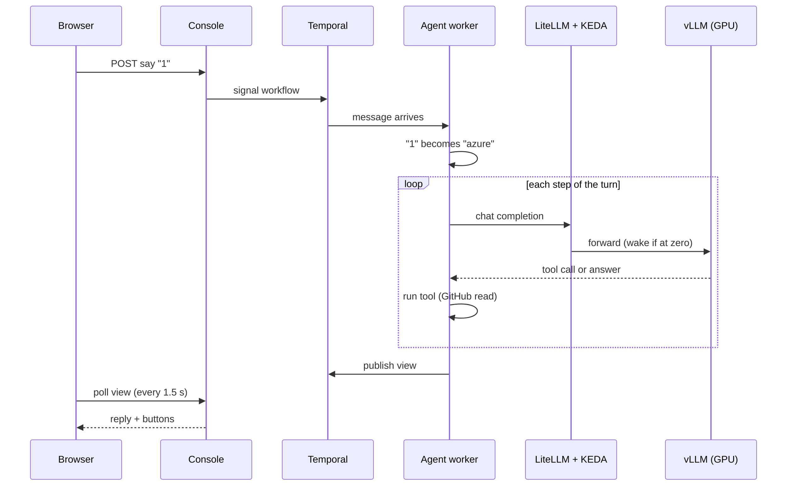

I typed "need to create a storage account" into the chat tab of my homelab's operator console and waited. And waited. Six minutes later the agent asked which cloud I wanted, with two buttons: Azure and AWS. I clicked Azure, and it went quiet again for minutes, this time with the model fully awake. Nothing was broken. Every component did exactly what it was configured to do. Two settings I hadn't thought about were costing minutes per message. In this post I follow one chat message through every component it touches, put numbers on each hop from that afternoon's logs, and explain why the fix was to turn the model's "thinking" off.

<!-- more -->

## The setup

The chat is Stack Author, an agent in my Cloudutsuk Platform homelab that turns "I need a storage account" into a pull request against a Terragrunt stack. It asks which cloud, environment and stack, reads the module's README, shows the exact diff, and opens a draft pull request when you confirm. The model is local: Qwen3.6-35B-A3B in FP8, served by vLLM on an NVIDIA DGX Spark (the GB10 chip, 128 GB of unified memory). There's no API bill, but the hardware is what it is.

The agent isn't a single model call. It's a small distributed system, and that's the first thing to understand about why a "simple" chat can be slow.

## What happens when you press Send

Here's the path of one message, from the browser to the GPU and back.



In words, with what each hop is for:

| # | Component | What it does with your message |
|---|---|---|
| 1 | Browser (the Author tab) | Sends the text, then polls the conversation's view every 1.5 seconds |
| 2 | Sign-in proxy | Checks you're signed in (Keycloak) and passes your identity on |
| 3 | Operator console | Checks the conversation is yours, then sends a Temporal *signal* to it |
| 4 | Temporal | Stores the signal durably and wakes the conversation's workflow |
| 5 | Workflow (agent worker) | Deterministic code: turns "1" into "azure", checks the kill switch, starts a model turn |
| 6 | Model turn (Pydantic AI) | Builds the prompt from the system instructions, the transcript and memory, and runs the tool loop |
| 7 | Tools | Read-only calls to GitHub as the agent's own GitHub App: the shared module's tree, a stack's `resources.yaml`, a module's README |
| 8 | LiteLLM gateway | Checks the agent's virtual key and budget, maps the model alias, forwards the request |
| 9 | KEDA HTTP add-on | Holds the request if the model is scaled to zero, and scales it up |
| 10 | vLLM on the GB10 | Applies the chat template, runs prefill and decode, and returns a tool call or a reply |
| 11 | Checks in code | Validates the output: a proposal must produce a clean diff; offered clouds must have a module |
| 12 | Back to you | The workflow publishes a new view, the console returns it, and the page draws the buttons |

Two things in that table matter more than the rest.

First, step 6 is a **loop**. A reply isn't one model call. The model decides to call a tool, gets the result, decides again, and so on until it answers. The agent allows up to 14 model requests per turn. Answering "Azure" typically means listing the Azure stacks, maybe reading one, and then asking which environment: three or four requests, each one a full model call.

Second, steps 9 and 10 are where the time went, for two different reasons.

## Reason one: the model was asleep

The GPU is shared. Image and video generation models run on the same box, so the chat model scales to zero after 30 idle minutes (a KEDA cooldown of 1,800 seconds). My first message arrived while it was at zero. The KEDA interceptor held the request and scaled the deployment from 0 to 1, and then vLLM did its startup work. I wrote about [what vLLM does while it loads a model](/posts/artificialintelligence/largelanguagemodel/what-happens-when-vllm-loads-a-model-in-a-kubernetes-pod/) in detail, so here are just the timings from this run:

| Time | Event |
|---|---|
| t+0:00 | Message sent; the deployment scales from 0 to 1 |
| t+0:00 to t+3:55 | Weights load: 42 shards, 33.38 GiB in 205.5 s |
| t+3:55 to t+6:00 | torch.compile and warm-up |
| t+6:00 | Health check passes |
| t+6:13 | The reply with the Azure and AWS buttons appears |

The weight loading works out to 33.38 GiB ÷ 205.5 s ≈ 166 MiB/s. The weights sit on the Spark's local NVMe, which reads much faster than that, so the disk isn't the limit. The time goes into reading the shards into memory and preparing the weights, not into raw I/O.

Six minutes of cold start is the price of sharing one GPU between several large models. You can't make it disappear without keeping the model in memory all day, but you can stop the user from paying for it in silence, which is what I did (more below).

## Reason two: thinking mode, with the model awake

After the first reply the model stayed loaded. I clicked Azure, and it was still slow. The vLLM log showed why. One request generated for more than two minutes straight:

```text
Engine 000: Avg prompt throughput: 0.0 tokens/s, Avg generation throughput: 47.3 tokens/s, Running: 1 reqs
Engine 000: Avg prompt throughput: 0.0 tokens/s, Avg generation throughput: 47.7 tokens/s, Running: 1 reqs
Engine 000: Avg prompt throughput: 0.0 tokens/s, Avg generation throughput: 47.0 tokens/s, Running: 1 reqs
... (the same line every 10 seconds, for minutes)
```

The agent's job at that point was tiny: list the Azure stacks and ask which environment. That's a tool call of a few dozen tokens. So why was the model writing thousands of tokens?

Because Qwen3 models **think by default**. Before the actual answer, the model writes out its reasoning: a long internal monologue about what the user probably wants, which tool to call, what could go wrong. vLLM returns it in a separate `reasoning` field, so the agent never even shows it. But every one of those tokens has to be generated, one at a time, before the answer starts.

I measured it directly against vLLM with the same one-line question, once with thinking on and once with it off:

| Thinking | Wall time | Output tokens | Reasoning text |
|---|---|---|---|
| On | 25.04 s | 747 | 2,744 characters |
| Off | 0.43 s | 11 | none |

Both answers were the same sentence: S3 is an Amazon Web Services service. Thinking made it 58 times slower and 68 times longer, and the answer was no better.

> The "on" request ran while the stuck Azure turn was still generating on the same GPU, so the two shared it. Alone it would have taken about 16 s (747 ÷ 47). The ratio is still dramatic.
{: .prompt-info }

## Why a Spark generates ~47 tokens per second

Is 47 tokens per second the Spark being weak? Not really. It's what the hardware should do for this model, and the maths is short.

Generating a token (decode) means reading every active weight of the model from memory once. For a single request, the GPU's arithmetic units mostly wait for memory, so the speed limit is memory bandwidth:

$$
\text{tokens per second} \approx \frac{\text{memory bandwidth}}{\text{bytes read per token}}
$$

The GB10's unified LPDDR5x memory provides **273 GB/s**, shared by the CPU and GPU. Qwen3.6-35B-A3B is a mixture-of-experts model: 35B parameters in total, but only about **3B active** per token (that's the "A3B"). In FP8 a parameter is one byte, so each token reads roughly 3 GB:

$$
\frac{273\ \text{GB/s}}{\approx 3\ \text{GB per token}} \approx 90\ \text{tokens/s (ceiling)}
$$

The real figure is lower because a token also reads the KV cache and attention state, routing between experts isn't free, and the CPU shares the same memory. So 47 tokens/s, about half the ceiling, is ordinary.

For comparison, an H100 has about 3.35 TB/s of HBM, roughly 12 times the Spark's bandwidth. The same model would decode several times faster there. That's the honest answer to "is it the hardware?": yes, the Spark is slower than a datacenter GPU per request. But look at what it does to the thinking problem.

## The arithmetic of a turn

Here's a turn with four model requests, the shape of the Azure step:

| | Thinking on | Thinking off |
|---|---|---|
| Output per request | 1,500 to 6,000 tokens | 50 to 200 tokens |
| Output per turn (×4) | 6,000 to 24,000 tokens | 200 to 800 tokens |
| Time on the Spark (÷ 47 tok/s) | **2 to 8.5 minutes** | **4 to 17 seconds** |
| Time on a ~5× faster GPU | 25 s to 1.7 minutes | 1 to 3 seconds |

The long requests weren't made up. The one I watched generated for over two minutes, which is more than 5,600 tokens at 47 per second, for a step that needed a few dozen.

Here's the point I took away. **A faster GPU divides the time by a constant, while thinking multiplies the token count.** A five-times-faster GPU with thinking on is still slower than the Spark with thinking off. In a chat agent the number of output tokens matters more than raw speed, and you control the token count with configuration, not hardware.

There's a smaller, steady cost too. Every request in a turn sends the whole conversation again: the system prompt, the transcript and every tool result so far, including module READMEs of several thousand characters. The model has to process all of it (prefill) before it writes a token. Prefill is much faster per token than decode, but it repeats on every request. The logs showed a 0% prefix-cache hit rate, so nothing was reused between them. That adds seconds per request, not minutes, but it's the next thing I'll look at.

## The decision: thinking off for this agent

Turning thinking off is one field in the request. vLLM accepts it per request in `chat_template_kwargs`:

```python
from openai import OpenAI

client = OpenAI(base_url="http://localhost:8000/v1", api_key="unused")
reply = client.chat.completions.create(
    model="qwen3.6-35b-a3b",
    messages=[{"role": "user", "content": "Which cloud has a service called S3?"}],
    max_tokens=4000,
    extra_body={"chat_template_kwargs": {"enable_thinking": False}},
)
print(reply.choices[0].message.content)
```

I didn't want the agent's code to know which model provider it talks to, so this went in as a deployment setting rather than code: a JSON object the agent framework sends with every request, set only for this agent:

```yaml
env:
  WARDENS_LLM_PROVIDER: openai-compatible
  WARDENS_LLM_MODEL: qwen3.6-35b-a3b
  # Thinking is on by default for this model; a chat agent's small steps don't need it.
  WARDENS_LLM_EXTRA_BODY: '{"chat_template_kwargs": {"enable_thinking": false}}'
```

Other agents on the platform keep thinking on, because some of them do real multi-step analysis. vLLM also has a server-wide switch (`--default-chat-template-kwargs`), but a per-request setting lets each agent decide.

### Why it's safe here

Thinking exists to improve answers on hard, multi-step problems. Stack Author's model doesn't face many of those, by design:

- Each step is small: pick a tool, ask one question, or fill in a module's values from its README.
- The decisions that matter are made in code, not by the model. The diff is generated and checked deterministically. A proposal that doesn't produce a clean edit is rejected and sent back. Values that look like secrets are refused. When the model offers clouds as choices, code removes any cloud that has no module for the resource. Nothing opens without the person pressing the button on the exact diff.
- A wrong question costs one more message, not a wrong pull request.

When the guard rails live in code, the model's job shrinks to "be a decent conversationalist with tools", and that doesn't need a two-minute monologue per step. If an agent's model *is* the safety mechanism, that's a different trade-off, and I'd keep thinking on and pay for it.

### The other three changes

Turning thinking off fixes the warm case. Three smaller changes cover the rest:

1. **A cap on output per response.** Each model response is limited to `max_tokens: 4000`. At 47 tokens/s the worst case is about 85 seconds, not "however long the model feels like". If a model ever loops, the person gets "I couldn't get an answer" instead of waiting forever.
2. **Wake the model when the conversation opens.** The moment you open the chat, the workflow sends a one-token request in the background. If the model is at zero, it starts loading while you read the greeting and type, so most of the six minutes overlaps with you typing. If the model is already up, it costs a fraction of a second. It runs once per conversation, and if it fails the conversation carries on; the first turn just waits for the model as before.
3. **Say what's happening.** The page shows "waking the model…" while that request is pending. If you send a message before the model is ready, it says "the model is starting up, so this first reply can take about 5 minutes". Six minutes with an explanation feels very different from six minutes of a spinner.

## Common pitfalls

A few lessons from this that apply to any self-hosted chat agent:

- **Check the model's defaults.** The reasoning toggle was on by default and documented, so it was easy to miss. I'd picked the model for its answers, not for its chat template. Read the serving docs for any model you deploy, not just its benchmarks.
- **Measure output tokens, not only latency.** "The model is slow" usually means "the model writes a lot". Your gateway and vLLM both report completion tokens; graph them per agent.
- **A turn is several requests.** When you estimate an agent's latency, multiply by the tool-loop length. One second per request becomes fifteen across a long turn.
- **Scale to zero needs a user experience.** It's a sensible default for a shared GPU, but the first user of the day pays the cold start. Wake early and say so.
- **Upgrading the GPU before trimming tokens is spending money on the wrong side of the division.**

## Conclusion

The six-minute first reply was a cold start: scale to zero, 205 seconds of weights and two minutes of compilation. The multi-minute replies after it were thinking mode, which wrote thousands of hidden tokens per step at the 47 tokens per second a 273 GB/s memory system allows for a 3B-active model. The hardware sets the speed per token. The configuration sets how many tokens there are, and that's the side I could change in an afternoon.

If you run a local model behind an agent, try one thing: send the same request with and without `enable_thinking`, and compare `usage.completion_tokens`. If the answers are equally good, you've found your speed-up.

## References

- [vLLM: Reasoning outputs](https://docs.vllm.ai/en/latest/features/reasoning_outputs/) (Qwen3 thinking on by default, `enable_thinking` in `chat_template_kwargs`, `--default-chat-template-kwargs`)
- [NVIDIA DGX Spark, specifications (via the OpenZeka product page)](https://openzeka.com/en/dgx-spark/) (128 GB LPDDR5x unified memory, 273 GB/s)
- [Tom's Hardware: NVIDIA DGX Spark review](https://www.tomshardware.com/pc-components/gpus/nvidia-dgx-spark-review/2) (memory bandwidth shared by the whole SoC)
