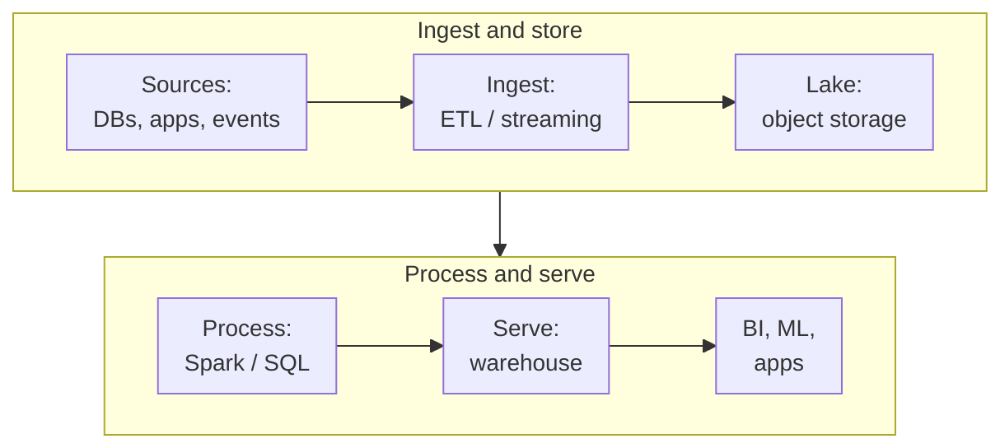

Every company eventually asks the same question: "Can we get all our data in one place and actually answer
questions with it?" The cloud answer is a stack of five or six services (storage, ingestion, processing, warehouse,
BI), and each provider names and slices them differently. On top of that, the industry has spent years moving from
"data warehouse vs data lake" to the lakehouse. This post lays out the analytics building blocks, explains what each
one is for, and compares the AWS, Azure and Google Cloud options.

<!-- more -->

## What the analytics category covers

Analytics services turn raw operational data (database rows, events, logs, files) into something people can query
and models can learn from. Most platforms follow the same flow:

- **Ingest.** Batch ETL/ELT tools and streaming services move data in.
- **Store.** A data lake on object storage holds raw and curated data in open formats (Parquet, Delta, Iceberg).
- **Process.** Spark, SQL engines and stream processors clean, join and aggregate it.
- **Serve.** A warehouse or lakehouse SQL endpoint powers dashboards, ad-hoc queries and ML feature pipelines.

The modern twist is the **lakehouse**: open table formats on object storage give lake data warehouse-like
transactions and performance, so the line between "lake" and "warehouse" keeps fading.

## Data warehouses

A cloud data warehouse is a columnar, massively parallel SQL engine built for scanning billions of rows. It's where
your BI tool points and where analysts live.

BigQuery set the template for serverless warehousing: no clusters, separate storage and compute, pay per query or per
reserved slot. Redshift started as a cluster you sized and has moved steadily towards serverless. On Azure, the
picture changed. Synapse Analytics still works and has no retirement date, but Microsoft is putting its new
investment into **Microsoft Fabric**, a SaaS analytics platform built on OneLake. For a greenfield Azure analytics
platform, evaluate Fabric first.



> On serverless, per-TB-scanned pricing, a careless `SELECT *` on a huge table is a real bill. Partition and cluster
> tables, select only the columns you need, and set per-user or per-project query quotas.
{: .prompt-warning }

## Spark and Hadoop processing

Apache Spark is the workhorse for large-scale transformation, data engineering and ML feature preparation. Each cloud
runs it as a managed service, either as clusters you size or serverless.

On Azure, Databricks is the dominant choice. It's a first-party Azure service, and its lakehouse platform (Delta Lake,
Unity Catalog) is also available on AWS and Google Cloud, which makes it a popular portability layer. EMR and Dataproc
are excellent at running open-source Spark cheaply, especially on Spot capacity.



## Real-time streaming analytics

Batch pipelines answer "what happened yesterday". Streaming answers "what's happening now": fraud detection, live
dashboards, IoT telemetry, clickstream personalisation. A streaming stack needs an **ingestion log** (Kinesis Data
Streams, Event Hubs, Pub/Sub or Kafka) and a **stream processor** that does windowed aggregations, joins and alerts.

My advice: only stream what genuinely needs low latency. Streaming pipelines cost more to build, run and debug than
batch. Many "real-time" requirements turn out to be "every 15 minutes", which micro-batch handles fine.



The event ingestion services themselves are compared in the
[application integration post](/posts/cloud/cloud-application-integration-services/).

## ETL and data integration

Integration services pull data from SaaS apps, databases and files, transform it, and land it in the lake or
warehouse. They're also the orchestration layer that schedules everything else.

The trend is towards ELT: load raw data first, transform with SQL inside the warehouse (often with dbt), and keep
visual ETL tools for connectivity and orchestration. Zero-ETL features (Aurora to Redshift, Cosmos DB and SQL mirroring
into Fabric, Datastream to BigQuery) remove pipelines entirely for some sources.



## Data lake storage and interactive query

The lake is object storage organised into zones (raw, cleaned, curated), stored in open columnar formats, and governed
by a catalog. Interactive query engines let analysts run SQL directly against those files without loading them into a
warehouse first. That's great for exploration, infrequent queries and keeping one copy of the data.



## Comparing the providers

- **Google Cloud** is often the favourite for analytics because of BigQuery's simplicity and performance. The
  serverless-first design means little to tune.
- **AWS** offers the most components (Redshift, EMR, Glue, Athena, Kinesis, MSK, Lake Formation). That's a lot of
  flexibility, but more assembly.
- **Azure** is consolidating onto Microsoft Fabric, with Databricks as the main Spark platform. Tight Power BI
  integration is a real advantage for Microsoft-centric organisations.

## Common pitfalls

- **Building a swamp.** A lake with no catalog, ownership or quality checks turns into a dumping ground. Invest
  in governance (Lake Formation, Unity Catalog, Purview, Dataplex) from the start.
- **Too many small files.** Streaming and frequent loads create millions of tiny files that cripple query
  performance. Schedule compaction, or use table formats that handle it.
- **Copying data everywhere.** Each copy (lake, warehouse, marts, extracts) adds cost and drift. Open table
  formats and query-in-place let several engines share one copy.
- **Forgetting cost controls.** Serverless engines scale beautifully, including your bill. Set budgets, quotas
  and alerts per team.
- **Ignoring Fabric and lakehouse roadmaps.** On Azure especially, new projects on older services may face a
  migration later. Check the product's direction before committing.

## Conclusion

Analytics on any cloud comes down to a lake on object storage, a processing engine, a SQL serving layer and
pipelines to feed them. BigQuery is the simplest end-to-end option, AWS gives you every component to assemble, and
Azure's future is Fabric plus Databricks. Start small: one source, one curated dataset, one dashboard people
actually use. Then expand. Every service side by side is in the [Analytics comparison](/cloud/#analytics).

## References

- [Amazon Redshift documentation](https://docs.aws.amazon.com/redshift/)
- [Amazon EMR documentation](https://docs.aws.amazon.com/emr/)
- [Microsoft Fabric, explained for existing Synapse users](https://blog.fabric.microsoft.com/blog/microsoft-fabric-explained-for-existing-synapse-users)
- [Azure Databricks documentation](https://learn.microsoft.com/azure/databricks/)
- [BigQuery documentation](https://cloud.google.com/bigquery/docs)
- [Dataflow documentation](https://cloud.google.com/dataflow/docs)
- [Dataproc documentation](https://cloud.google.com/dataproc/docs)
