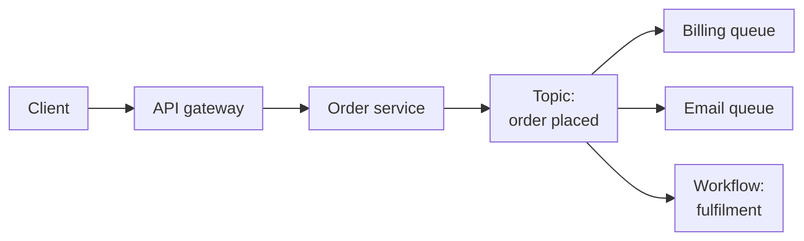

Two services that call each other directly over HTTP work fine until one of them is slow, down or being deployed.
Then the other one fails too, retries pile up, and a small blip becomes an outage. Application integration services
exist to break that coupling. They let components talk through queues, topics, events and workflows, so each part can
fail, scale and deploy on its own. The problem is that every cloud has five or six of these services with overlapping
features. This post explains what each pattern is for and maps it to the AWS, Azure and Google Cloud services.

<!-- more -->

## What application integration covers

Integration services move messages and coordinate work between components. The patterns:

| Pattern | Shape | Example |
|---|---|---|
| Queue | One producer, one consumer group, each message processed once | Order processing workers |
| Pub/sub | One message, many independent subscribers | "Order placed" goes to billing, email and analytics |
| Event routing | Events filtered and routed by content to targets | Blob uploaded triggers a thumbnail function |
| Event streaming | Ordered, replayable, high-volume log | Clickstream, telemetry, change data capture |
| Workflow | Multi-step process with state, retries and branching | Loan approval, data pipeline, saga |
| API gateway | Managed front door for synchronous APIs | Auth, throttling and routing for public APIs |

A single application often uses several of them together:

## Message queues

A queue decouples a producer from a consumer. The producer drops a message and moves on. Consumers pull messages at
their own pace and delete them once processed. If consumers fall behind, the queue absorbs the backlog. If one
crashes mid-message, the message becomes visible again and another worker picks it up.

Design consumers to be **idempotent**. Most queues deliver at least once, so the same message will occasionally
arrive twice. Use dead-letter queues for messages that keep failing, and alert on them. A dead-letter queue nobody
watches is just a slower way to lose data.



## Pub/sub and notifications

Pub/sub delivers one message to many subscribers, each getting its own copy. It's how you let new consumers react to
an event without changing the producer: add a subscription and you're done. A very common pattern on AWS is SNS fanning
out to several SQS queues, giving every consumer its own buffered, retryable copy.



## Event routing

Event routers sit between event sources and handlers and route by content. They're ideal for reacting to things that
happen in the cloud platform itself (a file uploaded, a VM deallocated, a resource tagged) and for loosely coupled,
event-driven architectures where producers shouldn't know who consumes their events.

The difference from pub/sub is subtle. Routers are built around **filtering rules and many target types**, often with
schemas, archives and replay, while pub/sub is a simpler topic-subscription model. EventBridge, Event Grid and Eventarc
all use or support the CloudEvents standard, which helps portability.



## Event streaming ingestion

Streams look like queues but behave differently. Messages aren't deleted when read; they stay in an ordered,
partitioned log for a retention period, and many consumers read at their own offsets. That makes streams the right
tool for high-volume telemetry, clickstreams, change data capture, and anything you might want to replay.

If your team already knows Kafka, all three providers offer either managed Kafka or a Kafka-compatible endpoint.



> Pick by semantics, not by name. If you need "process each job once, then forget it", that's a queue. If you need
> "keep an ordered history many systems can replay", that's a stream. Using a stream as a work queue (or the
> reverse) causes most of the pain I see in event-driven designs.
{: .prompt-tip }

## Workflow orchestration

When a business process has several steps with branching, retries, timeouts, waits for humans and compensation when
something fails, encoding it as a chain of queues and functions gets messy fast. Workflow services hold the state for
you and make the process visible, which is invaluable when someone asks "where is order 4711 stuck?"

Step Functions and Workflows are developer-focused state machines. Logic Apps leans towards low-code integration with
a huge connector library, making it as much an iPaaS as an orchestrator.



## API gateways and management

API gateways front synchronous APIs: authentication, rate limiting, request transformation, routing to backends,
caching and analytics. Full **API management** adds a developer portal, subscription keys, versioning and lifecycle
governance, which you need once external partners consume your APIs.

A newer use case is the **AI gateway**: putting a gateway in front of LLM endpoints to enforce token quotas, load
balance across model deployments, cache responses and log usage per team.



## Comparing the providers

- **Azure** has the richest enterprise messaging (Service Bus) and the most connectors (Logic Apps), which suits
  enterprise integration and hybrid scenarios.
- **AWS** offers clean, single-purpose building blocks (SQS, SNS, EventBridge, Step Functions) that compose well
  and scale with no tuning.
- **Google Cloud** consolidates much of this into Pub/Sub, which covers queues, fan-out and streaming in one
  global service, and Apigee is a leading API management platform.

## Common pitfalls

- **Assuming exactly-once.** Unless the service explicitly guarantees it and you configure it, expect duplicates.
  Make handlers idempotent.
- **Unbounded retries.** A poison message retried forever blocks a queue or burns money. Cap retries and use
  dead-letter queues.
- **Large payloads in messages.** Most services cap message size (often 256 KB to 1 MB). Store the payload in object
  storage and send a reference.
- **Ordering assumptions.** Global ordering is rare and expensive. Order per key (customer, device) using FIFO
  queues, sessions or ordering keys only where it matters.
- **No tracing.** Asynchronous flows are hard to debug. Propagate correlation IDs and use distributed tracing
  (see the [monitoring post](/posts/cloud/cloud-monitoring-management-services/)).

## Conclusion

Integration services make systems resilient by letting components fail and scale independently. Use queues for work
distribution, pub/sub for fan-out, event routers for reacting to platform and domain events, streams for
high-volume replayable data, workflows for multi-step processes, and an API gateway for synchronous entry points. A
good next step: find one synchronous call chain in your system where a downstream failure takes everything down, and
put a queue in the middle. See all the services side by side in the
[Application Integration comparison](/cloud/#integration).

## References

- [Amazon SQS](https://docs.aws.amazon.com/sqs/), [Amazon SNS](https://docs.aws.amazon.com/sns/), [Amazon EventBridge](https://docs.aws.amazon.com/eventbridge/)
- [AWS Step Functions documentation](https://docs.aws.amazon.com/step-functions/)
- [Azure messaging services compared](https://learn.microsoft.com/azure/service-bus-messaging/compare-messaging-services)
- [Azure Logic Apps documentation](https://learn.microsoft.com/azure/logic-apps/)
- [Azure API Management documentation](https://learn.microsoft.com/azure/api-management/)
- [Google Cloud Pub/Sub documentation](https://cloud.google.com/pubsub/docs)
- [Eventarc](https://cloud.google.com/eventarc/docs), [Workflows](https://cloud.google.com/workflows/docs)
