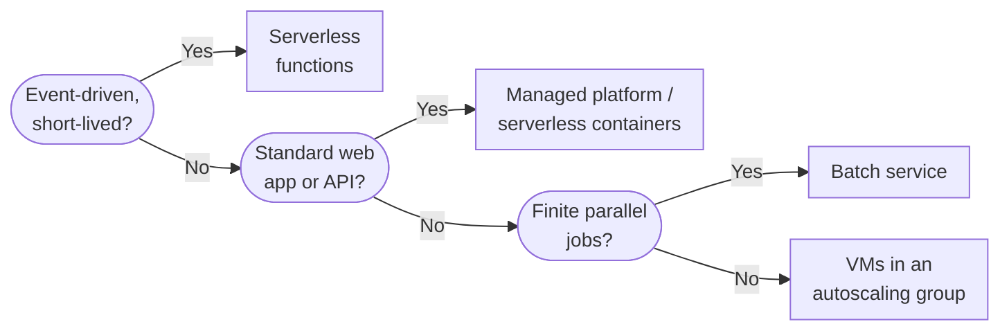

"Should this run on a VM, in a function, or on App Service?" is one of the first questions on any cloud project.
It's also where teams waste the most money. An app that sits idle 20 hours a day gets parked on a VM that bills
all 24, or a long-running job gets squeezed into a function until it hits the timeout. This post walks through
the compute models every cloud offers, what each one is for, and how the AWS, Azure and Google Cloud services
line up, so you can pick the right one before the bill tells you.

<!-- more -->

## What "compute" means in the cloud

Compute is the category that runs your code. Everything else (storage, networking, databases) exists to feed
it or to keep what it produces. What varies across compute services is **how much of the stack you manage**:

| Model | You manage | Provider manages | Billing |
|---|---|---|---|
| Virtual machines (IaaS) | OS, patches, runtime, app, scaling | Hardware, hypervisor | Per second/hour the VM exists |
| Managed platform (PaaS) | App code and config | OS, runtime, load balancing, scaling | Per plan/instance |
| Serverless functions (FaaS) | A function | Everything else | Per request and execution time |
| Batch | Job definitions | Provisioning and teardown of workers | Underlying compute only |

Containers sit across all of these and have their own [container services post](/posts/cloud/cloud-container-services/).

The rule I use: start as high up the stack as your workload allows, and only drop down a level when you hit a
real constraint (a kernel module, a licence tied to a machine, a 40-minute process, a GPU driver version). Every
level you drop buys flexibility and costs you patching, scaling and on-call work.

## Virtual machines

VMs are the lowest common denominator, and that's their main selling point. Anything that runs on a server in your
data centre will run on a cloud VM, which is why lift-and-shift migrations land here first. You pick a size
(vCPU, memory, sometimes GPU or local NVMe), an image, a disk and a network, and you get a machine you fully control.

What you also get is every operational job you had on-premises: OS patching, agent installs, backups, hardening,
right-sizing. The cloud doesn't make those go away. It just makes it easier to automate them.

Three things matter more than the brand name when you compare providers:

- **Pricing levers.** All three have on-demand, 1–3 year commitments and deeply discounted interruptible
  capacity (Spot). Google also applies sustained-use discounts automatically, without a commitment.
- **Instance shapes.** AWS has the widest catalogue. Google lets you build custom shapes. Azure has the
  smoothest path for Windows and SQL Server licences.
- **Maintenance behaviour.** Google live-migrates VMs during host maintenance. On AWS and Azure you'll
  occasionally get a scheduled-event notice and need to plan a restart.



> Don't size a cloud VM by copying the spec of the on-premises server. Most physical servers run at 10–20% CPU.
> Start one or two sizes smaller, watch a week of metrics, then adjust.
{: .prompt-tip }

## Autoscaling groups of VMs

A single VM is a single point of failure. Production VM workloads almost always run as a **group of identical
instances** behind a load balancer, created from a template, spread across availability zones and resized
automatically based on load.

This is the piece that turns VMs from "servers in someone else's building" into something cloud-shaped. Instances
become disposable: if one fails a health check, the group replaces it. When traffic doubles, the group adds
capacity. That only works if the instances hold no state. Logs ship off the box, sessions live in a cache or
database, and config comes from the image or a startup script, not from someone SSHing in.



## Serverless functions

Functions are the opposite end of the spectrum. You hand the platform a piece of code and a trigger ("run this
when a file lands in the bucket", "run this on every message in the queue", "run this every night at 2 am"), and
it handles everything else, including scaling to zero when nothing is happening.

They shine for glue work and spiky, event-driven workloads: image thumbnails, webhook receivers, queue consumers,
scheduled clean-up jobs, lightweight APIs. They're a poor fit for long-running processes, workloads that need
steady high throughput (per-invocation pricing gets expensive at sustained load), or anything that needs a
persistent connection pool.

The three gotchas I see most often:

1. **Cold starts.** The first request after idle pays for spinning up a runtime. Java and .NET feel this
   most. Provisioned/premium capacity or snapshot features fix it, at a price.
2. **Timeouts.** Lambda caps an invocation at 15 minutes. Azure and Google have higher limits on some
   plans, but a function that needs an hour should probably be a batch job or a container.
3. **Hidden fan-out.** A function that scales to 1,000 concurrent executions will happily open 1,000
   database connections. Put a queue or a connection proxy in front of relational databases.



## Managed application platforms

Between raw VMs and functions sits the classic PaaS: you deploy a web app or API, and the platform runs it on
managed instances with load balancing, TLS, autoscaling, deployment slots and logging included. It's the right
default for a conventional web application that runs continuously and doesn't need anything exotic from the OS.

Honestly, Azure App Service is the strongest product in this row. It has been around a long time, and features
like deployment slots and VNet integration are polished. AWS Elastic Beanstalk works but feels like a wrapper
around EC2, and Google's own guidance now points most new web workloads at Cloud Run instead of App Engine. That
reflects a wider trend: for new projects, **serverless containers** (Cloud Run, Azure Container Apps, ECS on
Fargate) are taking over this role, because they run any container image with similar operational simplicity.



## Batch computing

Some work isn't a service at all. It's a pile of jobs that need to run, ideally in parallel, and then stop:
nightly ETL, video transcoding, Monte Carlo simulations, genome alignment, rendering. Batch services take a queue
of job definitions, provision exactly the capacity needed (often Spot, since jobs can be retried), run them, and
scale back to zero.

You could build this yourself with an autoscaling group and a queue, and plenty of teams do. The managed batch
services earn their keep with job dependencies, array jobs, retries, and smart use of Spot capacity, which is
where the real savings are.



## Picking between the three providers

For compute specifically, the providers are closer than the marketing suggests. All three have mature VMs,
autoscaling, functions and batch. The differences that actually decide things are usually elsewhere:

- **Licensing.** Heavy Windows Server or SQL Server estates usually come out cheapest on Azure because of
  Hybrid Benefit.
- **Breadth.** If you need a niche instance type (specific GPU, high-memory SAP-certified, Mac instances),
  AWS is the most likely to have it in your region.
- **Simplicity and pricing defaults.** Google's automatic sustained-use discounts, custom machine types and
  live migration make Compute Engine pleasant for steady workloads without a FinOps team.
- **Where everything else lives.** Your compute should sit next to your data and identity provider. That
  usually matters more than any VM feature.

## Common pitfalls

- **Treating VMs as pets.** If losing an instance causes an incident, you don't have an autoscaling group,
  you have a server with extra steps. Bake images, externalise state, and test replacing instances.
- **Leaving dev VMs running.** Schedule shutdowns for non-production. It's the easiest saving in the
  [cost management](/posts/cloud/cloud-cost-management-tools/) playbook.
- **Ignoring Spot.** Batch, CI runners and stateless workers tolerate interruptions well. Running them on
  on-demand capacity often costs 3–5× more.
- **Forcing everything into functions.** Functions are brilliant glue but awkward as the backbone of a
  big application. If you're chaining dozens of them with shared state, step back and consider a container.
- **Forgetting egress and data gravity.** Compute that's cheap but sits in a different region from its
  database will cost you in latency and transfer fees.

## Conclusion

Start from the workload, not the service. Event-driven and spiky goes to functions. A standard web app goes to a
managed platform or serverless containers. Finite parallel work goes to batch. Only what genuinely needs an OS
goes to VMs, and even then, run them as an autoscaling group. A practical next step: list your current workloads,
put each in one of those four buckets, and see how many are on VMs that don't need to be. To see every compute
service side by side, use the [Compute comparison on the Cloud page](/cloud/#compute).

## References

- [Amazon EC2 documentation](https://docs.aws.amazon.com/ec2/)
- [AWS Lambda quotas](https://docs.aws.amazon.com/lambda/latest/dg/gettingstarted-limits.html)
- [Azure Virtual Machines documentation](https://learn.microsoft.com/azure/virtual-machines/)
- [Azure Functions hosting options](https://learn.microsoft.com/azure/azure-functions/functions-scale)
- [Compute Engine documentation](https://cloud.google.com/compute/docs)
- [Cloud Run functions overview](https://cloud.google.com/functions/docs/concepts/overview)
- [AWS Batch](https://docs.aws.amazon.com/batch/), [Azure Batch](https://learn.microsoft.com/azure/batch/), [Google Cloud Batch](https://cloud.google.com/batch/docs)
