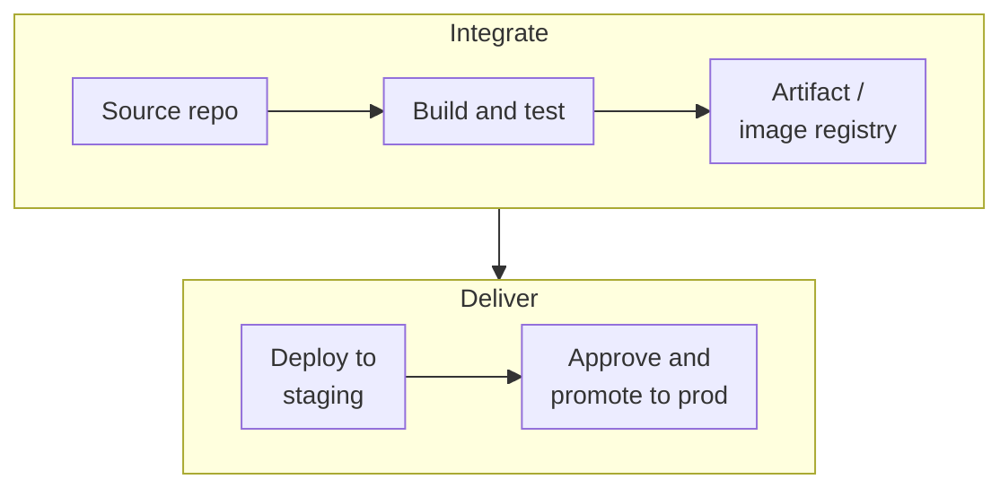

Ask ten teams what CI/CD tool they use and you'll get GitHub Actions, GitLab, Jenkins, Azure DevOps, and maybe one
lonely CodePipeline. That's the honest state of this category. The cloud providers' native DevOps tools compete with
very good third-party platforms, and plenty of teams mix and match. This post explains each piece of the developer
toolchain, what the native AWS, Azure and Google Cloud services do well, and when you'd still reach for something else.

<!-- more -->

## What the DevOps category covers

The developer tools category supports the path from a commit to running software:

- **Source control.** Git repositories, pull requests and branch policies.
- **Continuous integration.** Build, test, scan and package on every change.
- **Continuous delivery.** Promote artifacts through environments with approvals, safe rollout strategies and
  rollback.
- **CLIs and shells.** How engineers and scripts drive the cloud.
- **Dev and test environments.** Self-service, cost-controlled places to work and experiment.

Artifact and container registries are covered in the [containers post](/posts/cloud/cloud-container-services/), and
infrastructure as code in the [monitoring and management post](/posts/cloud/cloud-monitoring-management-services/).
For the general practice, see the [DevOps introduction](/posts/devops/devops/) and [CI/CD](/posts/devops/cicd/cicd/)
posts.

## Source code repositories

Most teams keep code in GitHub or GitLab, and that's a perfectly good choice on any cloud. The native repositories
make sense when you want everything inside one cloud account boundary, under the provider's IAM and compliance
controls, or when data residency rules out SaaS Git hosting.

The landscape has shifted more than once. AWS paused CodeCommit for new customers in 2024 and reversed that in
November 2025. Google retired Cloud Source Repositories for new customers in favour of Secure Source Manager. And
Microsoft's long-term investment goes into GitHub, with Azure Repos still fully supported.



## Continuous integration and builds

CI runs on every commit or pull request: compile, run unit tests, lint, scan dependencies and containers, and produce
a versioned artifact. The native build services are serverless (no build servers to maintain), billed per minute,
and run with cloud identities, so builds can push to registries or read secrets without stored credentials.

That last point is the main reason to use them even if your pipelines live elsewhere. For example, CodeBuild can act
as a managed runner for GitHub Actions jobs that need private VPC access.



## Continuous delivery and deployment

CD takes a tested artifact and rolls it out: dev, then staging, then production, with approvals, automated
verification and a rollout strategy (rolling, blue/green, canary) that limits the blast radius of a bad release.

Cloud Deploy and CodeDeploy are focused deployment engines. Azure Pipelines handles CI and CD in one YAML file with
environments and checks. For Kubernetes specifically, many teams use GitOps (Argo CD or Flux) instead, where the
cluster pulls desired state from Git. See the [GitOps posts](/posts/devops/cicd/gitops/gitops/) for that model.



> Whatever tool you use, authenticate pipelines to the cloud with **workload identity federation** (OIDC) rather
> than stored access keys or client secrets. All three clouds support it for GitHub Actions, GitLab and their own
> pipelines, and it removes the most commonly leaked credential in CI.
{: .prompt-tip }

## Command-line tools

The CLI is how most engineers actually work with a cloud day to day, and how scripts glue things together. All three
CLIs are mature, support SSO sign-in, and have a browser-based cloud shell with everything preinstalled. That's handy
when you're on a locked-down laptop.



The [AWS CLI cheat sheet](/posts/cloud/aws/aws-cli-commands-cheatsheet/) and
[Azure CLI cheat sheet](/posts/cloud/azure/az%20cli/az-cli-commands-cheatsheet/) collect the commands I use most.

## Development and test environments

Developers need places to try things without touching production or waiting for tickets. The challenge is cost and
sprawl: forgotten dev VMs running all weekend. Dev/test services give self-service environments from approved
templates, with auto-shutdown and spending limits built in.



## Native tools or third-party?

My rule of thumb:

| Situation | Reasonable choice |
|---|---|
| Code already on GitHub, mostly one cloud | GitHub Actions with OIDC to the cloud, native deploy tools where useful |
| Microsoft shop, Azure-heavy, need boards and test plans | Azure DevOps (or GitHub Enterprise) |
| All-AWS, strict account boundary, regulated | CodeCommit/CodeBuild/CodePipeline, or GitHub with CodeBuild runners |
| GKE and Cloud Run delivery on Google Cloud | Cloud Build for CI, Cloud Deploy for promotion |
| Many clouds, many teams | One SaaS platform (GitHub, GitLab) plus each cloud's identity federation |

The native tools' biggest strengths are identity integration, private networking and staying inside one billing and
compliance boundary. Third-party platforms usually win on developer experience, marketplace ecosystems and
multi-cloud consistency.

## Common pitfalls

- **Long-lived cloud credentials in CI.** Replace them with OIDC federation and short-lived tokens.
- **Pipelines with admin rights.** Give each pipeline the minimum roles for its environment, and separate
  production deploy identities.
- **No artifact immutability.** Build once, promote the same artifact everywhere. Rebuilding per environment means
  production runs something you never tested.
- **Manual production fixes.** Hotfixes in the portal create drift your next pipeline run will either undo or
  fight. Make the fast path go through the pipeline.
- **Ignoring supply-chain security.** Scan dependencies and images, sign artifacts and generate provenance (SLSA),
  and restrict deployments to signed images.

## Conclusion

The cloud-native DevOps tools are solid, particularly for builds and deployments that need tight identity and
network integration, but they aren't the only option, and mixing them with GitHub or GitLab is normal. Decide where
your code lives, use federated identity for every pipeline, build once and promote the same artifact, and pick the
deployment engine that fits your runtime. A quick next step: audit your pipelines for stored cloud credentials and
replace the first one with OIDC this week. Every service side by side is in the
[DevOps comparison](/cloud/#devtools).

## References

- [AWS CodeCommit returns to general availability](https://aws.amazon.com/blogs/devops/aws-codecommit-returns-to-general-availability/)
- [AWS CodeBuild documentation](https://docs.aws.amazon.com/codebuild/)
- [AWS CodePipeline documentation](https://docs.aws.amazon.com/codepipeline/)
- [Azure Pipelines documentation](https://learn.microsoft.com/azure/devops/pipelines/)
- [Cloud Build documentation](https://cloud.google.com/build/docs)
- [Cloud Deploy documentation](https://cloud.google.com/deploy/docs)
- [Secure Source Manager](https://cloud.google.com/secure-source-manager/docs)
