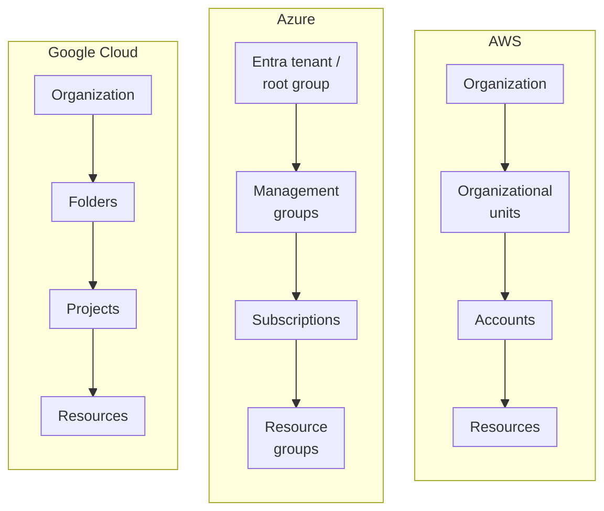

In the cloud, the network perimeter mostly disappears and identity takes its place. Anyone holding a valid
credential with the right permissions can reach your data from anywhere, so who can do what, and where, is the most
important security decision you make. It's also where the three providers differ most in their mental models. This
post explains the four parts of identity and governance, compares how AWS, Azure and Google Cloud handle each, and
flags the traps teams hit when they move between them.

<!-- more -->

## What identity and governance cover

This category answers four questions:

1. **Who can act on which resources?** Authorisation: roles, policies and permissions.
2. **Who are your people, and how do they sign in?** Workforce identity, SSO and MFA.
3. **How are resources organised?** The account, subscription and project hierarchy everything hangs off.
4. **What must never happen, whoever asks?** Guardrails that hold even for administrators.

The first two are identity. The last two are governance. In practice they're designed together, because policies
and permissions attach to the hierarchy.

The hierarchies look like this side by side:

## Access control for cloud resources

Every API call to a cloud provider is authenticated and then authorised against a policy. The models differ in
shape:

- **AWS IAM** is policy-centric. You write JSON policies listing allowed (and denied) actions on resource ARNs,
  with conditions, and attach them to identities or resources. It's very expressive, and correspondingly easy
  to get subtly wrong.
- **Azure RBAC** and **Google Cloud IAM** are role-centric. You assign a predefined or custom role to a
  principal at a scope, and permissions inherit down the hierarchy. They're easier to reason about, but coarse
  built-in roles tempt people into over-granting.

The principle is the same everywhere: least privilege, granted to groups rather than individuals, and short-lived
credentials. Human admins should elevate when needed (Entra PIM, IAM Identity Center permission sets, Google
Privileged Access Manager), not hold permanent admin rights. Workloads should use roles, managed identities or
service accounts, never long-lived keys.



> On Google Cloud, a service account key file is a long-lived credential that never expires. Block key creation
> with the `iam.disableServiceAccountKeyCreation` organisation policy and use Workload Identity Federation instead.
{: .prompt-warning }

## Workforce identity and single sign-on

Your people should sign in once, with MFA, through a single identity provider, and get access to every cloud and
SaaS app from there. Creating separate IAM users in each AWS account, or guest accounts scattered across tenants,
doesn't scale and leaves orphaned access behind when people leave.

Microsoft Entra ID is the most complete workforce identity platform of the three. Many organisations already run it
for Microsoft 365, and it's commonly used as the IdP for AWS and Google Cloud too. AWS IAM Identity Center and
Google Cloud Identity are cloud-access front doors that federate well with Entra ID, Okta or Google Workspace.



## Resource hierarchy

The hierarchy is the skeleton of a cloud estate. It decides blast radius, billing boundaries, and where policies and
permissions attach. Changing it later is painful, so it's worth designing deliberately.

The **isolation unit** differs: an AWS account, an Azure subscription, a Google Cloud project. The common pattern on
all three is many of them, split by environment and workload (prod and non-prod, one per application or team),
grouped under OUs, management groups or folders that carry the guardrails. That's the heart of a landing zone. See
the [Azure management groups post](/posts/azure/azure-management-groups/) and the
[GCP landing zone concepts post](/posts/cloud/gcp/gcp-landing-zone-concepts/) for worked examples.



## Policy guardrails

Permissions say what an identity *can* do. Guardrails say what *nobody* can do in a given part of the hierarchy,
including admins. Typical guardrails: only approved regions, no public IPs on databases, mandatory encryption and
tags, no disabling of audit logs, no leaving the organisation.

Two flavours exist. **Preventive** guardrails block the action outright (SCPs, Azure Policy with deny effect, Google
organisation policy constraints). **Detective** ones flag drift after the fact (AWS Config, Azure Policy audit,
Security Command Center). Use preventive for the few things that must never happen and detective for everything else.



> Azure Blueprints is being retired. New definitions have been blocked since July 2026, and the service shuts down on
> 31 January 2027. Microsoft's replacement is template specs plus **deployment stacks**, alongside Azure Policy. If
> you still have blueprint assignments, export them now.
{: .prompt-warning }

## Comparing the providers

- **AWS** gives the finest-grained control through IAM policies, and uses the account as a strong isolation
  boundary. The cost is complexity: the interplay of identity policies, resource policies, SCPs, RCPs and
  permission boundaries takes real expertise.
- **Azure** has the strongest identity platform (Entra ID) and a clean inheritance model. Azure Policy is the
  most capable built-in policy engine for enforcing and auto-remediating configuration.
- **Google Cloud** has the simplest model to explain (organisation, folders, projects, roles) and good
  organisation policy constraints. The service account key problem needs active management.

## Common pitfalls

- **Owner and admin everywhere.** Broad built-in roles granted "temporarily" become permanent. Review role
  assignments regularly and use just-in-time elevation.
- **One giant account or subscription.** It blurs blast radius, billing and permissions. Split early, because
  moving resources between accounts or subscriptions later is slow and sometimes impossible.
- **Identities that never die.** Leavers keep access through local IAM users, guest accounts and keys. Centralise
  on one IdP and automate deprovisioning.
- **No break-glass accounts.** If SSO fails or Conditional Access locks everyone out, you need emergency
  accounts that are excluded from it, heavily monitored, and tested.
- **Guardrails nobody can see.** A deny with no explanation looks like a bug to developers. Document your
  guardrails and give clear error messages where the platform allows it.

## Conclusion

Get identity and governance right and most other security controls become easier. Get them wrong and no amount of
tooling saves you. Federate workforce sign-in to one IdP, design the account, subscription or project hierarchy
before workloads arrive, grant least-privilege roles to groups, use workload identities instead of keys, and enforce
a small set of preventive guardrails. As a next step, list everyone with owner or admin rights across your
estate. The length of that list usually tells you where to start. See all services side by side in the
[Identity & Governance comparison](/cloud/#identity).

## References

- [AWS IAM documentation](https://docs.aws.amazon.com/IAM/)
- [AWS Organizations service control policies](https://docs.aws.amazon.com/organizations/latest/userguide/orgs_manage_policies_scps.html)
- [Azure RBAC overview](https://learn.microsoft.com/azure/role-based-access-control/overview)
- [Azure Policy overview](https://learn.microsoft.com/azure/governance/policy/overview)
- [Azure Blueprints retirement](https://learn.microsoft.com/azure/governance/blueprints/blueprint-retirement-faq)
- [Google Cloud resource hierarchy](https://cloud.google.com/resource-manager/docs/cloud-platform-resource-hierarchy)
- [Organization Policy Service](https://cloud.google.com/resource-manager/docs/organization-policy/overview)
