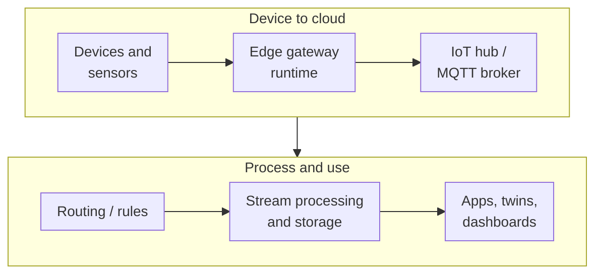

IoT projects tend to fail in the gap between the device and the dashboard. A thousand sensors work fine in the lab,
then the field deployment hits flaky connectivity, expired certificates, firmware that can't be updated remotely, and
a data pipeline that buckles at a million messages an hour. Cloud IoT services exist to cover that gap. They've also
seen more churn than almost any other category, with Google leaving it entirely. This post explains the parts of an
IoT platform, compares what AWS and Azure offer, and covers your options on Google Cloud.

<!-- more -->

## What the IoT category covers

An IoT platform has to handle several jobs that ordinary web services don't:

- **Identity and provisioning.** Each device needs a unique identity (usually an X.509 certificate) and a way to
  onboard securely at the factory or in the field.
- **Messaging.** Lightweight, bi-directional protocols (mostly MQTT) that tolerate unreliable links: telemetry up,
  commands and configuration down.
- **Device state.** A cloud-side record of what each device reports and what it should be (shadows or twins), so
  apps can work with devices that are offline.
- **Edge compute.** Processing near the devices for latency, bandwidth or offline reasons.
- **Fleet management.** Over-the-air updates, monitoring and remote jobs across thousands or millions of devices.
- **Modelling.** Representing physical environments (buildings, production lines) and their relationships.

The downstream processing (streaming analytics, time-series storage, ML) uses the services from the
[analytics](/posts/cloud/cloud-analytics-services/) and [integration](/posts/cloud/cloud-application-integration-services/)
posts.

## Device connectivity and messaging

This is the core of any IoT platform: a managed broker that authenticates devices, accepts their telemetry at
massive scale, delivers commands back, and routes messages into the rest of the cloud. AWS IoT Core and Azure IoT Hub
are both mature and comparable. They differ more in surrounding ecosystem than in fundamentals.

Design for **intermittent connectivity** from the start. Devices will drop offline. Use persistent sessions and QoS
levels appropriately, buffer on the device, and model desired state in the shadow or twin instead of sending
fire-and-forget commands.



> If you were on Google Cloud IoT Core, it shut down on 16 August 2023. Anything still referencing its endpoints
> stopped working then. New Google Cloud IoT designs need a partner or self-managed broker in front of Pub/Sub.
{: .prompt-info }

## Edge runtimes

Not everything should go to the cloud. Edge runtimes run code on gateways or capable devices to filter and aggregate
telemetry (saving bandwidth), act locally in milliseconds (stop a machine when vibration spikes), keep working
offline, and run ML inference near the data. The cloud side deploys and updates that code across the fleet.

Both Greengrass and IoT Edge treat edge workloads as deployable components or containers managed from the cloud. For
heavier edge sites (a store, a factory, a cell tower), the conversation shifts to on-premises cloud infrastructure:
AWS Outposts, Azure Local with Arc, and Google Distributed Cloud.



## Digital twins and industrial data

A digital twin is a live model of a physical environment: assets, their relationships ("this sensor is in room 4,
which is on floor 2 of building A") and their current state. Twins make it possible to ask questions across a site,
run simulations, and build applications that understand context rather than raw device IDs.

Industrial IoT adds asset modelling, OPC UA connectivity to factory equipment, and historian-style time-series data.
This is the least standardised part of the category, and the one with the most partner platforms.



## Comparing the providers

- **Azure** has the broadest first-party IoT portfolio: IoT Hub, IoT Edge, Digital Twins, Event Grid MQTT, plus Arc
  for edge infrastructure. It's a strong fit for industrial and building scenarios.
- **AWS** offers IoT Core, Greengrass and SiteWise, with very good scale and integration into the rest of AWS.
  It has also trimmed peripheral services (IoT Analytics, IoT Events), so check lifecycle status before adopting
  anything beyond the core.
- **Google Cloud** no longer has a first-party device platform. It's a fine destination for IoT *data* (Pub/Sub,
  Dataflow, BigQuery, Bigtable), but device connectivity comes from partners.

The churn in this category is a real risk factor. Keep devices talking **standard MQTT** with standard certificate
auth, and keep provider-specific logic in the cloud rather than in firmware. Re-flashing a million devices because a
service retired is the outcome to design against.

## Common pitfalls

- **Shared credentials across devices.** One leaked key compromises the fleet. Give every device its own identity,
  ideally in a hardware secure element.
- **No over-the-air update plan.** If you can't update firmware remotely, you can't fix security bugs. Build and
  test OTA before the first field deployment.
- **Certificate expiry.** Device certificates and CA chains expire. Track them and automate rotation, or a whole
  fleet goes offline on the same day.
- **Sending everything raw.** High-frequency raw telemetry is expensive to move and store. Aggregate at the edge
  and send what downstream systems actually use.
- **Vendor-specific firmware.** Hard-coding one cloud's SDK and endpoints into devices makes migration painful.
  Abstract it and stick to MQTT where you can.

## Conclusion

A solid IoT platform comes down to secure per-device identity, a managed MQTT hub, device state that tolerates
offline devices, edge compute where latency or bandwidth demands it, and a robust over-the-air update process. Azure
has the widest native portfolio, AWS a strong and scalable core, and Google Cloud is best treated as an analytics
destination behind a partner platform. Before picking services, write down your device count, message rate and
connectivity assumptions, because those drive almost every design decision. See all the services side by side in the
[IoT comparison](/cloud/#iot).

## References

- [AWS IoT Core documentation](https://docs.aws.amazon.com/iot/)
- [AWS IoT Greengrass documentation](https://docs.aws.amazon.com/greengrass/)
- [AWS service changes (IoT Analytics and IoT Events end of support)](https://aws.amazon.com/about-aws/whats-new/2025/05/aws-service-changes/)
- [Azure IoT Hub documentation](https://learn.microsoft.com/azure/iot-hub/)
- [Azure IoT Edge documentation](https://learn.microsoft.com/azure/iot-edge/)
- [Azure Digital Twins documentation](https://learn.microsoft.com/azure/digital-twins/)
- [Google Cloud IoT Core retirement](https://cloud.google.com/iot-core)
