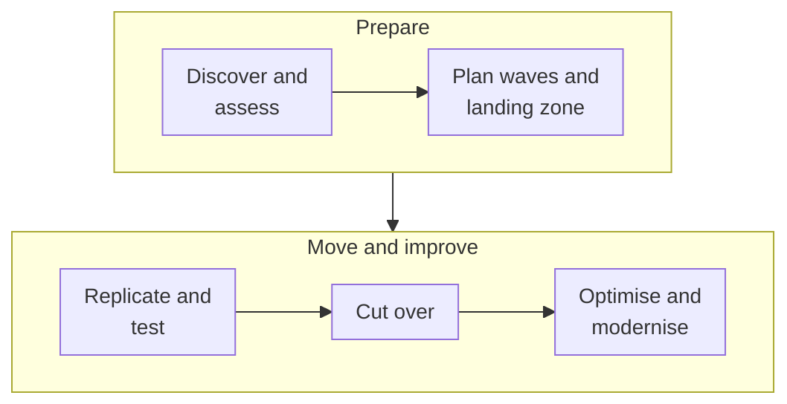

Most cloud migrations don't fail on the technology. They fail on the inventory nobody finished, the dependency
nobody mapped ("that server also runs the payroll export at month-end?"), and the cutover weekend that turned into a
cutover month. The providers offer free tooling for every stage, from discovery to the final switch. This post walks
through the migration stages, what each service is for, and how AWS, Azure and Google Cloud compare.

<!-- more -->

## What the migration category covers

A migration programme has a fairly standard shape, whichever cloud you're moving to:

The tooling maps onto those stages:

- **Discovery and assessment.** Inventory servers, map dependencies, size targets and build the business case.
- **Server migration.** Replicate VMs continuously, test in the cloud, then cut over with minimal downtime.
- **Database migration.** Move databases (same engine or a different one) with continuous replication.
- **Data transfer.** Move bulk files and object data, online or by shipping a device.

Before any of that, you need a landing zone (accounts or subscriptions, networking, identity, guardrails) to migrate
*into*. See the [identity and governance](/posts/cloud/cloud-identity-governance-services/) and
[networking](/posts/cloud/cloud-networking-services/) posts.

## The 6 Rs, briefly

Not every workload should be lifted and shifted. The common framework sorts each application into one of:

| Strategy | What it means | Typical tooling |
|---|---|---|
| Rehost | Move VMs as they are | Server migration services |
| Replatform | Small changes, e.g. move the database to a managed service | DMS, managed DBs |
| Refactor | Re-architect for cloud-native services | Containers, serverless |
| Repurchase | Replace with SaaS | — |
| Retire | Switch it off | — |
| Retain | Leave it where it is, for now | — |

In practice, most large migrations rehost the majority for speed, replatform databases where it's easy, and refactor
selectively later. Retiring is underrated. Discovery usually finds a surprising number of servers nobody uses.

## Discovery and assessment

Discovery tools scan your environment (usually agentless for VMware and Hyper-V), collect performance data over a few
weeks, map network dependencies between servers, and produce right-sized target recommendations with cost estimates.
That data drives two decisions: **what moves together** (dependency groups become migration waves) and **what it will
cost** (right-sized, not one-for-one).

Run discovery for at least two to four weeks to capture month-end and batch peaks. A one-week snapshot will undersize
the servers that matter most.



## Server migration (lift and shift)

Server migration services replicate disks continuously from source to cloud while the source keeps running. You can
launch test copies as often as you like without affecting production, and the final cutover is a short window: stop
the source, sync the last changes, start in the cloud, switch DNS.



The [migrating VMs post](/posts/cloud/azure/migration/migrating-vms/) and
[common migration issues](/posts/cloud/azure/migration/common-issues-during-migration/) go deeper on the Azure side.

> Test the cutover, not just the replication. Do at least one full rehearsal per wave: DNS change, app smoke tests,
> rollback. The runbook you write during the rehearsal is what gets you through the real weekend.
{: .prompt-tip }

## Database migration

Databases are usually the hardest part. The data is large, it changes constantly, and downtime is expensive. Database
migration services do an initial full load, then continuous change data capture to keep the target in sync until you're
ready to switch.

**Homogeneous** migrations (SQL Server to Azure SQL, MySQL to Cloud SQL) are mostly mechanical. **Heterogeneous** ones
(Oracle to PostgreSQL) need schema and code conversion, where stored procedures and engine-specific features dominate the
effort. The conversion tools, now increasingly AI-assisted, get you most of the way, but plan for manual work and
thorough testing.



See also the [migrating data post](/posts/cloud/azure/migration/migrating-data/) and the
[database services post](/posts/cloud/cloud-database-services/) for choosing targets.

## Bulk and offline data transfer

For file shares, archives and data lakes, online transfer services move data over the network with scheduling,
incremental sync and integrity checks. When the dataset is huge and bandwidth is limited, shipping a device can still be
faster. As a rough guide, 100 TB over a 1 Gbps link takes well over a week even at full utilisation.



> AWS no longer offers Snowball or other Snow Family devices to new customers. Use DataSync for online transfers, and
> Data Transfer Terminal or partners for physical moves.
{: .prompt-info }

## Comparing the providers

- **Azure Migrate** is the most integrated hub, with one place for discovery, assessment, business case and
  migration of servers, databases and web apps. It's a natural fit for VMware, Hyper-V and SQL Server estates.
- **AWS** has a deep toolset (Application Migration Service, DMS with schema conversion, AWS Transform for VMware) and
  extensive migration funding programmes through partners.
- **Google Cloud** offers Migration Center plus Migrate to Virtual Machines and DMS, with good support for migrating
  from other clouds as well as on-premises.

All three run funding and partner programmes for large migrations. Ask your account team before you start, because
the credits can be significant.

## Common pitfalls

- **Skipping the landing zone.** Migrating into a single flat subscription or account creates a mess you'll
  re-migrate later.
- **One-to-one sizing.** Copying on-premises specs over-provisions most workloads. Use performance-based sizing,
  then right-size after a month in the cloud.
- **Ignoring dependencies.** Moving one half of a chatty application pair adds latency and egress across the hybrid
  link. Migrate dependency groups together.
- **Licensing surprises.** Windows, SQL Server and Oracle licensing differs in the cloud. Check bring-your-own-licence
  rules and Azure Hybrid Benefit before you size.
- **No post-migration optimisation.** Lift and shift is a starting point. Schedule right-sizing, commitments and
  modernisation as part of the programme, not "later".

## Conclusion

A successful migration is mostly planning: discover thoroughly, group by dependency, prepare a landing zone, rehearse
every cutover, and optimise once you've landed. The native tools on each cloud handle the mechanics well and cost little
or nothing. The difference comes from how disciplined the programme is. A practical first step: run the provider's
discovery tool for a month against one data centre, and you'll have the inventory, dependency map and cost estimate to
plan from. All the services side by side are in the [Migration comparison](/cloud/#migration).

## References

- [AWS Application Migration Service](https://docs.aws.amazon.com/mgn/)
- [AWS Database Migration Service](https://docs.aws.amazon.com/dms/)
- [AWS Snowball Edge availability change](https://docs.aws.amazon.com/snowball/latest/developer-guide/snowball-edge-availability-change.html)
- [Azure Migrate documentation](https://learn.microsoft.com/azure/migrate/)
- [Azure Database Migration Service](https://learn.microsoft.com/azure/dms/)
- [Google Cloud Migration Center](https://cloud.google.com/migration-center/docs)
- [Migrate to Virtual Machines](https://cloud.google.com/migrate/virtual-machines/docs)
