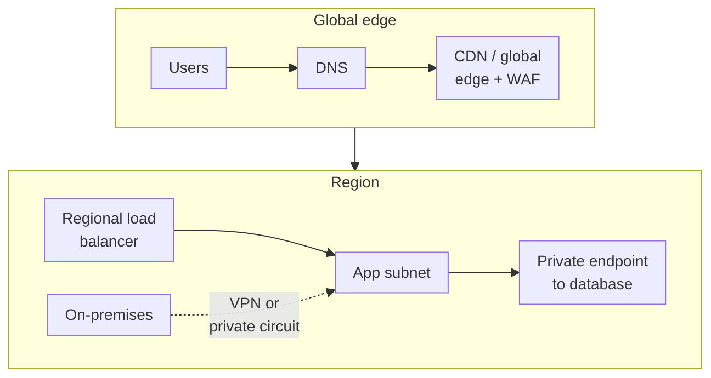

"It works from my machine but not from the VM" is almost always a networking problem: a route table, a security
group, a DNS zone nobody linked, a private endpoint resolving to a public IP. Cloud networking feels familiar
because it borrows the vocabulary of physical networks, but it behaves differently, and the three big providers
differ from each other in a few important ways. This post walks through the building blocks, what each is for, and
how AWS, Azure and Google Cloud implement them.

<!-- more -->

## What cloud networking covers

Networking connects everything else. The category breaks down into a handful of jobs:

1. **Isolation.** A private address space for your resources (VPC or VNet), split into subnets.
2. **Name resolution.** Public and private DNS.
3. **Traffic distribution.** Load balancers at layer 4 and layer 7, regional and global.
4. **Edge delivery.** CDNs and global entry points close to users.
5. **Hybrid connectivity.** VPNs and private circuits back to your data centre.
6. **Private access.** Reaching managed services without crossing the internet.

Security controls (firewalls, WAF, DDoS protection) are covered in the
[security services post](/posts/cloud/cloud-security-services/).

A typical production layout ties these together like this:

## Virtual networks

A VPC (AWS, Google) or VNet (Azure) is your private network in the cloud. You choose an IP range, carve it into
subnets, control routing, and decide what can reach the internet. Everything that needs a private IP (VMs,
Kubernetes nodes, private endpoints, managed databases with VNet integration) lives in one.

The biggest conceptual difference is scope. AWS and Azure networks are **regional**, so multi-region designs need
peering or a transit hub. Google's VPC is **global**: one network spans every region, and only subnets are regional.
That makes some multi-region architectures much simpler on Google Cloud. In exchange, you need to think carefully
about firewall rules and routes that now apply everywhere.

Plan your IP ranges as if you'll connect everything to everything eventually, because you will. Overlapping
`10.0.0.0/16` networks in every account and subscription are the single most painful thing to fix later.



For larger estates, the [hub-and-spoke architecture](/posts/cloud/azure/networking/hub-and-spoke-architecture/)
post walks through the common enterprise layout on Azure. The same ideas apply with Transit Gateway on AWS and
Shared VPC or Network Connectivity Center on Google Cloud.

## DNS

Every cloud offers managed authoritative DNS for public domains and private zones that resolve only inside your
networks. Private DNS matters more than people expect: private endpoints, internal load balancers and hybrid name
resolution all depend on it, and a missing zone link is behind a large share of "can't connect" tickets.

For hybrid setups you also need **conditional forwarding** both ways, so on-premises servers can resolve cloud
private zones and cloud workloads can resolve on-premises names. Each provider has a managed resolver for exactly
this.



## Load balancing

Load balancers spread traffic across healthy backends and are the front door of most applications. Two axes
matter: **layer** (L4 forwards TCP/UDP connections; L7 understands HTTP and can route by path, host or header,
terminate TLS and rewrite requests) and **scope** (regional versus global anycast).

AWS splits this by product: ALB for HTTP, NLB for raw TCP and UDP. Azure has separate L4 and L7 products plus Front
Door for global. Google's Cloud Load Balancing is one family with many modes, and its global external Application
Load Balancer, a single anycast IP fronting backends in many regions, is still something the others need two
products to replicate.



> Health checks decide everything. A load balancer that checks `/` on a page that renders fine while the database
> is down will keep sending traffic to broken instances. Point health checks at an endpoint that checks real
> dependencies, but keep it cheap.
{: .prompt-tip }

## CDN and global edge

A CDN caches content at edge locations close to users. That cuts latency, offloads your origin, and absorbs traffic
spikes and some attacks. Modern "edge" products go further: TLS termination, WAF, bot protection and small compute
functions running at the edge.



> On Azure, Azure CDN from Microsoft (classic) retires on 30 September 2027 and Front Door (classic) on
> 31 March 2027. New work should go straight to Front Door Standard or Premium.
{: .prompt-warning }

## Hybrid connectivity

Most organisations don't move everything to the cloud at once, so they need reliable connectivity back to
on-premises. There are two options, and most production setups use both:

- **Site-to-site VPN.** IPsec over the internet. Quick to set up and cheap, but throughput and latency
  depend on the internet path.
- **Private circuits.** Direct Connect, ExpressRoute, Cloud Interconnect. Dedicated bandwidth with
  predictable latency, provisioned through a colocation facility or carrier. It takes weeks to order, not
  minutes.

The common pattern is a private circuit for primary traffic with a VPN as failover, and BGP handling the switch. Be
aware that private circuits aren't encrypted by default. If you need encryption in transit, run IPsec or MACsec over
them.



## Private access to managed services

By default, many managed services (storage, databases, key vaults) have public endpoints. Locking them down
means giving them a **private IP inside your network** and turning off public access. All three providers support
this, with slightly different models.



On Azure, the difference between [private endpoints](/posts/cloud/azure/networking/private-endpoints/) and
[service endpoints](/posts/cloud/azure/networking/service-endpoints/) trips a lot of people up. Both posts are worth
a read.

## Common pitfalls

- **Overlapping CIDRs.** Fixing them later means re-IPing workloads. Keep a central IP plan from day one.
- **NAT gateway surprises.** Private subnets reach the internet through NAT, which charges per GB. A chatty
  workload pulling container images or calling external APIs can quietly run up a big bill. Use VPC
  endpoints and private registries where you can.
- **Private endpoint DNS.** A private endpoint without the right private DNS zone linked resolves to the
  public IP, so traffic either fails or leaves your network.
- **Cross-zone and cross-region transfer.** Traffic between zones and regions isn't free. Chatty microservices
  spread across zones can generate surprisingly large transfer charges.
- **Asymmetric routing through firewalls.** Forcing traffic through a hub firewall in one direction but not
  the other breaks stateful inspection. Model both directions when you add routes.

## Conclusion

The building blocks are the same on every cloud: a private network, DNS, load balancers, an edge layer, hybrid links
and private endpoints. The differences that matter are Google's global VPC and global load balancer, and the
product boundaries on AWS and Azure. Get the IP plan and DNS design right early and most networking problems never
happen. Next step: draw your current network on one page (ranges, peerings, DNS zones, egress paths). If you
can't, that's the first thing to fix. Every service side by side is in the
[Networking comparison](/cloud/#networking).

## References

- [Amazon VPC documentation](https://docs.aws.amazon.com/vpc/)
- [Elastic Load Balancing documentation](https://docs.aws.amazon.com/elasticloadbalancing/)
- [Azure Virtual Network documentation](https://learn.microsoft.com/azure/virtual-network/)
- [Azure CDN (classic) retirement FAQ](https://learn.microsoft.com/azure/cdn/classic-cdn-retirement-faq)
- [Google Cloud VPC overview](https://cloud.google.com/vpc/docs/overview)
- [Cloud Load Balancing overview](https://cloud.google.com/load-balancing/docs/load-balancing-overview)
- [Private Service Connect](https://cloud.google.com/vpc/docs/private-service-connect)
