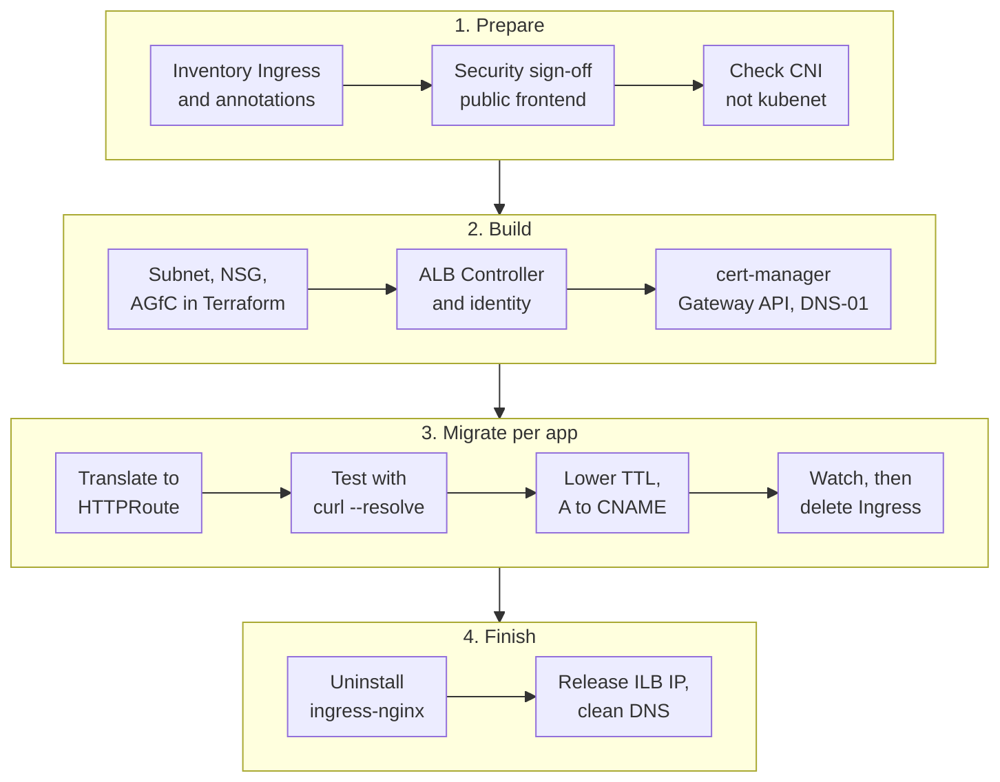

The community ingress-nginx project stopped getting maintenance in March 2026. That means no more CVE fixes for the component that terminates TLS for every app on your cluster. If your AKS cluster still runs the Helm-installed controller behind an internal load balancer, you need a plan, and Microsoft's list of options points straight at **Application Gateway for Containers** (AGfC). This post is that plan. I'll walk through how the two designs actually move a packet from a browser to a pod, why "private IP" turns into "CNAME", how your Ingress annotations become Gateway API routes, how TLS works (including encrypting all the way to the pod), and the order I'd run the migration in.

<!-- more -->

## The starting point and the target

Here's the setup this plan assumes, because it's the most common one I see in enterprise AKS clusters:

- **Today:** community `kubernetes/ingress-nginx`, installed with Helm, exposed through an Azure **internal** Standard Load Balancer. App hostnames such as `orders.corp.example.com` are A records in a Private DNS zone pointing at a private IP like `10.20.0.100`. Users reach it over VPN or ExpressRoute. cert-manager issues the TLS certificates.
- **Target:** Application Gateway for Containers, deployed **bring-your-own (BYO)** with Terraform, configured from the cluster with the **Gateway API** (`Gateway` + `HTTPRoute`), certificates still from cert-manager.

Before anything else, here's the constraint that shapes the whole plan.

> Application Gateway for Containers frontends don't support private IP addresses today. Each frontend gets a public, Azure-generated FQDN (`*.fzXX.alb.azure.com`) that you point a CNAME at. If an app must stay reachable only from your private network, AGfC is a public endpoint that you lock down. It is not a drop-in replacement for an internal load balancer.
{: .prompt-warning }

The plan below takes the "public frontend, locked down" route: NSG allow-lists on the AGfC association subnet plus a WAF policy. Your security team needs to sign off on that before you start, not after the first cutover. If they won't accept a public endpoint for some apps, those apps belong on the AKS application routing Gateway API implementation (Istio-based, internal LB) instead. The nice part is that the `HTTPRoute` manifests are the same either way. Only the `gatewayClassName` and the `Gateway` change.

## Layer 4 vs layer 7: where the routing decision happens

People often describe this migration as moving "from a network-layer load balancer to an application-layer one". That's half right, and the half that's wrong matters when you debug it.

NGINX itself is a layer 7 proxy. It reads the `Host` header, matches paths and terminates TLS. What changes is **where** the layer 7 work happens and **what Azure sees**:

| | ingress-nginx on an internal LB | Application Gateway for Containers |
|---|---|---|
| Azure resource in the path | Standard Load Balancer (internal) | AGfC frontend (Azure-managed proxy) |
| OSI layer of the Azure piece | Layer 4 (TCP 5-tuple only) | Layer 7 (HTTP, TLS, headers, paths) |
| Where TLS and routing happen | Inside the cluster, in NGINX pods | Outside the cluster, in the Azure data plane |
| Who scales the proxy | You (HPA, replicas, node capacity) | Azure (autoscaling) |
| Hops inside the cluster | LB → node → kube-proxy → NGINX pod → app pod | AGfC → app pod IP directly |
| Client address | Private IP you choose | Public FQDN you CNAME to |
| Config surface | `Ingress` + `nginx.ingress.kubernetes.io/*` annotations | `Gateway`/`HTTPRoute` + `alb.networking.azure.io` policies |
| Ports | Any (TCP/UDP via ConfigMaps) | 80 and 443 only, HTTP(S)/gRPC/WebSocket |
| WAF | Not built in (DIY ModSecurity at best) | Azure WAF policy |

The Azure Load Balancer in front of NGINX never sees a URL. It hashes the 5-tuple and hands TCP packets to a node. All the intelligence lives in pods that share CPU and memory with your workloads, so when NGINX falls over at 2 a.m. it's a cluster problem. With AGfC, Azure's own proxy reads the HTTP request, so routing, TLS, retries and WAF happen before the traffic enters your VNet's pod network.

## How a packet gets from the browser to the pod: NGINX

Step through the animation. The checkbox switches between TLS ending at NGINX and NGINX re-encrypting to the pod.



Two details in this path catch people out. First, with the default `externalTrafficPolicy: Cluster`, the load balancer can send a connection to a node that has no NGINX pod. kube-proxy then forwards it to another node and SNATs it, so NGINX sees a node IP instead of the client IP. That's why most internal NGINX installs set `externalTrafficPolicy: Local`. Second, NGINX doesn't use the app's ClusterIP. It reads the Service's endpoints and proxies straight to pod IPs, which is also what AGfC does.

## How a packet gets from the browser to the pod: AGfC

Same request, new path. Note the control-plane step at the start: the ALB Controller in the cluster only pushes configuration. It never carries traffic.



There's no NodePort, no kube-proxy hop and no ingress pod in the path. AGfC's data plane sits in a delegated subnet in your VNet and proxies straight to pod IPs. That works with Azure CNI and with CNI Overlay, where Azure extends the overlay routing domain to the AGfC subnet. **Kubenet isn't supported**, so if your cluster is still on kubenet, the IPAM upgrade to CNI Overlay becomes step zero of the migration.

## Private IP vs CNAME: what changes in DNS

This is the part that surprises application teams, because their URL doesn't change but everything behind it does.

With NGINX, you own the IP. You reserve `10.20.0.100` on the internal LB Service, create `orders.corp.example.com A 10.20.0.100` in a Private DNS zone, and every host on the corporate network resolves it to a private address and routes to it over ExpressRoute. Firewall rules, Front Door origins and partner allow-lists all reference that IP.

With AGfC, you never get an IP you control. Each frontend gets a generated FQDN, and you publish a CNAME:

```text
# Before (Private DNS zone corp.example.com)
orders    A      10.20.0.100

# After (public zone example.com, or the private zone if clients use it)
orders    CNAME  b7x2k9qf3h.fz42.alb.azure.com.
```

A few consequences follow from that:

- **The traffic path moves to the internet.** Corporate clients resolve the CNAME through public DNS and leave through your internet egress, not ExpressRoute. That's why the NSG allow-list on the association subnet should contain your corporate **egress NAT IPs**, plus the NAT gateway IPs of any Azure workloads that call the app.
- **No apex records.** You can't CNAME a zone apex (`example.com`), and Azure DNS alias records don't target AGfC frontends. Apex domains need a redirect, or Azure Front Door in front.
- **Use BYO frontends for stable names.** In ALB-managed mode, deleting a `Gateway` deletes its frontend, and recreating it gives you a new FQDN. In BYO mode the frontend is a Terraform resource, so the FQDN survives redeploys and your CNAME stays valid.
- **A and CNAME can't coexist.** The cutover is "delete the A record, create the CNAME". Lower the TTL days ahead so that gap and any rollback are quick.

## The NGINX routes we had

A typical Ingress from the old setup: TLS from cert-manager, an `/api` prefix stripped with a regex, a longer timeout, sticky sessions and an HTTPS redirect.

```yaml
apiVersion: networking.k8s.io/v1
kind: Ingress
metadata:
  name: orders
  namespace: orders
  annotations:
    cert-manager.io/cluster-issuer: corp-ca
    nginx.ingress.kubernetes.io/ssl-redirect: "true"
    nginx.ingress.kubernetes.io/use-regex: "true"
    nginx.ingress.kubernetes.io/rewrite-target: /$2
    nginx.ingress.kubernetes.io/proxy-read-timeout: "120"
    nginx.ingress.kubernetes.io/proxy-body-size: "20m"
    nginx.ingress.kubernetes.io/affinity: cookie
spec:
  ingressClassName: nginx
  tls:
    - hosts: [orders.corp.example.com]
      secretName: orders-tls
  rules:
    - host: orders.corp.example.com
      http:
        paths:
          - path: /api(/|$)(.*)
            pathType: ImplementationSpecific
            backend:
              service: { name: orders-api, port: { number: 8080 } }
          - path: /
            pathType: Prefix
            backend:
              service: { name: orders-web, port: { number: 80 } }
```

And the controller's Helm values that made it internal:

```yaml
controller:
  replicaCount: 3
  service:
    externalTrafficPolicy: Local
    annotations:
      service.beta.kubernetes.io/azure-load-balancer-internal: "true"
      service.beta.kubernetes.io/azure-load-balancer-ipv4: "10.20.0.100"
      service.beta.kubernetes.io/azure-load-balancer-health-probe-request-path: /healthz
```

Everything interesting lives in annotations. That's the core problem with Ingress: the spec only covers host and path, so every controller grew its own annotation dialect, and none of it carries over.

## The AGfC routes we'll have

### Infrastructure first (BYO, Terraform)

The platform team owns the AGfC resource, its association to a delegated `/24` subnet, and one frontend per Gateway:

```hcl
resource "azurerm_subnet" "agfc" {
  name                 = "snet-agfc"
  resource_group_name  = azurerm_resource_group.network.name
  virtual_network_name = azurerm_virtual_network.aks.name
  address_prefixes     = ["10.20.8.0/24"] # must be exactly /24

  delegation {
    name = "agfc"
    service_delegation {
      name    = "Microsoft.ServiceNetworking/trafficControllers"
      actions = ["Microsoft.Network/virtualNetworks/subnets/join/action"]
    }
  }
}

resource "azurerm_application_load_balancer" "agfc" {
  name                = "agfc-prod-cin"
  resource_group_name = azurerm_resource_group.agfc.name
  location            = "centralindia"
}

resource "azurerm_application_load_balancer_subnet_association" "agfc" {
  name                         = "assoc-aks-prod"
  application_load_balancer_id = azurerm_application_load_balancer.agfc.id
  subnet_id                    = azurerm_subnet.agfc.id
}

resource "azurerm_application_load_balancer_frontend" "orders" {
  name                         = "fe-orders"
  application_load_balancer_id = azurerm_application_load_balancer.agfc.id
}

output "orders_frontend_fqdn" {
  value = azurerm_application_load_balancer_frontend.orders.fully_qualified_domain_name
}
```

Put the subnet in the **same VNet as the cluster**. With CNI Overlay, an AGfC in a peered VNet isn't supported, even in the same region. The ALB Controller's managed identity needs the built-in **AppGw for Containers Configuration Manager** role on the AGfC resource group and **Network Contributor** on the association subnet. Owner and Contributor aren't enough, because the Configuration Manager role carries data actions they don't have. Install the controller with the AKS add-on or the Helm chart, as covered in Microsoft's quickstarts.

### NSG on the association subnet

This is what turns "public" into "public, but only for us". For associations created on or after 23 April 2026, NSGs are fully enforced on the association subnet, inbound and outbound:

```hcl
resource "azurerm_network_security_rule" "allow_corp_https" {
  name                        = "allow-corp-egress-443"
  priority                    = 100
  direction                   = "Inbound"
  access                      = "Allow"
  protocol                    = "Tcp"
  source_address_prefixes     = ["203.0.113.0/28", "198.51.100.16/29"] # corporate egress IPs
  source_port_range           = "*"
  destination_address_prefix  = "*"
  destination_port_ranges     = ["80", "443"]
  resource_group_name         = azurerm_resource_group.network.name
  network_security_group_name = azurerm_network_security_group.agfc.name
}

resource "azurerm_network_security_rule" "allow_azure_lb" {
  name                        = "allow-azureloadbalancer"
  priority                    = 110
  direction                   = "Inbound"
  access                      = "Allow"
  protocol                    = "*"
  source_address_prefix       = "AzureLoadBalancer"
  source_port_range           = "*"
  destination_address_prefix  = "*"
  destination_port_range      = "*"
  resource_group_name         = azurerm_resource_group.network.name
  network_security_group_name = azurerm_network_security_group.agfc.name
}
```

> Forget the `AzureLoadBalancer` rule and a "deny all inbound" rule breaks the gateway itself. If you also deny outbound, explicitly allow the pod CIDR, or health probes fail and every backend shows unhealthy.
{: .prompt-danger }

### Gateway (owned by the platform team)

```yaml
apiVersion: gateway.networking.k8s.io/v1
kind: Gateway
metadata:
  name: gw-orders
  namespace: ingress-agfc
  annotations:
    alb.networking.azure.io/alb-id: /subscriptions/<sub-id>/resourceGroups/rg-agfc-prod/providers/Microsoft.ServiceNetworking/trafficControllers/agfc-prod-cin
    cert-manager.io/cluster-issuer: letsencrypt-dns01
spec:
  gatewayClassName: azure-alb-external
  addresses:
    - type: alb.networking.azure.io/alb-frontend
      value: fe-orders
  listeners:
    - name: http
      port: 80
      protocol: HTTP
      hostname: orders.example.com
      allowedRoutes:
        namespaces: { from: All }
    - name: https
      port: 443
      protocol: HTTPS
      hostname: orders.example.com
      tls:
        mode: Terminate
        certificateRefs:
          - kind: Secret
            name: orders-example-com-tls
      allowedRoutes:
        namespaces:
          from: Selector
          selector:
            matchLabels:
              agfc.example.com/expose: "true"
```

### HTTPRoutes (owned by the app team)

The regex rewrite becomes a prefix replacement, the timeout moves into the route, and the redirect becomes its own route on the port 80 listener:

```yaml
apiVersion: gateway.networking.k8s.io/v1
kind: HTTPRoute
metadata:
  name: orders
  namespace: orders
spec:
  parentRefs:
    - name: gw-orders
      namespace: ingress-agfc
      sectionName: https
  hostnames: [orders.example.com]
  rules:
    - matches:
        - path: { type: PathPrefix, value: /api }
      filters:
        - type: URLRewrite
          urlRewrite:
            path:
              type: ReplacePrefixMatch
              replacePrefixMatch: /
      backendRefs:
        - name: orders-api
          port: 8080
      timeouts:
        request: 120s
    - matches:
        - path: { type: PathPrefix, value: / }
      backendRefs:
        - name: orders-web
          port: 80
---
apiVersion: gateway.networking.k8s.io/v1
kind: HTTPRoute
metadata:
  name: orders-https-redirect
  namespace: orders
spec:
  parentRefs:
    - name: gw-orders
      namespace: ingress-agfc
      sectionName: http
  hostnames: [orders.example.com]
  rules:
    - filters:
        - type: RequestRedirect
          requestRedirect:
            scheme: https
            statusCode: 301
```

Anything the Gateway API doesn't model goes into AGfC's own policy resources, attached by `targetRef`. Sticky sessions and the health probe look like this:

```yaml
apiVersion: alb.networking.azure.io/v1
kind: RoutePolicy
metadata:
  name: orders-affinity
  namespace: orders
spec:
  targetRef:
    group: gateway.networking.k8s.io
    kind: HTTPRoute
    name: orders
  default:
    sessionAffinity:
      affinityType: application-cookie
      cookieName: orders-session
      cookieDuration: 3600s
---
apiVersion: alb.networking.azure.io/v1
kind: HealthCheckPolicy
metadata:
  name: orders-api-health
  namespace: orders
spec:
  targetRef:
    group: ""
    kind: Service
    name: orders-api
    namespace: orders
  default:
    interval: 5s
    timeout: 3s
    healthyThreshold: 1
    unhealthyThreshold: 3
    port: 8080
    http:
      host: orders.example.com
      path: /healthz
      match:
        statusCodes:
          - start: 200
            end: 299
```

Define the `HealthCheckPolicy` explicitly. Without one, AGfC uses the pod's readiness probe, and without that it sends `GET /` with `Host: localhost`. Plenty of apps return 404 or a redirect for that, and you end up with a gateway that says every backend is down.

### Annotation mapping cheat sheet

| ingress-nginx annotation | AGfC with Gateway API |
|---|---|
| `ssl-redirect` | `RequestRedirect` filter on a port 80 route |
| `rewrite-target` (regex) | `URLRewrite` with `ReplacePrefixMatch`. No regex capture groups, so restructure paths. |
| `proxy-read-timeout` | `HTTPRoute` `timeouts.request` (or `RoutePolicy`) |
| `affinity: cookie` | `RoutePolicy` `sessionAffinity` |
| `backend-protocol: HTTPS` | `BackendTLSPolicy` |
| `canary` / `canary-weight` | Weighted `backendRefs` on the same rule |
| `whitelist-source-range` | NSG on the association subnet (gateway-wide) or WAF custom rules |
| `ssl-passthrough` | Not supported |
| `configuration-snippet`, `server-snippet`, `auth-url`, `limit-rps` | No equivalent. Move the logic into the app, API Management or WAF rules. |
| `tcp-services` / `udp-services` ConfigMaps | Not supported (only ports 80 and 443) |

For bulk translation, run [`ingress2gateway`](https://github.com/kubernetes-sigs/ingress2gateway) with the ingress-nginx provider, then set `gatewayClassName: azure-alb-external` and review every line. It gives you a starting point, not something to apply blind. Microsoft's own migration utility targets AGIC annotations, not NGINX ones.

## TLS: offload, re-encrypt, and terminating at the pod

### Certificates: keep cert-manager, change the challenge

AGfC reads listener certificates from **Kubernetes Secrets** in the Gateway's namespace. The Key Vault Secrets Store CSI driver isn't supported for this, so cert-manager is a good fit. Two changes:

1. Enable cert-manager's Gateway API support (`enableGatewayAPI: true` in its config, or `--enable-gateway-api` on older releases). It then reads the `cert-manager.io/cluster-issuer` annotation on the `Gateway` and issues one certificate per HTTPS listener hostname.
2. Use **DNS-01**, not HTTP-01. Your NSG only lets corporate IPs reach the frontend, so Let's Encrypt's HTTP-01 validation can't get in. DNS-01 against your Azure DNS zone (with workload identity) doesn't care about the NSG.

If your apps use an internal CA today, that still works. The frontend is public, but the certificate only has to be trusted by your users' browsers.

### Mode 1: TLS offload at AGfC

The listener's `tls.mode: Terminate` decrypts at the gateway and sends plain HTTP to the pod. This is the simplest setup and it's what most of the NGINX installs did. The hop from the AGfC subnet to the pod stays inside your VNet, but it's cleartext, and some compliance regimes won't accept that.

### Mode 2: end-to-end TLS (re-encrypt to the pod)

AGfC terminates the client's TLS, inspects and routes the request (which WAF needs), then opens a **new** TLS connection to the pod. You enable it with a `BackendTLSPolicy` on the Service:

```yaml
apiVersion: alb.networking.azure.io/v1
kind: BackendTLSPolicy
metadata:
  name: orders-api-tls
  namespace: orders
spec:
  targetRef:
    group: ""
    kind: Service
    name: orders-api
    namespace: orders
  default:
    sni: orders-api.orders.svc.cluster.local
    ports:
      - port: 8443
    verify:
      caCertificateRef:
        group: ""
        kind: Secret
        name: internal-ca
      subjectAltName: orders-api.orders.svc.cluster.local
```

On the pod side, cert-manager issues a certificate for `orders-api.orders.svc.cluster.local` from an internal `ClusterIssuer`, and the app (or a sidecar) serves HTTPS on 8443 with it. Put the CA certificate in the `internal-ca` Secret so AGfC can verify the pod's certificate. Without `verify`, you get encryption but no assurance you're talking to the right backend. When a `BackendTLSPolicy` targets the Service, default health probes switch to HTTPS too.

If you need the client to prove who it is to the pod as well, AGfC supports mutual TLS to the frontend, to the backend (`clientCertificateRef` in the same policy), or both.

### What about true passthrough?

With NGINX you could use `ssl-passthrough` and let the pod see the client's original TLS session. **AGfC can't do that.** It supports HTTPS and gRPC listeners on 80/443 and has no `TLSRoute`. If a workload genuinely needs the client's TLS to end in the pod (client-certificate pinning in the app, say, or a non-HTTP protocol over TLS), it doesn't belong on AGfC. Expose it with its own internal `LoadBalancer` Service, or put it behind the Istio-based Gateway API option. For everything else, re-encryption with `verify` gives you encryption on every hop and still lets the gateway see the request.

## The migration plan



**Phase 1: Prepare.** Dump every Ingress and its annotations, because the annotations decide how hard each app is:

```bash
kubectl get ingress -A -o json | jq -r '
  .items[] | select(.spec.ingressClassName=="nginx") |
  [.metadata.namespace, .metadata.name,
   ([.spec.rules[].host] | join(",")),
   ((.metadata.annotations // {}) | keys | map(select(startswith("nginx."))) | join(" "))]
  | @tsv' | column -t
```

Sort the apps into three buckets: clean (host/path only), translatable (annotations in the mapping table) and blocked (snippets, passthrough, TCP, custom auth). Migrate the clean ones first. Get the security sign-off on the public frontend now, and check `az aks show --query networkProfile.networkPlugin` while you're at it.

**Phase 2: Build alongside.** Provision AGfC with Terraform, install the ALB Controller and enable cert-manager's Gateway API support. NGINX keeps serving everything. Both controllers run happily side by side because each only watches its own class.

**Phase 3: Migrate one hostname at a time.** Deploy the `HTTPRoute` next to the existing Ingress, and test against the frontend before touching DNS:

```bash
FQDN=$(kubectl get gateway gw-orders -n ingress-agfc -o jsonpath='{.status.addresses[0].value}')
IP=$(dig +short "$FQDN" | tail -1)
curl -sv --resolve orders.example.com:443:"$IP" https://orders.example.com/api/health
```

Check status codes, redirects, response headers, session cookies and long-running requests. AGfC's default request timeout is 60 seconds and it applies even while data is streaming, so large downloads need a longer `timeouts.request`. Once DNS TTLs are down to 60 seconds and the old TTL has fully expired, swap the A record for the CNAME. Keep the Ingress and NGINX running. Rollback is just putting the A record back.

**Phase 4: Decommission.** After every hostname has run on AGfC for a week or two without surprises, delete the old Ingress objects, `helm uninstall` ingress-nginx, and remove the internal LB IP from any firewall rules and documentation that still mention it.

## Common pitfalls

- **Assuming the internal IP survives.** It doesn't. Anything that pinned `10.20.0.100` (Front Door origins, firewall rules, partner allow-lists, hard-coded `/etc/hosts` entries) has to be found in Phase 1, not after the cutover.
- **Default probes against the wrong path.** `GET /` with `Host: localhost` returns 404 on many apps. Write a `HealthCheckPolicy` for every backend.
- **Regex paths.** NGINX regex paths with capture groups have no direct equivalent. Expect to simplify some routes, and test the edge cases (`/api`, `/api/`, `/apix`).
- **HTTP-01 behind an allow-list.** The certificate issuance hangs at `pending` forever. Switch to DNS-01 before the first Gateway.
- **Asymmetric routing.** If a `0.0.0.0/0` route from ExpressRoute is propagated to the AGfC subnet, return traffic for the public frontend goes the wrong way. Disable gateway route propagation on that subnet's route table.
- **Subnet sizing.** It has to be exactly `/24`, one per AGfC deployment. Carve it out of the VNet early, because finding a free `/24` in a mature hub-spoke network can take a change request.
- **Cost model.** You're trading NGINX pods (paid for as node capacity) for hourly AGfC, frontend and association charges plus capacity units. Run the numbers per environment. Dev and test clusters often don't need their own AGfC.

## Conclusion

Moving from ingress-nginx to Application Gateway for Containers moves your layer 7 proxy out of the cluster and into Azure. You lose a component you had to patch, scale and babysit, and you gain WAF, autoscaling and direct-to-pod routing. The price is the private IP: you trade an internal A record for a public CNAME behind an NSG, and that needs a security conversation before any YAML gets written. My advice is to start with the inventory script above. Within an hour you'll know which apps are clean, which need translation, and which can't move to AGfC at all, and that list is the real migration plan.

Related reading on this blog: [AKS Networking](/posts/cloud/azure/containers/aks/aks-networking/), [Azure Application Gateway](/posts/cloud/azure/networking/azure-application-gateway/), [Azure Network Security Groups](/posts/cloud/azure/networking/azure-network-security-groups/) and [Kubernetes Network Policies](/posts/devops/orchestration/kubernetes/kubernetes-network-policies/).

## References

- [What is Application Gateway for Containers?](https://learn.microsoft.com/en-us/azure/application-gateway/for-containers/overview)
- [Application Gateway for Containers components](https://learn.microsoft.com/en-us/azure/application-gateway/for-containers/application-gateway-for-containers-components)
- [Container networking with Application Gateway for Containers](https://learn.microsoft.com/en-us/azure/application-gateway/for-containers/container-networking)
- [End-to-end TLS with Application Gateway for Containers (Gateway API)](https://learn.microsoft.com/en-us/azure/application-gateway/for-containers/how-to-end-to-end-tls-gateway-api)
- [Custom health probe for Application Gateway for Containers](https://learn.microsoft.com/en-us/azure/application-gateway/for-containers/custom-health-probe)
- [Session affinity in Application Gateway for Containers](https://learn.microsoft.com/en-us/azure/application-gateway/for-containers/session-affinity)
- [Migrate from AGIC to Application Gateway for Containers](https://learn.microsoft.com/en-us/azure/application-gateway/for-containers/migrate-from-agic-to-agc)
- [Migrate from application routing ingress-nginx to the Gateway API implementation](https://learn.microsoft.com/en-us/azure/aks/app-routing-nginx-to-gateway-api-migration)
- [Application Gateway for Containers FAQ](https://learn.microsoft.com/en-us/azure/application-gateway/for-containers/faq)
- [Ingress NGINX retirement announcement](https://www.kubernetes.dev/blog/2025/11/12/ingress-nginx-retirement/)
- [ingress2gateway](https://github.com/kubernetes-sigs/ingress2gateway)
