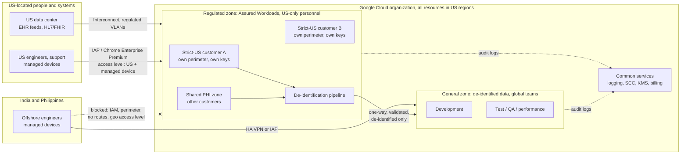
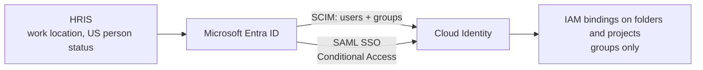
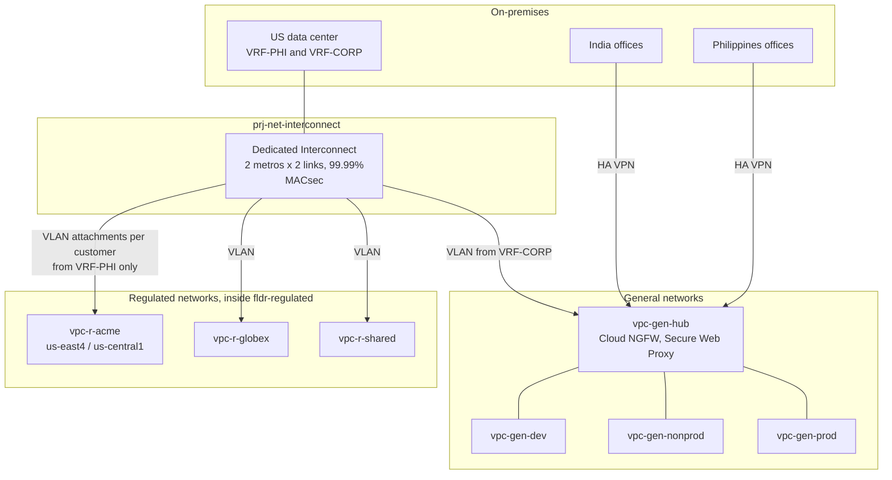
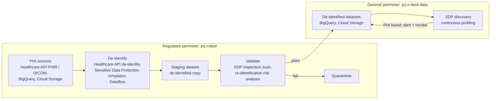

This is the design I would put in front of an architecture review board for a healthcare company moving
to Google Cloud. The company handles protected health information (PHI), has engineering teams in the
**United States, India and the Philippines**, and some customers contractually require that their data is
**stored in and accessed only from the US**. The offshore teams still need to develop, test and support
the platform, so they work in environments that hold only **de-identified** data.

<!-- more -->

This post assumes familiarity with the building blocks of a landing zone. If you need a refresher, start
with [GCP Landing Zone: Core Concepts and Google's Recommendations](/posts/cloud/gcp/gcp-landing-zone-concepts/).
{: .prompt-info }

## Index
{: #index }

- [Requirements](#requirements)
- [Assumptions and decisions](#assumptions)
- [Design principles](#principles)
- [Architecture overview](#overview)
- [Resource hierarchy](#hierarchy)
- [Identity and access](#identity)
- [Enforcing "US-only access" in layers](#us-only-access)
- [Network architecture](#network)
- [The de-identification pipeline](#deid)
- [Security and compliance controls](#security)
- [Logging, monitoring and the SOC](#logging)
- [Cost management](#cost)
- [Infrastructure as code and operating model](#iac)
- [Residual risks and open decisions](#risks)
- [Rollout plan](#rollout)
- [References](#references)

## Requirements
{: #requirements }

| # | Requirement | Source |
|---|---|---|
| R1 | PHI is protected to HIPAA standards; a Business Associate Agreement (BAA) with Google is in place and only BAA-covered services process PHI | Regulation |
| R2 | For *strict-US customers*, PHI is **stored only in US regions** and **accessed only by people located in the US**, including Google support staff | Customer contracts |
| R3 | Teams in India and the Philippines can develop, test and troubleshoot using **de-identified** data, without any path to PHI | Business |
| R4 | One customer's PHI must not be reachable from another customer's environment | Customer contracts, least privilege |
| R5 | Every access to PHI is attributable to a named person and auditable for at least six years | HIPAA documentation retention, contracts |
| R6 | The company's US data center and offices connect privately; cloud-only (zero-trust) access is supported too | Business |
| R7 | Spend is attributable by customer, environment and team | Finance |

## Assumptions and decisions
{: #assumptions }

These were agreed with the stakeholders before the design started:

- **All Google Cloud data stays in US regions, including the de-identified environments.** Offshore
  engineers work remotely on de-identified projects hosted in the US. Nothing has to leave the US, so
  residency becomes a single organization-wide rule instead of a per-folder exception.
- **Microsoft Entra ID is the identity provider**, federated to Cloud Identity.
- **Strict-US customers get dedicated folders**, projects, encryption keys and service perimeters. Customers
  without the restriction share a separate US PHI zone.
- **Both connectivity models are supported**: Dedicated Interconnect from the US data center and HA VPN
  from offices, *and* cloud-only access through Identity-Aware Proxy, Chrome Enterprise Premium and
  Cloud Workstations.
- Primary region **`us-east4`** (Northern Virginia), disaster recovery region **`us-central1`** (Iowa).

Whether de-identified data derived from a strict-US customer's PHI may be used offshore is a **contract
question, not a technical one**. HIPAA treats properly de-identified data as no longer PHI, but a contract
can still forbid it. The design keeps a per-customer flag. If it is off, that customer's data never feeds
the offshore environments, and offshore teams use synthetic data for that customer instead.
{: .prompt-warning }

## Design principles
{: #principles }

1. **Two worlds, one organization.** A *regulated zone* (PHI, US-only people) and a *general zone*
   (de-identified data, global teams) share one organization, identity system and toolchain, but no
   network path, no perimeter and no data path except one controlled, one-way de-identification
   pipeline.
2. **Defense in depth for the residency promise.** No single control (IAM, network, geography, device)
   is trusted to keep non-US people away from PHI. Each layer assumes the one before it failed.
3. **Isolation by customer where contracts demand it,** by project and dataset everywhere else.
4. **Guardrails over gatekeeping.** Offshore teams get self-service in the general zone. The regulated
   zone is changed only through reviewed pipelines and just-in-time access.
5. **Everything from code.** The hierarchy, policies, perimeters and networks are Terraform, deployed by
   pipelines whose identities are themselves zoned.

## Architecture overview
{: #overview }

## Resource hierarchy
{: #hierarchy }

I start from Google's environment-oriented blueprint (bootstrap, common, networking, environments) and
add a **data-classification split at the top**: regulated or general. Data classification is what changes
policy here: residency rules, perimeters, who may hold roles and which services are allowed. In Google's
terms this combines the *environment-oriented* and *region/regulation-oriented* patterns.

```mermaid
flowchart TB
    ORG["Organization: example-health.com<br/>gcp.resourceLocations = in:us-locations"]
    ORG --> BOOT["fldr-bootstrap"]
    ORG --> COM["fldr-common"]
    ORG --> NET["fldr-network"]
    ORG --> REG["fldr-regulated<br/>Assured Workloads: Healthcare and Life Sciences with Support"]
    ORG --> GEN["fldr-general"]
    ORG --> SBX["fldr-sandbox"]

    BOOT --> B1["prj-b-seed"]
    BOOT --> B2["prj-b-cicd-general"]
    BOOT --> B3["prj-b-cicd-regulated"]

    COM --> C1["prj-c-logging-general"]
    COM --> C2["prj-c-scc"]
    COM --> C3["prj-c-billing-export"]

    NET --> N1["prj-net-hub-general"]
    NET --> N2["prj-net-interconnect"]
    NET --> N3["prj-net-dns"]

    REG --> RC["fldr-reg-common<br/>prj-r-logging, prj-r-kms, prj-r-deid"]
    REG --> RS["fldr-reg-shared-phi<br/>prj-r-shared-svpc, prj-r-shared-prod, prj-r-shared-uat"]
    REG --> RA["fldr-reg-cust-acme<br/>prj-r-acme-svpc, prj-r-acme-prod, prj-r-acme-kms"]
    REG --> RB["fldr-reg-cust-globex<br/>prj-r-globex-svpc, prj-r-globex-prod, prj-r-globex-kms"]

    GEN --> GP["fldr-gen-production<br/>non-PHI corporate apps"]
    GEN --> GN["fldr-gen-nonproduction<br/>test, QA, perf on de-identified data"]
    GEN --> GD["fldr-gen-development<br/>dev on de-identified or synthetic data"]
```

| Folder | Holds | Key policies set at this level |
|---|---|---|
| Organization | Everything | `gcp.resourceLocations: in:us-locations`, the Google baseline constraints, domain-restricted sharing, no SA keys, SCC, org log sinks |
| `fldr-bootstrap` | Seed project, Terraform state, **separate** pipelines for regulated and general | Only the platform team; regulated pipeline service account is the only identity with write access to `fldr-regulated` |
| `fldr-common` | Org-wide logging (non-PHI), SCC, billing export | Security team and finance only |
| `fldr-network` | Hub for the general zone, Interconnect project, DNS | Network team; regulated network hosts live *inside* `fldr-regulated` |
| `fldr-regulated` | All PHI | Assured Workloads folder; IAM only for US-only groups; `gcp.restrictNonCmekServices`; `gcp.restrictServiceUsage` limited to BAA-covered services; stricter VM, SQL and storage constraints |
| `fldr-reg-cust-<name>` | One strict-US customer: own Shared VPC host, workload projects, key project | Own VPC-SC perimeter, own CMEK key ring, IAM only for that customer's US support group |
| `fldr-reg-shared-phi` | PHI for customers without the US-only clause | Shared perimeter; customer isolation by project, dataset and IAM |
| `fldr-general` | De-identified and non-PHI workloads | Global groups; standard blueprint constraints; Sensitive Data Protection discovery enabled |
| `fldr-sandbox` | Personal experiments | No data imports from other folders, budgets with hard caps, auto-deletion |

**Why the regulated network hosts sit inside `fldr-regulated`:** a project can belong to only one regular
VPC-SC perimeter, and a Shared VPC network's traffic is attributed to its host project. Putting each
strict-US customer's network host in that customer's folder and perimeter keeps the perimeter boundary,
the IAM boundary and the network boundary the same. That makes them easy to reason about and easy to
show to an auditor.

**Why PHI environments are not split into dev/test/prod:** there is no PHI in development. The regulated
zone has only `prod` and a US-only `uat` for the rare case where validation against real data is
unavoidable, such as reconciling a customer data feed. All other environments are in the general zone.

### Assured Workloads

`fldr-regulated` is created as an **Assured Workloads** folder with the **Healthcare and Life Sciences
with Support** control package. This adds controls that ordinary org policies cannot provide:

- Data residency in US regions, enforced and monitored by Google.
- Google support personnel who can access the workloads are limited to **US persons located in the US**.
  This is the part of R2 that applies to the cloud provider itself.
- Only services in scope for the package can be enabled.
- Violations are reported in the Assured Workloads monitoring view.

If a customer's contract requires only residency and not the healthcare controls, the *US Data Boundary and
Support* package is the lighter alternative. I keep one package for the whole regulated folder so there
is only one set of rules to explain.

## Identity and access
{: #identity }

### Federation

- **Entra ID → Cloud Identity** with SAML SSO and SCIM provisioning through the Google Cloud enterprise app
  in Entra. Only the groups prefixed `grp-gcp-` are provisioned.
- **Entra Conditional Access** on the Google Cloud app: phishing-resistant MFA (FIDO2 or Windows Hello for
  Business), compliant or hybrid-joined device, and sign-in risk policies.
- **Four or five super admin accounts** that exist only in Cloud Identity (super admins bypass SSO), held
  by US staff, protected with hardware security keys and alerted on every sign-in.
- **No service account keys.** Pipelines use Workload Identity Federation, and people use impersonation
  and Privileged Access Manager.

### Group model

Group names encode zone, scope and role, so a binding can be audited by reading its name:

| Group | Membership rule | Bound on |
|---|---|---|
| `grp-gcp-reg-acme-support` | Entra **dynamic group**: `usageLocation == US` AND `extensionAttribute: usPerson == true` AND assigned to customer Acme | `fldr-reg-cust-acme` (read and support roles) |
| `grp-gcp-reg-shared-ops` | Dynamic: US-located, US person, regulated operations team | `fldr-reg-shared-phi` |
| `grp-gcp-reg-platform` | Dynamic: US-located platform engineers | `fldr-regulated` (Privileged Access Manager *eligible*, not standing) |
| `grp-gcp-gen-dev-<team>` | Any location, team membership | `fldr-gen-development` projects |
| `grp-gcp-gen-qa-<team>` | Any location | `fldr-gen-nonproduction` projects |
| `grp-gcp-sec-analysts` | Security operations, any location | `fldr-common`, SCC (findings only, no data roles in regulated) |

The dynamic membership rules matter. When an engineer transfers from the US to India, HR updates their
work location, Entra removes them from every `grp-gcp-reg-*` group, and SCIM removes the group membership
in Cloud Identity. Their access to PHI ends without anyone editing an IAM policy.

A **deny policy** on `fldr-regulated` adds a second check. It denies data-access permissions (for example
`bigquery.tables.getData`, `storage.objects.get`, `healthcare.fhirResources.get`) to every principal
except the regulated groups and the zone's service accounts. Even a mistaken allow binding, for example
someone granting `roles/bigquery.dataViewer` to a general-zone group, does not grant access.

## Enforcing "US-only access" in layers
{: #us-only-access }

"Accessed only from the US" is the hardest requirement, because the cloud cannot see where a person really
is. The design stacks independent controls so that defeating one is not enough:

| Layer | Control | What it stops | Known gap covered by another layer |
|---|---|---|---|
| 1. Who | IAM and deny policy: PHI roles only for dynamic US-only groups | Offshore staff holding roles at all | Wrong HR data, misconfigured group |
| 2. Where (identity) | Entra Conditional Access: the regulated access path requires a **US named location** and a compliant device | Sign-in from non-US IPs | VPN or proxy that exits in the US |
| 3. Where (Google) | **VPC-SC ingress rules** for the regulated perimeters require an Access Context Manager **access level** with `regions: [US]` + corporate-owned, encrypted device (Endpoint Verification) | API and console access from non-US public IPs or unmanaged devices | Same VPN caveat; geo checks do not work for private IPs |
| 4. Network | Regulated VPCs have **no routes** from India or Philippines office networks; office VPNs terminate only in the general hub; a hierarchical firewall policy on `fldr-regulated` denies offshore office ranges | Network reachability from offshore offices | Remote access through a US machine |
| 5. Workspace | Hands-on PHI work happens only in **US-located VDI / Cloud Workstations** inside the regulated perimeter, reached through IAP with the layer 3 access level; clipboard, download and print disabled | Copying PHI to an endpoint | Screen photography (policy and training) |
| 6. Provider | Assured Workloads *with Support*, Access Approval, Access Transparency, Key Access Justifications | Non-US Google personnel | n/a |
| 7. Detect | Data Access audit logs on every PHI service, alerts for access from unexpected IPs or ASNs, and quarterly access reviews per customer | Anything that slipped through | n/a |

Access Context Manager's geographic attribute only evaluates **public** source IPs, and access levels that
require a region always **deny** requests from private IPs. Paths that arrive privately, over
Interconnect from the US data center or from inside a US VDI subnet, are therefore authorized by
**network-based ingress rules** (the specific VPC networks or IP ranges) rather than by the geo access
level. Design the perimeter ingress rules with both kinds of path in mind.
{: .prompt-warning }

## Network architecture
{: #network }

### Topology

The regulated and general zones get **separate network estates** that are never peered. Within each
zone I follow Google's guidance: Shared VPC hosts, private by default, centralized egress.

**Regulated zone**

- One Shared VPC host per strict-US customer (`prj-r-<customer>-svpc`) and one for the shared PHI zone,
  each with subnets in `us-east4` and `us-central1` only.
- **Dedicated VLAN attachments** from the Interconnect for each regulated VPC, terminating on the data
  center's PHI VRF. The corporate VRF that carries office traffic, including traffic from the offshore
  offices, cannot route into these attachments. Cloud Router advertisements are filtered so offshore
  prefixes are never learned.
- No Cloud NAT. Egress to the internet goes through a **Secure Web Proxy** in each regulated VPC with an
  explicit allow-list (for example a clearinghouse API), and every request is logged.
- Google APIs are reached only through **Private Service Connect** endpoints for the `vpc-sc` bundle,
  with private DNS zones that resolve `*.googleapis.com` to them.
- Inbound partner traffic (HL7/FHIR from hospitals) arrives through an **external Application Load
  Balancer with Cloud Armor** (mTLS for partners, geo-restriction to the US, WAF rules) or over the
  Interconnect.

**General zone**

- Hub-and-spoke: `vpc-gen-hub` holds **Cloud NGFW** policies, **Secure Web Proxy** and **Cloud NAT**.
  The dev, nonprod and prod spokes connect through Network Connectivity Center, with spoke-to-spoke
  traffic controlled at the hub.
- India and Philippines offices connect with **HA VPN** (two tunnels per office, BGP) to the hub only.
- Developers reach workloads through **IAP**. Cloud Workstations in `us-east4` give offshore engineers a
  US-hosted development environment close to the data.

**Shared**

- **Hierarchical firewall policies**: an org-level policy allows IAP and health-check ranges and denies
  common bad actors. A `fldr-regulated` policy denies all offshore office CIDRs and all general-zone
  ranges as defense in depth, even though no routes exist.
- **Hybrid DNS**: Cloud DNS in `prj-net-dns` for general zones, forwarding to on-prem. Each regulated VPC
  has its own private zones, so general-zone names never resolve regulated endpoints.
- **IP plan**: non-overlapping supernets per zone and per customer, sized for two active regions and
  room for new strict-US customers. Each new customer gets the next pre-allocated block.

### Cloud-only access

For staff who are not on a corporate network, and as the default for offshore teams:

- **Chrome Enterprise Premium (BeyondCorp)** with Endpoint Verification provides device posture.
- **IAP** for consoles, SSH/RDP and internal web apps, with access levels per zone. Regulated access
  levels require `regions: [US]` and a corporate-owned, encrypted device.
- **Cloud Workstations** in the general zone for offshore developers, and **US-only VDI** inside the
  regulated perimeters for the small number of US staff who must handle PHI directly.

## The de-identification pipeline
{: #deid }

The pipeline is the only bridge between the zones. Its design decides whether the offshore model is safe.

1. **Source selection.** A pipeline configuration lists which customers' data may be de-identified.
   Strict-US customers are included only if their contract allows it (the per-customer flag).
2. **Transformation in the regulated zone.** The **Cloud Healthcare API de-identify** operation handles
   FHIR and DICOM stores, including OCR redaction of text burned into images. It writes a copy to a
   destination dataset in the same location and never modifies the source. Structured data in BigQuery
   and files in Cloud Storage use **Sensitive Data Protection de-identification templates**: redaction,
   character masking, deterministic tokenization with a key held in `prj-r-kms` so joins still work, and
   **date shifting** so intervals between events are preserved. Templates are versioned in Git and
   approved by the privacy office.
3. **De-identification standard.** Templates implement **HIPAA Safe Harbor** (the 18 identifiers removed)
   by default. Datasets that need to keep more detail, such as exact dates for clinical analytics, go
   through **Expert Determination** with a documented risk analysis.
4. **Validation before release.** A Sensitive Data Protection inspection job scans the staged output for
   residual identifiers, and a risk analysis job (k-anonymity / l-diversity) checks re-identification
   risk. Failures go to quarantine and page the data engineering on-call.
5. **One-way transfer.** A VPC-SC **egress rule** on the regulated perimeter allows exactly one identity
   (`sa-deid-publisher@prj-r-deid`) to call exactly one method set (BigQuery and Cloud Storage writes) on
   exactly one project (`prj-n-deid-data`). A matching **ingress rule** on the general perimeter accepts
   it. Nothing is allowed in the other direction. The tokenization key never leaves the regulated
   zone, so tokens cannot be reversed offshore.
6. **Continuous detection downstream.** **Sensitive Data Protection discovery** profiles every BigQuery
   table and bucket in `fldr-general`. A high-sensitivity finding (for example an SSN pattern or names
   near diagnosis codes) creates an SCC finding and triggers automation that removes access to the table
   and opens an incident.

Treat the de-identification templates and the egress rule as **production code with privacy-office
approval**. A one-line template change that stops masking a field is a reportable breach waiting to
happen. Require two approvers, one from privacy, for changes to either.
{: .prompt-danger }

## Security and compliance controls
{: #security }

### Organization policies

On top of the Google baseline from the [concepts post](/posts/cloud/gcp/gcp-landing-zone-concepts/#security):

| Constraint | Scope | Value / purpose |
|---|---|---|
| `gcp.resourceLocations` | Organization | `in:us-locations`: every location-bound resource in the US, in both zones |
| `gcp.restrictNonCmekServices` | `fldr-regulated` | Listed services (BigQuery, Cloud Storage, Healthcare API, Cloud SQL, Compute) must use CMEK |
| `gcp.restrictCmekCryptoKeyProjects` | `fldr-reg-cust-<name>` | Only that customer's `prj-r-<name>-kms` may supply keys, so no cross-customer key use |
| `gcp.restrictServiceUsage` | `fldr-regulated` | Allow-list of BAA-covered services in scope for the Assured Workloads package |
| `iam.allowedPolicyMemberDomains` | Organization | Only the company's Cloud Identity customer ID |
| `compute.vmExternalIpAccess` | Organization | Deny all |
| `compute.requireShieldedVm`, `compute.requireOsLogin` | Organization | Enforced |
| `sql.restrictPublicIp`, `storage.publicAccessPrevention` | Organization | Enforced |
| `iam.disableServiceAccountKeyCreation` | Organization | Enforced, no exceptions in `fldr-regulated` |
| `compute.restrictVpcPeering` | `fldr-regulated` | Deny all, so no accidental peering to a general VPC |
| `compute.restrictSharedVpcHostProjects` | `fldr-reg-cust-<name>` | Service projects may attach only to that customer's host |

### Service perimeters (VPC Service Controls)

- One perimeter per strict-US customer (`sp-reg-acme`, `sp-reg-globex`), one for the shared PHI zone
  (`sp-reg-shared`), one for regulated common services (`sp-reg-common`, containing de-identification,
  KMS and logging), and one broad perimeter for the general zone (`sp-gen`), following Google's
  recommendation to apply VPC-SC broadly.
- Customer perimeters reach `sp-reg-common` only through narrow ingress and egress rules (for example the
  de-identification service account reading a customer's FHIR store). No perimeter bridges, because a
  bridge opens all services between two perimeters.
- Every perimeter runs in **dry-run mode for at least two weeks** before enforcement. Violations are
  reviewed in Logs Explorer and in the VPC-SC troubleshooter.

### Encryption and keys

- CMEK everywhere in the regulated zone, with a **key ring per customer** in that customer's KMS project,
  using **Cloud HSM** keys. Key administrators (US platform security) are a different group from key
  users (the service agents of the customer's projects).
- For customers that require it contractually, **Cloud External Key Manager** keys held in the
  customer's or company's external HSM, so access can be revoked outside Google.
- **Key Access Justifications** policies on regulated keys allow only justifications that correspond to
  customer-initiated access and approved support.
- Data in transit: TLS everywhere, mTLS for partner feeds, **MACsec** on the Interconnect.

### Provider access

- **Access Transparency** enabled at the organization.
- **Access Approval** enrolled for `fldr-regulated`, so every Google support access requires approval by
  the US security on-call.

### Detective controls

- **Security Command Center Enterprise** (or Premium) at the organization, with the **HIPAA** compliance
  standard assessed for `fldr-regulated` and CIS for everything else.
- **Assured Workloads monitoring** for residency and package violations.
- **Cloud Asset Inventory feeds** alerting on IAM changes in `fldr-regulated`, perimeter changes, new
  VLAN attachments and any org policy change.
- **Sensitive Data Protection discovery** across `fldr-general` (see the pipeline section).

## Logging, monitoring and the SOC
{: #logging }

Audit logs from PHI services can contain PHI, for example a FHIR resource ID or a query string. So logs
follow the same zoning as data:

- **Regulated logs** go through a folder-level aggregated sink on `fldr-regulated` to `prj-r-logging`, into
  log buckets in `us-east4` with **six-year retention** and **bucket lock**, encrypted with CMEK.
- **General and org-level logs** go to `prj-c-logging-general`.
- The organization's **default log storage location** is set to a US region, so even `_Default` buckets
  in new projects stay in the US.
- **Data Access audit logs** (`DATA_READ`, `DATA_WRITE`) are enabled for the Healthcare API, BigQuery,
  Cloud Storage and Cloud SQL in `fldr-regulated`. This is the evidence for R5.
- **The SOC has analysts in India.** They work from SCC findings and a SIEM fed with a **filtered,
  PHI-free log stream**: log views and exclusion filters drop request payloads and resource names. Full
  regulated logs are readable only by the US security group. An incident that needs PHI-level
  investigation is escalated to US responders.
- Cloud Monitoring metrics scopes per zone. Alerts page US on-call for the regulated zone and the global
  rotation for the general zone.

## Cost management
{: #cost }

- **One billing account**, with billing export (standard and detailed) to BigQuery in
  `prj-c-billing-export`, and Looker Studio dashboards per customer, zone and team.
- **Mandatory labels** applied by the project factory: `customer`, `dataclass` (`phi`, `deid`,
  `internal`), `env`, `costcenter`, `app`, `owner`. The factory refuses to create a project without them.
- **Budgets** per strict-US customer folder (the basis for contract pricing), per general environment and
  per sandbox. Alerts at 50%, 90%, 100% and forecasted 100% go to Pub/Sub. A Cloud Run function posts
  them to the owning team's channel and, for sandboxes, detaches billing at 120%.
- **Known premium costs** to plan for: Assured Workloads Premium (the *with Support* package), SCC
  Enterprise, Dedicated Interconnect ports, Cloud HSM keys, Sensitive Data Protection inspection and
  discovery volumes, and Data Access log volume. Exclude high-volume, low-value logs explicitly.
- **Committed use discounts** for the steady regulated production footprint once usage stabilizes
  (after about three months).

## Infrastructure as code and operating model
{: #iac }

- The foundation is built from **terraform-example-foundation** (or Cloud Foundation Fabric FAST), extended
  with stages for the regulated folder, per-customer folders, perimeters and the de-identification
  pipeline.
- **Two pipelines with two identities**: `prj-b-cicd-general` and `prj-b-cicd-regulated`. Only the
  regulated pipeline's service account can change anything under `fldr-regulated`, and its repository
  requires approval from a US-based platform engineer.
- Offshore engineers can **contribute** Terraform modules and application code. Applying changes to the
  regulated zone is a US-only action, and the pipeline runs inside the US perimeter. Writing code is not
  accessing PHI. Approving and deploying into the zone is a controlled action.
- A **customer onboarding module** creates everything for a new strict-US customer in one pull request:
  folder, projects, Shared VPC host and IP block, VLAN attachments, KMS key ring, perimeter, groups and
  budget.
- **Policy-as-code** checks (`gcloud terraform vet` with custom constraints) reject plans that, for
  example, add a non-US region, add a general-zone group to a regulated folder, or loosen an egress rule.
- **Break-glass**: Privileged Access Manager entitlements on `fldr-regulated`, time-boxed to four hours,
  requiring a ticket ID and approval by a second US engineer. Every grant is logged and reviewed weekly.

## Residual risks and open decisions
{: #risks }

| Risk / decision | Mitigation or owner |
|---|---|
| A determined insider abroad uses a US VPN exit and a stolen US credential | Phishing-resistant MFA, managed-device-only access levels, impossible-travel detection in Entra, and the identity is still not in any US-only group |
| A US employee shares a screen with an offshore colleague | Policy, training, VDI watermarking; legal and HR controls, not technical ones |
| De-identification misses an identifier in free text | SDP validation before release, discovery after release, Expert Determination for rich datasets |
| Contracts differ on whether de-identified data may go offshore | Per-customer flag in the pipeline; **owner: legal and contracts** |
| A Google service the team wants is not in the Assured Workloads package | Use it only in the general zone with de-identified data, or wait for it to be added to the package |
| Latency for offshore developers working on US-hosted environments | Cloud Workstations in `us-east4`, IDE-over-browser; measured during the pilot |

## Rollout plan
{: #rollout }

1. **Weeks 1-3: foundation.** Organization, super admins, Entra federation, bootstrap pipelines, common
   folder, org policies, logging and SCC.
2. **Weeks 3-6: general zone.** Hub network, HA VPN to the India and Philippines offices, dev and nonprod
   folders, Cloud Workstations, project factory. Offshore teams start on synthetic data.
3. **Weeks 5-9: regulated zone.** Assured Workloads folder, shared PHI zone, Interconnect and regulated
   VLANs, perimeters in dry run, CMEK, Access Approval.
4. **Weeks 8-11: de-identification pipeline.** Templates approved by privacy, validation jobs, one-way
   egress rule, SDP discovery in the general zone.
5. **Weeks 10-12: first strict-US customer.** Run the onboarding module, enforce perimeters, complete a
   penetration test and a mock audit, then migrate the customer's data.
6. **Ongoing:** quarterly access reviews per customer, annual HIPAA risk assessment, and a landing zone
   backlog owned by the platform team.

## References
{: #references }

- [GCP Landing Zone: Core Concepts and Google's Recommendations](/posts/cloud/gcp/gcp-landing-zone-concepts/)
- [Landing zone design in Google Cloud](https://docs.cloud.google.com/architecture/landing-zones)
- [Enterprise foundations blueprint](https://docs.cloud.google.com/architecture/security-foundations)
- [Assured Workloads control packages](https://docs.cloud.google.com/assured-workloads/docs/control-packages)
- [Access Context Manager access level attributes](https://docs.cloud.google.com/access-context-manager/docs/access-level-attributes)
- [VPC Service Controls overview](https://docs.cloud.google.com/vpc-service-controls/docs/overview)
- [Cloud Healthcare API de-identification](https://docs.cloud.google.com/healthcare-api/docs/concepts/de-identification)
- [Sensitive Data Protection de-identification](https://docs.cloud.google.com/sensitive-data-protection/docs/deidentify-sensitive-data)
- [HIPAA compliance on Google Cloud](https://cloud.google.com/security/compliance/hipaa)
- [HHS guidance on de-identification of PHI](https://www.hhs.gov/hipaa/for-professionals/special-topics/de-identification/index.html)
