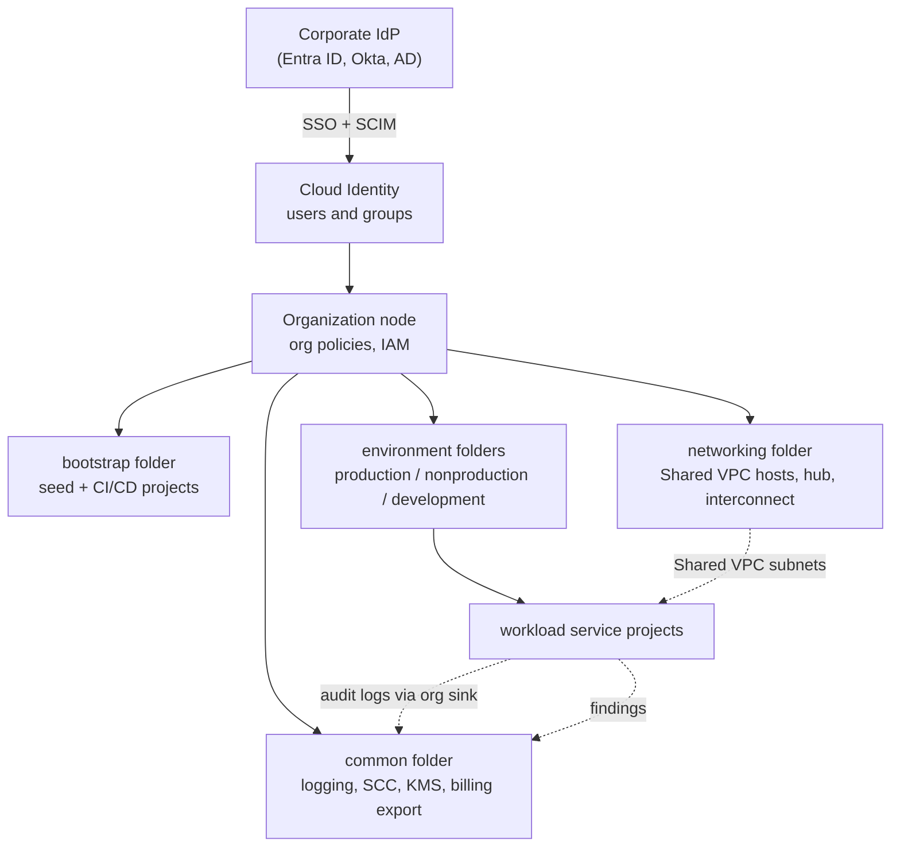

A **landing zone** is the foundation you build in Google Cloud before the first real workload arrives. It
is the organization, the folders and projects, the identities and roles, the networks, the guardrails,
the logs and the budgets that every later project inherits. Get it right and each new team gets a secure,
compliant, observable project in minutes. Get it wrong and you spend years retrofitting controls onto
hundreds of projects that grew up without them.

<!-- more -->

This post explains the concepts and Google's recommendations for each part of a landing zone. The
companion post applies them to a real scenario:
[Designing a GCP landing zone for a healthcare company with PHI](/posts/cloud/gcp/gcp-healthcare-landing-zone-design/).
{: .prompt-info }

## Index
{: #index }

- [What a landing zone is](#what-is-a-landing-zone)
- [Why you need one before the first workload](#why)
- [The building blocks at a glance](#building-blocks)
- [Resource hierarchy](#resource-hierarchy)
- [Identity and access management](#identity)
- [Network architecture](#network)
- [Security and compliance](#security)
- [Logging and monitoring](#logging)
- [Cost management](#cost)
- [Infrastructure as code and deployment options](#iac)
- [Common mistakes](#mistakes)
- [Landing zone checklist](#checklist)
- [References](#references)

## What a landing zone is
{: #what-is-a-landing-zone }

Google defines a landing zone (also called a *cloud foundation*) as a modular and scalable configuration
that lets an organization adopt Google Cloud for its business needs, and treats it as a prerequisite for
deploying enterprise workloads.

In practice a landing zone is three things:

1. **A structure**: an organization node, folders and projects arranged so that policies and permissions
   can be applied once, high up, and inherited everywhere below.
2. **A set of shared services**: identity federation, shared networks, central logging, security
   monitoring, key management and billing export, owned by a platform team and consumed by everyone else.
3. **A set of guardrails**: organization policies, IAM boundaries, firewall policies and service
   perimeters that make the insecure option impossible or loud, rather than relying on every team to
   remember the rules.

A landing zone is not a one-time project. It is a product with its own backlog, owned by a platform team
and deployed from code.
{: .prompt-tip }

## Why you need one before the first workload
{: #why }

- **Policies inherit downward, not sideways.** An organization policy set on a folder applies to every
  project created under it from then on. Adding it later means auditing every existing project for
  violations first.
- **Networks are hard to re-plan.** Overlapping IP ranges, VPCs created per project and ad-hoc VPNs are
  expensive to untangle once applications depend on them.
- **Identity sprawl is permanent.** Personal Gmail accounts granted roles, service account keys committed
  to repositories and individual role bindings instead of groups all accumulate quickly.
- **Auditors ask for evidence from day one.** Audit logs that were never collected cannot be produced
  later.
- **Cost attribution needs labels and structure up front.** You cannot charge back spend that was never
  tagged to an owner.

## The building blocks at a glance
{: #building-blocks }

Google's landing zone design guide is organized around four decision areas: **identity onboarding,
resource hierarchy, network design and security controls**. The enterprise foundations blueprint adds
centralized logging, detective controls, billing and an infrastructure-as-code deployment method on top.

| Building block | What it decides | Google's headline recommendation |
|---|---|---|
| Resource hierarchy | How the org, folders and projects are arranged | One organization; folders by environment; separate bootstrap, common and networking folders |
| Identity | Where identities come from and how access is granted | Federate your existing IdP with Cloud Identity; grant roles to groups, never to individuals |
| Network | How workloads connect to each other, to on-prem, to Google APIs and to the internet | Shared VPC per environment (or hub-and-spoke); private by default; Interconnect for hybrid |
| Security and compliance | What is prevented, what is detected, who can see data | Org policies, VPC Service Controls broadly, Security Command Center at org level |
| Logging and monitoring | Where evidence lives | Org-level aggregated log sinks to a central logging project |
| Cost management | Who pays, how spend is watched | Billing export to BigQuery, labels, budgets and alerts per folder/project |
| Infrastructure as code | How the foundation is built and changed | Terraform deployed through a pipeline (GitOps), not by clicking in the console |

## Resource hierarchy
{: #resource-hierarchy }

Google Cloud resources sit in a tree: **organization → folders → projects → resources**. IAM allow
policies and organization policies attached at any level are inherited by everything beneath it. That
single fact drives every hierarchy decision: you place things in the tree so that the policies they need
can be set once, as high as possible.

### Google's recommendations

- **Use a single organization node whenever possible.** Multiple organizations multiply the number of
  places where policies, logs and identities must be managed. Separate organizations are justified only
  for testing the foundation itself, sandboxes that must be completely isolated, or legally separate
  entities.
- **Separate foundation folders from workload folders.** The enterprise foundations blueprint uses six
  top-level folders:

  | Folder | Purpose | Example projects |
  |---|---|---|
  | `bootstrap` | Projects that deploy the foundation itself | `prj-b-seed` (Terraform state, deployer service account), `prj-b-cicd` |
  | `common` | Shared services used by all environments | `prj-c-logging`, `prj-c-scc`, `prj-c-kms`, `prj-c-secrets`, `prj-c-billing-export` |
  | `networking` | Environment-agnostic network resources | `prj-net-hub`, `prj-net-interconnect`, `prj-net-{env}-svpc` |
  | `production` | Production workloads | `prj-p-<app>` |
  | `nonproduction` | Pre-production that mirrors production | `prj-n-<app>` |
  | `development` | Development workloads | `prj-d-<app>` |

- **Pick a folder pattern that matches how policy differs, not your org chart.** Google describes three
  patterns:
  - *Environment-oriented* (production / nonproduction / development at the top): best when policies
    and admin rights differ mainly by environment. This is the most common choice.
  - *Region- or subsidiary-oriented*: best when regions or subsidiaries operate independently or face
    different regulations (data residency, local law).
  - *Accountability-oriented* (by product or business unit): best when product teams own their full
    lifecycle and share few policies.

  Mixing them is normal, for example business unit folders with environment folders underneath. Google
  explicitly warns against mirroring the corporate org chart, because reorganizations then force
  hierarchy changes.
- **Use a consistent naming convention.** The blueprint uses `prj-{env-code}-{function}` (for example
  `prj-p-claims-api`) and `fldr-{name}`, so ownership and environment are obvious from the ID alone.
- **Label every project** with owner, cost center, environment and application. The blueprint
  standardizes labels such as `application`, `businesscode`, `billingcode`, `primarycontact`,
  `environment` and `envcode`.

**Why:** a project is the boundary for billing, quotas, APIs and most IAM. A folder is the boundary for
policy. Keeping environments in separate folders means a rule such as "no external IPs in production" or
"only the SRE group can deploy to production" is one binding, not hundreds.

## Identity and access management
{: #identity }

Every human and machine that touches Google Cloud needs an identity, and every permission should be
traceable to a reason.

### Google's recommendations

- **Keep your existing identity provider as the source of truth.** Google lists three onboarding
  options:
  1. *Google as the primary IdP* (Cloud Identity or Google Workspace accounts), for organizations without
     an existing IdP.
  2. *Federate an external IdP with Cloud Identity* (Microsoft Entra ID, Active Directory, Okta, Ping and
     so on): SAML or OIDC for single sign-on plus SCIM or Google Cloud Directory Sync for user and group
     provisioning. This is the usual enterprise choice.
  3. *Workforce Identity Federation*: users sign in with the external IdP directly, without
     Cloud Identity accounts. Useful when you cannot or do not want to synchronize users.
- **Grant roles to groups, not to individual users.** Groups are managed in the IdP, so joiners, movers and
  leavers are handled by HR processes rather than by editing IAM policies.
- **Prefer predefined roles; use custom roles only where a predefined role is too broad.** Avoid the basic
  roles (Owner, Editor, Viewer) for anything beyond sandboxes.
- **Protect super administrator accounts separately.** Super admins always bypass SSO, so they need their
  own strong 2-Step Verification (hardware security keys), a small number of named holders and alerting
  on every use. Do not use them for day-to-day work.
- **Restrict who can be granted access** with the `iam.allowedPolicyMemberDomains` organization policy
  (domain-restricted sharing), so roles can only be granted to identities in your own Cloud Identity
  customer.
- **Eliminate service account keys.** Enforce `iam.disableServiceAccountKeyCreation` and use Workload
  Identity Federation for CI/CD systems and other clouds, and service account impersonation for humans.
- **Use just-in-time elevation** (Privileged Access Manager) for production and break-glass access
  instead of standing admin roles.

**Why:** long-lived credentials and individually granted roles are the two most common root causes of
cloud breaches. Federating identity and granting access through groups makes access reviewable and
revocable in one place.

## Network architecture
{: #network }

The network design decides how workloads talk to each other, to on-premises systems, to Google APIs and
to the internet.

### Google's recommendations

- **Centralize networks with Shared VPC.** A *host project* owned by the network team holds the VPC,
  subnets, routes and firewall policies. Application *service projects* attach to it and deploy into the
  subnets they are allowed to use. Application teams get self-service compute without the ability to
  change network security.
- **Choose a topology.** The blueprint offers two:
  - *One Shared VPC per environment* (production, nonproduction, development) with no connectivity
    between them. Best when isolation between environments matters most.
  - *Hub-and-spoke*: environment spokes connected to a central hub, with traffic between spokes
    inspected by network virtual appliances or Cloud NGFW. Best when environments must share services
    (for example a central CI runner or on-prem connectivity) under control.
- **Private by default.** No inbound or outbound internet by default.
  - Outbound internet goes through **Cloud NAT** (or **Secure Web Proxy** where you need URL allow-lists).
  - Inbound internet goes through **Cloud Load Balancing with Cloud Armor**, never through VMs with public
    IPs (enforce `compute.vmExternalIpAccess`).
  - Google APIs are reached privately through **Private Google Access** or **Private Service Connect**
    endpoints (the blueprint uses the `vpc-sc` API bundle so API traffic stays inside service perimeters).
- **Use hierarchical firewall policies** at the organization and folder level for rules that must apply
  everywhere (for example "allow IAP ranges for SSH", "deny known-bad ranges"), and network firewall
  policies with secure tags for workload-level rules.
- **Hybrid connectivity:** Dedicated or Partner **Cloud Interconnect** for production traffic, with the
  99.99% topology (four connections across two metros); **HA VPN** for smaller sites or as backup.
  Cloud Routers with global dynamic routing advertise subnets to on-prem.
- **Hybrid DNS:** Cloud DNS for Google Cloud zones, forwarding and inbound server policies for on-prem
  zones, centralized in the hub or networking project.
- **Plan IP space once, for growth.** The blueprint reserves address space for two active regions and six
  expansion regions so new regions do not overlap existing ranges.
- **Zero-trust access for admins:** use Identity-Aware Proxy (IAP) TCP forwarding for SSH/RDP instead of
  bastion hosts with public IPs.

**Why:** a central network team owning a few well-designed VPCs is far easier to secure and audit than one
VPC per project, and private-by-default removes whole classes of exposure (open SSH, public databases,
data exfiltration over the internet).

## Security and compliance
{: #security }

Google's foundation uses defense in depth with three kinds of control:

- **Preventive (policy) controls** stop a bad configuration from being created.
- **Architecture controls** make the secure configuration the default.
- **Detective controls** find what slipped through and anything malicious.

### Preventive controls: organization policies

Organization policies are guardrails that apply regardless of IAM: even a project Owner cannot violate
them. The blueprint enforces, among others:

| Constraint | What it prevents |
|---|---|
| `compute.skipDefaultNetworkCreation` | The permissive `default` VPC in every new project |
| `compute.vmExternalIpAccess` | VMs with external IPv4 addresses (allow-list exceptions) |
| `compute.requireOsLogin` | SSH keys in metadata; SSH access is tied to IAM instead |
| `compute.disableSerialPortAccess` | Serial console access that bypasses network controls |
| `compute.restrictXpnProjectLienRemoval` | Accidental deletion of Shared VPC host projects |
| `iam.allowedPolicyMemberDomains` | Granting roles to identities outside your organization |
| `iam.disableServiceAccountKeyCreation` / `iam.disableServiceAccountKeyUpload` | Long-lived service account keys |
| `iam.automaticIamGrantsForDefaultServiceAccounts` | Default service accounts automatically getting Editor |
| `sql.restrictPublicIp` / `sql.restrictAuthorizedNetworks` | Cloud SQL instances reachable from the internet |
| `storage.uniformBucketLevelAccess` | Object ACLs that bypass IAM |
| `storage.publicAccessPrevention` | Buckets shared with `allUsers` or `allAuthenticatedUsers` |
| `essentialcontacts.allowedContactDomains` | Security notifications going to outside email domains |

Add `gcp.resourceLocations` when you have data residency requirements. It restricts where location-bound
resources can be created, for example `in:us-locations`.

Organizations created after **23 May 2024** get a baseline of these constraints (such as blocking service
account keys and domain-restricted sharing) enforced automatically. Older organizations should apply them
deliberately.
{: .prompt-info }

### Data exfiltration: VPC Service Controls

IAM answers *who* can call an API. **VPC Service Controls (VPC-SC)** answers *from where* and *to where*.
A service perimeter around a set of projects blocks API calls that cross the perimeter, so a stolen
credential used from outside, or a misconfigured bucket copied to an outside project, fails even though
IAM would allow it. Ingress and egress rules and access levels (from Access Context Manager: IP ranges,
device posture, geography) open precise, auditable exceptions.

Google's first-choice recommendation is to configure VPC Service Controls **broadly across the
environment** rather than only around a few sensitive projects. Always roll a perimeter out in
**dry-run mode** first and watch the violation logs before you enforce it.

### Encryption and provider access

- **At rest:** Google encrypts everything by default. Use **Cloud KMS customer-managed keys (CMEK)** where
  regulation or contracts require you to control key rotation and destruction, **Cloud HSM** for
  FIPS 140-2 Level 3 keys, and **Cloud External Key Manager** to keep keys outside Google entirely.
- **In transit:** default encryption plus TLS for application traffic, and MACsec for Cloud Interconnect.
- **Cloud provider access:** enable **Access Transparency** (logs of Google personnel actions on your
  content), and add **Access Approval** (you approve each support access) or **Key Access Justifications**
  (each key-use request carries a reason you can allow or deny) for sensitive workloads.
- **Regulated workloads:** **Assured Workloads** applies a compliance control package (for example
  *US Data Boundary*, *Healthcare and Life Sciences*, *FedRAMP High*) to a folder. It enforces data
  location, restricts the services available and, in the "with Support" variants, limits Google support
  to personnel in a given country.

### Detective controls

- Activate **Security Command Center (SCC)** at the **organization** level. It finds misconfigurations
  (Security Health Analytics), threats (Event Threat Detection, Container Threat Detection), vulnerable
  images and public exposure, and reports compliance posture against standards such as CIS, PCI DSS and
  HIPAA.
- Use **Sensitive Data Protection** discovery to find sensitive data where it should not be.
- Use **Cloud Asset Inventory** feeds to alert on high-risk changes (for example new IAM grants to
  external domains or changes to org policies).

**Why:** preventive controls cannot cover everything without blocking legitimate work, and detective
controls alone are too late for some mistakes. Using both, with the perimeter as a backstop for
credential theft, is what Google means by defense in depth.

## Logging and monitoring
{: #logging }

### Google's recommendations

- **Create organization-level aggregated log sinks** that route audit logs from every project to a
  central logging project (`prj-c-logging`), into log buckets with appropriate retention (and locked
  buckets where regulation requires immutability), and optionally to BigQuery for analysis or Pub/Sub for
  a SIEM.
- **Enable Data Access audit logs** for services that hold sensitive data. Admin Activity logs are always
  on; Data Access logs are mostly off by default and are the evidence that answers "who read this record?"
- **Keep logs separate from workloads.** Workload admins should not be able to delete the evidence of
  what they did.
- **Set the default log storage location** for the organization and folders when logs must stay in a
  region.
- **SIEM integration:** Google SecOps can ingest directly; other SIEMs consume a Pub/Sub sink.
- **Monitoring:** a central Cloud Monitoring metrics scope per environment, with alerting for
  foundation-level signals (org policy changes, firewall changes, super admin logins, budget breaches).

**Why:** central, tamper-resistant logs are the basis of incident response and audit evidence, and they
only exist for the period they have been collected.

## Cost management
{: #cost }

### Google's recommendations

- **Billing export to BigQuery** (standard usage cost and detailed resource-level cost) in a dedicated
  project such as `prj-c-billing-export`. This is the raw material for every cost report and chargeback.
- **Labels on every project and resource** (`costcenter`, `application`, `environment`, `owner`),
  enforced through the project factory, so spend can be grouped by owner.
- **Budgets and alerts** per billing account, folder or project, with thresholds at 50%, 90% and 100% of
  actual and forecast spend. Send alerts to Pub/Sub to notify teams in chat or trigger automation (for
  example disabling billing on a runaway sandbox).
- **Quotas as a safety net** for expensive services in non-production.
- **Use the Recommender and Active Assist** for idle resources, right-sizing and committed use discount
  recommendations.
- **Grant billing roles carefully**: Billing Account Administrator is separate from project IAM, and the
  ability to link projects to billing accounts should be restricted to the platform team.

**Why:** cloud spend is decentralized by design, since anyone who can create a resource can spend money.
Cost management works only if attribution (labels and hierarchy), visibility (export and dashboards) and
reaction (budgets and alerts) are built in from the start.

## Infrastructure as code and deployment options
{: #iac }

Google recommends building and changing the landing zone with **infrastructure as code** through a
pipeline, so every change is reviewed, versioned and repeatable. The options, from simplest to most
flexible:

| Option | What it is | When to use it |
|---|---|---|
| **Cloud Setup** (console) | Guided console flow that creates the organization, admins, a starter hierarchy, networks, logging and baseline policies, and can export Terraform | Small or first deployments, proofs of concept |
| **terraform-example-foundation** | Google's Terraform implementation of the enterprise foundations blueprint, deployed in stages (bootstrap, org, environments, networks, projects) through Cloud Build or another CI tool | Enterprises that want Google's opinionated reference architecture |
| **Cloud Foundation Fabric / FAST** | Google-maintained modular Terraform modules and a staged landing zone (FAST) | Teams that want more modular building blocks and customization |
| **Partners / Professional Services** | Delivery partners with accelerators | Regulated or large estates with tight timelines |

Whichever you choose, the pattern is the same:

1. A **bootstrap** stage, run once with elevated rights, creates the seed project, Terraform state bucket
   and deployer service accounts.
2. Later stages run from the **pipeline**, impersonating stage-specific service accounts, never from a
   laptop.
3. A **project factory** creates workload projects with the right folder, labels, Shared VPC attachment,
   budget and baseline IAM.
4. **Policy-as-code validation** (for example `gcloud terraform vet` or OPA policies) blocks a non-compliant
   plan before it is applied.

## Common mistakes
{: #mistakes }

- Starting workloads in "temporary" projects outside the hierarchy that become permanent.
- Granting roles to individual users, or using Owner and Editor broadly.
- Leaving service account keys enabled "for now".
- Using the `default` VPC, or one VPC per project with overlapping ranges.
- Applying VPC Service Controls in enforced mode without a dry-run period, then disabling it after the
  first outage.
- Collecting logs only in each project, where workload owners can change or delete them.
- Creating one giant shared billing view with no labels, so nobody owns the bill.
- Building the foundation by hand in the console, so the next environment is a little different.

## Landing zone checklist
{: #checklist }

- [ ] Single organization; super admins limited, hardware-key protected, alerted
- [ ] IdP federated to Cloud Identity; groups provisioned by SCIM/GCDS; roles granted to groups only
- [ ] Bootstrap, common, networking and environment folders; naming convention and labels defined
- [ ] Baseline organization policies enforced (plus `gcp.resourceLocations` if residency applies)
- [ ] Shared VPC hosts per environment or hub-and-spoke; IP plan for growth; private Google API access
- [ ] Cloud NAT / Secure Web Proxy for egress; load balancer + Cloud Armor for ingress
- [ ] Interconnect or HA VPN with hybrid DNS
- [ ] VPC Service Controls perimeters in dry run, then enforced
- [ ] Security Command Center at org level; Access Transparency enabled
- [ ] Org-level log sinks to a central logging project; Data Access logs for sensitive services
- [ ] Billing export to BigQuery; budgets and alerts; labels enforced
- [ ] Everything deployed from Terraform through a pipeline, with a project factory

Next, see how these concepts change when the data is regulated:
[Designing a GCP landing zone for a healthcare company with PHI](/posts/cloud/gcp/gcp-healthcare-landing-zone-design/).

## References
{: #references }

- [Landing zone design in Google Cloud](https://docs.cloud.google.com/architecture/landing-zones)
- [Decide the resource hierarchy for your landing zone](https://docs.cloud.google.com/architecture/landing-zones/decide-resource-hierarchy)
- [Decide how to onboard identities to Google Cloud](https://docs.cloud.google.com/architecture/landing-zones/decide-how-to-onboard-identities)
- [Decide network design for your landing zone](https://docs.cloud.google.com/architecture/landing-zones/decide-network-design)
- [Decide the security for your landing zone](https://docs.cloud.google.com/architecture/landing-zones/decide-security)
- [Enterprise foundations blueprint](https://docs.cloud.google.com/architecture/security-foundations)
- [terraform-example-foundation on GitHub](https://github.com/terraform-google-modules/terraform-example-foundation)
- [Cloud Foundation Fabric on GitHub](https://github.com/GoogleCloudPlatform/cloud-foundation-fabric)
- [Assured Workloads control packages](https://docs.cloud.google.com/assured-workloads/docs/control-packages)
