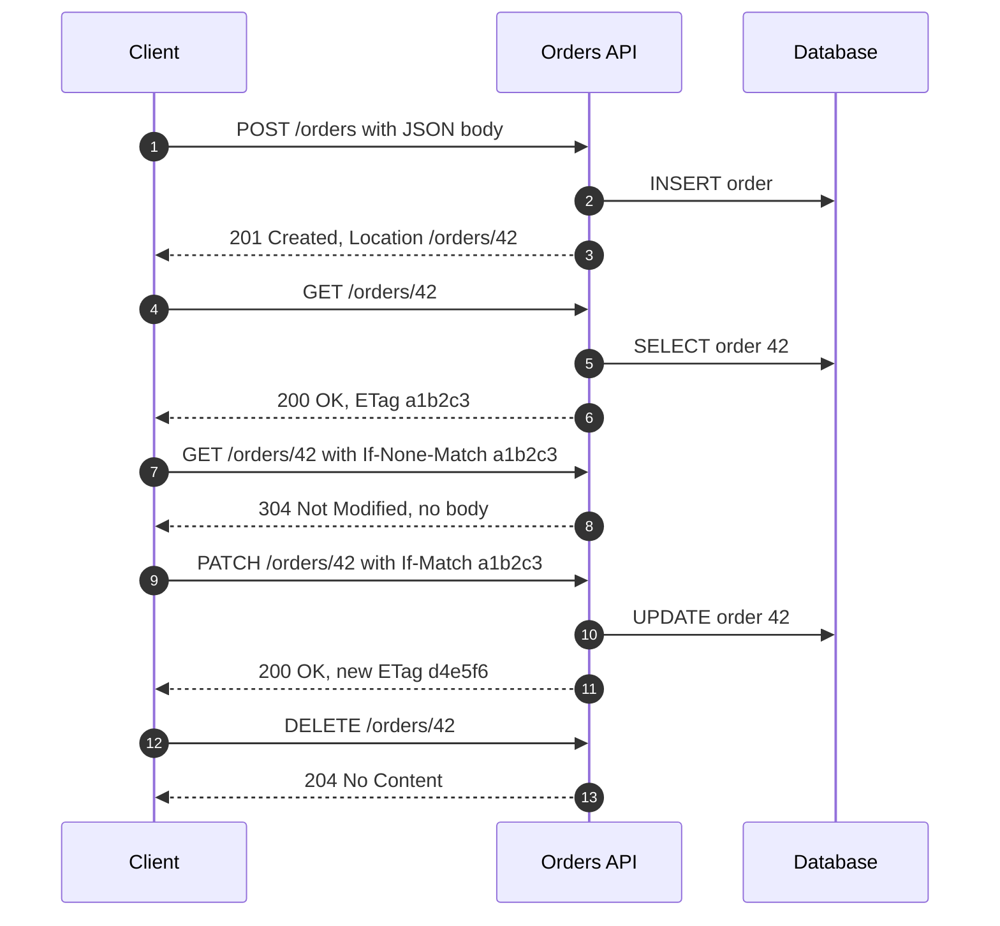
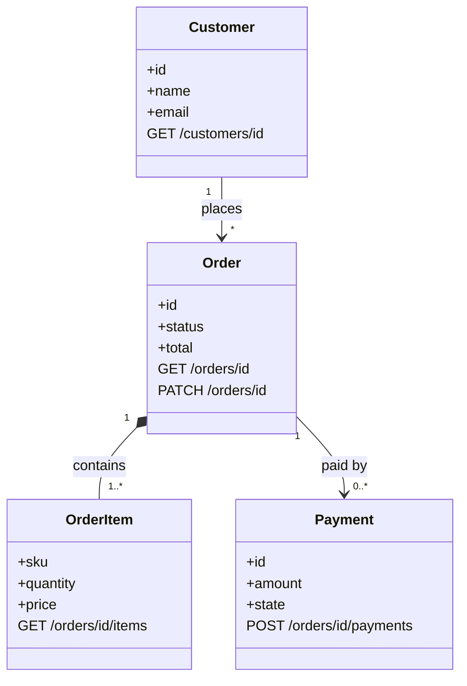

REST (Representational State Transfer) is the most widely used style for web APIs. It does not add a
new protocol on top of HTTP; it uses HTTP the way the web itself uses it: everything is a **resource**
with a URL, clients act on resources with a small set of **verbs**, and every response says how it may
be **cached**. That simplicity is why almost every public API, from GitHub to Stripe, is a REST API.

<!-- more -->

This post is part of the [API communication protocols](/posts/communication/api/api-communication-protocols/) series.
{: .prompt-info }

## At a glance

| | REST |
|---|---|
| Type | Architectural style (not a protocol or a standard) |
| Defined by | Roy Fielding, PhD dissertation, UC Irvine, 2000 |
| Transport | HTTP/1.1, HTTP/2 or HTTP/3 |
| Payload | Usually JSON; also XML, HTML, images, anything with a media type |
| Contract | Optional: OpenAPI (formerly Swagger) |
| Direction | Request/response, client always initiates |
| Caching | Native HTTP caching (`Cache-Control`, `ETag`, CDNs) |
| Best for | Public APIs, CRUD services, anything that must be easy to call from anywhere |

## What REST is

REST is a set of **constraints**. An API that follows them is called RESTful. The idea is that if you
build an API with the same constraints as the web, you get the same benefits as the web: scalability,
independent evolution of client and server, and intermediaries (caches, proxies, gateways) that work
without understanding your application.

| Constraint | Meaning | What it buys you |
|---|---|---|
| Client-server | UI and data storage are separated | Client and server evolve independently |
| Stateless | Each request carries everything needed to process it; no server-side session | Any server instance can serve any request, so horizontal scaling is easy |
| Cacheable | Responses declare whether and how long they may be cached | Fewer requests reach the server; lower latency |
| Uniform interface | Resources identified by URIs, manipulated through representations, self-descriptive messages, hypermedia links | Generic tools (browsers, curl, proxies) work with every API |
| Layered system | A client cannot tell whether it talks to the origin or an intermediary | CDNs, load balancers and gateways can be inserted transparently |
| Code on demand (optional) | Servers may send executable code | Rarely used in APIs |

A **resource** is any named thing: an order, a user, the collection of a user's orders. A
**representation** is what travels on the wire, for example a JSON document describing order 42. The
client never sees the database row, only representations of it.

## Why it was developed

In the late 1990s, distributed systems were built with RPC technologies such as CORBA, DCOM, Java RMI
and then SOAP. They treated the network as a way to call functions, and every service invented its own
operations. Roy Fielding, one of the authors of the HTTP/1.1 and URI specifications, asked a different
question: why does the web scale to millions of servers and clients that were never designed together?
His 2000 dissertation, *Architectural Styles and the Design of Network-based Software Architectures*,
answered it by naming the constraints of the web's architecture and calling the style REST.

Developers then applied those constraints to APIs. Around 2005 to 2010, Flickr, Amazon Web Services,
Twitter and later most SaaS products published REST APIs that were simpler than their SOAP equivalents.
Combined with JSON replacing XML, REST became the default API style of the web. OpenAPI, which began as
Swagger in 2011 and was donated to the OpenAPI Initiative in 2015, later added a machine-readable
contract.

## How it works

A REST call is an ordinary HTTP request. This animation follows one `GET /orders/42` through an HTTP
cache, an API gateway and a service. Switch on the cache-hit mode to see why caching matters:



### The request

1. **Method**: what to do (`GET`, `POST`, `PUT`, `PATCH`, `DELETE`).
2. **URL**: which resource, for example `https://api.example.com/v1/orders/42`.
3. **Query parameters**: optional filters, sorting and paging after `?`, for example `?status=paid&limit=20`.
4. **Headers**: metadata such as `Accept`, `Content-Type`, `Authorization`, `If-None-Match`, `Idempotency-Key`.
5. **Body**: the representation sent to the server, usually JSON, for `POST`, `PUT` and `PATCH`.

### The response

1. **Status code and message**: the result, for example `200 OK`, `201 Created`, `404 Not Found`.
2. **Headers**: `Content-Type`, `Location` of a new resource, `ETag`, `Cache-Control`, rate-limit headers.
3. **Body**: the representation of the resource or an error document.

```http
GET /v1/orders/42 HTTP/1.1
Host: api.example.com
Accept: application/json
Authorization: Bearer eyJhbGciOi...

HTTP/1.1 200 OK
Content-Type: application/json
ETag: "a1b2c3"
Cache-Control: private, max-age=60

{
  "id": 42,
  "status": "paid",
  "total": 129.90,
  "currency": "EUR",
  "customer": "/v1/customers/7",
  "items": "/v1/orders/42/items"
}
```

### HTTP methods

| Method | Typical use | Safe | Idempotent | Example |
|---|---|---|---|---|
| GET | Read a resource or collection | Yes | Yes | `GET /orders/42` |
| POST | Create a resource in a collection, or trigger an action | No | No | `POST /orders` |
| PUT | Replace a resource completely | No | Yes | `PUT /orders/42` |
| PATCH | Change part of a resource | No | Not guaranteed | `PATCH /orders/42` |
| DELETE | Remove a resource | No | Yes | `DELETE /orders/42` |
| HEAD / OPTIONS | Headers only / allowed methods and CORS preflight | Yes | Yes | `OPTIONS /orders` |

*Safe* means the call does not change state. *Idempotent* means repeating it has the same effect as
sending it once, which is what makes retries after a timeout safe. `POST` is not idempotent, so payment
APIs accept an `Idempotency-Key` header to make retries safe.

### Status codes

| Class | Meaning | Common codes |
|---|---|---|
| 2xx | Success | `200 OK`, `201 Created`, `202 Accepted`, `204 No Content` |
| 3xx | Redirection or caching | `301 Moved Permanently`, `304 Not Modified` |
| 4xx | The client made a mistake | `400 Bad Request`, `401 Unauthorized`, `403 Forbidden`, `404 Not Found`, `409 Conflict`, `422 Unprocessable Content`, `429 Too Many Requests` |
| 5xx | The server failed | `500 Internal Server Error`, `502 Bad Gateway`, `503 Service Unavailable`, `504 Gateway Timeout` |

For error bodies, RFC 9457 (Problem Details for HTTP APIs) defines a standard JSON format with `type`,
`title`, `status` and `detail`.


### A full CRUD conversation



`If-Match` with an `ETag` is optimistic concurrency: if someone else changed the order in between, the
server answers `412 Precondition Failed` instead of overwriting their change.

### Resource modelling

Design the API around nouns and their relationships, not around database tables or functions. This UML
class diagram shows the resources of an order API and the URLs that address them:



| Do | Avoid |
|---|---|
| `GET /orders?customer=7&status=paid` | `GET /getOrdersByCustomer?id=7` |
| `POST /orders/42/cancellation` (an action as a sub-resource) | `POST /cancelOrder` |
| Plural collection names: `/orders`, `/orders/42` | Mixing `/order/42` and `/orders` |
| Versioning in the path or a header: `/v1/orders` | Breaking changes without a new version |
| Cursor pagination: `?limit=50&cursor=abc` | Returning unbounded collections |

### The Richardson Maturity Model

Leonard Richardson described four levels of "how RESTful" an API is:

| Level | Description | Example |
|---|---|---|
| 0 | One URL, one verb, the operation in the body (RPC over HTTP) | `POST /api` with `{"action": "getOrder"}` |
| 1 | Separate resources with their own URLs | `/orders/42` |
| 2 | Correct HTTP verbs and status codes | `GET`, `POST`, `404`, `201` |
| 3 | Hypermedia controls (HATEOAS): responses contain links to the next possible actions | `"links": {"cancel": "/orders/42/cancellation"}` |

Most real APIs that are called RESTful are at level 2.

### Describing the contract with OpenAPI

```yaml
openapi: 3.1.0
info:
  title: Orders API
  version: 1.0.0
paths:
  /orders/{id}:
    get:
      summary: Get one order
      parameters:
        - name: id
          in: path
          required: true
          schema: { type: integer }
      responses:
        "200":
          description: The order
          content:
            application/json:
              schema: { $ref: "#/components/schemas/Order" }
        "404":
          description: Not found
components:
  schemas:
    Order:
      type: object
      required: [id, status, total]
      properties:
        id: { type: integer }
        status: { type: string, enum: [pending, paid, shipped, cancelled] }
        total: { type: number }
```

From this file, tools generate documentation (Swagger UI, Redoc), client SDKs, server stubs, mock
servers and contract tests.

## Where it is used

- **Public and partner APIs**: payments, cloud providers, SaaS products, social platforms.
- **CRUD back ends** for web and mobile apps.
- **Cloud control planes**: Azure Resource Manager, the AWS APIs behind the SDKs and the Kubernetes API
  server are all resource-oriented HTTP APIs.
- **Microservices** where simplicity and debuggability matter more than raw speed.

## Real-life examples

### GitHub REST API

GitHub's REST API models repositories, issues and pull requests as resources:
`GET /repos/{owner}/{repo}/issues` lists issues, `POST` on the same URL creates one. It shows several
REST practices in one place: versioning via an `X-GitHub-Api-Version` header, pagination through the
`Link` header (`rel="next"`), rate-limit information in `X-RateLimit-*` headers and conditional requests
with `ETag`, where a `304 Not Modified` answer does not count against the rate limit. GitHub also offers a
GraphQL API for the cases where clients need nested data in one call.

### Stripe API

Stripe is often cited as a model REST API. Resources such as `/v1/customers`, `/v1/payment_intents` and
`/v1/refunds` are created with `POST` and read with `GET`. Because network failures during payments are
dangerous, every `POST` accepts an `Idempotency-Key` header: if the client retries with the same key,
Stripe returns the original result instead of charging twice. Versions are pinned per account and can be
overridden with the `Stripe-Version` header, and events are delivered to merchants with
[webhooks](/posts/communication/api/webhooks/).

## Strengths and limitations

| Strengths | Limitations |
|---|---|
| Works with every language, browser, proxy and tool | Over-fetching: endpoints return fields the client does not need |
| HTTP caching and CDNs for free on `GET` | Under-fetching: related data needs several round trips |
| Human-readable, easy to debug with curl | No built-in contract; OpenAPI is optional and can drift |
| Stateless, so it scales horizontally | Text JSON is larger and slower to parse than binary formats |
| Mature security model (OAuth 2.0, TLS, API gateways) | Client-initiated only; no server push |

## Best practices

- **Use nouns, plural collections and HTTP verbs**, and return accurate status codes.
- **Version from day one** (`/v1/` or a version header) and never break a published version.
- **Make retries safe**: idempotent `PUT`/`DELETE`, and `Idempotency-Key` for `POST`.
- **Send `ETag` and `Cache-Control`** and support conditional requests.
- **Paginate collections** with cursors and cap page sizes.
- **Use one error format**, ideally RFC 9457 Problem Details.
- **Publish an OpenAPI document** and test the implementation against it in CI.
- **Secure every endpoint**: TLS, OAuth 2.0 or API keys, rate limits and input validation; see
  [API Security](/posts/communication/api/api-security/).

## When to use REST, and when not

Use REST when the API is public or shared between teams, when caching matters, when the operations map
naturally to resources, or when you simply want the option that everyone already knows.

Look elsewhere when clients need deeply nested data for each screen
([GraphQL](/posts/communication/api/graphql/)), when internal services exchange very many small calls or
need streaming ([gRPC](/posts/communication/api/grpc/)), or when the server must push data
([WebSocket](/posts/communication/api/websocket/), [SSE](/posts/communication/api/sse-and-long-polling/)).

## Related posts

- [API Communication Protocols: overview](/posts/communication/api/api-communication-protocols/)
- [Comparison of API protocols](/posts/communication/api/api-protocols-comparison/)
- [Introduction to APIs](/posts/communication/api/introduction-to-apis/)
- [API Security](/posts/communication/api/api-security/)
