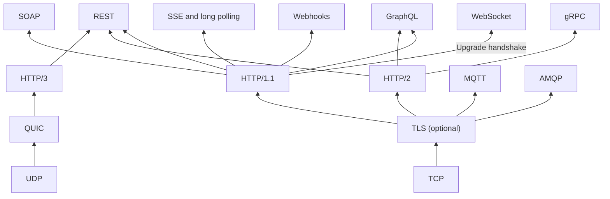
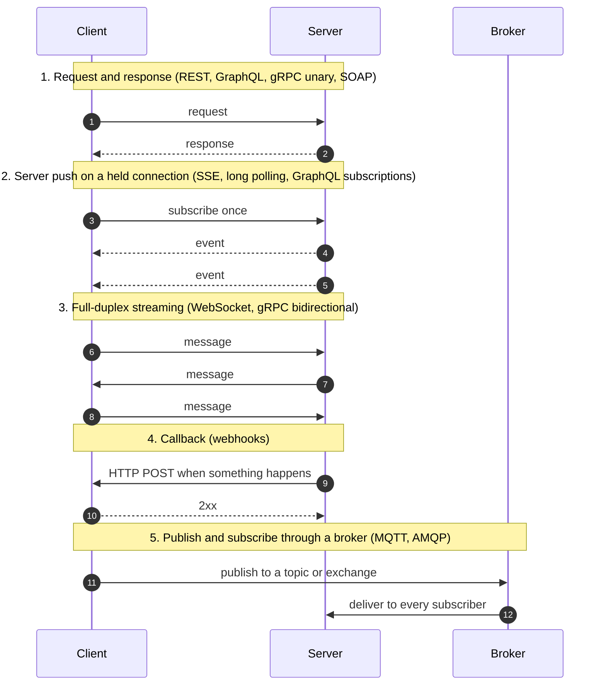

Every distributed system is a conversation between programs: a browser asking a server for a page, a
phone asking for an order history, a microservice calling another, a sensor reporting a temperature, a
payment provider telling a shop that a card was charged. The rules of those conversations are
**communication protocols** and **API styles**. This post is the entry point to a series that explains
the ones you meet most often: what they are, why each was invented and where each one fits.

<!-- more -->

This post is the hub of the **API communication protocols** series. Each protocol has its own deep dive,
and the series ends with a [side-by-side comparison](/posts/communication/api/api-protocols-comparison/).
{: .prompt-info }

## Index
{: #index }

- [What a communication protocol is](#what-is-a-protocol)
- [Protocol, API style or transport?](#protocol-style-transport)
- [Why there are so many](#why-so-many)
- [Where they came from](#origins)
- [The five communication patterns](#patterns)
- [The protocols in one paragraph each](#summaries)
- [Summary table](#summary-table)
- [Which protocol for which use case](#use-cases)
- [Beyond this series](#beyond)
- [Reading order](#reading-order)

## What a communication protocol is
{: #what-is-a-protocol }

A protocol is an agreement between two parties about:

- **Who speaks first**, and whether the other side may speak without being asked.
- **How a message is framed**: where one message ends and the next starts.
- **How data is encoded**: JSON text, XML, or a binary format such as Protocol Buffers.
- **How operations are named**: a URL plus an HTTP verb, a method name in a contract, a topic, a queue.
- **What happens on failure**: status codes, faults, retries, acknowledgements, redelivery.
- **What the connection looks like**: one request per connection, a long-lived connection, or a broker in
  the middle.

An **API** (Application Programming Interface) is the set of operations a system exposes to others. The
protocol or style is how those operations are reached over a network. For the basics of APIs, see
[Introduction to APIs](/posts/communication/api/introduction-to-apis/).

## Protocol, API style or transport?
{: #protocol-style-transport }

The names in this series sit at different layers, which is why comparisons such as "REST versus
WebSocket" can be confusing. REST is an architectural style, gRPC is a framework, WebSocket is a
transport-level protocol and AMQP is a messaging wire protocol. The diagram shows what each one is built on.

| Layer | Examples | What it decides |
|---|---|---|
| Transport | TCP, UDP, QUIC | Reliable byte stream or datagrams; see [OSI and TCP/IP model](/posts/networking/basics/osi-and-tcp-ip-model/) and [UDP](/posts/communication/protocols/udp-protocol/) |
| Application protocol | HTTP/1.1, HTTP/2, HTTP/3, WebSocket, MQTT, AMQP | Framing, connection lifetime, who may send when |
| API style or framework | REST, GraphQL, gRPC, SOAP | How operations and data are modelled on top of the protocol |
| Integration pattern | Webhooks, long polling, SSE | A way of using HTTP to get push or event behaviour |

## Why there are so many
{: #why-so-many }

No single protocol can be best at everything, because the requirements pull in opposite directions:

| Pressure | Pulls towards |
|---|---|
| **Anyone must be able to call it** (browsers, partners, curl) | Plain HTTP and JSON: REST, webhooks |
| **The client needs many related things in one round trip** | A query language: GraphQL |
| **Millions of internal calls per second, many languages** | Binary encoding and generated code: gRPC |
| **The server must speak first** | Long-lived connections: WebSocket, SSE, long polling |
| **Formal contracts, signed messages, transactions** | SOAP and WS-* standards |
| **Tiny devices on bad networks** | A minimal binary pub/sub protocol: MQTT |
| **Messages must never be lost, even if the consumer is down** | A broker with queues and acknowledgements: AMQP |
| **The other system belongs to another company** | Callbacks over public HTTP: webhooks |

Each protocol in this series was created because the existing ones failed one of these pressures.

## Where they came from
{: #origins }

The history runs from document fetching, through enterprise RPC and messaging, to real-time push and
contract-first APIs. Press play, or step through it:



| Year | Protocol | Origin | Problem it solved |
|---|---|---|---|
| 1991 | HTTP | Tim Berners-Lee, CERN | Fetch hypertext documents across the internet |
| 1998 | XML-RPC, then SOAP | Dave Winer (UserLand) with Microsoft; SOAP 1.2 became a W3C Recommendation in 2003 | Call remote procedures across languages and firewalls, unlike DCOM and CORBA |
| 1999 | MQTT | Andy Stanford-Clark (IBM) and Arlen Nipper (Arcom) | Monitor oil pipelines over costly, unreliable satellite links |
| 2000 | REST | Roy Fielding's PhD dissertation, UC Irvine | Describe why the web scales, and apply those constraints to APIs |
| 2003 | AMQP | John O'Hara, JPMorgan Chase; AMQP 1.0 became an OASIS standard in 2012 | Replace proprietary, non-interoperable message-oriented middleware |
| 2006 | Comet, long polling, SSE | Alex Russell named Comet; SSE grew out of WHATWG work and shipped in Opera in 2006 | Push data to browsers that could only make requests |
| 2007 | Webhooks | Term coined by Jeff Lindsay | Let services notify each other instead of being polled |
| 2011 | WebSocket | IETF RFC 6455 | A real two-way connection for browsers |
| 2015 | gRPC | Google, from its internal RPC system Stubby | Fast, typed, polyglot service-to-service calls |
| 2015 | GraphQL | Facebook (internal since 2012) | Fetch nested data for mobile apps in one request |
| 2015 / 2022 | HTTP/2, HTTP/3 | IETF RFC 7540 (now 9113), RFC 9114 | Multiplexing and, with QUIC, no TCP head-of-line blocking |

## The five communication patterns
{: #patterns }

Most of the differences between protocols come down to which of these patterns they support.

| Pattern | Who starts | Connection | Protocols |
|---|---|---|---|
| Request/response | Client, every time | Short or reused | REST, GraphQL queries and mutations, gRPC unary, SOAP |
| Server push | Client subscribes, then the server sends | Long-lived, one direction | SSE, long polling, GraphQL subscriptions |
| Streaming | Either side | Long-lived, both directions | WebSocket, gRPC streaming |
| Callback | The provider, on an event | Short, reversed roles | Webhooks |
| Publish/subscribe | Publisher; the broker delivers | Long-lived, to a broker | MQTT, AMQP, also Kafka and NATS |

## The protocols in one paragraph each
{: #summaries }

### REST

An architectural style that models data as **resources** with URLs and manipulates them with HTTP verbs
(GET, POST, PUT, PATCH, DELETE). It uses HTTP status codes, headers and caching as they were designed,
which makes it the default for public APIs. Its weakness is over-fetching and under-fetching: a screen
that needs a user, their orders and their reviews may need three calls.
[Deep dive: REST API](/posts/communication/api/rest-api/).

### GraphQL

A query language and runtime where the client sends one query to a single endpoint and gets back exactly
the fields it asked for, shaped like the query. A typed schema is mandatory and introspectable.
Subscriptions add server push. The cost is moved to the server: resolver performance, N+1 queries, query
cost limits and harder HTTP caching. [Deep dive: GraphQL](/posts/communication/api/graphql/).

### gRPC

A remote procedure call framework from Google. Services and messages are defined in a `.proto` file,
code is generated for each language, payloads are binary Protocol Buffers and calls run over HTTP/2 with
unary, client-streaming, server-streaming and bidirectional-streaming methods. Very fast and strictly
typed, but not human-readable and not callable from browsers without gRPC-Web.
[Deep dive: gRPC](/posts/communication/api/grpc/).

### WebSocket

A protocol (RFC 6455) that upgrades an HTTP connection into a persistent, full-duplex channel. Either side
can send text or binary frames at any time with only a few bytes of overhead. Ideal for chat, games,
trading screens and collaborative editing. You design your own message format, and stateful connections
make load balancing and scaling harder. [Deep dive: WebSocket](/posts/communication/api/websocket/).

### Server-Sent Events and long polling

Two ways to get server push over plain HTTP. **SSE** keeps one HTTP response open and streams
`text/event-stream` events to the browser's `EventSource`, with automatic reconnection. **Long polling**
holds each request until there is news, then the client immediately asks again. Both are simpler than
WebSocket when data only needs to flow from server to client. SSE is how most LLM APIs stream tokens.
[Deep dive: SSE and long polling](/posts/communication/api/sse-and-long-polling/).

### SOAP

An XML messaging protocol with a strict contract (WSDL), a standard envelope, standard faults and a
family of WS-* standards for security, reliability and transactions. Verbose and heavyweight, yet still
common in banking, insurance, telecom, government and older ERP integrations.
[Deep dive: SOAP](/posts/communication/api/soap/).

### Webhooks

User-defined HTTP callbacks. You register a URL, and the provider POSTs a signed event to it when
something happens: a payment succeeded, a pull request was opened. Simple and firewall-friendly, but the
receiver must verify signatures, return quickly and handle retries and duplicates.
[Deep dive: Webhooks](/posts/communication/api/webhooks/).

### MQTT

A lightweight publish/subscribe protocol for constrained devices and unreliable networks. Clients publish
to hierarchical topics on a broker, subscribers use wildcards, and three Quality of Service levels trade
overhead for delivery guarantees. Retained messages and the Last Will and Testament feature make it the
standard protocol of IoT. [Deep dive: MQTT](/posts/communication/api/mqtt/).

### AMQP

A wire protocol for reliable business messaging through a broker. In AMQP 0-9-1 (RabbitMQ), producers
publish to exchanges, bindings route messages to queues and consumers acknowledge each message. Durable
queues, acknowledgements, dead-lettering and publisher confirms let services communicate asynchronously
without losing work. [Deep dive: AMQP](/posts/communication/api/amqp/).

## Summary table
{: #summary-table }

| | Model | Transport | Payload | Contract | Direction | Browser |
|---|---|---|---|---|---|---|
| **REST** | Resources with URLs and HTTP verbs | HTTP/1.1, 2 or 3 | Usually JSON | Optional (OpenAPI) | Request/response | Native |
| **GraphQL** | Client-written query to one endpoint | HTTP (usually POST) | JSON | Required schema | Request/response plus subscriptions | Native |
| **gRPC** | Methods on a service contract | HTTP/2 | Protobuf (binary) | Required `.proto` with codegen | Unary and three streaming kinds | Needs gRPC-Web |
| **WebSocket** | Persistent message channel | TCP after an HTTP upgrade | Any text or binary | None built in | Full duplex | Native |
| **SSE** | One long HTTP response of events | HTTP | UTF-8 text | Event format only | Server to client | Native (`EventSource`) |
| **Long polling** | Held request, re-issued | HTTP | Any | None | Server to client, simulated | Native |
| **SOAP** | Operations in an XML envelope | Usually HTTP POST | XML | Required WSDL | Request/response | Possible, rarely done |
| **Webhooks** | Provider calls your URL | HTTP POST | Usually JSON | Provider's event docs | Server to server, event-driven | Not applicable |
| **MQTT** | Publish/subscribe on topics | TCP (or WebSocket) | Any bytes | None (topics by convention) | Pub/sub through a broker | Over WebSocket |
| **AMQP** | Exchanges, bindings and queues | TCP | Any bytes plus properties | None (by convention) | Pub/sub and work queues | Not directly |

## Which protocol for which use case
{: #use-cases }

| Use case | First choice | Why | Alternatives |
|---|---|---|---|
| Public API for third parties | REST | Universal tooling, HTTP caching, easy to debug | GraphQL for data-rich platforms |
| Mobile or SPA screen with nested data | GraphQL (often in a BFF) | One round trip, no over-fetching | REST with aggregation endpoints |
| Internal microservice calls | gRPC | Low latency, typed contracts, streaming | REST, or AMQP when async |
| Chat, multiplayer games, collaborative editing | WebSocket | Low-latency two-way messages | WebTransport, WebRTC data channels |
| Live notifications, progress bars, LLM token streams | SSE | One-way push over plain HTTP | WebSocket, long polling |
| Clients behind restrictive proxies | Long polling | Looks like ordinary requests | SSE |
| Banking, insurance, government integrations | SOAP | Existing WSDL contracts, WS-Security | REST for new APIs |
| "Tell me when X happens" between companies | Webhooks | No polling, works across organisations | SSE or a shared queue |
| Sensors, vehicles, smart home | MQTT | Tiny overhead, QoS, offline handling | CoAP, AMQP |
| Order processing, background jobs, decoupled services | AMQP | Durable queues, acks, routing, retries | Kafka for event streams, cloud queues |

These protocols are rarely used alone. A typical system uses REST or GraphQL at the edge, gRPC between
services, a broker for asynchronous work, webhooks with partners and WebSocket or SSE for live updates.
The [comparison post](/posts/communication/api/api-protocols-comparison/) follows one order through all of
them.

## Beyond this series
{: #beyond }

| Protocol | What it is | When you meet it |
|---|---|---|
| JSON-RPC 2.0 | A minimal RPC envelope in JSON | Ethereum nodes, the Language Server Protocol, the Model Context Protocol (MCP) |
| tRPC | End-to-end typed RPC for TypeScript monorepos | Next.js and other TypeScript full-stack apps |
| WebRTC | Peer-to-peer audio, video and data channels over UDP | Video calls, screen sharing |
| WebTransport | Multiplexed streams and datagrams over HTTP/3 | A successor candidate to WebSocket |
| Kafka protocol | A binary protocol for a distributed, replayable log | Event streaming and data pipelines |
| STOMP | A simple text messaging protocol, often over WebSocket | Spring and RabbitMQ web messaging |
| CoAP | A REST-like protocol over UDP for tiny devices | Constrained IoT, alongside MQTT |
| OData | REST conventions for queryable data | Microsoft Dynamics, SAP |

Two specifications describe these APIs: **OpenAPI** for request/response HTTP APIs, and **AsyncAPI** for
event-driven ones such as WebSocket, MQTT, AMQP and Kafka.

## Reading order
{: #reading-order }

1. [REST API](/posts/communication/api/rest-api/): the baseline everything else is compared to
2. [GraphQL](/posts/communication/api/graphql/): client-driven queries
3. [gRPC](/posts/communication/api/grpc/): contract-first RPC between services
4. [SOAP](/posts/communication/api/soap/): the enterprise XML ancestor
5. [WebSocket](/posts/communication/api/websocket/): full-duplex real time
6. [Server-Sent Events and long polling](/posts/communication/api/sse-and-long-polling/): push over plain HTTP
7. [Webhooks](/posts/communication/api/webhooks/): event callbacks between systems
8. [MQTT](/posts/communication/api/mqtt/): publish/subscribe for IoT
9. [AMQP](/posts/communication/api/amqp/): reliable messaging with brokers
10. [Comparison of all protocols](/posts/communication/api/api-protocols-comparison/): the differences, side by side

Related: [API Security](/posts/communication/api/api-security/) and
[Common Protocols and Ports](/posts/communication/protocols/common-protocols/).
