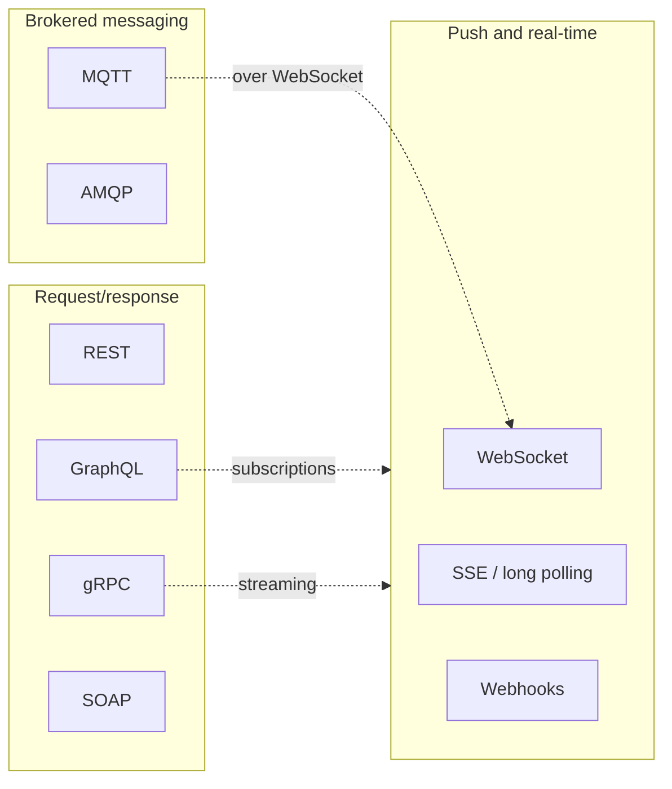
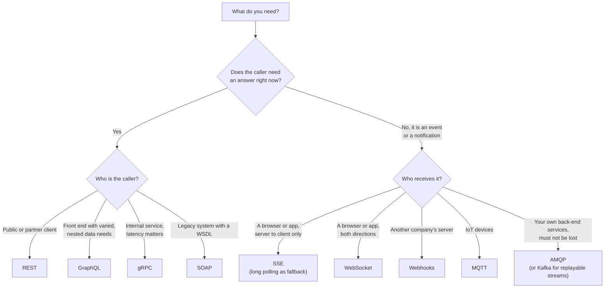

REST and GraphQL are styles for client-facing request/response APIs, gRPC is a high-performance RPC
framework mostly used between services, WebSocket is a transport for persistent two-way messaging, SSE
and long polling push data over plain HTTP, SOAP is the contract-heavy XML predecessor, webhooks are
HTTP callbacks between systems, and MQTT and AMQP are broker-based messaging protocols. This post puts
them side by side: how they differ, where each one fits and how they are combined in a real system.

<!-- more -->

This post concludes the [API communication protocols](/posts/communication/api/api-communication-protocols/)
series. Each protocol links to its own deep dive.
{: .prompt-info }

## Index
{: #index }

- [The three families](#families)
- [The master comparison table](#master-table)
- [Operational comparison](#operations)
- [Head to head](#head-to-head)
- [The same operation in each protocol](#same-operation)
- [Decision tree](#decision-tree)
- [Using them together](#together)
- [Where each one is used](#where-used)
- [Common mistakes](#mistakes)
- [Summary](#summary)

## The three families
{: #families }

Comparing every protocol with every other only makes sense once you notice they solve three different
problems:

| Family | Question it answers | Members |
|---|---|---|
| **Request/response APIs** | "Client, ask me for something and wait for the answer." | [REST](/posts/communication/api/rest-api/), [GraphQL](/posts/communication/api/graphql/), [gRPC](/posts/communication/api/grpc/), [SOAP](/posts/communication/api/soap/) |
| **Push and real-time** | "Server, tell me when something changes." | [WebSocket](/posts/communication/api/websocket/), [SSE and long polling](/posts/communication/api/sse-and-long-polling/), [webhooks](/posts/communication/api/webhooks/), GraphQL subscriptions, gRPC streaming |
| **Brokered messaging** | "Deliver this reliably to whoever needs it, even if they are not ready." | [MQTT](/posts/communication/api/mqtt/), [AMQP](/posts/communication/api/amqp/) |



## The master comparison table
{: #master-table }

| | REST | GraphQL | gRPC | SOAP | WebSocket | SSE | Long polling | Webhooks | MQTT | AMQP |
|---|---|---|---|---|---|---|---|---|---|---|
| **What it is** | Architectural style | Query language and runtime | RPC framework | XML messaging protocol | Full-duplex protocol | Streaming format and browser API | HTTP technique | HTTP callback pattern | Pub/sub protocol | Messaging protocol |
| **Origin** | Fielding, 2000 | Facebook, 2012 / 2015 | Google, 2015 | Microsoft and partners, 1998 | IETF RFC 6455, 2011 | WHATWG, Opera 2006 | Comet, 2006 | Jeff Lindsay, 2007 | IBM and Arcom, 1999 | JPMorgan Chase, 2003 |
| **Model** | Resources, URLs, verbs | One endpoint, client-written queries | Methods on services | Operations in an envelope | Message channel | Event stream | Held request | Provider calls your URL | Topics through a broker | Exchanges, bindings, queues |
| **Transport** | HTTP/1.1, 2, 3 | HTTP | HTTP/2 | HTTP (also JMS, SMTP) | TCP via HTTP upgrade | HTTP | HTTP | HTTP | TCP (or WebSocket) | TCP |
| **Payload** | JSON (any media type) | JSON | Protobuf (binary) | XML | Text or binary | UTF-8 text | Any | JSON | Any bytes | Any bytes plus properties |
| **Contract** | Optional (OpenAPI) | Required schema | Required `.proto` | Required WSDL | None | None | None | Provider docs | None | None |
| **Code generation** | Optional | Common | Built in | Built in | No | No | No | No | No | No |
| **Direction** | Request/response | Request/response plus subscriptions | Unary and three streaming types | Request/response | Full duplex | Server to client | Server to client | Provider to consumer | Pub/sub | Pub/sub and queues |
| **Connection** | Short or keep-alive | Short or keep-alive | Long-lived, multiplexed | Short | Long-lived, stateful | Long-lived | Repeated | Short | Long-lived to broker | Long-lived to broker |
| **Coupling** | Client knows URL | Client knows schema | Client knows contract | Client knows WSDL | Both know message format | Client knows stream | Client knows endpoint | Provider knows URL | Only topic names | Only exchange and key |
| **Delivery guarantee** | Per request (retry if idempotent) | Per request | Per call, with deadlines | Per request (WS-ReliableMessaging) | None beyond TCP | Resume with `Last-Event-ID` | Cursor based | At least once, retries | QoS 0, 1 or 2 | At least once with acks |
| **HTTP caching** | Native | Hard (persisted queries help) | No | No | No | No | No | No | No (retained messages) | No |
| **Browser** | Native | Native | gRPC-Web proxy | Possible, rare | Native | Native | Native | Not applicable | Over WebSocket | Not directly |
| **Human-readable** | Yes | Yes | No | Yes, verbose | Depends | Yes | Yes | Yes | Depends | Depends |

## Operational comparison
{: #operations }

| | REST | GraphQL | gRPC | SOAP | WebSocket | SSE | Webhooks | MQTT | AMQP |
|---|---|---|---|---|---|---|---|---|---|
| **Message overhead** | Medium (HTTP headers + JSON) | Medium | Low (HPACK + Protobuf) | High (XML) | Very low (2 to 14 B frames) | Very low | Medium | Very low (2 B fixed header) | Low |
| **Latency** | Good | Good, one round trip | Excellent | Fair | Excellent | Excellent | Seconds (event driven) | Excellent | Good |
| **Load balancing** | Easy (stateless) | Easy | Needs L7 or client-side | Easy | Hard (sticky, long-lived) | Medium | Easy | Broker cluster | Broker cluster |
| **Scaling concern** | Request rate | Query cost, N+1 | Connection spread | XML CPU | Open connections, fan-out | Open connections | Receiver bursts | Connections, fan-out | Queue depth |
| **Debugging** | curl, browser | GraphiQL | grpcurl, reflection | SoapUI | Browser DevTools | curl, DevTools | Delivery logs, tunnels | MQTT Explorer | Management UI |
| **Security model** | TLS, OAuth 2.0, API keys | Same as REST plus cost limits | TLS or mTLS, metadata tokens | TLS plus WS-Security | TLS, Origin check, token at connect | Same as HTTP | HMAC signatures, TLS | TLS, client certs, topic ACLs | TLS, SASL, vhost permissions |
| **Learning curve** | Low | Medium | Medium | High | Low to start, high to scale | Low | Low | Low | Medium |

## Head to head
{: #head-to-head }

### REST vs GraphQL

| | REST | GraphQL |
|---|---|---|
| Endpoints | Many, one per resource | One |
| Who shapes the response | Server | Client |
| Round trips for nested data | Often several | One |
| Caching | HTTP and CDN | Client-side normalised cache, persisted queries |
| Versioning | `/v1`, `/v2` | Evolve the schema, deprecate fields |
| Errors | HTTP status codes | `200` with an `errors` array |
| Main risk | Over-fetching and chatty clients | Expensive queries, N+1 resolvers |

**Choose REST** for public, cacheable, resource-oriented APIs. **Choose GraphQL** when many screens need
different views of a connected data model, usually behind a BFF. Many companies, GitHub among them, offer
both.

### REST vs gRPC

| | REST | gRPC |
|---|---|---|
| Contract | Optional | Mandatory, with generated code |
| Encoding | JSON text | Protobuf binary |
| Streaming | No (use SSE or WebSocket) | Four call types |
| Browser | Native | Needs gRPC-Web |
| Speed | Good | Better: smaller messages, multiplexing, no JSON parsing |
| Ecosystem | Universal | Strong in cloud-native and polyglot back ends |

**Choose REST** at the edge and for partners. **Choose gRPC** for internal east-west traffic, especially
with many languages, high call rates or streaming.

### GraphQL vs gRPC

Both have a typed schema, but they optimise for different consumers. GraphQL lets the **client** decide
the shape of each response, which suits front ends. gRPC fixes the shape in the **contract** and
optimises the wire, which suits services. A common architecture uses GraphQL at the edge and gRPC behind it.

### SOAP vs REST

SOAP offers formal contracts, message-level security and WS-* transactions at the cost of verbose XML and
complexity. REST trades those features for simplicity and the web's infrastructure. Use SOAP when a
partner or regulator requires it; build new APIs as REST or gRPC and wrap legacy SOAP services behind a
facade.

### WebSocket vs SSE vs long polling

| | WebSocket | SSE | Long polling |
|---|---|---|---|
| Direction | Both ways | Server to client | Server to client |
| Protocol | Own framing after HTTP upgrade | Plain HTTP response | Plain HTTP requests |
| Reconnect and resume | You build it | Built in | You build it (cursor) |
| Binary data | Yes | No (text only) | Yes |
| Proxy friendliness | Good on 443, some proxies break it | Very good (watch buffering) | Excellent |
| Per-message overhead | 2 to 14 bytes | A few bytes | A full HTTP exchange |
| Typical uses | Chat, games, collaboration, trading | Notifications, progress, LLM tokens | Fallback, bot APIs, restrictive networks |

**Rule of thumb**: if the client also sends a lot, use WebSocket; if only the server sends, use SSE; use
long polling only when streaming is blocked.

### Webhooks vs polling vs SSE

All three answer "how do I learn about changes in another system?". **Polling** is simple but slow and
wasteful. **Webhooks** are instant and cheap but need a public endpoint and careful verification.
**SSE or long polling** work when the consumer cannot accept inbound connections (a laptop, a mobile app,
a locked-down network). Many providers, such as Telegram, offer both webhooks and long polling for
exactly this reason.

### MQTT vs AMQP (and Kafka)

| | MQTT | AMQP 0-9-1 | Kafka (for reference) |
|---|---|---|---|
| Designed for | Constrained devices and unreliable networks | Reliable business messaging between services | High-throughput, replayable event streams |
| Routing | Topic hierarchy with `+` and `#` wildcards | Exchanges (direct, fanout, topic, headers) and bindings | Topics and partitions |
| Storage | Retained message and session queues only | Queues until acknowledged | Log retained for days or forever |
| Consumers | Every subscriber gets a copy (shared subscriptions in MQTT 5) | Competing consumers per queue, copies per queue | Consumer groups, each can replay |
| Client footprint | Tiny | Moderate | Heavier |
| Typical scale | Millions of device connections | Thousands of service connections | Millions of messages per second |

**Choose MQTT** at the device edge, **AMQP** for commands, jobs and business events inside the platform,
and Kafka when many consumers need to replay a stream. They are often chained: MQTT from devices, bridged
into AMQP or Kafka in the cloud.

### gRPC streaming vs WebSocket

Both provide bidirectional streams. gRPC streams are typed by a contract, multiplexed over HTTP/2 and
best between services. WebSocket is untyped but native in every browser and best between a browser and a
server.

## The same operation in each protocol
{: #same-operation }

"Get order 42" makes the differences concrete.

**REST**

```http
GET /v1/orders/42 HTTP/1.1
Accept: application/json
```

**GraphQL**

```graphql
query { order(id: "42") { id status total } }
```

**gRPC**

```bash
grpcurl -d '{"id": 42}' orders.internal:50051 orders.v1.OrderService/GetOrder
```

**SOAP**

```xml
<soap:Envelope xmlns:soap="http://www.w3.org/2003/05/soap-envelope" xmlns:o="urn:orders">
  <soap:Body><o:GetOrder><o:Id>42</o:Id></o:GetOrder></soap:Body>
</soap:Envelope>
```

**WebSocket** (a message on an already open connection; the format is your own)

```json
{ "type": "order.get", "id": "req-17", "orderId": 42 }
```

**SSE** (you do not ask; updates to order 42 arrive on the stream)

```text
event: order
data: {"id": 42, "status": "shipped"}
```

**Webhook** (the provider calls you when order 42 changes)

```http
POST /webhooks/orders HTTP/1.1
Content-Type: application/json

{"type": "order.updated", "data": {"id": 42, "status": "shipped"}}
```

**MQTT** and **AMQP** (publish an event; whoever is subscribed receives it)

```bash
mosquitto_pub -t 'shop/orders/42/status' -m 'shipped' -q 1
rabbitmqadmin publish exchange=orders routing_key=order.shipped payload='{"id": 42}'
```

## Decision tree
{: #decision-tree }



## Using them together
{: #together }

Real systems mix protocols, each where it is strongest. This animation follows one order from a mobile
app through six of them:



| Hop | Protocol | Why this one |
|---|---|---|
| Mobile app to BFF | GraphQL | One round trip with exactly the fields the screen needs |
| BFF to Order service, Order to Inventory | gRPC | Fast, typed, internal calls with deadlines |
| Order service to payment provider | REST | The provider's public API; universal and well documented |
| Payment provider to webhook handler | Webhook | The provider notifies you; no polling |
| Webhook handler to other services | AMQP | Durable, decoupled fan-out to billing, shipping and notifications |
| Notification service to app | WebSocket (or SSE, or mobile push) | Instant update on an open connection |

Add MQTT if warehouse scanners or delivery vans report events, bridged into the same broker.

## Where each one is used
{: #where-used }

| Protocol | Industries and products | Well-known examples |
|---|---|---|
| REST | Every industry; public APIs, cloud control planes | GitHub, Stripe, Twilio, Kubernetes API, Azure Resource Manager |
| GraphQL | E-commerce, social, media, developer platforms | GitHub API v4, Shopify Storefront API, Netflix and Airbnb internal graphs |
| gRPC | Cloud-native infrastructure, microservices, ML serving | Kubernetes CRI, etcd, Envoy xDS, TensorFlow Serving |
| SOAP | Banking, insurance, telecom, government, ERP | EU VIES VAT check, Salesforce SOAP API, carrier and payment gateways |
| WebSocket | Messaging, gaming, trading, collaboration | Slack, Discord Gateway, exchange market-data feeds |
| SSE / long polling | AI products, notifications, feeds; bots | LLM streaming APIs (Anthropic, OpenAI), Telegram `getUpdates` |
| Webhooks | SaaS, payments, DevOps, e-commerce | Stripe events, GitHub webhooks, Shopify, Slack apps |
| MQTT | IoT, manufacturing, energy, automotive, smart home | AWS IoT Core, Azure IoT Hub, Home Assistant, Facebook Messenger (2011) |
| AMQP | Finance, e-commerce back ends, enterprise integration | RabbitMQ with Celery, Azure Service Bus |

## Common mistakes
{: #mistakes }

- **Using WebSocket for everything "real-time"**, when SSE would be simpler and work with existing HTTP
  infrastructure.
- **Exposing gRPC to browsers or partners directly** instead of putting REST or GraphQL at the edge.
- **Using GraphQL as a thin proxy over REST** without batching, cost limits or schema design.
- **Calling services synchronously in long chains** (REST or gRPC) where an AMQP event would decouple
  them and survive outages.
- **Trusting webhooks without verifying signatures**, or doing slow work before returning `2xx`.
- **Treating MQTT QoS 2 or AMQP acks as end-to-end exactly-once**; consumers still need idempotency.
- **Building new SOAP services** where REST or gRPC would do.
- **Forgetting the infrastructure**: long-lived connections (WebSocket, SSE, gRPC, MQTT) need load
  balancers, timeouts and capacity planning designed for them.

## Summary
{: #summary }

- **REST**: the universal default for public and CRUD APIs; cacheable and simple, but can be chatty.
- **GraphQL**: client-shaped queries for rich front ends; flexible, but moves complexity to the server.
- **gRPC**: fast, typed, streaming RPC between services; not for browsers without help.
- **SOAP**: formal contracts and WS-Security for enterprise and legacy integration; heavy for new work.
- **WebSocket**: full-duplex real time; powerful, but stateful and you design the protocol.
- **SSE and long polling**: one-way push over plain HTTP; the simplest way to stream to a browser.
- **Webhooks**: event callbacks between systems; verify, deduplicate and acknowledge fast.
- **MQTT**: tiny, reliable pub/sub for devices on bad networks.
- **AMQP**: durable, acknowledged messaging that decouples services in time.

Pick per interaction, not per system: most architectures use three or four of these at once.

## Related posts

- [API Communication Protocols: overview](/posts/communication/api/api-communication-protocols/)
- [REST API](/posts/communication/api/rest-api/) ·
  [GraphQL](/posts/communication/api/graphql/) ·
  [gRPC](/posts/communication/api/grpc/) ·
  [SOAP](/posts/communication/api/soap/)
- [WebSocket](/posts/communication/api/websocket/) ·
  [SSE and long polling](/posts/communication/api/sse-and-long-polling/) ·
  [Webhooks](/posts/communication/api/webhooks/)
- [MQTT](/posts/communication/api/mqtt/) · [AMQP](/posts/communication/api/amqp/)
- [API Security](/posts/communication/api/api-security/)
