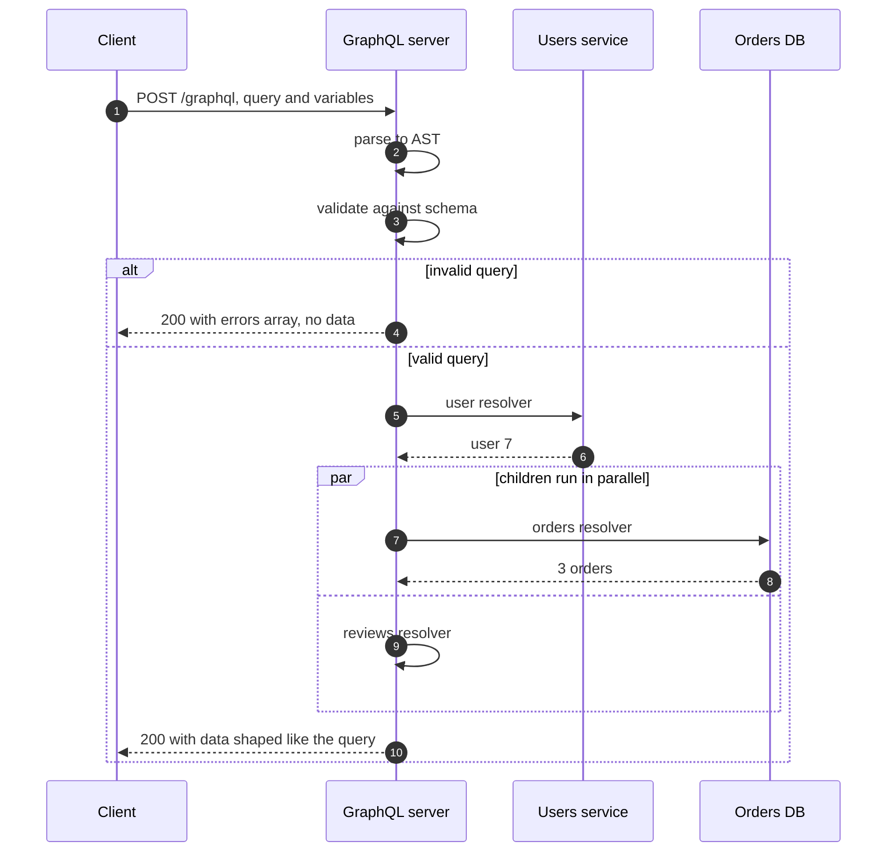
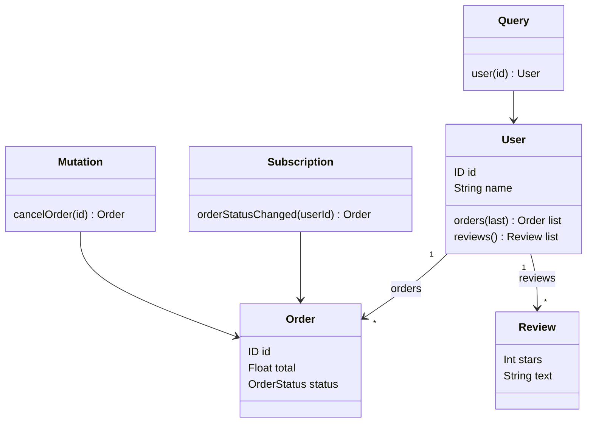

GraphQL is a query language for APIs and a runtime that answers those queries. Instead of calling
several fixed endpoints, a client sends **one query** to **one endpoint**, describing exactly the
fields it needs, and receives a JSON response with exactly that shape. A strongly typed **schema**
defines everything that can be asked for.

<!-- more -->

This post is part of the [API communication protocols](/posts/communication/api/api-communication-protocols/) series.
{: .prompt-info }

## At a glance

| | GraphQL |
|---|---|
| Type | Query language plus server runtime, with a specification |
| Created by | Facebook (internal 2012, open-sourced 2015); now the GraphQL Foundation (Linux Foundation) |
| Transport | HTTP, almost always `POST /graphql`; WebSocket or SSE for subscriptions |
| Payload | JSON request (`query`, `variables`, `operationName`) and JSON response (`data`, `errors`) |
| Contract | Required: a typed schema written in SDL, discoverable through introspection |
| Operations | `query` (read), `mutation` (write), `subscription` (server push) |
| Caching | Not HTTP-native; done by clients (normalised caches) or persisted queries |
| Best for | Front ends with varied, nested data needs; aggregating many back ends |

## What GraphQL is

A GraphQL API is described by a schema of **types** and **fields**. Some fields are scalars (`String`,
`Int`, `ID`), others point to other types, so the schema is a graph. The `Query` and `Mutation` types are
the entry points.

```graphql
type User {
  id: ID!
  name: String!
  orders(last: Int = 10): [Order!]!
  reviews: [Review!]!
}

type Order {
  id: ID!
  total: Float!
  status: OrderStatus!
}

type Review {
  stars: Int!
  text: String
}

enum OrderStatus { PENDING PAID SHIPPED }

type Query {
  user(id: ID!): User
}

type Mutation {
  cancelOrder(id: ID!): Order
}

type Subscription {
  orderStatusChanged(userId: ID!): Order
}
```

The client chooses a path through that graph:

```graphql
query UserSummary($id: ID!) {
  user(id: $id) {
    name
    orders(last: 3) { total status }
    reviews { stars }
  }
}
```

and gets back the same shape:

```json
{
  "data": {
    "user": {
      "name": "Asha",
      "orders": [
        { "total": 129.9, "status": "PAID" },
        { "total": 42.0, "status": "SHIPPED" },
        { "total": 15.5, "status": "PENDING" }
      ],
      "reviews": [{ "stars": 5 }, { "stars": 4 }]
    }
  }
}
```

With REST, the same screen might need `GET /users/7`, `GET /users/7/orders?limit=3` and
`GET /users/7/reviews`, three round trips, each returning fields the screen never shows.

## Why it was developed

In 2012 Facebook was rewriting its iOS app as a native app. The News Feed needed deeply nested data
(stories, authors, comments, likes, friends) and the existing REST-style endpoints and FQL either
returned too much, too little or needed many round trips on slow mobile networks. Lee Byron, Nick
Schrock and Dan Schafer designed GraphQL so that the app could describe the data it needed in one
request, and product teams could change what a screen showed without waiting for new back-end endpoints.

Facebook presented GraphQL publicly in 2015 and released the specification and the `graphql-js`
reference implementation. In 2018 the project moved to the GraphQL Foundation under the Linux
Foundation. GitHub, Shopify, Netflix, Airbnb and many others have since adopted it.

## How it works

Every operation goes through the same pipeline: parse, validate against the schema, execute resolvers,
shape the result. This animation follows one query whose fields come from three different back ends:



### Resolvers

Each field in the schema has a **resolver**, a function that returns its value. The executor walks the
query tree and calls resolvers level by level, passing each parent's result to its children:

```javascript
const resolvers = {
  Query: {
    user: (_parent, { id }, ctx) => ctx.usersApi.getUser(id),          // REST call
  },
  User: {
    orders: (user, { last }, ctx) => ctx.db.ordersFor(user.id, last),  // SQL
    reviews: (user, _args, ctx) => ctx.reviewsClient.list(user.id),   // gRPC call
  },
};
```

This is why GraphQL is often used as an **aggregation layer**: the client sees one graph, while the
fields are backed by databases, REST services and gRPC services.

### Operation lifecycle



GraphQL over HTTP usually returns `200 OK` even when some fields failed. Errors are reported in an
`errors` array next to partial `data`, so clients must check both.

### Schema as UML

The schema above, drawn as a UML class diagram. Each arrow is a field that a query can follow:



### Mutations and subscriptions

**Mutations** are writes. They run sequentially, in the order written, and return the changed object so
the client can update its cache:

```graphql
mutation { cancelOrder(id: "42") { id status } }
```

**Subscriptions** are server push. The client subscribes once, and the server sends a result every time
the event fires. The transport is usually WebSocket (the `graphql-ws` protocol) or
[Server-Sent Events](/posts/communication/api/sse-and-long-polling/):

```graphql
subscription { orderStatusChanged(userId: "7") { id status } }
```

### The N+1 problem and DataLoader

A naive `orders` resolver runs once per user. Asking for 100 users and their orders produces 1 query for
the users plus 100 queries for orders. **DataLoader** collects all the keys requested during one tick of
execution and loads them with one batched call (`WHERE user_id IN (...)`), with a per-request cache.

### Federation

In large organisations a single schema is owned by many teams. **Apollo Federation** (and the open
GraphQL Composite Schemas work) lets each team publish a **subgraph**, and a **router** composes them
into one **supergraph** that clients query as if it were one API.

## Where it is used

- **Mobile and web front ends** with many screens that need different slices of the same data.
- **Backend-for-frontend (BFF)** layers that aggregate microservices for one client type.
- **Public developer platforms** where consumers want flexible access to a rich data model.
- **Content and commerce platforms** (headless CMSs such as Contentful, commerce such as Shopify).

## Real-life examples

### GitHub GraphQL API

GitHub announced its GraphQL API (API v4) in 2016 because integrators were making many REST calls to
assemble one view. A single query can fetch a repository, its last 10 pull requests, each one's reviews
and labels. GitHub limits cost rather than requests: each query is scored by the number of nodes it may
return, and the score is deducted from a points-per-hour budget, which is how it protects itself from
expensive nested queries.

```graphql
query {
  repository(owner: "cotes2020", name: "jekyll-theme-chirpy") {
    pullRequests(last: 5, states: OPEN) {
      nodes { title author { login } reviews(first: 3) { nodes { state } } }
    }
  }
}
```

### Shopify Storefront and Admin APIs

Shopify exposes its commerce platform through GraphQL. Custom storefronts (for example built with
Shopify's Hydrogen framework) query products, variants, prices and inventory in one request per page, and
apps manage orders through the Admin GraphQL API. Shopify also uses calculated query cost for rate
limiting and offers bulk operations for large exports, two answers to GraphQL's main operational risks.

## Strengths and limitations

| Strengths | Limitations |
|---|---|
| No over-fetching or under-fetching; one round trip per screen | HTTP caching does not work for `POST` to one URL |
| Strong, introspectable schema; great tooling (GraphiQL, codegen) | Resolver performance: N+1 queries without batching |
| Front ends evolve without new endpoints; fields deprecate gracefully | Malicious or accidental expensive queries need depth and cost limits |
| One graph over many back ends | Errors return with `200 OK`; monitoring needs GraphQL awareness |
| Subscriptions for real-time updates | File uploads and binary data are awkward |

## Best practices

- **Use persisted queries** (allow-listed query hashes) in production: smaller requests, `GET` caching
  becomes possible and arbitrary queries are blocked.
- **Limit depth, complexity and cost**, and set timeouts per operation.
- **Batch with DataLoader** in every resolver that loads by key.
- **Disable introspection in public production endpoints** unless the API is meant to be explored.
- **Design the schema for the client**, not as a mirror of database tables. Use `@deprecated` rather
  than breaking changes; GraphQL APIs are usually versionless.
- **Authorise in the business layer**, per field or per object, not only at the endpoint.
- **Paginate with connections** (`first`, `after`, `edges`, `pageInfo`).

## When to use GraphQL, and when not

Use GraphQL when many clients need different shapes of related data, when a front-end team wants to move
without back-end changes, or when you need a single graph over many services.

Prefer [REST](/posts/communication/api/rest-api/) for simple CRUD, public resources that benefit from
CDN caching, or file-heavy APIs. Prefer [gRPC](/posts/communication/api/grpc/) for internal
service-to-service calls where the shape of data is fixed and latency matters.

## Related posts

- [API Communication Protocols: overview](/posts/communication/api/api-communication-protocols/)
- [REST API](/posts/communication/api/rest-api/)
- [gRPC](/posts/communication/api/grpc/)
- [Comparison of API protocols](/posts/communication/api/api-protocols-comparison/)
