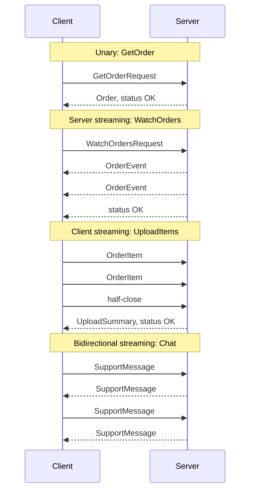
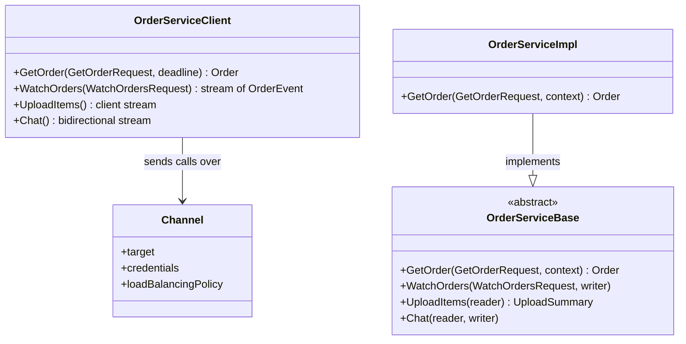

gRPC is a high-performance remote procedure call (RPC) framework. You define a service and its messages
once in a `.proto` file, generate client and server code for each language, and then call remote methods
as if they were local functions. Messages are encoded as compact binary **Protocol Buffers** and
travel over **HTTP/2**, which gives gRPC streaming, multiplexing and low latency.

<!-- more -->

This post is part of the [API communication protocols](/posts/communication/api/api-communication-protocols/) series.
{: .prompt-info }

## At a glance

| | gRPC |
|---|---|
| Type | RPC framework with a wire protocol |
| Created by | Google (open-sourced 2015, 1.0 in 2016); a CNCF incubating project since 2017 |
| Transport | HTTP/2 (one long-lived connection, many concurrent streams) |
| Payload | Protocol Buffers (binary) by default; JSON possible but rare |
| Contract | Required: `.proto` file, with generated client stubs and server skeletons |
| Call types | Unary, server streaming, client streaming, bidirectional streaming |
| Browser support | Needs gRPC-Web (or Connect) plus a proxy such as Envoy |
| Best for | Internal microservice calls, polyglot systems, streaming, mobile-to-backend |

## What gRPC is

gRPC has three parts:

1. **An interface definition language**: Protocol Buffers (`proto3`) describe services, methods and
   messages.
2. **Code generation**: `protoc` with language plugins produces typed clients and server interfaces for
   Go, Java, C#, Python, C++, Node.js, Kotlin, Swift, Rust, Dart and more.
3. **A runtime and wire protocol**: channels, load balancing, deadlines, cancellation, metadata,
   interceptors and status codes, all mapped onto HTTP/2.

```protobuf
syntax = "proto3";
package orders.v1;

service OrderService {
  rpc GetOrder (GetOrderRequest) returns (Order);                        // unary
  rpc WatchOrders (WatchOrdersRequest) returns (stream OrderEvent);      // server streaming
  rpc UploadItems (stream OrderItem) returns (UploadSummary);            // client streaming
  rpc Chat (stream SupportMessage) returns (stream SupportMessage);      // bidirectional
}

message GetOrderRequest { int64 id = 1; }

message Order {
  int64 id = 1;
  string status = 2;
  double total = 3;
  repeated OrderItem items = 4;
}

message OrderItem { string sku = 1; int32 quantity = 2; }
message WatchOrdersRequest { int64 customer_id = 1; }
message OrderEvent { int64 order_id = 1; string status = 2; }
message UploadSummary { int32 accepted = 1; }
message SupportMessage { string text = 1; }
```

The numbers (`= 1`, `= 2`) are **field tags**. On the wire, a field is identified by its tag, not its
name, which is why Protobuf messages are small, and why you can add new fields without breaking old
clients, as long as you never reuse or renumber a tag.

## Why it was developed

Google has connected its services with an internal RPC system called **Stubby** since around 2001,
handling billions of calls per second across its data centres. Protocol Buffers, Stubby's serialisation
format, was open-sourced in 2008, but Stubby itself was tied to Google's infrastructure. When HTTP/2
(derived from Google's SPDY) was being standardised, Google rebuilt the ideas of Stubby on top of it and
open-sourced the result as gRPC in February 2015. Version 1.0 followed in August 2016, and gRPC joined the
Cloud Native Computing Foundation in 2017.

The goals were the problems REST and JSON leave open for internal traffic: a strict contract shared by
many languages, efficient binary encoding, streaming in both directions, and built-in deadlines,
cancellation and load balancing for large microservice fleets.

## How it works

A gRPC call passes through a generated stub, becomes an HTTP/2 stream, and is dispatched to a typed
handler on the server. Switch modes to compare a unary call with server streaming:



### On the wire

Each call is one HTTP/2 stream on a shared connection:

| HTTP/2 frame | Content |
|---|---|
| `HEADERS` | `:method POST`, `:path /orders.v1.OrderService/GetOrder`, `content-type: application/grpc`, `grpc-timeout: 300m`, custom metadata such as `authorization` |
| `DATA` | One or more messages, each prefixed with a 1-byte compression flag and a 4-byte length |
| `HEADERS` (trailers) | `grpc-status: 0` and optional `grpc-message` |

Because HTTP/2 multiplexes streams, hundreds of concurrent calls share one TCP connection without
head-of-line blocking at the HTTP level, and headers are compressed with HPACK.

### The four kinds of method



### Generated code as UML

Code generation produces a typed client and an abstract server class for each service. This is roughly
what `protoc` generates in an object-oriented language:



### Using it

A Go server and client for `GetOrder`:

```go
// server
type server struct{ ordersv1.UnimplementedOrderServiceServer }

func (s *server) GetOrder(ctx context.Context, req *ordersv1.GetOrderRequest) (*ordersv1.Order, error) {
    o, err := store.Find(ctx, req.GetId())
    if errors.Is(err, store.ErrNotFound) {
        return nil, status.Errorf(codes.NotFound, "order %d not found", req.GetId())
    }
    return o, err
}

// client
conn, _ := grpc.NewClient("orders:50051", grpc.WithTransportCredentials(creds))
client := ordersv1.NewOrderServiceClient(conn)
ctx, cancel := context.WithTimeout(context.Background(), 300*time.Millisecond)
defer cancel()
order, err := client.GetOrder(ctx, &ordersv1.GetOrderRequest{Id: 42})
```

For debugging, `grpcurl` is the gRPC equivalent of curl:
`grpcurl -d '{"id": 42}' orders:50051 orders.v1.OrderService/GetOrder` (it needs server reflection or
the `.proto` files).

### Deadlines, cancellation and status codes

- **Deadlines** travel with the call (`grpc-timeout`). When a deadline passes, the client gets
  `DEADLINE_EXCEEDED` and the server's context is cancelled, so downstream calls stop too.
- **Status codes** replace HTTP status codes: `OK`, `INVALID_ARGUMENT`, `NOT_FOUND`, `ALREADY_EXISTS`,
  `PERMISSION_DENIED`, `UNAUTHENTICATED`, `RESOURCE_EXHAUSTED`, `UNAVAILABLE`, `DEADLINE_EXCEEDED`,
  `INTERNAL` and others, 17 in all.
- **Metadata** is the equivalent of HTTP headers, used for auth tokens and tracing context.
- **Interceptors** are middleware for logging, metrics, auth and retries.

### Load balancing

Because one HTTP/2 connection carries many calls, a layer 4 (TCP) load balancer sends all of a client's
calls to the same backend. gRPC needs either **client-side load balancing** (the client resolves all
backends through DNS or xDS and spreads calls) or a **layer 7 proxy** that understands HTTP/2, such as
Envoy, Linkerd or Istio.

### gRPC in the browser

Browsers do not expose HTTP/2 frames or trailers to JavaScript, so they cannot speak native gRPC.
**gRPC-Web** uses a slightly different wire format that a proxy (Envoy) translates. The **Connect**
protocol from Buf is another option that serves gRPC, gRPC-Web and a simple JSON-over-HTTP protocol from
the same handlers.

## Where it is used

- **Microservice back ends** where many services in different languages call each other.
- **Infrastructure and control planes**: container runtimes, service meshes, databases.
- **Mobile to backend** where bandwidth and battery matter.
- **Streaming**: telemetry, logs, real-time updates between services.
- **Machine learning serving**: TensorFlow Serving and NVIDIA Triton Inference Server offer gRPC endpoints.

## Real-life examples

### Kubernetes Container Runtime Interface

The kubelet on every Kubernetes node does not talk to containerd or CRI-O through a custom API: it calls
them through the **Container Runtime Interface**, a gRPC service defined in `.proto` files
(`RuntimeService` with methods such as `RunPodSandbox`, `CreateContainer` and `StartContainer`, and
`ImageService` with `PullImage`). The call goes over a local Unix socket. Any runtime that implements
the gRPC contract can be plugged into Kubernetes, which is the point of contract-first design.

### etcd and Envoy

**etcd**, the key-value store that holds all Kubernetes cluster state, exposes its v3 API over gRPC; the
`Watch` method is a bidirectional stream that pushes key changes to the API server. **Envoy** proxies
receive their configuration through the **xDS** APIs, which are gRPC streaming services, so a control
plane such as Istio can push new routes and endpoints to thousands of proxies instantly.

## Strengths and limitations

| Strengths | Limitations |
|---|---|
| Small binary messages, fast to serialise | Not human-readable; needs grpcurl or reflection to debug |
| Strict, versionable contract with code generation | Browsers need gRPC-Web or Connect and a proxy |
| Four call types including bidirectional streaming | Load balancing needs L7 proxies or client-side balancing |
| Deadlines, cancellation and metadata built in | HTTP caching and CDNs do not apply |
| HTTP/2 multiplexing over one connection | Shared `.proto` files must be managed (registry, linting, breaking-change checks) |

## Best practices

- **Always set deadlines** on the client and propagate the context downstream.
- **Version packages** (`orders.v1`) and never reuse or change field numbers; reserve removed ones with
  `reserved`.
- **Lint and check for breaking changes** in CI with `buf lint` and `buf breaking`, and keep `.proto`
  files in a shared repository or schema registry.
- **Return rich status codes**, not `UNKNOWN` for everything.
- **Use TLS or mTLS** (a service mesh can do this transparently) and pass auth tokens in metadata.
- **Enable health checking** (`grpc.health.v1`) and retries with backoff only for idempotent methods.
- **Keep messages small**; the default maximum received message size is 4 MB. Stream large data.

## When to use gRPC, and when not

Use gRPC for internal service-to-service traffic, polyglot systems, low-latency or high-throughput paths,
and anything that needs streaming in both directions.

Prefer [REST](/posts/communication/api/rest-api/) for public APIs and browser clients,
[GraphQL](/posts/communication/api/graphql/) for flexible front-end data fetching, and
[AMQP](/posts/communication/api/amqp/) when the caller should not wait for the callee at all.

## Related posts

- [API Communication Protocols: overview](/posts/communication/api/api-communication-protocols/)
- [REST API](/posts/communication/api/rest-api/)
- [WebSocket](/posts/communication/api/websocket/)
- [Comparison of API protocols](/posts/communication/api/api-protocols-comparison/)
