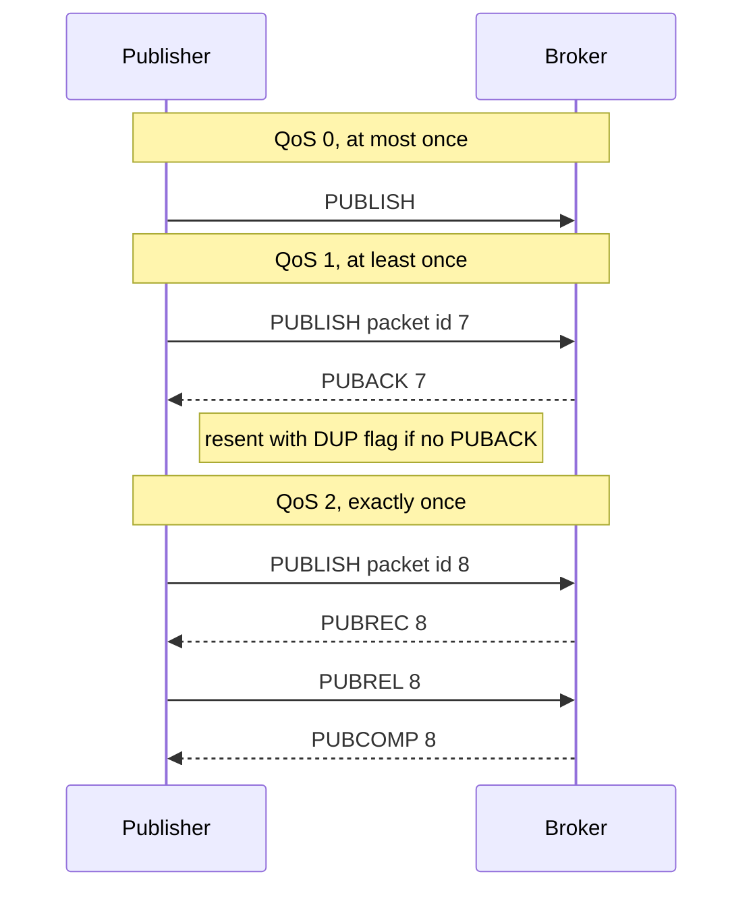
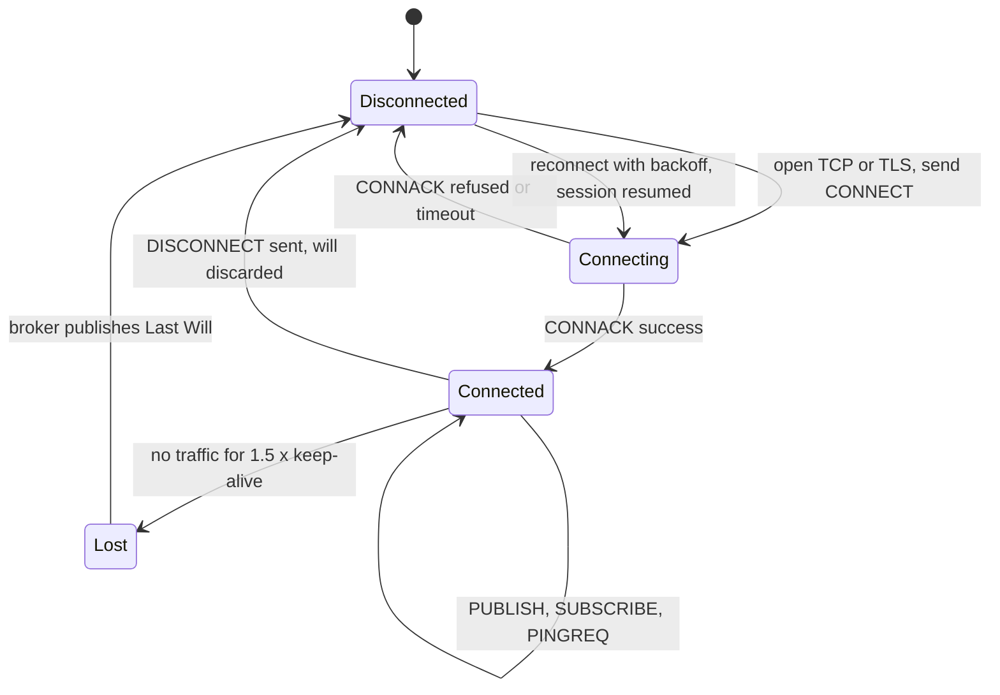

MQTT is a lightweight **publish/subscribe** messaging protocol. Devices connect to a central **broker**,
publish messages to hierarchical **topics** such as `plant/1/temp`, and receive messages on topics they
subscribe to. The fixed header is only two bytes, connections survive flaky networks, and three
**Quality of Service** levels let each message choose between speed and guaranteed delivery. That makes
MQTT the default protocol of the Internet of Things.

<!-- more -->

This post is part of the [API communication protocols](/posts/communication/api/api-communication-protocols/) series.
{: .prompt-info }

## At a glance

| | MQTT |
|---|---|
| Type | Binary publish/subscribe protocol through a broker |
| Created | 1999 by Andy Stanford-Clark (IBM) and Arlen Nipper (Arcom, now Cirrus Link) |
| Standards | MQTT 3.1.1 (OASIS 2014, ISO/IEC 20922 in 2016), MQTT 5.0 (OASIS 2019) |
| Name | Originally "MQ Telemetry Transport"; today simply MQTT |
| Transport | TCP on port 1883, TLS on 8883; MQTT over WebSocket for browsers |
| Payload | Opaque bytes: JSON, Protobuf, CBOR or raw sensor values |
| Contract | None; topic names and payloads are a convention (AsyncAPI can document them) |
| Delivery | QoS 0 at most once, QoS 1 at least once, QoS 2 exactly once (between client and broker) |
| Best for | Sensors, vehicles, smart homes, industrial telemetry, mobile apps on poor networks |

## What MQTT is

Publishers and subscribers never talk to each other directly. They only know the broker and topic
names, so a sensor does not know who reads its data, and a dashboard does not know which sensors exist.

**Topics** are UTF-8 strings with levels separated by `/`. Subscribers can use wildcards:

| Filter | Matches | Does not match |
|---|---|---|
| `plant/1/temp` | exactly `plant/1/temp` | `plant/2/temp` |
| `plant/+/temp` (`+` = one level) | `plant/1/temp`, `plant/7/temp` | `plant/1/line/3/temp` |
| `plant/#` (`#` = all remaining levels) | `plant/1/temp`, `plant/1/line/3/alarm` | `factory/1/temp` |

```bash
# Subscribe to every temperature in plant 1's lines (Mosquitto command-line clients)
mosquitto_sub -h broker.example.com -p 8883 --cafile ca.pem -t 'plant/+/temp' -q 1 -v

# Publish a reading, retained so new subscribers get the last value immediately
mosquitto_pub -h broker.example.com -p 8883 --cafile ca.pem -t 'plant/1/temp' -m '21.7' -q 1 -r
```

## Why it was developed

In 1999, Phillips 66 needed to monitor oil pipelines from remote stations in the desert. The data went
over satellite links that were slow, expensive per byte and often interrupted, and the field devices had
very little power and memory. Andy Stanford-Clark of IBM and Arlen Nipper of Arcom designed a protocol
with a tiny header, a persistent connection with keep-alive, and delivery guarantees that survive lost
links. It became part of IBM's MQSeries (WebSphere MQ) family as "MQ Telemetry Transport".

IBM published the specification royalty-free in 2010, and the Eclipse Foundation's Paho (clients) and
Mosquitto (broker) projects made it widely available. OASIS standardised version 3.1.1 in 2014, and
MQTT 5.0 in 2019 added features learned from large deployments: reason codes, session and message
expiry, shared subscriptions, user properties and request/response correlation.

## How it works

The animation shows topic-based routing through a broker. Switch on the offline mode to see the
Last Will and Testament in action:



### Packets

| Packet | Direction | Purpose |
|---|---|---|
| `CONNECT` / `CONNACK` | Client to broker / back | Client ID, credentials, keep-alive, clean start flag, Last Will |
| `PUBLISH` | Both | Topic, QoS, retain flag, payload |
| `PUBACK` | Both | Acknowledges QoS 1 |
| `PUBREC`, `PUBREL`, `PUBCOMP` | Both | Four-step handshake for QoS 2 |
| `SUBSCRIBE` / `SUBACK` | Client to broker / back | Topic filters and the maximum QoS for each |
| `UNSUBSCRIBE` / `UNSUBACK` | Client to broker / back | Remove subscriptions |
| `PINGREQ` / `PINGRESP` | Client to broker / back | Keep-alive when there is no other traffic |
| `DISCONNECT` | Both | Clean disconnect; the Last Will is not sent |

### Quality of Service



| QoS | Guarantee | Cost | Typical use |
|---|---|---|---|
| 0 | At most once; may be lost | One packet | Frequent sensor readings where the next value replaces the last |
| 1 | At least once; may be duplicated | Two packets, stored until acknowledged | Alarms, commands, most business data |
| 2 | Exactly once | Four packets | Billing or metering where duplicates are unacceptable |

QoS applies to each hop separately: publisher to broker, and broker to each subscriber. A subscriber
receives at the lower of the publish QoS and its subscription QoS.

### Features that make MQTT fit devices

- **Retained messages**: the broker keeps the last message on a topic and sends it to every new
  subscriber, so a dashboard sees the current state immediately.
- **Last Will and Testament (LWT)**: a message the client registers at connect time; the broker publishes
  it if the client disappears without a clean `DISCONNECT`.
- **Keep-alive**: if the broker hears nothing for 1.5 times the keep-alive interval, it closes the session.
- **Persistent sessions**: with a clean start flag of false, the broker remembers subscriptions and queues
  QoS 1 and 2 messages while the device sleeps or is offline.
- **Shared subscriptions** (MQTT 5, `$share/group/topic`): load-balance messages across a group of
  backend consumers.

### Client session state

A device's view of its connection as a UML state machine:



## Where it is used

- **Industrial IoT**: factories, oil and gas, energy grids, often with the **Sparkplug B** specification
  that defines topic names and payloads for SCADA systems.
- **Smart home**: Home Assistant, Zigbee2MQTT, Tasmota and many devices talk MQTT.
- **Connected vehicles and fleets**: telemetry and remote commands over mobile networks.
- **Cloud IoT platforms**: AWS IoT Core, Azure IoT Hub and Azure Event Grid's MQTT broker, HiveMQ Cloud,
  EMQX Cloud.
- **Mobile messaging and notifications** on unreliable networks.
- **Brokers** to know: Eclipse Mosquitto (small, single node), EMQX, HiveMQ, VerneMQ and RabbitMQ's
  MQTT plugin (clustered, millions of connections).

## Real-life examples

### AWS IoT Core and Azure IoT Hub

On AWS IoT Core, every device connects with an X.509 certificate over MQTT on port 8883 and publishes
telemetry to topics such as `factory/line1/temp`. **Rules** written in an SQL-like language subscribe to
topics and route messages to Lambda, DynamoDB, Kinesis or S3. **Device Shadows** use reserved topics
(`$aws/things/<name>/shadow/update`) to sync the desired and reported state of a device that is often
offline. Azure IoT Hub follows the same pattern: devices publish to `devices/{deviceId}/messages/events/`
and receive cloud-to-device messages and **device twin** updates on reserved topics.

### Facebook Messenger

When Facebook built its Messenger app in 2011, its engineers chose MQTT to deliver messages to phones.
Their engineering post explained why: keeping a persistent MQTT connection open used less battery and
bandwidth than repeated HTTP polling, and messages arrived in a fraction of a second even on poor mobile
networks. It is a well-known example of MQTT outside classic IoT: any client on a constrained or
unreliable link benefits from the same design.

## Strengths and limitations

| Strengths | Limitations |
|---|---|
| Very small overhead; good for low bandwidth and battery-powered devices | The broker is a central component that must be highly available and scaled |
| Publishers and subscribers fully decoupled | No payload schema, no built-in request/response before MQTT 5 |
| Three QoS levels, retained messages, Last Will, persistent sessions | Not designed for large payloads or long message retention |
| Handles intermittent connectivity well | Topic design and ACLs need care to stay secure |
| Huge ecosystem of clients, brokers and cloud services | Exactly-once is per hop, not end to end |

## Best practices

- **Always use TLS (8883)** and per-device credentials, ideally X.509 client certificates.
- **Enforce topic ACLs** so each device can only publish and subscribe under its own prefix.
- **Design topics hierarchically**, from general to specific (`site/area/device/measurement`), and never
  start them with `/` or `$` (reserved for the broker).
- **Pick the lowest QoS that is acceptable**; QoS 2 is rarely needed.
- **Use retained messages for state, not for events**, and clear them with an empty retained payload.
- **Set a Last Will** with a status topic for every device.
- **Use unique client IDs**: a second connection with the same ID disconnects the first.
- **Bridge to a stream platform** (Kafka, Event Hubs, Kinesis) for analytics and long-term storage.

## When to use MQTT, and when not

Use MQTT for many devices sending small messages over unreliable or metered networks, for telemetry and
commands, and when you want producers and consumers fully decoupled.

Prefer [AMQP](/posts/communication/api/amqp/) for back-end business messaging with complex routing and
work queues, Kafka for high-volume event streams that must be replayed, and
[WebSocket](/posts/communication/api/websocket/) or [REST](/posts/communication/api/rest-api/) for
browser applications that do not need a broker.

## Related posts

- [API Communication Protocols: overview](/posts/communication/api/api-communication-protocols/)
- [AMQP](/posts/communication/api/amqp/)
- [WebSocket](/posts/communication/api/websocket/)
- [Comparison of API protocols](/posts/communication/api/api-protocols-comparison/)
