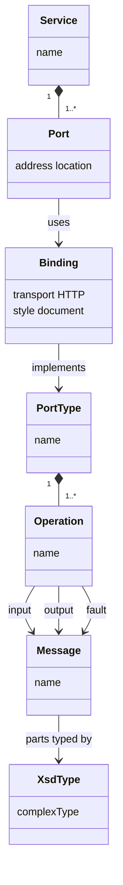
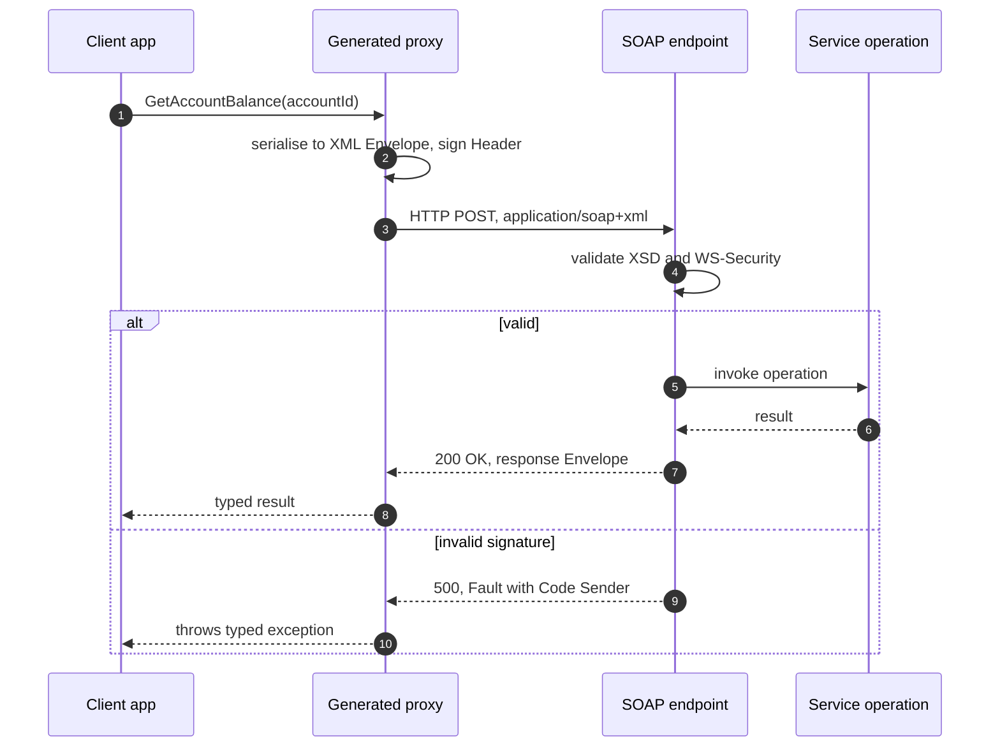

SOAP is an XML-based messaging protocol for calling operations on remote services. Every message is an
XML **Envelope** with an optional **Header** and a **Body**, and every service publishes a formal contract
in **WSDL** from which clients are generated. SOAP dominated enterprise integration in the 2000s and,
although new public APIs are rarely SOAP today, it still runs a large share of banking, insurance,
telecom, healthcare and government systems.

<!-- more -->

This post is part of the [API communication protocols](/posts/communication/api/api-communication-protocols/) series.
{: .prompt-info }

## At a glance

| | SOAP |
|---|---|
| Type | Messaging protocol (W3C Recommendation) |
| Created | 1998 by Dave Winer, Don Box, Bob Atkinson and Mohsen Al-Ghosein at Microsoft; SOAP 1.1 W3C Note in 2000; SOAP 1.2 Recommendation in 2003 |
| Name | Originally "Simple Object Access Protocol"; since 1.2 just SOAP |
| Transport | Usually HTTP `POST`; also SMTP, JMS, TCP |
| Payload | XML only, validated by XML Schema (XSD) |
| Contract | Required: WSDL (Web Services Description Language) |
| Errors | Standard `Fault` element |
| Extensions | WS-Security, WS-Addressing, WS-ReliableMessaging, WS-AtomicTransaction, WS-Policy |
| Best for | Integrations that require formal contracts, message-level security and existing WSDLs |

## What SOAP is

A SOAP message is a document, not a URL plus a verb. The operation and its parameters are inside the
XML body, and everything goes to one endpoint URL.

```xml
POST /AccountService HTTP/1.1
Host: bank.example.com
Content-Type: application/soap+xml; charset=utf-8

<?xml version="1.0" encoding="UTF-8"?>
<soap:Envelope xmlns:soap="http://www.w3.org/2003/05/soap-envelope"
               xmlns:acc="http://bank.example.com/accounts">
  <soap:Header>
    <wsse:Security xmlns:wsse="http://docs.oasis-open.org/wss/2004/01/oasis-200401-wss-wssecurity-secext-1.0.xsd">
      <!-- signed timestamp, binary security token, signature -->
    </wsse:Security>
  </soap:Header>
  <soap:Body>
    <acc:GetAccountBalance>
      <acc:AccountId>DE89370400440532013000</acc:AccountId>
    </acc:GetAccountBalance>
  </soap:Body>
</soap:Envelope>
```

The response is another envelope:

```xml
<soap:Envelope xmlns:soap="http://www.w3.org/2003/05/soap-envelope"
               xmlns:acc="http://bank.example.com/accounts">
  <soap:Body>
    <acc:GetAccountBalanceResponse>
      <acc:Balance currency="EUR">1520.75</acc:Balance>
    </acc:GetAccountBalanceResponse>
  </soap:Body>
</soap:Envelope>
```

| Part | Purpose |
|---|---|
| `Envelope` | Root element; its namespace identifies the SOAP version (1.1 or 1.2) |
| `Header` | Optional metadata processed by intermediaries: security, routing, transactions, correlation |
| `Body` | The operation and its parameters, or a `Fault` |
| `Fault` | Standard error structure: `Code` (Sender, Receiver, VersionMismatch, MustUnderstand), `Reason`, `Detail` |

### WSDL: the contract

A WSDL document describes what a service offers and how to reach it. WSDL 1.1 has five main parts:

| Element | Describes |
|---|---|
| `types` | XML Schema definitions of the messages' data |
| `message` | The input and output messages |
| `portType` | The abstract interface: a set of operations |
| `binding` | How the operations map to SOAP over HTTP (style, encoding) |
| `service` / `port` | The concrete endpoint address |

Tools such as `wsimport` (Java), `svcutil` and `dotnet-svcutil` (.NET), Apache CXF and Python's `zeep`
read a WSDL and generate typed proxy classes, so calling a SOAP service looks like calling a local method.

The relationships between WSDL elements as a UML class diagram:



## Why it was developed

In the late 1990s, distributed objects were built with **DCOM** (Microsoft), **CORBA** (OMG) and
**Java RMI**. Each was tied to a platform or required complex brokers, and their binary protocols on
custom ports were blocked by corporate firewalls. XML and HTTP had just become universal, so Dave Winer
and a Microsoft team designed **XML-RPC** (1998) and then SOAP: send an XML document over HTTP port 80,
and any platform that can parse XML can call any other.

IBM, Microsoft and others then built the **WS-\*** stack on top of SOAP for enterprise needs: message
signing and encryption (WS-Security, an OASIS standard from 2004), reliable delivery, distributed
transactions and policies. SOAP became the backbone of Service-Oriented Architecture (SOA) and
Enterprise Service Buses. Its complexity is also why developers moved to
[REST](/posts/communication/api/rest-api/) in the late 2000s.

## How it works

A SOAP call goes through a generated proxy, the SOAP endpoint and header processing. Switch on the fault
mode to see how errors are returned:





### SOAP 1.1 versus 1.2

| | SOAP 1.1 | SOAP 1.2 |
|---|---|---|
| Content type | `text/xml` plus a `SOAPAction` header | `application/soap+xml` with an optional `action` parameter |
| Envelope namespace | `http://schemas.xmlsoap.org/soap/envelope/` | `http://www.w3.org/2003/05/soap-envelope` |
| Fault codes | `Client`, `Server` | `Sender`, `Receiver` |
| Status | W3C Note | W3C Recommendation |

### Styles and attachments

Use **document/literal wrapped** style: the Body contains one element defined by an XML Schema, which is
what the WS-I Basic Profile recommends for interoperability. The older **RPC/encoded** style is
deprecated. Binary data travels as Base64 in the XML or, more efficiently, as **MTOM** attachments.

## Where it is used

- **Banking and payments**: core banking interfaces, card processors, interbank messaging gateways.
- **Insurance and healthcare**: policy administration systems; parts of HL7 v3 and IHE profiles.
- **Telecom**: provisioning and billing systems built in the 2000s.
- **Government and tax**: filing and e-invoicing gateways in several countries.
- **Enterprise software**: older SAP, Oracle, Microsoft Dynamics and Salesforce integration APIs.
- **Logistics**: carrier shipping, rating and tracking APIs.

## Real-life examples

### EU VIES VAT number validation

The European Commission's **VIES** service, which checks whether an EU VAT number is valid, has long been
offered as a SOAP web service with a public WSDL (`checkVatService.wsdl`). E-commerce platforms and
invoicing systems call its `checkVat` operation with a country code and a number before applying
reverse-charge VAT on cross-border B2B invoices. Libraries in every language wrap that one WSDL, which
shows SOAP's main strength: a published contract that clients can be generated from without any
hand-written documentation.

### Salesforce and carrier APIs

Salesforce still offers a **SOAP API** next to its REST API. Customers download an Enterprise WSDL
(strongly typed to their own org's objects) or a Partner WSDL (generic), generate a client in Java or
.NET, and use it for back-office integrations. Parcel carriers have a similar history: UPS, FedEx and
national postal services exposed rating, shipping and tracking as SOAP web services for years, and
logistics systems built against those WSDLs are still common even as the carriers move to REST.

## Strengths and limitations

| Strengths | Limitations |
|---|---|
| Formal, machine-readable contract and generated clients | Verbose XML; larger and slower than JSON or Protobuf |
| Message-level security (signing, encryption) independent of transport | Complex: WS-* standards, namespaces, interoperability profiles |
| Standard error model (`Fault`) | Uses HTTP as a tunnel: always `POST`, no HTTP caching |
| Reliable messaging and distributed transactions via WS-* | Poor fit for browsers, mobile and modern tooling |
| Transport independent (HTTP, JMS, SMTP) | XML parsing attacks (XXE, billion laughs) if parsers are not hardened |

## Best practices

- **Harden XML parsers**: disable external entities and DTDs to prevent XXE, and limit document size
  and depth.
- **Use document/literal wrapped** and follow the WS-I Basic Profile.
- **Combine TLS with WS-Security** where messages pass through intermediaries.
- **Version namespaces** (`.../accounts/v2`) rather than changing existing types.
- **Wrap legacy SOAP services** with a REST or GraphQL facade (API gateway or BFF) for new clients,
  instead of spreading SOAP to new code.
- **Log and monitor Faults**, not only HTTP status codes.

## When to use SOAP, and when not

Use SOAP when you integrate with a system that only offers a WSDL, when a regulator or partner mandates
it, or when you need message-level signatures and WS-* features that the parties already support.

For new APIs, prefer [REST](/posts/communication/api/rest-api/) for public interfaces and
[gRPC](/posts/communication/api/grpc/) for typed internal contracts: they give most of SOAP's benefits
with far less weight.

## Related posts

- [API Communication Protocols: overview](/posts/communication/api/api-communication-protocols/)
- [REST API](/posts/communication/api/rest-api/)
- [API Security](/posts/communication/api/api-security/)
- [Comparison of API protocols](/posts/communication/api/api-protocols-comparison/)
