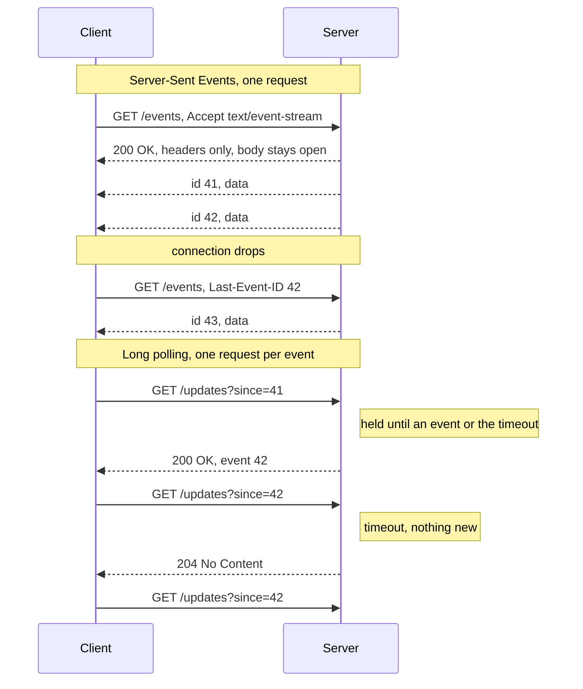
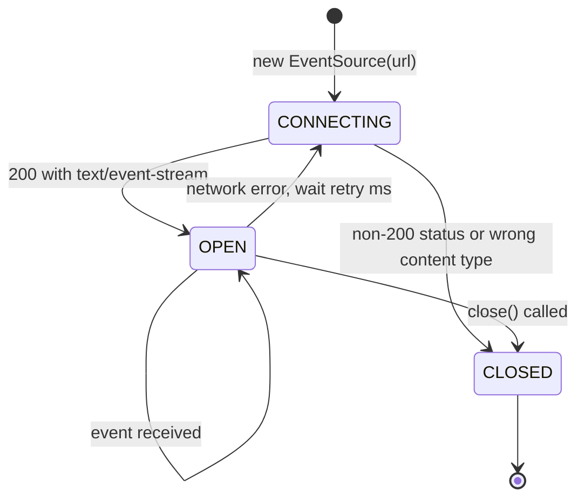

Many "real-time" features only need data to flow **one way**: from the server to the client.
Notifications, progress bars, live scores, log tails and AI chat responses that appear token by token
all fit this shape. For these, you do not need [WebSocket](/posts/communication/api/websocket/). Two
techniques push data over plain HTTP: **Server-Sent Events (SSE)**, a standard streaming format with a
built-in browser API, and **long polling**, the older trick of holding a request open until there is news.

<!-- more -->

This post is part of the [API communication protocols](/posts/communication/api/api-communication-protocols/) series.
{: .prompt-info }

## At a glance

| | Server-Sent Events | Long polling |
|---|---|---|
| Type | Standard (WHATWG HTML Living Standard) with the `EventSource` API | Technique, no standard |
| Origin | Proposed by Ian Hickson from 2004, first shipped in Opera in 2006 | Part of the Comet family of techniques, named in 2006 |
| Transport | One long-lived HTTP response | Repeated HTTP requests, each held open |
| Payload | UTF-8 text, `Content-Type: text/event-stream` | Anything, usually JSON |
| Direction | Server to client only | Server to client (client to server uses normal requests) |
| Reconnect and resume | Built in (`retry`, `Last-Event-ID`) | You implement it (cursor or `since` parameter) |
| Overhead per event | A few bytes of text | A full HTTP request and response |
| Best for | Notifications, feeds, progress, LLM streaming | Environments where streaming responses are blocked |

## What they are

### Server-Sent Events

The client makes one `GET` request and the server never finishes the response. Instead it keeps writing
**events** in a simple text format, separated by blank lines:

```text
retry: 5000

id: 41
event: order
data: {"id": 42, "status": "paid"}

id: 42
event: order
data: {"id": 42, "status": "shipped"}

: this line is a comment, often sent every 15 s as a keep-alive
```

| Field | Meaning |
|---|---|
| `data:` | The payload. Several `data:` lines are joined with newlines |
| `event:` | Event type; the browser dispatches it to listeners of that name (default `message`) |
| `id:` | Event ID. The browser remembers the last one and sends it as `Last-Event-ID` when it reconnects |
| `retry:` | Reconnection delay in milliseconds |
| `:` | Comment, ignored; useful as a heartbeat |

In the browser:

```javascript
const source = new EventSource("/events?topic=orders");
source.addEventListener("order", (e) => updateOrder(JSON.parse(e.data)));
source.onerror = () => console.log("connection lost, the browser will retry by itself");
```

### Long polling

The client asks "anything new since X?" and the server **does not answer immediately** if there is
nothing new. It holds the request until an event arrives or a timeout (often 20 to 60 seconds) expires,
then responds. The client processes the answer and immediately sends the next request.

```javascript
async function poll(since) {
  while (true) {
    const res = await fetch(`/updates?since=${since}&timeout=30`);
    if (res.status === 200) {
      const { events, cursor } = await res.json();
      events.forEach(handle);
      since = cursor;
    } else if (res.status !== 204) {
      await sleep(backoff());          // error: wait before retrying
    }
  }
}
```

Compare this with **short polling** (asking every few seconds regardless): long polling delivers events
almost instantly and does not waste requests on "nothing new" answers.

## Why they were developed

Early web applications could only receive data by asking for it. Around 2005 and 2006, Gmail chat,
Meebo and others needed instant updates, and developers invented ways to hold HTTP open: long polling,
"forever frame" iframes and streaming XHR. Alex Russell named this family **Comet** in 2006, and the
**Bayeux** protocol (CometD) standardised one variant. Facebook Chat launched in 2008 on long polling.

Ian Hickson's WHATWG work on "server-sent events" turned the streaming variant into a proper standard
with a browser API. Opera shipped it in 2006, and Firefox, Safari and Chrome followed around 2010 to 2011
under the name `EventSource`. Microsoft Edge added it in 2020 when it moved to Chromium, which is why
older articles say "SSE does not work in IE".

The rise of large language models made SSE popular again: streaming a model's output token by token is
exactly a one-way, ordered stream of small text events.

## How they work

Switch between the two modes to compare one long-lived SSE stream with a chain of long-poll requests:



### Side by side



### Server side

An SSE endpoint just sets the right headers, flushes after each event and keeps the connection open.
In Node.js with Express:

```javascript
app.get("/events", (req, res) => {
  res.set({
    "Content-Type": "text/event-stream",
    "Cache-Control": "no-cache",
    "Connection": "keep-alive",
    "X-Accel-Buffering": "no",          // tell NGINX not to buffer the stream
  });
  res.flushHeaders();
  const lastId = Number(req.get("Last-Event-ID") ?? 0);
  replayFrom(lastId, res);              // send what the client missed
  const unsubscribe = bus.subscribe((evt) => {
    res.write(`id: ${evt.id}\nevent: ${evt.type}\ndata: ${JSON.stringify(evt.data)}\n\n`);
  });
  req.on("close", unsubscribe);
});
```

### Client connection states

The `EventSource` object moves through three states (`readyState` 0, 1, 2). Unlike WebSocket, the
browser reconnects automatically:



### Things that break streaming

- **Proxy and gateway buffering**: NGINX, some CDNs and API gateways buffer responses, so events arrive
  in bursts. Disable buffering (`X-Accel-Buffering: no`, `proxy_buffering off`).
- **Idle timeouts**: load balancers close connections that are silent for 60 seconds or so. Send a
  comment line as a heartbeat.
- **HTTP/1.1 connection limits**: browsers allow only about six connections per domain on HTTP/1.1, and
  each SSE stream holds one. Over HTTP/2 streams are multiplexed, so this limit disappears.
- **Compression**: gzip without flushing holds events back.
- **No custom headers**: the browser's `EventSource` cannot send an `Authorization` header; use cookies,
  or a `fetch`-based SSE client when you need headers or `POST`.

## Where they are used

- **AI and LLM APIs**: streaming completions token by token.
- **Notifications and activity feeds** in web apps.
- **Progress of long-running jobs**: builds, deployments, file processing, report generation.
- **Live data**: scores, prices, dashboards, log tails, CI build output.
- **Long polling** where streaming is impossible: some corporate proxies, legacy clients, bot APIs, and
  as the fallback transport in libraries such as Socket.IO and SignalR.

## Real-life examples

### Streaming responses from LLM APIs

When you call the Anthropic Messages API or the OpenAI API with `"stream": true`, the HTTP response is an
SSE stream. Anthropic's stream, for example, sends named events such as `message_start`,
`content_block_delta` (each carrying the next piece of text), `message_delta` and `message_stop`. Chat
interfaces render each delta as it arrives, which is why answers appear word by word instead of after a
long wait. The request is a normal `POST`, so clients use an SSE parser over `fetch` rather than
`EventSource`, which only supports `GET`.

### Telegram Bot API

A Telegram bot can receive updates in two ways: a [webhook](/posts/communication/api/webhooks/), or
**long polling** with the `getUpdates` method. A bot calls
`getUpdates?offset=<last update id + 1>&timeout=30`; Telegram holds the request for up to 30 seconds and
returns as soon as a message arrives. The `offset` acknowledges everything before it, so no update is
lost or repeated. Long polling lets a bot run on a laptop or behind NAT with no public HTTPS endpoint,
which is why most bot frameworks use it by default during development.

## Strengths and limitations

| | Strengths | Limitations |
|---|---|---|
| **SSE** | Plain HTTP: works with existing auth, proxies, HTTP/2 and observability | One direction only; the client sends with ordinary requests |
| | Automatic reconnect and resume with `Last-Event-ID` | Text only (binary must be Base64 encoded) |
| | Tiny per-event overhead, trivial to implement | Buffering proxies and idle timeouts need configuration |
| **Long polling** | Works almost everywhere, even with strict proxies | Full HTTP request and response per event |
| | Simple server model: a request that waits | Latency gap between a response and the next request |
| | Easy to make reliable with a cursor | Many held requests use server resources |

## Best practices

- **Prefer SSE over long polling** unless something in the path blocks streaming responses.
- **Give every event an `id`** and support `Last-Event-ID` (or a `since` cursor) so reconnects lose nothing.
- **Send heartbeats** every 15 to 30 seconds.
- **Serve SSE over HTTP/2** to avoid the per-domain connection limit.
- **Disable response buffering** in every proxy on the path.
- **Use async servers** (Node.js, Go, Python asyncio, Spring WebFlux) so thousands of idle connections
  do not each hold a thread.
- **For long polling**, return `204` on timeout, cap the timeout below your load balancer's idle timeout,
  and back off on errors.

## When to use them, and when not

Use **SSE** for any one-way stream from server to browser or between services: notifications,
progress, feeds and LLM output. Use **long polling** as a fallback, or when the client cannot hold a
streaming response.

Prefer [WebSocket](/posts/communication/api/websocket/) when the client also sends frequent messages,
[webhooks](/posts/communication/api/webhooks/) when the receiver is another server with a public URL,
and [MQTT](/posts/communication/api/mqtt/) for devices.

## Related posts

- [API Communication Protocols: overview](/posts/communication/api/api-communication-protocols/)
- [WebSocket](/posts/communication/api/websocket/)
- [Webhooks](/posts/communication/api/webhooks/)
- [Comparison of API protocols](/posts/communication/api/api-protocols-comparison/)
