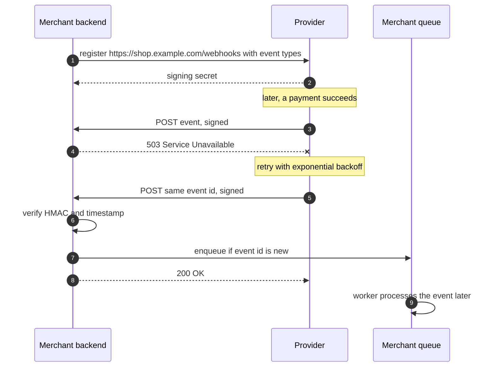
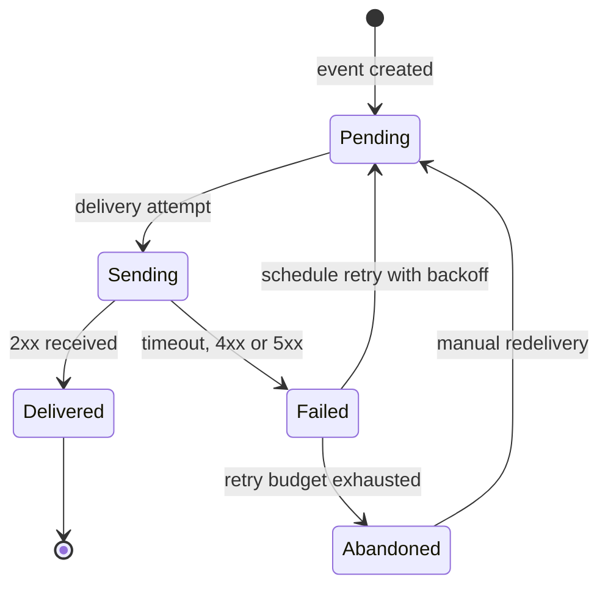

A webhook is an HTTP callback: **you give a service a URL, and it sends you an HTTP `POST` when
something happens**. Instead of asking a payment provider every minute "has this payment succeeded
yet?", you let it tell you. Webhooks are how SaaS platforms, payment providers, Git hosts, CI systems
and chat tools notify other systems about events.

<!-- more -->

This post is part of the [API communication protocols](/posts/communication/api/api-communication-protocols/) series.
{: .prompt-info }

## At a glance

| | Webhooks |
|---|---|
| Type | Integration pattern on top of HTTP (no single standard) |
| Named by | Jeff Lindsay, 2007 |
| Transport | HTTPS `POST` from the provider to the consumer's endpoint |
| Payload | Usually JSON; the provider defines the event schema |
| Contract | The provider's event catalogue; optionally CloudEvents or the Standard Webhooks spec |
| Direction | Server to server, triggered by events, reversed roles: the provider is the client |
| Delivery | At least once, with retries; ordering not guaranteed |
| Best for | Notifying other systems, especially other organisations, about events |

## What webhooks are

In a normal API call the consumer is the client and the provider is the server. With a webhook the
roles are reversed for the notification: the provider makes an HTTP request to an endpoint the consumer
runs.

```http
POST /webhooks/payments HTTP/1.1
Host: shop.example.com
Content-Type: application/json
Webhook-Id: evt_1Q2w3E4r
Webhook-Timestamp: 1759740000
Webhook-Signature: v1,K5oZfzN95Z9UVu1EsfQmfVNQhnkZ2pj9o9NDN/H/pI4=

{
  "id": "evt_1Q2w3E4r",
  "type": "payment.succeeded",
  "created": 1759740000,
  "data": { "payment_id": "pay_88", "order_id": "42", "amount": 12990, "currency": "EUR" }
}
```

The headers above follow the **Standard Webhooks** specification; providers such as Stripe and GitHub
use their own header names but the same ideas: a unique event ID, a timestamp and an HMAC signature.

The consumer answers with any `2xx` status, and that answer is all the provider waits for.

## Why they were developed

The web of the mid-2000s connected services by **polling**: an application asked another service's API
every few minutes whether anything had changed. That wasted requests when nothing had changed, and
delayed reactions when something had. In 2007 Jeff Lindsay proposed **web hooks**: user-defined
callbacks over HTTP, the web equivalent of Unix pipes and hooks, so that any service could trigger code in
any other service. PayPal's Instant Payment Notification (IPN) was already doing this for payments.

GitHub's service hooks, Twilio's callbacks and Stripe's events made the pattern mainstream, and it is now
the default way for SaaS products to emit events. Recent efforts standardise the details: CNCF
**CloudEvents** for the event envelope and **Standard Webhooks** for signatures and headers.

## How it works

The animation shows registration, a signed delivery, verification and acknowledgement. Switch on the
outage mode to see retries:





### Signing and verification

The provider computes an HMAC (usually HMAC-SHA256) over the event ID, the timestamp and the **raw**
request body, using the shared secret. The receiver repeats the computation and compares:

```python
import base64, hashlib, hmac, time

TOLERANCE = 300  # seconds

def verify(secret: bytes, msg_id: str, timestamp: str, body: bytes, signature_header: str) -> bool:
    if abs(time.time() - int(timestamp)) > TOLERANCE:
        return False                                   # too old: possible replay
    signed = f"{msg_id}.{timestamp}.".encode() + body  # raw bytes, never re-serialised JSON
    expected = base64.b64encode(hmac.new(secret, signed, hashlib.sha256).digest()).decode()
    candidates = [s.split(",", 1)[1] for s in signature_header.split() if s.startswith("v1,")]
    return any(hmac.compare_digest(expected, c) for c in candidates)
```

Three details matter: use the raw body (parsing and re-serialising JSON changes the bytes), compare in
constant time (`compare_digest`) to avoid timing attacks, and reject old timestamps to stop replays.

### Delivery semantics

| Property | What providers typically guarantee | What the receiver must do |
|---|---|---|
| Delivery | At least once | Deduplicate by event ID (idempotent handler) |
| Ordering | Not guaranteed | Use timestamps or versions; fetch current state from the API if needed |
| Timeout | A few seconds to about 30 s | Acknowledge fast, process asynchronously |
| Retries | Exponential backoff over hours or days | Make handlers safe to repeat |
| Failure | Endpoint disabled after repeated failures, alert sent | Monitor the endpoint; replay missed events |

### Event lifecycle on the provider side



### The "thin event" pattern

Some providers send only an event type and an ID; the receiver then calls the provider's API to fetch the
current state. This avoids acting on stale or out-of-order data and keeps sensitive data out of the
webhook payload, at the cost of one extra API call.

## Where it is used

- **Payments**: payment succeeded or failed, refunds, disputes, subscription renewals.
- **Source control and CI/CD**: push, pull request and release events trigger builds and deployments.
- **Messaging and collaboration**: Slack incoming webhooks, Microsoft Teams connectors, Twilio SMS
  callbacks.
- **E-commerce**: order created, inventory changed, fulfilment updates (Shopify, WooCommerce).
- **Identity and SaaS**: user provisioning, form submissions, calendar changes.
- **Cloud events**: Azure Event Grid delivers events to webhook endpoints; AWS EventBridge API
  destinations call external webhooks.

## Real-life examples

### Stripe

Stripe sends events such as `payment_intent.succeeded`, `invoice.paid` and `charge.dispute.created` to
endpoints you register in the dashboard or API. Each request carries a `Stripe-Signature` header with a
timestamp and an HMAC-SHA256 signature, and Stripe's libraries provide `constructEvent` to verify it. In
live mode, Stripe retries failed deliveries with exponential backoff for up to three days, so
handlers must be idempotent; Stripe's documentation explicitly recommends logging processed event IDs
and returning `2xx` before doing heavy work. A shop typically marks the order as paid only when the
webhook arrives, never on the browser redirect, because the customer may close the tab.

### GitHub

A GitHub webhook on a repository or organisation sends events such as `push`, `pull_request` and
`workflow_run` to a URL, with the event type in `X-GitHub-Event`, a delivery GUID in
`X-GitHub-Delivery` and an HMAC-SHA256 signature in `X-Hub-Signature-256`. CI servers such as Jenkins,
Argo CD, chat bots and deployment tools use them to react to commits within seconds instead of polling
Git. GitHub does not automatically retry failed deliveries; you can see each delivery's request and
response in the settings and redeliver it manually or through the REST API, so receivers often run a
reconciliation job for missed events.

## Strengths and limitations

| Strengths | Limitations |
|---|---|
| Real-time notification without polling | The receiver needs a public HTTPS endpoint |
| Plain HTTP and JSON: easy for any stack | Duplicates, retries and out-of-order delivery must be handled |
| Works across organisations and firewalls (outbound from the provider) | Security depends on correct signature verification |
| Cheap for both sides compared with polling | Debugging is harder: the provider initiates the request |
| Loose coupling: the provider does not know what you do with the event | No back-pressure; bursts can overload the receiver |

## Best practices

**For receivers:**

- **Verify every signature** over the raw body, in constant time, and check the timestamp.
- **Respond `2xx` within a few seconds**; put the event on a queue and process it asynchronously.
- **Deduplicate by event ID** and make handlers idempotent.
- **Do not trust the payload blindly** for critical actions; re-fetch the object from the provider's API.
- **Use HTTPS only**, and consider IP allow-lists if the provider publishes its ranges.
- **Monitor failures** and run a periodic reconciliation for events you may have missed.
- **Develop locally** with a tunnel such as ngrok or the provider's CLI (`stripe listen`).

**For providers:**

- **Sign payloads**, include an event ID and timestamp, and support secret rotation.
- **Retry with exponential backoff and jitter**, show delivery logs and offer manual redelivery.
- **Protect against SSRF**: validate registered URLs and block private IP ranges.
- **Version event schemas** and document every event type.

## When to use webhooks, and when not

Use webhooks when one system must tell another, possibly in another organisation, that something
happened, and the receiver can expose an HTTPS endpoint.

Prefer [long polling or SSE](/posts/communication/api/sse-and-long-polling/) when the consumer cannot
accept inbound connections, [WebSocket](/posts/communication/api/websocket/) for a stream of updates to a
user's browser, and a broker such as [AMQP](/posts/communication/api/amqp/) inside your own platform,
where durable queues give stronger guarantees than HTTP callbacks.

## Related posts

- [API Communication Protocols: overview](/posts/communication/api/api-communication-protocols/)
- [REST API](/posts/communication/api/rest-api/)
- [AMQP](/posts/communication/api/amqp/)
- [Comparison of API protocols](/posts/communication/api/api-protocols-comparison/)
