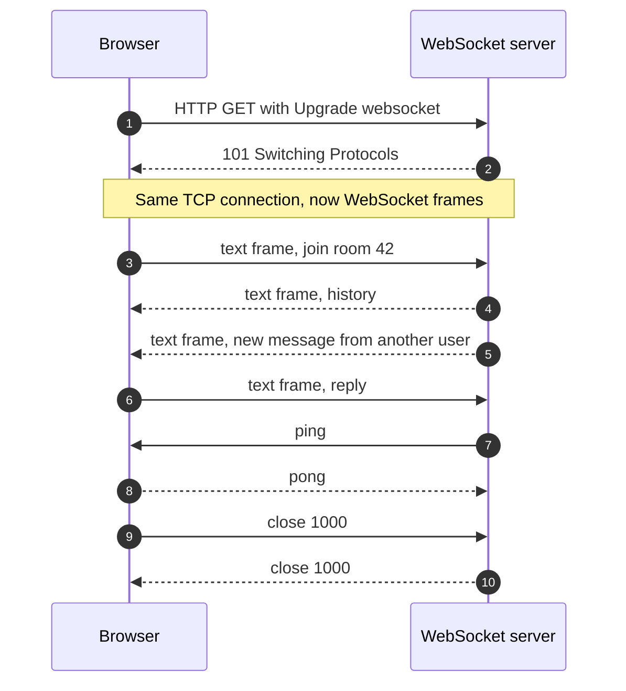
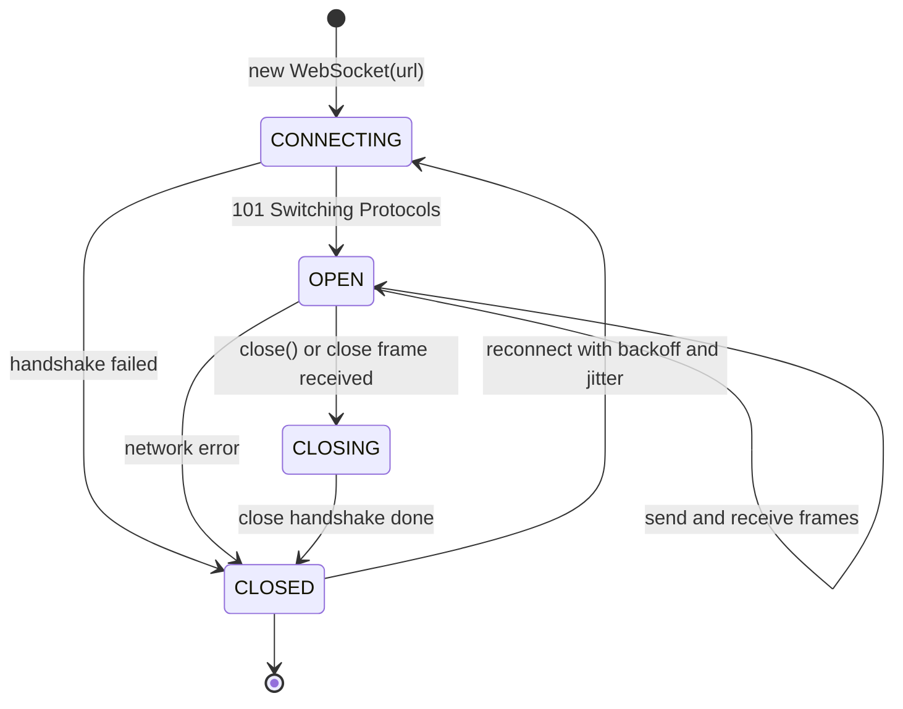

WebSocket is a protocol that turns one HTTP request into a **persistent, two-way connection**. After a
short handshake, client and server can each send messages at any moment, in both directions at once,
with only a few bytes of framing per message. It is the standard way to build chat, multiplayer games,
live dashboards, trading screens and collaborative editors on the web.

<!-- more -->

This post is part of the [API communication protocols](/posts/communication/api/api-communication-protocols/) series.
{: .prompt-info }

## At a glance

| | WebSocket |
|---|---|
| Type | Application-layer protocol (IETF RFC 6455) plus the browser `WebSocket` API |
| Published | December 2011 |
| Transport | TCP, upgraded from an HTTP/1.1 request; over HTTP/2 via RFC 8441 |
| URL schemes | `ws://` (port 80) and `wss://` (TLS, port 443) |
| Payload | Text (UTF-8) or binary frames; the message format is up to you |
| Contract | None built in; subprotocols (`Sec-WebSocket-Protocol`) or AsyncAPI document it |
| Direction | Full duplex, either side may send at any time |
| Best for | Low-latency, high-frequency, two-way messaging |

## What WebSocket is

HTTP is request/response: the client asks, the server answers, and the server can never speak first.
WebSocket keeps the TCP connection open after the first exchange and replaces HTTP with a lightweight
**framing** protocol. There are no headers, cookies or status lines on each message, just a 2 to 14 byte
frame header and the payload.

```javascript
const ws = new WebSocket("wss://chat.example.com/rooms/42", ["chat.v1"]);

ws.onopen = () => ws.send(JSON.stringify({ type: "join", user: "asha" }));
ws.onmessage = (event) => render(JSON.parse(event.data));
ws.onclose = (event) => scheduleReconnect(event.code);
```

## Why it was developed

Before WebSocket, browsers had no way to receive data the server wanted to send. Developers simulated it
with **polling** (ask every few seconds), **long polling** and **streaming** hacks collectively called
**Comet** (2006), hidden iframes and Flash sockets. Every message paid for HTTP headers, connections were
constantly re-established and latency was poor.

In 2008, a `TCPConnection` API was proposed for HTML5; Ian Hickson and Michael Carter developed it
further and named it **WebSocket**. After several incompatible drafts (and a security issue with early
versions and transparent proxies, fixed with client-side masking), the IETF published **RFC 6455** in
December 2011, and all major browsers implemented it shortly after.

## How it works

The animation shows a chat message: the handshake, the upgrade, then a message from client A to client
B, who is connected to a different server:



### The opening handshake

The client starts with an ordinary HTTP/1.1 `GET`:

```http
GET /rooms/42 HTTP/1.1
Host: chat.example.com
Upgrade: websocket
Connection: Upgrade
Sec-WebSocket-Key: dGhlIHNhbXBsZSBub25jZQ==
Sec-WebSocket-Version: 13
Sec-WebSocket-Protocol: chat.v1
Origin: https://app.example.com
```

The server agrees by switching protocols:

```http
HTTP/1.1 101 Switching Protocols
Upgrade: websocket
Connection: Upgrade
Sec-WebSocket-Accept: s3pPLMBiTxaQ9kYGzzhZRbK+xOo=
Sec-WebSocket-Protocol: chat.v1
```

`Sec-WebSocket-Accept` is the Base64 of the SHA-1 of the client's key concatenated with the fixed GUID
`258EAFA5-E914-47DA-95CA-C5AB0DC85B11`. It proves the server really understands WebSocket and is not a
confused HTTP server or cache. From this point the connection carries frames, not HTTP.

### Frames

| Field | Size | Meaning |
|---|---|---|
| FIN | 1 bit | Last fragment of a message |
| Opcode | 4 bits | `0x1` text, `0x2` binary, `0x0` continuation, `0x8` close, `0x9` ping, `0xA` pong |
| MASK | 1 bit | Set on every client-to-server frame |
| Payload length | 7, 7+16 or 7+64 bits | Size of the payload |
| Masking key | 0 or 4 bytes | XOR key for client frames, so proxies cannot be tricked into caching data |
| Payload | Variable | Your message |

**Ping** and **pong** frames act as heartbeats and keep NAT and proxy idle timers from closing quiet
connections. A **close** frame carries a status code such as `1000` (normal), `1001` (going away) or
`1008` (policy violation), and both sides reply before closing TCP.

### Message sequence



### Connection lifecycle

The browser API exposes the connection state as `readyState`. A UML state machine of the lifecycle,
including the reconnect logic every production client needs:



### Designing the message protocol

WebSocket only moves bytes, so you define the messages yourself. A typical JSON envelope:

```json
{ "type": "message", "id": "c1f7", "room": "42", "body": "hi", "ts": 1759740000 }
```

Common choices are a `type` field for routing, an `id` for acknowledgements and deduplication, and a
sequence number so a reconnecting client can ask for what it missed. Higher-level options already exist:
STOMP, MQTT over WebSocket, `graphql-ws` for GraphQL subscriptions, WAMP, and libraries such as
Socket.IO and SignalR that add rooms, acknowledgements and fallbacks.

### Scaling WebSocket servers

Every connection is long-lived state on one server, which changes the operational picture:

- **Load balancers** must support the `Upgrade` header and long idle timeouts (AWS ALB, NGINX, Envoy
  and Azure Application Gateway do). Use layer 7 balancing or sticky routing during the handshake.
- **A pub/sub backplane** (Redis, NATS, Kafka) is needed when users in the same room are connected to
  different servers, as in the animation.
- **Capacity is counted in connections**, not requests per second. Memory per connection, file
  descriptors and kernel limits matter.
- **Deployments drop connections.** Drain servers gradually and make clients reconnect with
  exponential backoff and jitter, or a restart turns into a thundering herd.
- **Managed services** such as AWS API Gateway WebSocket APIs, Azure Web PubSub and Cloudflare Durable
  Objects take care of the connection layer for you.

## Where it is used

- **Chat and messaging** (Slack, WhatsApp Web, customer support widgets).
- **Multiplayer games** and real-time collaboration (Figma, Google Docs-style editors, whiteboards).
- **Financial market data**: crypto exchanges and brokers stream order books and trades.
- **Live dashboards, sports scores, auctions, ride tracking.**
- **Developer tools**: hot reload in dev servers, browser DevTools protocol, Jupyter kernels.

## Real-life examples

### Slack

Slack's clients keep a WebSocket connection open to Slack's edge to receive new messages, typing
indicators and presence changes the moment they happen. Slack's engineering blog describes how its
real-time messaging infrastructure fans out a message to every connected client in a channel through a
layer of gateway servers holding the WebSockets and channel servers that route messages between them,
the same split as the pub/sub backplane in the animation. For apps, Slack's **Socket Mode** delivers
events to a bot over a WebSocket instead of public webhooks, which is useful behind a firewall.

### Discord Gateway

Discord's real-time API is a documented WebSocket service called the **Gateway**. A bot connects to
`wss://gateway.discord.gg`, receives a `Hello` with a heartbeat interval, sends `Identify` with its
token, and then receives events such as `MESSAGE_CREATE` as JSON frames. It must send a heartbeat at the
given interval or be disconnected, and can `Resume` a dropped session with a sequence number so missed
events are replayed. It is a textbook example of designing a message protocol on top of raw WebSocket.

## Strengths and limitations

| Strengths | Limitations |
|---|---|
| True server push and full duplex | Stateful connections complicate load balancing, scaling and deploys |
| Very low per-message overhead and latency | No built-in message format, acknowledgements, or replay |
| Supported natively by every browser | No HTTP caching; harder to observe with standard HTTP tools |
| Works through most proxies on port 443 | Some corporate proxies still break long-lived connections |
| Text or binary payloads | Auth happens once at connect time; tokens can expire mid-connection |

## Best practices

- **Always use `wss://`** and validate the `Origin` header to prevent cross-site WebSocket hijacking.
- **Authenticate during the handshake** (a short-lived token in a cookie or the first message, not a
  long-lived token in the URL, which ends up in logs) and re-check authorisation per action.
- **Heartbeat** with ping/pong and detect dead connections on both sides.
- **Reconnect with exponential backoff and jitter**, and resume from the last sequence number.
- **Cap message size and rate** per connection to protect the server.
- **Version your message protocol** via `Sec-WebSocket-Protocol` or a version field.
- **Use SSE instead** if data only flows from server to client.

## When to use WebSocket, and when not

Use WebSocket when both sides send frequently and latency matters: chat, games, collaboration, live
trading.

Prefer [Server-Sent Events](/posts/communication/api/sse-and-long-polling/) for one-way updates such as
notifications or LLM token streaming, [webhooks](/posts/communication/api/webhooks/) for
server-to-server events, and [REST](/posts/communication/api/rest-api/) for everything that is naturally
request/response.

## Related posts

- [API Communication Protocols: overview](/posts/communication/api/api-communication-protocols/)
- [Server-Sent Events and long polling](/posts/communication/api/sse-and-long-polling/)
- [MQTT](/posts/communication/api/mqtt/)
- [Comparison of API protocols](/posts/communication/api/api-protocols-comparison/)
