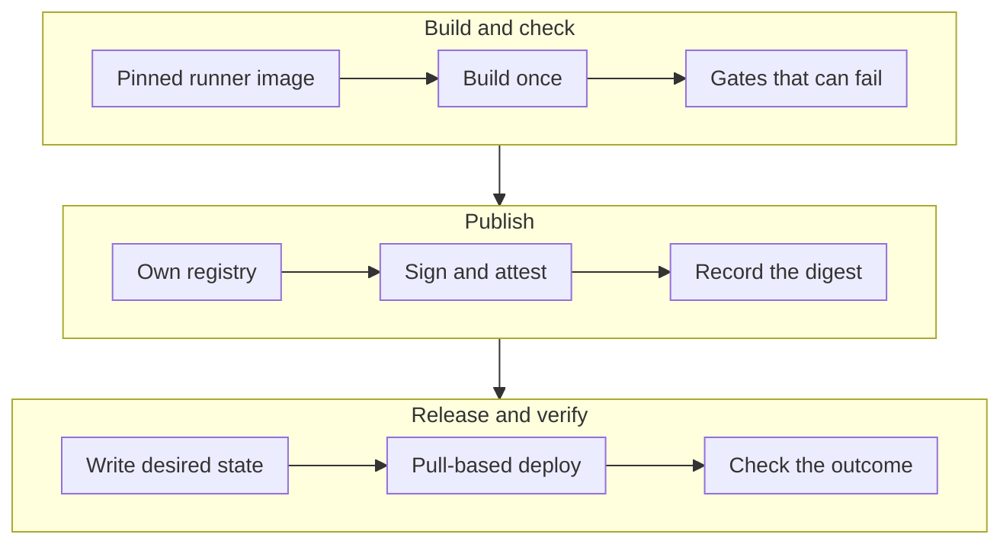

A green pipeline isn't the same as a working one. The failures that cost the most time are rarely red builds. They're
quiet: tests that no job runs, a setup step that downloads the same tools on every run, an older build that deploys
after a newer one, a cancelled run that keeps going, an alert that can't see the thing that broke.

This post is a checklist of the practices that catch those problems. Every point comes from a real issue recorded in
the [Cloudutsuk Platform lessons log](/posts/projects/cloudutsuk-platform/lessons-learned/) or the
[RAG on Cloud lessons log](/posts/projects/rag-on-cloud/lessons-learned/). The points are kept short and general; each
links to the lesson (`L0xx`) with the symptom, the cause and the fix.

<!-- more -->

## The shape of a pipeline worth trusting

Most of the points hang on this shape: every stage produces something the next one can check, or a decision a person
can see.



New to the moving parts? Start with the [introduction to CI/CD](/posts/devops/cicd/cicd/) and
[GitHub Actions](/posts/devops/cicd/github%20actions/github-actions/). How these points come together in one platform
is in its [CI/CD and release management playbook](/posts/projects/cloudutsuk-platform/12-cicd-and-release-management/).

## 1. Prove every gate can fail

A gate you've never seen fail is a guess.

- **Make each gate go red once on purpose.** For every row of the test and security matrix, find the job that runs it
  and break it deliberately. Tests that exist but that no job calls are more common than bad thresholds.
  [L054](/posts/projects/cloudutsuk-platform/lessons-learned/#lesson-l054)
- **Check the plan and features a gate depends on.** Branch protection and required checks depend on the hosting plan
  and repo visibility. [L035](/posts/projects/cloudutsuk-platform/lessons-learned/#lesson-l035)
- **Prove policy exceptions where they're enforced.** A clean report doesn't mean admission agrees; test with a
  server-side dry run. [L051](/posts/projects/cloudutsuk-platform/lessons-learned/#lesson-l051)
- **Repeat cloud deny policies as plan-time checks.** A tenant's policy only speaks at apply time, after the review.
  [RAG L002](/posts/projects/rag-on-cloud/lessons-learned/#lesson-l002)
- **Record deliberate scanner exceptions once, with a reason and an expiry,** at the organisation or repository level,
  instead of silencing the rule per stack. [RAG L004](/posts/projects/rag-on-cloud/lessons-learned/#lesson-l004)
- **Triage a CVE by where the match came from.** A generic database match on a distribution package is often a
  backport the distribution already fixed. [L088](/posts/projects/cloudutsuk-platform/lessons-learned/#lesson-l088)
- **Don't hide errors in shell steps.** `2>/dev/null || true` turns a missing tool into a silent skip, and checking only
  the exit code of a first run hides wrong results. [L082](/posts/projects/cloudutsuk-platform/lessons-learned/#lesson-l082),
  [L023](/posts/projects/cloudutsuk-platform/lessons-learned/#lesson-l023)
- **Render templates before planning, and look for what's missing.** A value valid in the schema can render nothing,
  or an empty body. [L028](/posts/projects/cloudutsuk-platform/lessons-learned/#lesson-l028),
  [L096](/posts/projects/cloudutsuk-platform/lessons-learned/#lesson-l096)

Which scanners belong where: [SAST, SCA, DAST and friends](/posts/devsecops/devsecops-security-testing-types-and-tools/).

## 2. Treat the runner as a product

Self-hosted, ephemeral runners move every assumption a hosted image made for you onto your plate.

- **Bake tools into the runner image.** On an ephemeral runner, anything one job downloads, every job downloads. Time
  the setup steps, not just the scans. [L046](/posts/projects/cloudutsuk-platform/lessons-learned/#lesson-l046),
  [faster image builds](/posts/devops/cicd/github%20actions/speeding-up-gpu-image-builds-github-actions/)
- **Keep version pins in one place.** When the image bakes a version and a shared workflow pins one, a bump on either
  side falls back to downloading without failing. [L090](/posts/projects/cloudutsuk-platform/lessons-learned/#lesson-l090)
- **Check the tools a step calls, not a version string.** Slim images expose gaps hosted images hide.
  [L042](/posts/projects/cloudutsuk-platform/lessons-learned/#lesson-l042)
- **Check what a binary is before trusting its name.** Two tools can share a name.
  [L029](/posts/projects/cloudutsuk-platform/lessons-learned/#lesson-l029)
- **Count jobs, not minutes,** and grep reusable workflows for hosted runner labels.
  [L082](/posts/projects/cloudutsuk-platform/lessons-learned/#lesson-l082)
- **Before registering a runner label, clear stale queued jobs for it.**
  [L034](/posts/projects/cloudutsuk-platform/lessons-learned/#lesson-l034)
- **Alert on work waiting, not pods running.** [L093](/posts/projects/cloudutsuk-platform/lessons-learned/#lesson-l093)
- **Don't let a bot roll out the runner image.** A bad image can stop the CI that would fix it.
  [L046](/posts/projects/cloudutsuk-platform/lessons-learned/#lesson-l046)
- **Clean up by name or label, never globally.** A global prune removes what was only paused.
  [L001](/posts/projects/cloudutsuk-platform/lessons-learned/#lesson-l001)
- **In shared working copies, stage files by path,** and when a file operation hangs, read the process's kernel stack
  before guessing. [L061](/posts/projects/cloudutsuk-platform/lessons-learned/#lesson-l061),
  [L084](/posts/projects/cloudutsuk-platform/lessons-learned/#lesson-l084)
- **Sanity-check a tool's breakdown against the total it explains.**
  [L077](/posts/projects/cloudutsuk-platform/lessons-learned/#lesson-l077)

A pattern for skipping a download the image already covers:

```yaml
- name: Check Python
  id: py
  shell: bash
  run: |
    if python --version 2>/dev/null | grep -q ' 3\.13\.' && python -m pip --version >/dev/null 2>&1; then
      echo "needs_install=false" >> "$GITHUB_OUTPUT"
    else
      echo "needs_install=true" >> "$GITHUB_OUTPUT"
    fi

- name: Set up Python
  if: steps.py.outputs.needs_install == 'true'
  timeout-minutes: 5
  uses: actions/setup-python@v7
  with:
    python-version: "3.13"
```

## 3. Put a clock on everything that waits on the network

GitHub's default job timeout is six hours. A stalled download with no timeout holds the run, its runner and its
concurrency group until someone notices.

- **Set `timeout-minutes` on jobs and download steps,** a few times the normal duration.
- **Never time-box an apply.** An interrupted Terraform or Helm upgrade leaves locks or half-done releases. Put the
  clock around the download, not the change. [L040](/posts/projects/cloudutsuk-platform/lessons-learned/#lesson-l040)
- **Mirror what you download,** and pre-sync very large images before the first deploy.
  [L006](/posts/projects/cloudutsuk-platform/lessons-learned/#lesson-l006),
  [L031](/posts/projects/cloudutsuk-platform/lessons-learned/#lesson-l031),
  [L060](/posts/projects/cloudutsuk-platform/lessons-learned/#lesson-l060)
- **Read the error before the error.** A mirror's "filtered out" can hide a failed layer copy.
  [L037](/posts/projects/cloudutsuk-platform/lessons-learned/#lesson-l037)
- **When unrelated tools fail at once, test name resolution first,** from where the workload runs (a pod, a host-network
  pod, the node), not from your laptop. [L009](/posts/projects/cloudutsuk-platform/lessons-learned/#lesson-l009),
  [L036](/posts/projects/cloudutsuk-platform/lessons-learned/#lesson-l036),
  [L065](/posts/projects/cloudutsuk-platform/lessons-learned/#lesson-l065)
- **Look at what shares a proxy.** One protocol exhausting a load balancer looks like every service behind it failing.
  [L068](/posts/projects/cloudutsuk-platform/lessons-learned/#lesson-l068)
- **Time the same request from another host before changing protocols.** If one machine is slow, it's that machine.
  [L080](/posts/projects/cloudutsuk-platform/lessons-learned/#lesson-l080)
- **Turning on TLS verification may need more settings than the switch.**
  [L066](/posts/projects/cloudutsuk-platform/lessons-learned/#lesson-l066)

```yaml
jobs:
  report:
    runs-on: self-hosted
    timeout-minutes: 15      # normally under 2
```

## 4. Know what cancelled, skipped and failed mean

- **Use `!cancelled()`, not `always()`,** for the skipped-ancestor workaround: `always()` runs after a cancel too.
  [L083](/posts/projects/cloudutsuk-platform/lessons-learned/#lesson-l083)
- **Never cancel a run that applies.** Cancel superseded pull request runs only.
- **Check the pull request behind an event** before acting on a webhook about one of its jobs.
  [L083](/posts/projects/cloudutsuk-platform/lessons-learned/#lesson-l083)
- **Treat "partially failed" as failed,** and check what's inside the result, not only its status.
  [L087](/posts/projects/cloudutsuk-platform/lessons-learned/#lesson-l087)

```yaml
concurrency:
  group: ${{ github.workflow }}-${{ github.event_name == 'pull_request' && github.event.pull_request.number || github.run_id }}
  cancel-in-progress: ${{ github.event_name == 'pull_request' }}
```

## 5. Write reusable workflows for someone else's repo

- **Isolate tool installs from the caller's config** (uv, pip, npm, git all read it), and test from a caller.
  [L045](/posts/projects/cloudutsuk-platform/lessons-learned/#lesson-l045)
- **Pin the reusable workflow by ref on purpose.** `@main` makes every merge a deploy to every caller.
- **Job names are for people; contracts use IDs.** Anything that parses job names breaks the day someone renames a job
  for readability. Give machines run and job IDs and a small record the workflow writes.
- **Check what a shared module injects before the first use,** and update wrappers with the module they wrap, or new
  inputs are dropped silently. [L007](/posts/projects/cloudutsuk-platform/lessons-learned/#lesson-l007),
  [L017](/posts/projects/cloudutsuk-platform/lessons-learned/#lesson-l017)
- **Prefer generating a CLI's own config over a thin, lightly maintained wrapper.**
  [L003](/posts/projects/cloudutsuk-platform/lessons-learned/#lesson-l003)

## 6. Treat the supply chain as part of the pipeline

- **Build once, promote the same digest.** See [artifact management](/posts/artifacts/artifact-management/).
- **Tag local images by content,** not upstream version, and compare what runs with what the repo says.
  [L027](/posts/projects/cloudutsuk-platform/lessons-learned/#lesson-l027)
- **Take pin digests from the source registry;** behind a converting mirror the running digest is the mirror's.
  [L052](/posts/projects/cloudutsuk-platform/lessons-learned/#lesson-l052)
- **Pinning freezes packages too:** upgrade OS packages in the build, or a scanner gate becomes a release freeze.
  [L079](/posts/projects/cloudutsuk-platform/lessons-learned/#lesson-l079)
- **Pin a framework's whole release,** and make CI start the real image.
  [L098](/posts/projects/cloudutsuk-platform/lessons-learned/#lesson-l098)
- **Search cached registry metadata for an odd dependency** instead of reading trees.
  [L055](/posts/projects/cloudutsuk-platform/lessons-learned/#lesson-l055)
- **Test a registry with the client that will use it,** and check which manifest format each client pushes.
  [L020](/posts/projects/cloudutsuk-platform/lessons-learned/#lesson-l020),
  [L021](/posts/projects/cloudutsuk-platform/lessons-learned/#lesson-l021)
- **Check what policies assume about multi-arch indexes.**
  [L048](/posts/projects/cloudutsuk-platform/lessons-learned/#lesson-l048)
- **Check every Docker stage copies the config the build reads,** and the file permissions survive a change of user.
  [L062](/posts/projects/cloudutsuk-platform/lessons-learned/#lesson-l062),
  [L056](/posts/projects/cloudutsuk-platform/lessons-learned/#lesson-l056)
- **Smoke-test a reused vendor image for every library you call;** slim images are slim for their own workload.
  [L075](/posts/projects/cloudutsuk-platform/lessons-learned/#lesson-l075)
- **Alert on registry clean-up failures, and verify retention rules with a dry run.**
  [L085](/posts/projects/cloudutsuk-platform/lessons-learned/#lesson-l085),
  [L092](/posts/projects/cloudutsuk-platform/lessons-learned/#lesson-l092)

## 7. Handle secrets as if the log is public

- **Never print a secret or pass it as an argument;** pipe it from a protected file and rehearse on a throwaway
  instance. [L005](/posts/projects/cloudutsuk-platform/lessons-learned/#lesson-l005)
- **Feed secrets byte-exact:** `jq -j` or `printf %s`, never `jq -r` or `echo`.
  [L044](/posts/projects/cloudutsuk-platform/lessons-learned/#lesson-l044)
- **Fail when a secret variable is empty.** Many tools treat an empty password as "none".
  [L081](/posts/projects/cloudutsuk-platform/lessons-learned/#lesson-l081)
- **Test a new token's write permission before handing it over.**
  [L013](/posts/projects/cloudutsuk-platform/lessons-learned/#lesson-l013)
- **Know which config source wins** when an app keeps its own env file.
  [L072](/posts/projects/cloudutsuk-platform/lessons-learned/#lesson-l072)
- **When a secret won't sync, read the operator's log first,** and force a recheck after the store recovers.
  [L019](/posts/projects/cloudutsuk-platform/lessons-learned/#lesson-l019),
  [L015](/posts/projects/cloudutsuk-platform/lessons-learned/#lesson-l015)
- **Configure audit and security settings declaratively;** older API-based tutorials may no longer work.
  [L004](/posts/projects/cloudutsuk-platform/lessons-learned/#lesson-l004)

## 8. Deploy by pull, and check the outcome

CI that publishes an artifact and writes the desired state, with a GitOps controller pulling it, keeps target
credentials out of CI. More in [GitOps](/posts/devops/cicd/gitops/gitops/).

- **The last writer wins, not the newest commit.** Compare against what's deployed before writing.
  [L091](/posts/projects/cloudutsuk-platform/lessons-learned/#lesson-l091)
- **Let a fix jump the retry queue,** and read the generator's status, not just your app.
  [L049](/posts/projects/cloudutsuk-platform/lessons-learned/#lesson-l049),
  [L064](/posts/projects/cloudutsuk-platform/lessons-learned/#lesson-l064),
  [L041](/posts/projects/cloudutsuk-platform/lessons-learned/#lesson-l041)
- **A permanent OutOfSync is usually an empty map or a defaulted field.**
  [L050](/posts/projects/cloudutsuk-platform/lessons-learned/#lesson-l050)
- **Check the app works, not that the tool finished.** Forced upgrades can wipe runtime-filled Secrets; a ready server
  may not answer. Make one real request part of the deploy.
  [L047](/posts/projects/cloudutsuk-platform/lessons-learned/#lesson-l047),
  [L069](/posts/projects/cloudutsuk-platform/lessons-learned/#lesson-l069)
- **Verify the rendered objects and arguments, not the values you set.** Charts change keys between versions without an
  error. [L011](/posts/projects/cloudutsuk-platform/lessons-learned/#lesson-l011),
  [L018](/posts/projects/cloudutsuk-platform/lessons-learned/#lesson-l018)
- **Deliver CRD instances after their CRDs,** through a tool that handles deep schemas.
  [L008](/posts/projects/cloudutsuk-platform/lessons-learned/#lesson-l008),
  [L030](/posts/projects/cloudutsuk-platform/lessons-learned/#lesson-l030)
- **Know your immutable fields;** choose them at creation. [L010](/posts/projects/cloudutsuk-platform/lessons-learned/#lesson-l010)
- **One namespace per release.** [L033](/posts/projects/cloudutsuk-platform/lessons-learned/#lesson-l033)
- **Check what an image ships in paths you mount over,** and ask explicitly for what it doesn't mount by default.
  [L012](/posts/projects/cloudutsuk-platform/lessons-learned/#lesson-l012),
  [L032](/posts/projects/cloudutsuk-platform/lessons-learned/#lesson-l032)
- **Run new images once with the production user and read-only root** before deploying.
  [L038](/posts/projects/cloudutsuk-platform/lessons-learned/#lesson-l038)
- **Test add-ons on every network plugin they'll meet.**
  [L063](/posts/projects/cloudutsuk-platform/lessons-learned/#lesson-l063)
- **Never mutate an object an operator owns.** [L089](/posts/projects/cloudutsuk-platform/lessons-learned/#lesson-l089)
- **Decide how a config change reaches a running process** (re-read or roll), and test it by changing the config.
  [L097](/posts/projects/cloudutsuk-platform/lessons-learned/#lesson-l097)
- **Size limits for the restart, not the steady state.** [L053](/posts/projects/cloudutsuk-platform/lessons-learned/#lesson-l053)
- **Budget shared resources against the host when containers can't see them.**
  [L002](/posts/projects/cloudutsuk-platform/lessons-learned/#lesson-l002)
- **Read a model's config and size before switching, and name apps by role.**
  [L073](/posts/projects/cloudutsuk-platform/lessons-learned/#lesson-l073)
- **Quote risky YAML arguments, add risky settings as drop-ins, and restart with the tool that owns the node.**
  [L025](/posts/projects/cloudutsuk-platform/lessons-learned/#lesson-l025),
  [L026](/posts/projects/cloudutsuk-platform/lessons-learned/#lesson-l026)
- **Apply bootstrap dependencies in order** (DNS before secret stores), and check name resolution from inside first.
  [L022](/posts/projects/cloudutsuk-platform/lessons-learned/#lesson-l022)
- **Retry calls that depend on something just created,** then verify the result.
  [L024](/posts/projects/cloudutsuk-platform/lessons-learned/#lesson-l024)
- **Runbooks for "create a new one" rot.** Re-check the bootstrap order when a shared default changes, and derive
  per-environment lists from one place. [L076](/posts/projects/cloudutsuk-platform/lessons-learned/#lesson-l076)

## 9. Infrastructure pipelines have their own rules

- **Plan on the pull request, apply the reviewed plan on merge, and make sure the apply runs.** A resource removed
  from code whose apply never ran stays in state and breaks the next scan.
- **Plan before apply** when the generator writes the stack during plan.
  [L014](/posts/projects/cloudutsuk-platform/lessons-learned/#lesson-l014)
- **Watch "replace on change" resources;** a changed hash input rebuilds every instance.
  [L016](/posts/projects/cloudutsuk-platform/lessons-learned/#lesson-l016)
- **Change the code before deleting by hand.** Anything still managed comes back on the next apply, or breaks it.
  [L086](/posts/projects/cloudutsuk-platform/lessons-learned/#lesson-l086)
- **Treat provider aliases as part of a module's interface.**
  [RAG L001](/posts/projects/rag-on-cloud/lessons-learned/#lesson-l001)
- **Reference roles and similar objects by ID, not name.**
  [RAG L003](/posts/projects/rag-on-cloud/lessons-learned/#lesson-l003)
- **Run a scheduled drift scan** and treat a stack that fails to plan as a finding.

## 10. Watch what the pipeline delivered

A deploy isn't done when it's green; it's done when you'd know if it broke.

- **Alert on what should exist,** not only on what reports itself broken, and list which environments each critical
  alert can actually see. [L059](/posts/projects/cloudutsuk-platform/lessons-learned/#lesson-l059),
  [L074](/posts/projects/cloudutsuk-platform/lessons-learned/#lesson-l074),
  [L086](/posts/projects/cloudutsuk-platform/lessons-learned/#lesson-l086)
- **Safety limits that depend on a lookup must fail closed,** with a startup check that the key exists.
  [L078](/posts/projects/cloudutsuk-platform/lessons-learned/#lesson-l078)
- **Time "it reloads every minute" once.** [L058](/posts/projects/cloudutsuk-platform/lessons-learned/#lesson-l058)
- **Read start-up warnings,** and finish every alerting change by checking the always-firing alert arrives.
  [L039](/posts/projects/cloudutsuk-platform/lessons-learned/#lesson-l039)
- **Load observable config through the API from Git,** so the UI shows what runs.
  [L070](/posts/projects/cloudutsuk-platform/lessons-learned/#lesson-l070)
- **Imported dashboards and rules encode someone else's shape** (names, deployment mode, single vs multi-cluster).
  Rewrite them once, in the import script, and check each environment.
  [L043](/posts/projects/cloudutsuk-platform/lessons-learned/#lesson-l043),
  [L057](/posts/projects/cloudutsuk-platform/lessons-learned/#lesson-l057),
  [L071](/posts/projects/cloudutsuk-platform/lessons-learned/#lesson-l071)
- **Queries move with the backend:** grep every place a query lives when the store changes.
  [L067](/posts/projects/cloudutsuk-platform/lessons-learned/#lesson-l067)
- **Split memory into its parts before chasing a leak.**
  [L095](/posts/projects/cloudutsuk-platform/lessons-learned/#lesson-l095)
- **When a script feeds a model, make every gap explicit** in its input.
  [L094](/posts/projects/cloudutsuk-platform/lessons-learned/#lesson-l094)

## 11. Keep the process honest

- **Record decisions, not just changes,** in ADRs: see the platform's
  [ADR log](/posts/projects/cloudutsuk-platform/architecture-decision-records/).
- **Measure delivery** with [DORA metrics](/posts/devops/dora/dora-metrics/).
- **Have a rollback or roll-forward plan per component;** some changes are one-way doors.
  [L098](/posts/projects/cloudutsuk-platform/lessons-learned/#lesson-l098),
  [playbook](/posts/projects/cloudutsuk-platform/12-cicd-and-release-management/#rollback-and-roll-forward-procedures)
- **Write each lesson down the day it happens.** A lessons log is what turns these failures into a checklist.

## The checklist

| Area | Check |
|---|---|
| Gates | Every test and scan has a job that runs it, and has been seen to fail |
| Runner | Tools baked in; setup steps timed; pins in one place; clean-up by label |
| Time | `timeout-minutes` on jobs and downloads; never on an apply |
| Conditions | `!cancelled()` over `always()`; applies never cancelled; partial = failed |
| Reuse | Caller config isolated; tested from a caller; pinned by ref; IDs not names |
| Supply chain | Build once; digests from source; content tags; signed; real image started in CI |
| Secrets | Never printed; byte-exact; empty fails; permissions tested |
| Deploy | Pull-based; newest wins on purpose; rendered output checked; one real request |
| IaC | Reviewed plan applied; apply really runs; code before hand-deletes; drift scanned |
| Watch | Alerts on what should exist; fail closed; imported dashboards adapted |
| Process | ADRs; DORA; rollback plans; a lessons log |

## Conclusion

None of these are exotic. They're what's left after pipelines have surprised someone a few times. If you pick one
thing this week, take your most important gate and make it fail on purpose. If nothing goes red, you've found your
first problem.

## References

- [GitHub Actions: workflow syntax (`timeout-minutes`, `if`, `concurrency`)](https://docs.github.com/en/actions/writing-workflows/workflow-syntax-for-github-actions)
- [GitHub Actions: security hardening](https://docs.github.com/en/actions/security-for-github-actions/security-guides/security-hardening-for-github-actions)
- [actions/setup-python](https://github.com/actions/setup-python)
- [SLSA: supply-chain levels for software artifacts](https://slsa.dev/)
