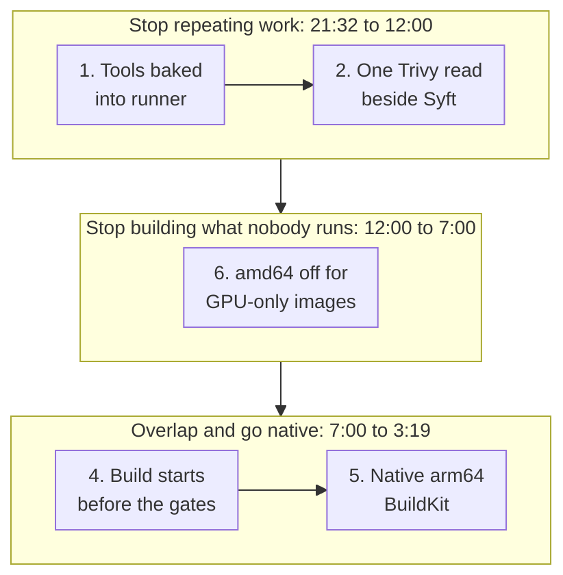

A pull request that touched one Python file in my image-generation service took 29 minutes to go green.
21.5 of those minutes were one job: `build-image.yaml`, the reusable workflow every service on my homelab
platform builds through. The service itself is small: two pure-Python wheels and some code on top of
NVIDIA's vLLM base image. The base image is the problem, at about 22 GB unpacked, and every step that
touched it was paying for that size.

By the end of the same day the job took 3 minutes 19 seconds, with exactly the same security findings.
This post walks through what I measured, the six changes I made (one of which I changed halfway through),
and the things that broke along the way. Most of it applies to any team building large images on
self-hosted runners, GPU or not.

<!-- more -->

## The setup

A bit of context so the numbers make sense:

- **Runners:** GitHub Actions Runner Controller (ARC) with ephemeral runner pods, in a k3d cluster on an
  x86 homelab PC. The k3d node has a 20 GiB memory limit; each runner pod is limited to 12 GiB.
- **Build:** `docker buildx` with remote BuildKit daemons. amd64 builds natively on the PC; arm64 ran
  under QEMU on a rootless BuildKit inside the cluster, because the PC is amd64.
- **Where the image runs:** an NVIDIA DGX Spark (arm64, GB10) that serves the models.
- **Gates:** Gitleaks, Semgrep, Bandit, Trivy (dependencies and IaC), Checkov, Conftest and Hadolint on
  the source; then Trivy on the built image and a CycloneDX SBOM from Syft for each platform; Cosign
  signs the image and attests the SBOMs; Kyverno verifies the signature at admission.

## Step 0: find out where the time actually goes

Before changing anything I broke the 21.5 minutes down from the job log:

| Part of the run | Time | Why |
|---|---|---|
| Waiting for a runner (twice) | 2.6 + 4.9 min | Other jobs held all the runners |
| Installing CI tools | 4 min 43 s | The runner image predated the tool set, so every job downloaded them |
| Build, arm64 + amd64 in parallel | 4 min 30 s | arm64 under QEMU: the `pip install` layer took 191 s vs 11 s on amd64 |
| Trivy image scans | 5 min 29 s | Four full reads of the image: vulnerabilities, then licences, per platform |
| SBOMs (Syft) | 5 min 50 s | Two full reads, about 3 min each |

Then I ran the same scans on the Spark, against the same base image digest and the same tool versions.
**Trivy took 6 seconds per read there, and Syft took 20 seconds.** In CI the same reads took 50 to 90
seconds and about 3 minutes.

The difference wasn't the tools. The runner pods share one k3d node that was at 16.7 of its 20 GiB with
five runners busy, on a host with a load average of 49 on 32 cores. The image doesn't fit in the node's
page cache, so every read decompresses it from disk again while other jobs fight for the CPU.

> Benchmark your scanners outside CI before tuning them inside it. If they're fast on a quiet machine,
> your problem is contention, and the lever is fewer reads of the image, not faster tools.
{: .prompt-tip }

## The six changes at a glance



The numbering follows my plan, not the order I shipped them in. Step 3 (rolling out new runner images
automatically) is still open.

## Change 1: actually roll out the runner image

This one was embarrassing. The workflow already preferred tools baked into the runner image and only
downloaded them when they were missing. A new runner image with the current tool set had been built and
signed a few days earlier. Nobody had changed the digest the runner scale set used, so every build job
downloaded and installed every scanner, every time.

Pinning the new image digest took the install step from **4 min 43 s to 0 s**. That saving applies to
every build job in every repo, not just the GPU images.

The lesson isn't "remember to bump the digest". A runner image that's built automatically but deployed
by hand will always fall behind. That's why plan step 3 adds a test job and an automatic digest commit,
the same way the services already promote their own images.

## Change 2: read the image once for Trivy, and hide it behind Syft

The scan step read each platform's image three times in a row: Trivy for vulnerabilities, Trivy again
for licences, then Syft. I measured the options on the Spark with an empty cache:

| Option | Findings | Time | Peak memory |
|---|---|---|---|
| `--scanners vuln`, then `--scanners license` | 5359 CVEs, 895 fixable HIGH/CRITICAL | 6.2 + 6.1 s | 0.75 GB |
| One read: `--scanners vuln,license` | identical | 6.2 s | 0.68 GB |
| Syft SBOM, then `trivy sbom` on it | **222 CVEs** | 19.6 + 0.3 s | 6.4 GB |
| Trivy in the background while Syft runs | identical | 21 s (Syft's time) | 6.4 GB |

Scanning the SBOM looks attractive, since you generate it anyway. It drops 96% of the findings, because
Trivy's own analysers see packages that Syft's SBOM doesn't describe the way Trivy expects. That option
was out.

Running two Syft processes at once was out too: at 6.4 GB each they don't fit a 12 GiB runner.

So the step became one combined Trivy read per platform, all in the background with an in-memory
layer cache, while Syft writes the SBOMs one platform at a time:

```bash
trivy image --quiet --download-db-only
declare -A scan
for p in $PLATFORMS; do
  trivy image --quiet --cache-backend memory --input "$RUNNER_TEMP/image-$p" \
    --scanners vuln,license --format json -o "$RUNNER_TEMP/reports/trivy-image-$p.json" \
    > "$RUNNER_TEMP/trivy-image-$p.log" 2>&1 &
  scan[$p]=$!
done
for p in $PLATFORMS; do
  syft scan "oci-dir:$RUNNER_TEMP/image-$p" --platform "linux/$p" --quiet \
    -o "cyclonedx-json=$RUNNER_TEMP/reports/sbom-$p.cdx.json"
done
for p in $PLATFORMS; do
  wait "${scan[$p]}" || { cat "$RUNNER_TEMP/trivy-image-$p.log"; exit 1; }
done
# The licence report is the same JSON with the vulnerabilities removed
jq '.Results |= map(select(.Licenses) | del(.Vulnerabilities))' \
  "$RUNNER_TEMP/reports/trivy-image-arm64.json" > "$RUNNER_TEMP/reports/trivy-licenses-arm64.json"
```

Why `--cache-backend memory`? The cache directory is brand new in every ephemeral runner pod anyway, and
parallel Trivy runs sharing one on-disk cache wait on its lock. The vulnerability DB is downloaded once
up front, so the background scans only read it.

Changes 1 and 2 together took the build job from **21 min 32 s to 12 min 00 s**. Trivy and SBOM went
from 11 min 19 s to 6 min 16 s, and the findings were identical: same CVE count, same fixable count,
same licence counts. Syft was now the slowest part, at about 3 minutes per platform.

## Change 6: stop building an amd64 image nobody runs

Partway through I asked myself which nodes actually run these images. Only the Spark, which is arm64.
The amd64 build, its Trivy scan and its SBOM were about 3 minutes of every run for an image no node
would ever pull. The reusable workflow could already switch arm64 off for PC-only images; it needed the
mirror switch:

```yaml
inputs:
  arm64: {type: boolean, default: true}
  amd64: {type: boolean, default: true}
# ...
env:
  PLATFORMS: >-
    ${{ inputs.arm64 && inputs.amd64 && 'arm64 amd64'
      || (inputs.arm64 && 'arm64' || (inputs.amd64 && 'amd64' || '')) }}
```

With both defaults set to `true`, every existing caller behaved exactly as before, and the job fails fast
if a caller switches both off.

### The gotcha: Kyverno and single-platform indexes

My first plan was to keep pushing an image index, just with one arm64 entry. Before writing any YAML I
checked how the admission policy resolves an index, and that saved me from breaking production.

Kyverno 1.19's image verification loads images through go-containerregistry's `remote.Image` without a
platform option. go-containerregistry then defaults to `linux/amd64`. So for an index, Kyverno looks
for the amd64 child, and an arm64-only index has none. The pod would have been denied with a
signature-verification failure that says nothing about platforms.

A plain single-platform manifest has no children to resolve, so it passes. With `amd64: false` the
workflow therefore skips the index and pushes the arm64 image directly, under the commit-SHA tag:

```bash
if [[ " $PLATFORMS " != *" amd64 "* ]]; then
  crane tag "$ref@$DIGEST_ARM64" "$GITHUB_SHA"
  echo "digest=$DIGEST_ARM64" >> "$GITHUB_OUTPUT"
  exit 0
fi
```

Signing and SBOM attestation then happen once, on that manifest, which is also the digest the
deployment pins.

> Prove an admission change on the live cluster before you ship it. A server-side dry run of a pod goes
> through the admission webhooks without creating anything:
> `kubectl apply --dry-run=server -f pod.yaml`. I ran it with the signed arm64 image (admitted) and with
> a digest that doesn't exist (denied). The second result shows the policy is actually checking.
{: .prompt-info }

The test run took the build job from **12 min 00 s to 7 min 00 s**, already under the 8-minute target I
had set for this work.

### What happened when three big builds ran at once

Merging the change that switched amd64 off for three GPU images started three `main` builds at once,
while the pull request's own builds were still running. That was five vLLM-sized builds on one 20 GiB
node. The node reached 18.3 GiB and briefly went NotReady (Kubernetes started evicting pods and then
cancelled it). One PR build died mid-scan without a log line. One `main` build pushed and signed its image,
then failed uploading its report artifact on `getaddrinfo EAI_AGAIN`, because DNS inside the starved
cluster stopped answering. That failure skipped the job that commits the digest to GitOps, so a rerun
was needed.

Nothing was lost, but it was a clear warning. Faster builds don't fix a runner node that's too small for
several large builds at once. I'm still deciding between a concurrency group for the GPU image
workflows and a bigger memory limit for the node.

## Change 4: I replaced the Trivy server with something simpler

The original plan step 4 was a shared `trivy server`, so that clients only analyse layers the server
hasn't seen yet. When I came to build it, two measurements killed it:

1. The image scan already runs in the background behind Syft (change 2). A faster Trivy shortens nothing.
2. The only other Trivy cost on the critical path was the vulnerability DB download, about 12 seconds.

So a server would have saved about 12 seconds, and cost a new pod on the node that had just run out of
memory. Not worth it.

The time I could actually win was the order of the steps. The image build didn't depend on the source
gates at all, yet it waited for them (about 30 seconds of Gitleaks, Semgrep, Checkov and friends). Now the
build starts in the background straight after the OpenBao sign-in, and the gates run while it builds:

```bash
# "Start the build (in the background)": runs before the source gates
for p in $PLATFORMS; do
  ( build "$p"; echo $? > "$RUNNER_TEMP/build-$p.rc" ) </dev/null >/dev/null 2>&1 &
  echo $! > "$RUNNER_TEMP/build-$p.pid"
  disown
done
```

```bash
# "Build (each platform)": after the gates, just waits
for p in $PLATFORMS; do
  until [ -e "$RUNNER_TEMP/build-$p.rc" ]; do
    kill -0 "$(cat "$RUNNER_TEMP/build-$p.pid")" 2>/dev/null \
      || [ -e "$RUNNER_TEMP/build-$p.rc" ] || { echo 1 > "$RUNNER_TEMP/build-$p.rc"; }
    sleep 2
  done
done
```

Two details make this work:

- **The background process must not hold the step's stdout.** Redirect everything to files, or the
  runner waits for the pipe to close and the step doesn't end.
- **Processes outlive their step.** The Actions runner only kills orphaned processes at the end of the
  job, so a build started in one step is still running in the next. If a gate fails, the wait step is
  skipped and the end of the job stops the build. The rule "a failed gate means nothing is pushed" still
  holds.

The test run took the build job from 7 min 00 s to **4 min 48 s**. Honestly, part of that was a quieter
host: the emulated pip layer took 126 s instead of 195 s on that run.

## Change 5: build arm64 natively on the machine that runs it

This was the largest single change. In the 4 min 25 s build step, the emulated `pip install` layer alone
took 195 seconds, for two pure-Python wheels and an import check. QEMU makes Python startup painfully slow.

The Spark is arm64, so I gave it a rootless BuildKit for CI. The obvious objection: the Spark is the
model host, and keeping builds and models on separate machines was the whole point of moving everything
else off it. So the daemon is fenced in:

```bash
docker run -d --name homelab-buildkit-arm64 --restart unless-stopped \
  --user "$(id -u):$(id -g)" \
  --security-opt seccomp=unconfined --security-opt apparmor=buildkit-rootless \
  --memory 12g --cpus 8 \
  -p "10.0.0.1:1234:1234" \
  -v "$CERTS:/certs:ro" -v "$CACHE:/home/user/.local/share/buildkit" \
  moby/buildkit:v0.33.0-rootless \
  --addr tcp://0.0.0.0:1234 \
  --tlscert /certs/server.crt --tlskey /certs/server.key --tlscacert /certs/ca.crt \
  --config /certs/buildkitd.toml --oci-worker-no-process-sandbox
```

- **Network:** it's published only on the direct 2.5 GbE cable between the PC and the Spark (here
  `10.0.0.1` stands in for the Spark's end and `10.0.0.2` for the PC's), not on the Wi-Fi LAN.
- **Mutual TLS:** only a client certificate signed by its own CA, issued to CI, can build. The client
  side lives in OpenBao, and the CI roles read it at job start.
- **Caps:** 12 GB of memory, 8 CPUs, and `gckeepstorage = "60GB"` for the cache.
- **AppArmor:** Ubuntu's `apparmor_restrict_unprivileged_userns=1` blocks rootless BuildKit, so a
  one-line profile allows user namespaces for this container only.

The workflow probes the Spark before trusting it, and falls back to QEMU if it doesn't answer:

```bash
if timeout 20 docker buildx inspect --bootstrap spark >/dev/null 2>&1; then
  arm=(--driver-opt "$opt" "$BUILDKIT_ARM64_ADDR")
else
  echo "::warning::The DGX Spark's arm64 BuildKit didn't answer within 20 s; building arm64 emulated"
fi
```

That probe means a Spark that's down or rebooting costs a build at most 20 seconds, about what change 4
saves, instead of failing it.

### Warm the cache before the first CI build

A fresh BuildKit has an empty cache, so the first build would pull the whole vLLM base over the Spark's
Wi-Fi. I added a `warm` command that builds `FROM <base>` plus `RUN true` once. My first version passed
`--output type=cacheonly`, which failed with `exporter "cacheonly" could not be found`. That output type
exists in `docker buildx` but not in `buildctl`. With `buildctl`, leaving out `--output` builds into the
cache and exports nothing, which is exactly what you want. The warm-up took about 7 minutes, once.

### The result

The next test run logged `linux/arm64 builds natively on the DGX Spark`. The pip layer took **10.8
seconds** instead of 126 to 195. The whole build, including streaming the OCI layout back over the
cable, took 66 seconds, and most of it overlapped the source gates. The build job took **3 min 19 s**,
with 896 fixable HIGH or CRITICAL findings and 5362 CVEs, the same as every run before it.

## The timeline

| After | Build job | What changed |
|---|---|---|
| Start | 21 min 32 s | — |
| 1 + 2 | 12 min 00 s | Tools baked into the runner image; one Trivy read beside Syft |
| 6 | 7 min 00 s | No amd64 build for images that only run on arm64 |
| 4 | 4 min 48 s | Build starts before the source gates |
| 5 | 3 min 19 s | arm64 builds natively on the Spark |

Syft is the long pole now, at about 2 minutes. It has no layer cache, and the obvious shortcuts
(scanning the SBOM instead of the image, or fewer catalogers) give up findings or SBOM coverage. I'd rather keep
those two minutes.

## What I'd do differently

- **Profile before planning.** My first plan had a Trivy server in it. Two measurements later it was
  clear it would save about 12 seconds. Ten minutes of measuring would have caught that before it was
  ever in a plan.
- **Ask what the image is for.** Building, scanning and attesting a platform nothing runs was the
  easiest 5 minutes I removed. Check this for every multi-arch image you build.
- **Read the admission controller's source before changing image formats.** The Kyverno amd64 default
  isn't in any error message you'd see. It would have shown up as a vague signature failure on the GPU
  cluster.
- **Size the runner node for merges, not single builds.** Each fix made single builds lighter. A merge
  that starts three builds while two PR builds are still running is the real peak load.

## Conclusion

None of these changes is clever on its own: roll out the image you already built, read the image once,
don't build platforms you don't run, start work as soon as its inputs exist, and build on the
architecture you deploy to. Together they took a 21.5-minute job to 3 minutes 19 seconds without
dropping a single finding.

If your image builds are slow, start where I did. Break one slow run down step by step, then run the
same scanners on an idle machine. The gap between those two numbers tells you which of these changes
to make first.

## References

- [Trivy: client/server mode](https://trivy.dev/latest/docs/references/modes/client-server/)
- [Trivy: cache backends](https://trivy.dev/latest/docs/configuration/cache/)
- [Syft](https://github.com/anchore/syft)
- [BuildKit: rootless mode](https://github.com/moby/buildkit/blob/master/docs/rootless.md)
- [Docker Buildx remote driver](https://docs.docker.com/build/builders/drivers/remote/)
- [go-containerregistry `remote` package](https://pkg.go.dev/github.com/google/go-containerregistry/pkg/v1/remote)
- [Kyverno: verifying image signatures](https://kyverno.io/docs/policy-types/image-validating-policy/)
- [GitHub Actions Runner Controller](https://docs.github.com/en/actions/hosting-your-own-runners/managing-self-hosted-runners-with-actions-runner-controller/about-actions-runner-controller)
