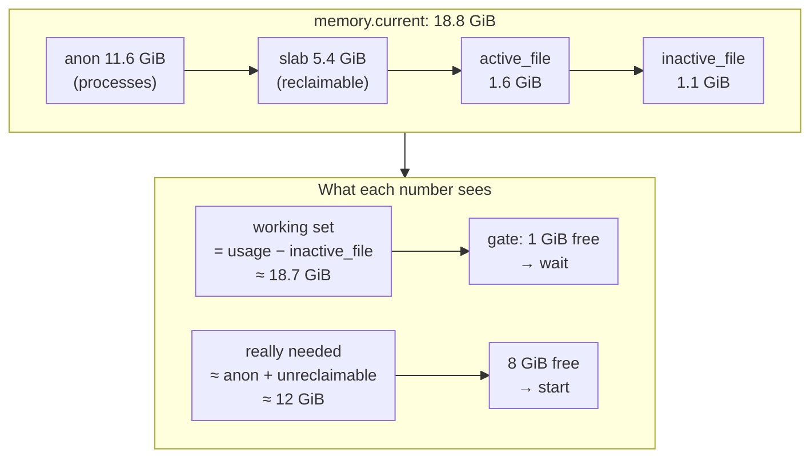

Ten runner pods, all stuck at `Init:0/1`, and about forty GitHub Actions jobs queued behind them. Nothing was
crashing and nothing was out of memory. Each pod printed the same line every 30 seconds:

```text
platform node has 1 GiB free (needs 2): waiting
```

The node did have plenty of memory. My own safety check was reading a number that included several gigabytes of
kernel cache the kernel would have freed on demand. This post walks through what I was doing when it happened, why
that check exists, how I found the gap between "used" and "really used", the one-line fix, and what I'd change so it
doesn't happen again.

<!-- more -->

## What I was doing

I was rolling out a self-hosted Renovate across my homelab GitHub organisation, replacing Dependabot. Renovate's first
real run had opened about sixty dependency update pull requests across seventeen repositories, and I was merging the
green ones in batches. Every merge starts a main-branch build. Several image builds had also died the day before and
needed reruns. So within a few minutes I'd put a few dozen jobs in the queue.

All of those jobs run on [Actions Runner Controller (ARC)](https://github.com/actions/actions-runner-controller)
runners in a k3d cluster on my homelab PC. The details that matter here:

- The cluster's node is a Docker container (that's what k3d is), and I've capped it at **20 GiB** of memory.
- The runner scale set can run up to **10 runners** at once, each a pod on that node.
- Builds go to a BuildKit pod on the same node, and some of them are large: one GPU image is over 25 GiB unpacked.

The day before, during the first wave of Renovate PRs, three image builds had failed in a way that should have been
a hint. Their logs weren't uploaded at all: the API answered `BlobNotFound`, and the steps after "Build and scan"
never reported a result. Two others failed with BuildKit dropping the connection mid-build:

```text
ERROR: failed to build: failed to receive status: rpc error: code = Unavailable desc = error reading from server: EOF
```

Runners and the builder had been fighting over the node's memory. That's the exact problem the memory gate was
added to prevent.

## Why the memory gate exists

Kubernetes schedules pods by their **requests**, not their actual use. My runner pods request 512 MiB, so the
scheduler thinks ten runners need 5 GiB. In practice a typical runner peaks around **1.3 GiB**, and a busy one
running an SBOM scanner over a big image goes far beyond that. Ten of them at once, plus BuildKit, Argo CD, a database
and the other apps on that node, push the node container into its 20 GiB limit. The kernel's OOM killer then picks
something, and from the outside that looks like a runner that silently vanished.

Raising every runner's request would fix the scheduling maths, but it would reserve memory that sits idle most of
the time. So I added a small init container to the runner pod template instead. Before the runner starts, it asks
the host's cAdvisor how much memory the node container is using and holds the pod until at least 2 GiB is free.
GitHub keeps the job queued while it waits, which is exactly what I want.

```yaml
initContainers:
  - name: memory-gate
    image: ghcr.io/actions/actions-runner:2.337.0
    command: [bash, -ec]
    args:
      - |
        min=$NODE_MIN_FREE_GIB
        while :; do
          free=$(curl -fsS -m 5 http://<host>:9101/metrics 2>/dev/null | awk '
            /name="k3d-platform-server-0"/ && $1 ~ /^container_memory_working_set_bytes\{/ {u = $2}
            /name="k3d-platform-server-0"/ && $1 ~ /^container_spec_memory_limit_bytes\{/ {l = $2}
            END {if (u > 0 && l > 0) printf "%d", (l - u) / 1073741824}') || free=
          if [ -z "$free" ]; then
            echo "cAdvisor didn't answer: starting without the memory check"; exit 0
          fi
          if [ "$free" -ge "$min" ]; then
            echo "platform node has $free GiB free (needs $min): starting"; exit 0
          fi
          echo "platform node has $free GiB free (needs $min): waiting"
          sleep 30
        done
    env:
      - {name: NODE_MIN_FREE_GIB, value: "2"}
```

Two design choices are worth calling out. The gate **fails open**: if cAdvisor doesn't answer, the runner starts
anyway, because a broken monitoring endpoint shouldn't stop all CI. And it reads
`container_memory_working_set_bytes`, the same metric the kubelet and most dashboards use for "memory used". That
second choice is the one that bit me.

## The symptom

After I'd merged the first two batches of PRs, nothing moved. The PRs' checks sat at "pending", and the runner pods
looked like this:

```console
$ kubectl -n arc-runners get pods
NAME                             READY   STATUS     RESTARTS   AGE
homelab-xxxxx-runner-frx9x       0/1     Init:0/1   0          9m
homelab-xxxxx-runner-g8s9f       0/1     Init:0/1   0          8m34s
homelab-xxxxx-runner-grqzc       0/1     Init:0/1   0          10m
...                              (ten in total, all Init:0/1)

$ kubectl -n arc-runners logs homelab-xxxxx-runner-qdlcq -c memory-gate --tail=2
platform node has 1 GiB free (needs 2): waiting
platform node has 1 GiB free (needs 2): waiting
```

So the gate was doing its job, and the node really was reported at 18.8 of 20 GiB:

```console
$ kubectl top nodes
NAME                    CPU(cores)   CPU(%)   MEMORY(bytes)   MEMORY(%)
k3d-platform-server-0   625m         1%       19334Mi         92%
```

## Where did 10 GiB go?

The first thing I checked was which pods were using all that memory:

```console
$ kubectl top pods -A --sort-by=memory | head -6
NAMESPACE          NAME                               CPU(cores)   MEMORY(bytes)
argocd             argocd-application-controller-0    14m          2043Mi
nexus              nexus-5848d8f97-x5nqh              3m           1806Mi
job-hunter         job-hunter-64c797f744-l2pzh        18m          677Mi
dependency-track   dependency-track-api-server-...    9m           618Mi
hermes             hermes-75bd46dd6c-q8h8z            13m          565Mi
```

Adding up every pod came to roughly **9 GiB**. Add k3s itself and containerd and you're still well short of
18.8 GiB. The runners weren't the problem either: they were all waiting, so they used next to nothing.

When pod numbers don't add up to the node's number, the answer is usually in memory that belongs to the cgroup but
to no process: page cache, kernel objects, tmpfs. On cgroup v2 the node container's `memory.stat` breaks it down. I
read it from the host:

```bash
id=$(docker inspect -f '{{.Id}}' k3d-platform-server-0)
f=/sys/fs/cgroup/system.slice/docker-$id.scope
grep -E '^(anon|file|active_file|inactive_file|shmem|kernel|slab|slab_reclaimable|slab_unreclaimable) ' \
  "$f/memory.stat" | awk '{printf "%-20s %.1f GiB\n", $1, $2/1073741824}'
```

```text
anon                 11.6 GiB
file                 2.8 GiB
kernel               5.6 GiB
shmem                0.2 GiB
inactive_file        1.1 GiB
active_file          1.6 GiB
slab                 5.4 GiB
slab_reclaimable     5.4 GiB
slab_unreclaimable   0.1 GiB
```

There it is: **5.4 GiB of slab, almost all of it reclaimable**. Slab is memory the kernel allocates for its own
objects. The reclaimable part is mostly the dentry and inode caches: the kernel's memory of which files and
directories exist and their metadata. An image build that unpacks and scans a 25 GiB image with hundreds of thousands
of files leaves a lot of that behind, all charged to the node container's cgroup.

## Why the working set counted it

cAdvisor's working set is defined as total usage minus `inactive_file`: memory the kernel can't drop cheaply, as
opposed to cold page cache it can. That subtraction is the only cache it takes out. Reclaimable slab and
`active_file` stay in the number, even though the kernel can drop both when it needs memory.



That would be harmless if the kernel reclaimed the cache in the background, but it doesn't. Under cgroup v2, the
kernel reclaims a cgroup's memory when the cgroup gets close to its limit (or the whole machine runs short). The node
container was at 18.8 of 20 GiB, close but not at the point that forces reclaim. And nothing was going to push it
there, because the only thing that would add memory pressure was the runners, and the runners were waiting for the
pressure to go away first.

It was a self-sustaining stall: the cache would only be freed by load, and the gate blocked the load until the cache
was freed. Left alone, it would have waited until some other pod on the node happened to allocate enough memory to
trigger reclaim.

> This isn't a cAdvisor bug. The working set is a sensible "memory the kernel can't easily give back" estimate for
> page cache. It just doesn't know about reclaimable slab, and a large build job produces a lot of it.
{: .prompt-info }

## The fix: ask the kernel to reclaim

cgroup v2 has a file for exactly this: `memory.reclaim`. Writing an amount to it asks the kernel to reclaim that
much memory from the cgroup now, using the same reclaim it would do under pressure. Cache goes first; anonymous
memory would go to swap only if there's nothing cheaper. It's available from Linux 5.19.

A k3d node is a privileged container with its own cgroup namespace, so inside it `/sys/fs/cgroup` is the node
container's own cgroup. That means I didn't need root on the host, only access to Docker:

```bash
docker exec k3d-platform-server-0 sh -c 'echo 5G > /sys/fs/cgroup/memory.reclaim'
```

Then the same `memory.stat` read, from the host:

```text
anon                 9.7 GiB
file                 0.6 GiB
slab_reclaimable     0.1 GiB
memory.current       10.8 GiB
```

Usage went from **18.8 GiB to 10.8 GiB**. No process was touched; the kernel dropped cached dentries, inodes and file
pages, which it will rebuild from disk when it needs them.

The gate didn't react straight away, because cAdvisor's metrics lag reality by its housekeeping interval. About a
minute later the working set it reported fell to 12.4 GiB, the gate printed `starting`, and the runners began picking
up the queue:

```console
$ kubectl -n arc-runners get pods --no-headers | awk '{print $3}' | sort | uniq -c
      9 Init:0/1
      1 PodInitializing
      1 Running
```

Over the next minutes the rest followed, as each new runner's gate re-checked and found room.

> Writing to `memory.reclaim` is safe in the sense that it can't free memory a process is using without swapping
> it, but it isn't free: the next build has to re-read file metadata from disk. Do it when you're stuck, not on a
> tight loop.
{: .prompt-warning }

## What I'd change: a gate that measures the right thing

The one-liner got CI moving, but the gate will stall again the next time a big build leaves its cache behind. I've
recorded a durable fix as a follow-up rather than rushing it. There are two reasonable designs, with different
trade-offs.

| Option | How | Good | Not so good |
|---|---|---|---|
| Read `memory.stat` instead of the working set | Compute "used" as `anon` + `slab_unreclaimable` + `shmem` (+ a margin for active file cache) from the node's cgroup | Measures what the node really can't give back; no extra moving parts | The init container would need the host's cgroup file (a hostPath mount or a small exporter), and cAdvisor doesn't export these fields |
| A host timer that reclaims | A systemd timer that writes to `memory.reclaim` when `slab_reclaimable` is above a threshold | Keeps the gate as it is; fixes the cause for every consumer of the metric, including dashboards | Another host component; drops cache that might have been useful |
| Lower the threshold | Start a runner at 1 GiB "free" | Trivial | Hides the problem and brings back the OOM kills the gate was added for |

I'd pick the first one. The gate's job is to answer "can another runner fit?", and the working set answers a
slightly different question. Making the gate read the right number is cleaner than making the number fit the gate.
The timer is a decent stopgap if you can't change how the gate reads memory.

The gate's fail-open behaviour stays either way. A memory check that stops all CI when its data source breaks is
worse than the occasional OOM it prevents.

## Common pitfalls

A few things I'd check first if you hit something similar:

- **Pod memory doesn't add up to node memory.** Go straight to the cgroup's `memory.stat`. Look at `slab_reclaimable`,
  `active_file` and `shmem` (tmpfs and memory-backed `emptyDir` volumes land in `shmem`, and those *can't* be
  reclaimed without deleting files).
- **Reading the wrong cgroup.** On a cgroup v2 host with systemd, a Docker container's cgroup is
  `/sys/fs/cgroup/system.slice/docker-<full id>.scope`. Inside a container with its own cgroup namespace, it's
  `/sys/fs/cgroup`. The numbers at the root of the host are the whole machine's, which is not what you want.
- **`free -g` on the host looks fine.** The host had 48 GiB available. The cap that mattered was the node container's
  20 GiB `memory.max`, and nothing in `free` shows that.
- **Expecting the metric to change instantly.** cAdvisor samples on an interval, so the reclaim showed up about a
  minute later. Read `memory.current` directly to confirm the reclaim worked.
- **Reaching for `drop_caches`.** `echo 2 > /proc/sys/vm/drop_caches` also frees dentries and inodes, but for the whole
  machine and only as root. `memory.reclaim` is scoped to one cgroup and, for a privileged container like a k3d node,
  doesn't need sudo on the host.
- **Blaming the runners.** Silent runner deaths and BuildKit `EOF` errors look like flaky infrastructure. On a shared
  node with a memory cap, check the memory first.

## Conclusion

The memory gate did what it was written to do. It just measured "used" with a metric that counts memory the kernel
would happily give back, and under the burst of Renovate builds that difference was 5.4 GiB of filesystem metadata
cache. One write to `memory.reclaim` freed it, the runners started, and the queue drained.

If you run a "wait until there's room" check of your own, look at which memory number it reads. The working set is
the right number for eviction decisions and dashboards. For "will one more job fit before the cgroup limit", the
non-reclaimable part of `memory.stat` is the better number. Next for me is moving the gate to it, so the next big
build doesn't stall CI again.

Related: [From 22 minutes to 3: how I sped up a GPU image build in GitHub Actions](/posts/devops/cicd/github%20actions/speeding-up-gpu-image-builds-github-actions/)
covers the same runners and the build that produces most of this cache.

## References

- [Control Group v2: memory interface files (memory.current, memory.stat, memory.reclaim)](https://docs.kernel.org/admin-guide/cgroup-v2.html#memory-interface-files)
- [Kubernetes: Node-pressure eviction (the working set and how the kubelet computes it)](https://kubernetes.io/docs/concepts/scheduling-eviction/node-pressure-eviction/)
- [cAdvisor: Prometheus metrics (container_memory_working_set_bytes)](https://github.com/google/cadvisor/blob/master/docs/storage/prometheus.md)
- [Actions Runner Controller](https://github.com/actions/actions-runner-controller)
- [k3d](https://k3d.io/)
