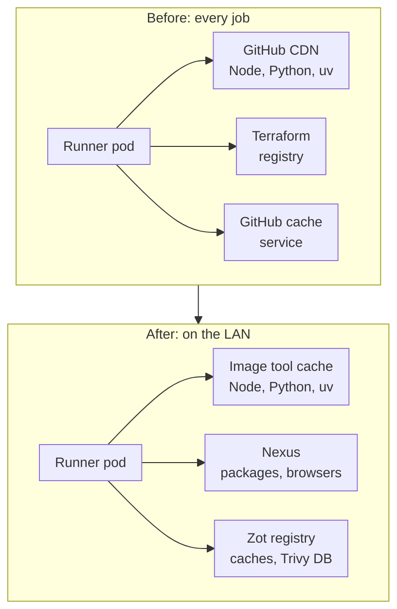

Renovate's jobs on my self-hosted runners started dying at the 50-minute timeout, and the step they died in wasn't
Renovate at all. It was `actions/setup-node`. That morning the home connection was pulling from GitHub at 14 to 29
KB/s, at times 18 bytes a second, and every job was downloading the same Node.js tarball it had downloaded the day
before. The odd part: a few weeks earlier we'd moved every package install behind a local Nexus proxy precisely so
CI stopped depending on the internet. The packages came from the LAN. The tools that install the packages didn't.

This post is how I went looking for every other place that happens, across all 50 repositories in the org: the
method, the list it produced, the one fix that's already live, and the question that came straight after it: once a
tool is baked into a runner image, who tells you it needs updating?

<!-- more -->

## The blind spot: "we use a package proxy" covers the wrong step

When people say "CI goes through our proxy", they mean the install step: `npm ci` reads an `.npmrc`, `uv sync` reads
an index in `pyproject.toml`, pip reads `PIP_INDEX_URL`. That part was done. What it leaves out is everything that
runs before the install:

- `setup-node`, `setup-python` and `setup-uv` download a runtime or a binary from GitHub's release CDN.
- `terraform init` downloads providers from the Terraform registry.
- Trivy downloads its vulnerability database before it scans anything.
- `playwright install` downloads a browser from Playwright's CDN.
- `actions/cache` and the `cache:` input of the setup actions save and restore through GitHub's cache service, which
  sits on the internet even though it feels like part of the runner.

None of these show up when you grep for registry URLs, because the URL lives inside the action, not in your YAML. On
GitHub-hosted runners you'd never notice: they sit next to GitHub's CDN and many of these tools are preinstalled. On
self-hosted runners at home, each one is a download across the slowest link you have, repeated by every ephemeral pod.

## How I built the inventory

I wanted a list I could trust, not a list from memory, so the audit had three passes.

### 1. Read every workflow from the default branch, not the local checkouts

Local clones go stale. Some had branches checked out, some were weeks behind. So I pulled every workflow file and every
composite action straight from GitHub:

```bash
gh api --paginate "orgs/$ORG/repos?per_page=100" \
  -q '.[] | select(.archived | not) | "\(.name) \(.default_branch)"' > repos.txt

while read -r repo branch; do
  gh api "repos/$ORG/$repo/git/trees/$branch?recursive=1" -q '.tree[] | select(.type == "blob") | .path' \
    | grep -E '^\.github/workflows/[^/]+\.ya?ml$|(^|/)action\.ya?ml$' > "list-$repo.txt"
  while read -r p; do
    mkdir -p "$repo/${p%/*}"
    gh api -H "Accept: application/vnd.github.raw" "repos/$ORG/$repo/contents/$p?ref=$branch" > "$repo/$p"
  done < "list-$repo.txt"
done < repos.txt
```

That gave 147 files across 50 repositories.

> If you run this loop in zsh, don't call your loop variable `path`. In zsh, `path` is tied to `PATH`, and the first
> assignment wipes it: my first attempt died with `command not found: wc`. Wrapping the loop in `bash -c` fixed it.
{: .prompt-warning }

### 2. Match every step against download patterns

A small Python script parsed each file with PyYAML, walked every job and step, and flagged two kinds of thing:

- `uses:` lines for actions known to download: `actions/setup-node`, `actions/setup-python`, `astral-sh/setup-uv`,
  `hashicorp/setup-terraform`, `actions/cache`, `aquasecurity/trivy-action`, the Sonar scanners and so on.
- `run:` lines with `curl` or `wget` to anything that isn't the homelab, plus `terraform init`, `trivy`, `semgrep`,
  `playwright install` and the package managers.

The core of it is a table of regexes and a loop:

```python
USES = {
    r"actions/setup-node": "setup-node (Node.js from GitHub)",
    r"actions/setup-python": "setup-python (Python from GitHub)",
    r"astral-sh/setup-uv": "setup-uv (uv from GitHub releases)",
    r"actions/cache": "actions/cache (GitHub cache service)",
    # ...
}
for step in job.get("steps", []):
    uses = step.get("uses", "")
    for pattern, label in USES.items():
        if re.match(pattern, uses, re.I):
            findings.append((repo, workflow, job_name, runs_on, label))
```

The static pass found plenty, but a lot of it was noise until I knew where each job actually ran.

### 3. Find out which runner each job really used

Half the workflows don't say `runs-on: homelab`. They say `${{ inputs.runner }}`, or
`${{ vars.CI_RUNNER || 'ubuntu-latest' }}`, or they're reusable workflows whose caller decides. Reading the YAML can't
tell you where those land. The jobs API can: every job of a run records the labels of the runner that took it. So
for each active workflow I took its latest run and listed its jobs:

```bash
gh api "repos/$ORG/$repo/actions/workflows/$id/runs?per_page=1" -q '.workflow_runs[0].id'
gh api "repos/$ORG/$repo/actions/runs/$run/jobs?per_page=100" \
  -q '.jobs[] | "\(.name)\t\(.labels | join(","))\t\(.conclusion)"'
```

The result surprised me. Of the jobs in those latest runs, 180 ran on the general `homelab` runners, 96 on
`homelab-iac`, 87 on `homelab-cloud-iac`, and only 21 on GitHub-hosted machines (Pages deploys, Dependabot's graph
jobs, Copilot). Almost everything uses the home connection now, so almost every finding mattered.

Then two checks per repository: does its `.npmrc` or `pyproject.toml` already point at Nexus, and how long do the
flagged steps take in a recent run? The step timings come from the same jobs API (`started_at` and `completed_at` on
each step), which beats guessing.

## What the audit found

Package installs were fine: npm and yarn through Nexus in the four JavaScript repositories, uv through Nexus in eight
Python ones, pip through Nexus in the shared Terraform module. The security scanners' binaries were already baked into
the runner image from an earlier change. Here's what was left, biggest first:

| What still downloads | Where | Cost seen | Fix |
|---|---|---|---|
| Terraform providers, per stack and per job, with nothing kept between jobs | Every Terragrunt plan and apply | Init 16–19 s per stack; azurerm alone is tens of MB | A provider mirror baked into the IaC runner image |
| The uv cache, saved and restored through GitHub's cache service | Seven service pipelines and the agent pipelines | Save 85 s, restore 20 s; one PR failed twice restoring it | Store the cache in the local registry as an OCI artifact |
| Trivy's vulnerability database, fresh into `$RUNNER_TEMP` every job | Every image build, every plan scan | Tens of MB per job | Point Trivy at the registry's pull-through mirror |
| CPython from `setup-python` | Shared module's Python workflows | 55 s | Bake it into the runner image's tool cache |
| `cache: npm` / `cache: pip` on the setup actions | Front-end CI and deploys | A 71 s post step | Drop it: Nexus is the cache, on the LAN |
| uv from `setup-uv` | 18 workflows | 1–3 s on a good day, from the CDN that served 18 B/s | Bake the pinned versions into the tool cache |
| Chromium from `playwright install` | Two UI test jobs | 31 s | A raw proxy in Nexus plus `PLAYWRIGHT_DOWNLOAD_HOST` |
| Semgrep's `p/default` rules from semgrep.dev | Every image build | A few MB | A pinned rules snapshot in the image |

Two findings deserve a sentence each. The GitHub cache service is the sneaky one: it looks local because it's "the
cache", but on a self-hosted runner a restore is a download from the internet, and with Nexus on the LAN the
packages it holds are one hop away anyway. And the Terraform providers are the heaviest by far, because every
stack in every plan downloads them again from scratch.



## The first fix: Node.js in the runner image's tool cache

The Node.js problem had a neat fix, because `actions/setup-node` already knows how to skip the download. With
`node-version: 24` and no `check-latest`, it looks in the runner's tool cache first and uses the newest 24.x it finds
there. On GitHub-hosted runners that cache is pre-filled. On ours it was empty, and ephemeral pods meant it stayed
empty. So the runner image now fills it at build time.

A list of the releases, one per major our workflows ask for, with the checksum of each download:

```text
# <version> <sha256 of node-<version>-linux-x64.tar.gz>
v22.23.5 c54118104acc524633b5abe106bbf44a53126ec8b4e5fa105cb92b5d7de8a1a1
v24.22.3 061ec3e3062115705b56b51fa9cc330ab50d34b6969387d4e4b1a50c6809acc2
v26.13.1 518674de2b621728a5e4486f5fb3b7d2900bb3cc4aa97969edaa463db99f9778
```

A script that downloads each one, checks the sha256 and unpacks it in the layout the tool cache expects, including
the marker file setup-node checks for:

```bash
grep -vE '^\s*(#|$)' "$list" | while read -r version sha; do
  file="node-$version-linux-x64.tar.gz"
  curl -fsSL --retry 5 --retry-all-errors --speed-limit 1000000 --speed-time 15 \
    -o "$dl/$file" "https://nodejs.org/dist/$version/$file"
  echo "$sha  $dl/$file" | sha256sum -c --quiet
  dest="$cache/node/${version#v}/x64"
  mkdir -p "$dest"
  tar -xzf "$dl/$file" -C "$dest" --strip-components 1
  touch "$cache/node/${version#v}/x64.complete"
done
```

And three lines in the Dockerfile:

```dockerfile
ENV RUNNER_TOOL_CACHE=/opt/hostedtoolcache
COPY runner-image/node-versions.txt runner-image/node-toolcache.sh /tmp/node/
RUN /tmp/node/node-toolcache.sh /tmp/node/node-versions.txt "$RUNNER_TOOL_CACHE" \
 && chown -R 1001:1001 "$RUNNER_TOOL_CACHE" \
 && rm -rf /tmp/node
```

Two details that cost me a build each. The first version used the `.tar.xz` downloads, which are smaller, and the
image build failed with `tar (child): xz: Cannot exec: No such file or directory`: the stock actions-runner image has
no `xz`. The `.tar.gz` files work with what's there. The second is the `chown`. Pointing `RUNNER_TOOL_CACHE` at a
root-owned folder would break every other `setup-*` action, because they write into the same cache when they download
something the image doesn't have. Owned by the runner user, a version that isn't baked in still works the old way.

The check after the rollout is one log line. A dry Renovate run printed:

```text
Found in cache @ /opt/hostedtoolcache/node/24.22.3/x64
```

and the whole job took 54 seconds, against 50 minutes and a timeout the day before.

> Roll a new runner image out by hand, by digest, after starting one throwaway pod on it. A runner image that's
> broken stops the CI that would build the fix, so this is the one image I don't let a bot promote.
{: .prompt-tip }

## So who tells you a baked tool is out of date?

This was the first question I got after the fix, and the honest answer was: nobody. Baking a tool into an image swaps
a download for a pin, and a pin only moves when someone moves it. In our setup the lists live in plain text files
(the security tools, the IaC tools and now the Node releases), and the repository that holds them wasn't onboarded to
Renovate, so no bot read them. The image scan did list fixable CVEs in each build's summary, but a summary nobody
opens isn't a notification.

Updating one works like this today:

1. Change the line in the list: the new version and the sha256 of its download.
2. Open a pull request. The runner image's own workflow builds the image from it and runs the same gates as any other
   image (secrets, SAST, dependency CVEs, Dockerfile lint).
3. Merge. `main` builds the image again, signs it and pushes it to the registry.
4. Start one throwaway pod on the new digest, check it's admitted and the tools run, then put the digest in the runner
   scale set's manifest. Argo CD syncs it and the next job uses it.

What's missing is step zero: something that notices a new release. The plan is to make Renovate do it, because it
already runs on these runners and already opens our update PRs:

- A custom regex manager per list: GitHub releases for the binaries, the `node-version` datasource for the Node line,
  with the same 14-day cooldown as everything else.
- A post-upgrade task that downloads the new release and rewrites its checksum in the same PR. This is one of the
  quiet advantages of running Renovate yourself: the hosted app won't run arbitrary commands, so it could bump the
  version but not the sha256, and every PR would arrive broken.
- A second PR after the image builds on `main`, putting the new digest in the scale set. A person still merges it,
  after the throwaway pod.
- A weekly scan of the deployed runner images that posts to Slack when a fixable HIGH or CRITICAL appears, for the
  CVEs that land between releases.

A sketch of the manager for the Node list:

```json
{
  "customManagers": [
    {
      "customType": "regex",
      "managerFilePatterns": ["/^ci/runner-image/node-versions\\.txt$/"],
      "matchStrings": ["^(?<currentValue>v(?<major>\\d+)\\.\\d+\\.\\d+) [0-9a-f]{64}$"],
      "datasourceTemplate": "node-version",
      "depNameTemplate": "node-{{{major}}}"
    }
  ],
  "packageRules": [
    {"matchDepNames": ["node-22"], "allowedVersions": "<23"},
    {"matchDepNames": ["node-24"], "allowedVersions": "<25"},
    {"matchDepNames": ["node-26"], "allowedVersions": "<27"}
  ]
}
```

One rule per major keeps each line on its own major: a new Node 24 patch updates the 24 line and nothing else. Treat
it as a starting point and try it with a dry run before it goes in.

## What I'd tell someone running self-hosted runners

**Audit by runner, not by file.** The YAML lies about where things run. The jobs API's runner labels don't. A few hundred
`gh api` calls gave me a picture no amount of grepping would have.

**Measure the setup steps, not the build.** Everyone looks at the test or build step when a pipeline is slow. In this
audit the expensive steps had names like "Set up Python 3.13" and "Post Run actions/setup-node".

**A cache on the internet isn't a cache for you.** If your packages come from a proxy on the LAN, GitHub's cache
service is usually slower than a cold install. Remove `cache:` before you tune it.

**Every baked tool is a pin you now own.** Baking is the right call for anything every job needs, but only with
something that tells you when the pin is old. Without that, you've traded a slow download for a slowly ageing image.

## Conclusion

The proxy for packages was the easy half. The setup steps that run before any install were still downloading Node.js,
Python, uv, Terraform providers, Trivy's database and a browser on every job, and on a bad day that turned a
one-minute Renovate run into a timeout. The audit came down to reading every workflow from the default branch,
matching steps to known download patterns, and checking which runner really ran each job. That produced a ranked list,
and the first fix, Node.js in the runner image's tool cache, already took a 50-minute timeout down to 54 seconds.

If you run self-hosted runners, start with step 3 of the audit: list which jobs actually land on your machines, then
time their setup steps. The rest of the list writes itself.

## References

- [actions/setup-node: check-latest and the tool cache](https://github.com/actions/setup-node/blob/main/docs/advanced-usage.md#check-latest-version)
- [GitHub REST API: workflow jobs](https://docs.github.com/en/rest/actions/workflow-jobs)
- [Terraform CLI: terraform providers mirror](https://developer.hashicorp.com/terraform/cli/commands/providers/mirror)
- [Trivy: database configuration](https://trivy.dev/latest/docs/configuration/db/)
- [Playwright: installing browsers behind a proxy or mirror](https://playwright.dev/docs/browsers#install-behind-a-firewall-or-a-proxy)
- [Renovate: custom managers](https://docs.renovatebot.com/modules/manager/regex/) and [postUpgradeTasks](https://docs.renovatebot.com/configuration-options/#postupgradetasks)
- Related on this blog: [Choosing an artifact manager: Zot, Nexus or Harbor]() and [Why my self-hosted GitHub runners stopped]()
