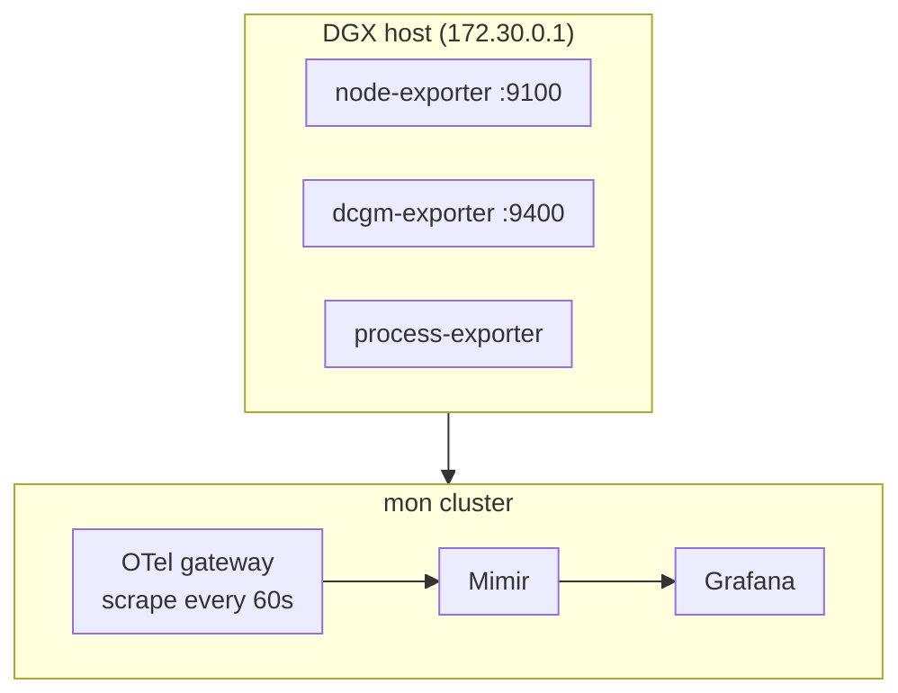
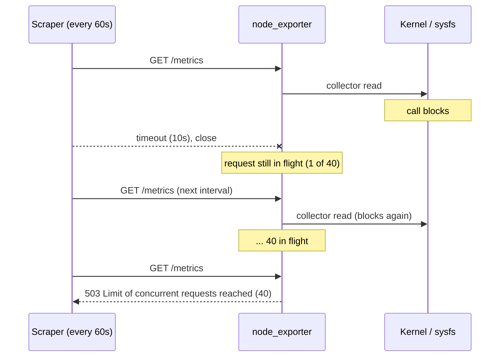

You open a host dashboard and every single stat panel says **No data**: uptime, CPU, memory, GPU, disk, all of them. Not one panel looks a bit odd. They're all blank. That pattern is a clue in itself. When everything is empty at once, the problem is rarely sixty broken queries. It's usually one thing they all depend on. This post walks through a real debugging session on my homelab, from the blank dashboard to the line that explained it (`Limit of concurrent requests reached (40), try again later.`). It covers the checks I'd run in the same order next time, and what to capture before you restart anything.

<!-- more -->

## The setup

The homelab runs on an NVIDIA DGX Spark. A set of host exporters runs there as a Docker Compose project, each listening on the homelab bridge address `172.30.0.1`:

| Exporter | Port | What it gives the dashboard |
| --- | --- | --- |
| node-exporter | 9100 | CPU, memory, load, disks, swap, uptime |
| dcgm-exporter | 9400 | GPU utilisation, power, temperature |
| cAdvisor | 9101 | Per-container memory (one container per k3d node) |
| process-exporter | 9256 | Memory and CPU per process name |
| blackbox-exporter | 9115 | HTTP probes of the platform's endpoints |

A separate k3d cluster called `mon` runs the monitoring stack: Grafana, Mimir, Loki and Tempo. An OpenTelemetry Collector gateway in `mon` scrapes the host exporters with its Prometheus receiver every 60 seconds. It adds `cluster="dgx"` to every series and writes them to Mimir.



The dashboard in the screenshot is *Fleet / DGX Spark host*. Its one variable, **Host**, is defined like this:

```json
{
  "name": "cluster",
  "label": "Host",
  "type": "query",
  "query": "label_values(node_uname_info, cluster)"
}
```

Every panel filters on that variable:

```promql
time() - node_boot_time_seconds{cluster="$cluster"}
avg(DCGM_FI_DEV_GPU_UTIL{cluster="$cluster"})
```

Keep that in mind, because it explains why the GPU panels went blank too, even though nothing was wrong with the GPU exporter.

## Step 1: read the URL before you read the panels

The browser URL ended in `&var-cluster=&refresh=30s`. The variable was **empty**. Grafana fills a query variable by running its query (`label_values(node_uname_info, cluster)`). If that query returns nothing, the dropdown has no options and `$cluster` expands to an empty string. Every panel then asks Mimir for `{cluster=""}`, which matches nothing.

So the first real question isn't "why is CPU busy empty?" but "why does `node_uname_info` not exist?"

> When every panel on a dashboard shows **No data** at once, look at the template variables first. One empty variable blanks the whole dashboard, including panels whose own data is perfectly fine.
{: .prompt-tip }

## Step 2: ask the datasource directly

I skipped the panels and queried Mimir through Grafana's datasource proxy, using a read-only API token. You can do the same in **Explore**, but curl makes it easy to run several checks at once:

```bash
TOKEN=$(cat ~/.config/homelab/grafana-labs-token)
G=https://grafana.mon.home.cloudutsuk.com/api/datasources/proxy/uid/mimir/api/v1

q() { curl -sk -H "Authorization: Bearer $TOKEN" "$G/query" --data-urlencode "query=$1"; echo; }

q 'count(node_uname_info)'
q 'count by (cluster)(DCGM_FI_DEV_GPU_UTIL)'
q 'up{cluster="dgx"}'
```

The answers narrowed it down quickly:

- `count(node_uname_info)` returned an **empty result**. No host metrics at all.
- `count by (cluster)(DCGM_FI_DEV_GPU_UTIL)` returned `{cluster="dgx"} 1`. GPU metrics were arriving fine.
- `up{cluster="dgx"}` listed every DGX scrape target. All of them were `1` except one:

```text
{cluster="dgx", instance="dgx", job="dcgm-exporter"}    1
{cluster="dgx", instance="dgx", job="docker-cadvisor"}  1
{cluster="dgx", instance="dgx", job="node-exporter"}    0
{cluster="dgx", instance="dgx", job="process-exporter"} 1
```

That rules out a lot. The gateway was running, it could reach `172.30.0.1`, Mimir was accepting writes, and the token was fine. Only the node-exporter scrape was failing.

`up` is the most useful metric in Prometheus for exactly this reason. It's written by the scraper, not the target, so it still exists when the target is broken.

## Step 3: when did it start?

A range query on `up` showed the history. I printed only the moments where the value changed:

```bash
END=$(date +%s)
curl -sk -H "Authorization: Bearer $TOKEN" "$G/query_range" \
  --data-urlencode 'query=up{job="node-exporter",cluster="dgx"}' \
  -d start=$((END-86400)) -d end=$END -d step=300 |
python3 -c '
import sys, json, datetime
vals = json.load(sys.stdin)["data"]["result"][0]["values"]
prev = None
for t, v in vals:
    if v != prev:
        print(datetime.datetime.fromtimestamp(t), v); prev = v'
```

```text
2026-10-23 13:01:17 0
2026-10-23 17:41:17 1
2026-10-23 18:11:17 0
2026-10-23 18:16:17 1
...
2026-10-24 01:11:17 0
2026-10-24 01:16:17 1
2026-10-24 09:46:17 0
```

It wasn't a clean break. The target had **flapped** for about a day, with short outages that cleared on their own. Then from 09:46 it stayed down. Flapping like that points away from config and networking. A wrong port or a firewall rule doesn't come and go. It points towards the exporter being intermittently unable to answer.

## Step 4: look at the exporter itself

The container was running, and had been for 19 hours:


```bash
$ docker ps --filter name=homelab- --format '{{.Names}}\t{{.Status}}'
homelab-node-exporter       Up 19 hours
homelab-dcgm-exporter       Up 11 hours
homelab-process-exporter    Up 19 hours
...
```


A container that's "Up" tells you the process is alive, nothing more. Its logs were a wall of the same error:

```text
level=ERROR source=http.go:231 msg="error encoding and sending metric family:
  write tcp 172.30.0.1:9100->192.168.1.19:38958: write: connection reset by peer"
```

That's node_exporter trying to write a response to a client that has already gone. The client is the scraper, which gave up when its scrape timeout ran out. Then I hit the endpoint myself:

```bash
$ curl -s -w '\nHTTP %{http_code} in %{time_total}s\n' http://172.30.0.1:9100/metrics
Limit of concurrent requests reached (40), try again later.
HTTP 503 in 0.000354s
```

There's the answer. node_exporter has a flag for this:

```text
--web.max-requests=40   Maximum number of parallel scrape requests. Use 0 to disable.
```

Forty requests were already in flight inside the exporter. Every new request, from the gateway or from me, was rejected straight away with a 503. The process was alive, the port was open, and it was useless.

## Why requests pile up

This is the part that's worth understanding, because the 503 is a symptom, not the cause.

1. A scrape arrives. node_exporter runs all its enabled collectors to build the response.
2. One collector blocks. It might be waiting on a sysfs read, a stat on a mount, or some other kernel call that doesn't return.
3. The scraper's timeout runs out (Prometheus defaults `scrape_timeout` to 10s), and it closes the connection. On the scraper's side the scrape failed and `up` is 0.
4. **Inside the exporter the request doesn't end.** The handler is still waiting on the stuck collector. When it finally tries to write, it gets `connection reset by peer`, which is the log line above.
5. Sixty seconds later the next scrape arrives and gets stuck behind the same thing.

With a 60-second scrape interval, 40 stuck requests means about 40 minutes of failed scrapes, after which the limit is full and *every* request gets a 503 instantly. If the blocking call clears up, the stuck requests drain and the target recovers. That fits the flapping on the first day. If it never clears, you're stuck at the limit until someone restarts the exporter.



The limit isn't the bug. It protects the host from a flood of goroutines all stuck on the same kernel call. Setting `--web.max-requests=0` to "fix" it just swaps a clean 503 for an unbounded pile-up. I wouldn't do it.

## The fix (and what I should have captured first)

The immediate fix was a restart:

```bash
docker restart homelab-node-exporter
curl -s -o /dev/null -w '%{http_code} %{time_total}s\n' http://172.30.0.1:9100/metrics
# 200 0.045193s
```

A full scrape took 45 ms. A minute later the gateway's next scrape succeeded, `up{job="node-exporter"}` went back to 1, `node_uname_info{cluster="dgx"}` was back in Mimir, the Host dropdown showed `dgx`, and the dashboard filled in.

Then I checked which collectors were slowest, sorted with `sort -g`, because the values are in scientific notation and plain `-n` sorts them wrongly:

```bash
curl -s http://172.30.0.1:9100/metrics |
  grep '^node_scrape_collector_duration_seconds' | sort -k2 -g -r | head -5
```

```text
node_scrape_collector_duration_seconds{collector="thermal_zone"} 0.0245
node_scrape_collector_duration_seconds{collector="hwmon"}        0.0241
node_scrape_collector_duration_seconds{collector="textfile"}     0.0232
node_scrape_collector_duration_seconds{collector="netdev"}       0.0194
node_scrape_collector_duration_seconds{collector="netclass"}     0.0185
```

Everything was fast. That's the catch with restarting first: **the restart destroyed the evidence.** The stuck goroutines were gone, so I couldn't tell which collector had been blocking. I tried reading the threads' kernel stacks from `/proc/<pid>/task/*/stack` before the restart, but that needs root, and I didn't have it in that shell.

What I'd do differently is take a goroutine dump *before* restarting. node_exporter serves Go's pprof handlers on the same port. I confirmed this on v1.12.1:

```bash
# While it's stuck, before you restart anything
curl -s 'http://172.30.0.1:9100/debug/pprof/goroutine?debug=2' > node-exporter-goroutines.txt
grep -A12 'collector\.' node-exporter-goroutines.txt | less
```

Forty goroutines sitting in the same function, say `collector.(*hwmonCollector).Update` or the filesystem collector's stat call, tell you exactly which collector to disable. With that dump, the restart is safe.

> pprof on the metrics port is handy here, but it also means anyone who can reach the port can pull profiles. Keep the exporter on a private address. Here it listens only on the homelab bridge, not the LAN.
{: .prompt-warning }

## Once you know the culprit

Disable that one collector rather than the whole exporter. For a Compose service it's one more line in `command:`:

```yaml
services:
  node-exporter:
    image: prom/node-exporter:v1.12.1
    command:
      - --path.rootfs=/host
      - --web.listen-address=172.30.0.1:9100
      - --no-collector.hwmon        # example: only if the goroutine dump points here
```

If it's the filesystem collector stuck on one mount, which is a classic with NFS or FUSE, narrow the mounts instead of dropping disk metrics. Use `--collector.filesystem.mount-points-exclude` or `--collector.filesystem.fs-types-exclude`. On the DGX the obvious FUSE mounts were already under `/run`, and the existing exclude pattern already skipped `/run`. That's part of why I didn't want to guess without the dump.

You can also filter per scrape with the `collect[]` URL parameter. That's useful for checking whether one collector is the slow one without changing the exporter:

```bash
curl -s 'http://172.30.0.1:9100/metrics?collect[]=hwmon' -o /dev/null -w '%{time_total}s\n'
```

## Common pitfalls

**Trusting "container is Up".** Docker's status only says the process exists. An exporter can be up, listening, and answering every request with a 503. If you add a healthcheck, make it fetch `/metrics` with a short timeout, not just check the port.

**Debugging panels instead of variables.** It's tempting to open panel after panel and stare at the queries. If the URL shows `var-something=` with nothing after it, stop and fix the variable's source first.

**Assuming the dashboard's variable is the right choice.** Driving the Host dropdown from `node_uname_info` means a node-exporter outage blanks the GPU panels too, which makes the outage look much bigger than it is. Querying `label_values(up{job=~"node-exporter|dcgm-exporter"}, cluster)` instead would keep `dgx` in the list as long as *any* host scrape is configured. `up` exists even when the target fails. That's a trade-off: you'd see a populated dropdown with a few blank panels, which is more honest about what's actually broken.

**Restarting before capturing.** Covered above, and it's the lesson I'm taking away. One `curl` to `/debug/pprof/goroutine?debug=2` costs nothing.

**No alert on the scraper's view.** The target flapped for a day and was solidly down for over three hours before I noticed, and only because a dashboard looked wrong. A rule like this would have caught it on the first long outage:


```yaml
groups:
  - name: host-exporters
    rules:
      - alert: HostExporterDown
        expr: up{cluster="dgx", job=~"node-exporter|dcgm-exporter|process-exporter"} == 0
        for: 5m
        labels:
          severity: warning
        annotations:
          summary: "{{ $labels.job }} on {{ $labels.instance }} is not being scraped"
          description: "Check the exporter directly: curl http://172.30.0.1:9100/metrics. A 503 'Limit of concurrent requests' means scrapes are stuck; take a pprof goroutine dump before restarting."
```


It's worth also watching `promhttp_metric_handler_requests_in_flight` from the exporter itself, while you can still scrape it. A value that climbs past 1 or 2 and stays there is the early warning, long before it hits 40.

## The debugging order, condensed

| # | Check | What it rules in or out |
| --- | --- | --- |
| 1 | Dashboard URL and variables | Is an empty variable blanking everything? |
| 2 | The variable's query in Explore | Does the source metric exist at all? |
| 3 | `up{...}` for the job | Is the scrape failing, or is the data just missing? |
| 4 | `up` over 24h | Clean break (config) or flapping (target health)? |
| 5 | `curl` the target yourself | Status code and body. A 503 here is the giveaway. |
| 6 | Exporter logs | `connection reset by peer` means the scraper is timing out. |
| 7 | pprof goroutine dump | Which collector is stuck. **Before** the restart. |
| 8 | Restart, then fix the collector | Disable or narrow the one that blocks. |

## Conclusion

The dashboard was blank because one variable was empty. The variable was empty because one metric was missing. The metric was missing because node_exporter had 40 stuck requests and was turning everything else away. Each layer looked like a bigger failure than the one under it. The fix took one restart. Finding the root cause would take one more `curl` than I ran.

If you run node_exporter anywhere, add an alert on `up == 0` for it today, and put the pprof goroutine command in your runbook next to the restart. If you're running the same kind of self-hosted LGTM setup, the [Cloudutsuk Platform operations and observability post](/posts/projects/cloudutsuk-platform/14-operations-and-observability/) covers how the `mon` cluster and the host exporters fit together, and the [OpenTelemetry lab's monitoring post](/posts/labs/opentelemetry-lab/05-monitor/) shows querying the same stack from the application side.

## References

- [node_exporter README: collectors, `--no-collector.<name>`, `collect[]` filtering](https://github.com/prometheus/node_exporter/blob/master/README.md)
- [Prometheus configuration: `scrape_interval` and `scrape_timeout` defaults](https://prometheus.io/docs/prometheus/latest/configuration/configuration/)
- `node_exporter --help` (v1.12.1) for `--web.max-requests`
