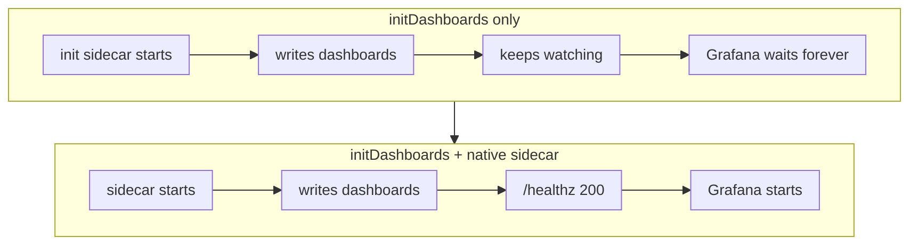

My homelab's Grafana rollout had been sitting at `Init:0/1` for a few minutes, and the only event on
the pod was this:

```text
Normal  Pulled  3m4s  kubelet  spec.initContainers{grafana-init-sc-dashboard}: Container image
"quay.io/kiwigrid/k8s-sidecar:2.11.2@sha256:2912be00…" already present on machine and can be accessed by the pod
```

That line isn't an error. It's the kubelet saying the image was already cached, which is the most
boring thing an event can tell you. No `BackOff`, no `CrashLoopBackOff`, no failed probe. The init
container had started and was running happily. It just never finished. This post walks through why
that happens with the Grafana Helm chart's `initDashboards` option, how I confirmed it, and the
five-line change that fixes it without giving up the reason I turned the option on.

<!-- more -->

## The setup

The cluster in question is `mon`, the monitoring cluster in my homelab: a k3d cluster on Kubernetes
v1.35 running Grafana, Mimir, Loki and Tempo. Nothing on it is installed by hand. Argo CD runs on a
separate `platform` cluster and deploys Grafana from an `Application` in a GitOps repo, using the
community Grafana Helm chart (13.2.6) with Grafana 13.2.2 (distroless image) and the
`kiwigrid/k8s-sidecar` 2.11.2 image for dashboards. The `Application` has `selfHeal: true`, and it is
itself owned by a parent app-of-apps called `cluster-mon`.

Dashboards are provisioned the usual way for this chart. Each dashboard is a ConfigMap labelled
`grafana_dashboard: "1"` with a `grafana_folder` annotation. The `k8s-sidecar` container watches the
`monitoring` namespace for those ConfigMaps, writes each one to `/tmp/dashboards/<folder>/` in a volume
it shares with Grafana, and Grafana's file provisioner picks them up.

If you haven't used Argo CD before, [Argo CD architecture](/posts/devops/cicd/gitops/argocd/argocd-architecture/)
covers how the controller, repo server and `Application` fit together.

## Why `initDashboards` was turned on in the first place

Two days earlier I'd fixed a different bug. Grafana's `grafana.ini` sets a custom home dashboard:

```yaml
dashboards:
  default_home_dashboard_path: /tmp/dashboards/Overview/platform-status.json
```

After a restart, Grafana would sometimes come up with its stock home page instead of mine. The reason
was a startup race. Grafana and the dashboard sidecar start at the same time, and Grafana got to its
home dashboard path before the sidecar had written `/tmp/dashboards/Overview`. The file didn't exist
yet, so Grafana fell back to its default and didn't look again.

The chart has an option that sounds like exactly the fix:

```yaml
sidecar:
  dashboards:
    enabled: true
    # Also run once as an init container, so every dashboard file exists before Grafana starts.
    initDashboards: true
```

That comment is the one I wrote in the GitOps repo, and the phrase "also run once" is where it went
wrong. I assumed the chart would add an init container that does a one-off sync and exits, and keep the
regular sidecar running next to Grafana for live updates. That's not what this chart does.

> Startup races like this one are common in homelabs, where everything restarts at once after a
> reboot. I hit a similar one with [Backstage and Keycloak](/posts/homelab/backstage-keycloak-sso-503-startup-race/)
> the day before.
{: .prompt-info }

## The symptom

Argo CD synced the change, the Deployment rolled to a new revision, and the new pod never got past its
init container:

```bash
kubectl --context k3d-mon get pods -A | grep -i grafana
```

```text
monitoring   grafana-8566744f47-k2wpk   0/1   Init:0/1   0   3m2s
monitoring   grafana-dc8fcdc4b-kbxql    2/2   Running    0   36h
```

The good news is visible in the second line. Because the Deployment uses a rolling update, the old pod
from the previous ReplicaSet was still running and still serving Grafana. Users saw nothing. Argo CD
showed the app as `Progressing` rather than `Degraded`, which is easy to miss if you're not looking.

## Reading the pod, not the events

The event stream was a dead end, so the next stop was the init container itself:

```bash
kubectl --context k3d-mon -n monitoring describe pod grafana-8566744f47-k2wpk
```

The relevant parts:

```text
Init Containers:
  grafana-init-sc-dashboard:
    State:          Running
      Started:      Fri, 23 Oct 2026 01:54:38 +0530
    Ready:          False
    Restart Count:  0
    Environment:
      HEALTH_PORT:  8084
      METHOD:       WATCH
      LABEL:        grafana_dashboard
      ...
Containers:
  grafana:
    State:          Waiting
      Reason:       PodInitializing
```

`State: Running` with `Restart Count: 0` on an *init* container is the clue. An init container has to
exit with code 0 before the next one (or the app containers) can start. This one was in `WATCH` mode,
and a watch never exits by design: it opens a long-lived watch against the API server and waits for
ConfigMaps to change.

The logs confirmed the sidecar was doing its job perfectly well:

```bash
kubectl --context k3d-mon -n monitoring logs grafana-8566744f47-k2wpk -c grafana-init-sc-dashboard --tail=3
```

```text
{"level": "INFO", "msg": "Found a folder override annotation, placing the dashboard-platform-traefik in: /tmp/dashboards/Platform"}
{"level": "INFO", "msg": "Found a folder override annotation, placing the dashboard-platform-velero in: /tmp/dashboards/Platform"}
{"level": "INFO", "msg": "Found a folder override annotation, placing the lab-lab-ebpf-ebpf-lab in: /tmp/dashboards/Labs"}
```

Every dashboard had been written. Then it sat there, watching, forever.

## What the chart actually renders

To see why, I pulled the exact chart version Argo CD was using and read the pod template:

```bash
helm pull oci://registry.core.home.cloudutsuk.com/mirror/ghcr.io/grafana-community/helm-charts/grafana \
  --version 13.2.6 --untar -d chart
grep -nE 'initDashboards|watchMethod|sc-dashboard$' chart/grafana/templates/_pod.tpl
```

Three things stand out in `templates/_pod.tpl`.

First, the init container is only rendered when `initDashboards` is on:


```yaml
{{- if and .Values.sidecar.dashboards.enabled .Values.sidecar.dashboards.initDashboards }}
  - name: {{ include "grafana.name" . }}-init-sc-dashboard
```

Second, the regular sidecar container is only rendered when it's **off**:

```yaml
{{- if and .Values.sidecar.dashboards.enabled (not .Values.sidecar.dashboards.initDashboards) }}
  - name: {{ include "grafana.name" . }}-sc-dashboard
```

So `initDashboards` doesn't *add* an init container. It *moves* the sidecar from `containers` to
`initContainers`. You get one or the other, never both. That's why the new pod showed `0/1` where the
old one showed `2/2`.

Third, the init container's method comes from the same value as the regular sidecar's:

```yaml
      - name: METHOD
        value: {{ .Values.sidecar.dashboards.watchMethod }}
```


`watchMethod` defaults to `WATCH`. Nothing switches it to `LIST` for the init variant. Put those
together and you get a container that the kubelet expects to exit, running a process that never will.

The chart's own `values.yaml` hints at the intended setup, in a comment right under the option:

```yaml
    # This is needed if skipReload is true, to load any dashboards defined at startup time.
    # Deploy the dashboard sidecar as an initContainer.
    initDashboards: false
    # Use native sidecar https://kubernetes.io/docs/concepts/workloads/pods/sidecar-containers/
    # restartPolicy: Always
    # # only applies to native sidecars
    # startupProbe:
    #   httpGet:
    #     path: /healthz
    #     port: 8083
```

In other words, `initDashboards` is meant to be paired with a native sidecar. On its own, with the
default `WATCH` method, it deadlocks the pod.



## Native sidecars in two paragraphs

Kubernetes native sidecars (KEP-753) landed as alpha in 1.28, became beta and on by default in 1.29,
and went GA in 1.33. A native sidecar is an init container with `restartPolicy: Always`. The kubelet
treats it differently from a normal init container in two ways that matter here: it doesn't wait for
it to exit, and it keeps it running for the life of the pod, restarting it if it dies.

The startup ordering is the useful part. The kubelet starts native sidecars in order and moves on to
the next init container (or the app containers) once the sidecar has *started*. If the sidecar has a
`startupProbe`, "started" means the probe has passed. That gives you exactly what I wanted from
`initDashboards`: Grafana doesn't start until the sidecar says it's ready, and the sidecar keeps
watching for new dashboards afterwards. It's the same idea as a classic
[init container](/posts/devops/orchestration/kubernetes/hands-on/init-container/), minus the
requirement to exit.

## Checking that the probe means what I need it to mean

A startup probe is only useful if it goes green at the right moment. If `/healthz` returned 200 as soon
as the HTTP server came up, Grafana could still start before the dashboards were written and the
original race would come back.

My first idea was to port-forward to the stuck pod and poke the endpoint. That doesn't work:

```text
error: unable to forward port because pod is not running. Current status=Pending
```

A pod stuck in init is still `Pending` as far as port-forwarding is concerned, even though one of its
containers is running. The old pod wasn't useful either, because its sidecar had been rendered without
a `HEALTH_PORT` at all.

So I read the code instead. The image ships its Python source, which `docker cp` can pull out of a
created (not running) container:

```bash
docker create --name sc-inspect quay.io/kiwigrid/k8s-sidecar:2.11.2
docker cp sc-inspect:/app ./sc
docker rm sc-inspect
grep -n 'is_ready\|mark_ready' sc/app/.venv/lib/python3.15/site-packages/healthz.py
```

`healthz.py` keeps an `is_ready = False` flag, and the `/healthz` handler returns a non-200 response
until it flips. The only thing that flips it is `mark_ready()`, which `resources.py` calls with the
comment `# After successful initial WATCH sync`. That's the behaviour I needed: the probe fails until
every existing dashboard has been written, then passes.

## The fix

Five lines under the existing sidecar block in the Argo CD `Application`:

```yaml
sidecar:
  dashboards:
    enabled: true
    initDashboards: true
    # initDashboards replaces the sc-dashboard container and keeps METHOD=WATCH, so as a plain init
    # container it never exits and Grafana stays in Init:0/1. Run it as a native sidecar:
    # /healthz only turns 200 after the initial sync, so the startupProbe still gates Grafana's start.
    restartPolicy: Always
    startupProbe:
      httpGet: {path: /healthz, port: 8084}
      periodSeconds: 5
      failureThreshold: 60
    label: grafana_dashboard
    labelValue: "1"
    folderAnnotation: grafana_folder
    searchNamespace: monitoring
```

`failureThreshold: 60` with `periodSeconds: 5` gives the sidecar up to five minutes for its first sync,
which is generous for a few dozen ConfigMaps but harmless.

> Check the port. The chart's example in `values.yaml` uses `8083`, but this release rendered
> `HEALTH_PORT: 8084` for the dashboard sidecar. Copy the example as-is and the startup probe hits a
> closed port, fails 60 times, and the kubelet restarts the sidecar. Read `HEALTH_PORT` from the
> rendered pod spec, not the comment.
{: .prompt-warning }

Before committing, I rendered the chart locally with the `Application`'s values to make sure the
output was what I expected:

```bash
yq '.spec.source.helm.valuesObject' clusters/mon/grafana.yaml > values.yaml
helm template grafana chart/grafana -n monitoring -f values.yaml \
  | yq 'select(.kind=="Deployment") | .spec.template.spec
        | {"init": [.initContainers[] | {"name":.name,"restartPolicy":.restartPolicy,"startupProbe":.startupProbe}],
           "containers": [.containers[].name]}'
```

```json
{
  "init": [
    {
      "name": "grafana-init-sc-dashboard",
      "restartPolicy": "Always",
      "startupProbe": {"failureThreshold": 60, "httpGet": {"path": "/healthz", "port": 8084}, "periodSeconds": 5}
    }
  ],
  "containers": ["grafana"]
}
```

This check takes ten seconds and catches most "I set the value in the wrong place" mistakes, which
with deeply nested Helm values is the most common way a fix like this silently does nothing.

## Rolling it out through GitOps

Patching the live `Application` with `kubectl` would have been faster, and it would have been undone
within minutes. The `grafana` app is owned by the `cluster-mon` app-of-apps with `selfHeal` on, so Argo
CD would put the old spec straight back. The change went in as a pull request to the GitOps repo and
was merged to `main`.

To avoid waiting for the next poll, I asked Argo CD to refresh both apps and then watched the rollout:

```bash
kubectl --context k3d-platform -n argocd annotate application cluster-mon argocd.argoproj.io/refresh=normal --overwrite
kubectl --context k3d-platform -n argocd annotate application grafana argocd.argoproj.io/refresh=normal --overwrite
kubectl --context k3d-mon -n monitoring rollout status deploy/grafana --timeout=300s
```

```text
deployment "grafana" successfully rolled out
NAME                      READY   STATUS        RESTARTS   AGE
grafana-d7c5f45d6-9p6s5   2/2     Running       0          18s
grafana-dc8fcdc4b-kbxql   2/2     Terminating   0          36h
```

Note the `2/2`. Native sidecars count towards the pod's `READY` column even though they're declared
under `initContainers`, so the pod looks the same as it did with a regular sidecar. Grafana's logs
showed dashboard provisioning finishing cleanly on the first attempt:

```text
logger=provisioning.dashboard level=info msg="starting to provision dashboards"
logger=provisioning.dashboard level=info msg="finished to provision dashboards"
```

Argo CD reported the app `Synced` and `Healthy`.

## Common pitfalls

A few things from this incident that are worth carrying into other charts:

| Pitfall | What it looks like | What to do |
| --- | --- | --- |
| Assuming an "init" option adds a container | Pod shows `0/1` instead of `2/2`, live updates stop | Render the chart and compare `initContainers` and `containers` |
| A watcher used as a plain init container | `Init:0/1`, init container `Running`, restart count 0, no errors | Use `restartPolicy: Always` (native sidecar) or a one-shot mode like `METHOD=LIST` |
| Copying the probe port from a comment | Sidecar restarts after the probe's failure budget runs out | Read the port from the rendered env (`HEALTH_PORT`) |
| A health endpoint that's green too early | The original startup race comes back | Check what the endpoint actually waits for before relying on it |
| `kubectl port-forward` to a pod in init | `pod is not running. Current status=Pending` | Read the code, or test against a pod that has finished starting |
| Debugging a distroless container | `exec: "ls": executable file not found in $PATH` | Use logs, the API, or `kubectl debug` with an ephemeral container |

The broader lesson for me is about the comment I wrote two days earlier. "Also run once as an init
container" described what I *wanted*, not what the chart *did*, and nobody (me included) rendered the
chart to check. The rolling update hid the mistake from users, which is good, but it also meant the
broken revision could have sat there quietly for a long time.

### What I'd do differently

I'd render the chart diff before merging any values change to a shared component. With Argo CD you can
get the same view from `argocd app diff`, or from the diff in the UI before syncing. Either would have
shown the `sc-dashboard` container disappearing from `containers`, which is a red flag on its own.

I'd also alert on Deployments stuck mid-rollout. A rollout that hasn't progressed in ten minutes is
something `kube-state-metrics` already exposes (`kube_deployment_status_condition` with
`condition="Progressing"` and `status="false"`). It turns "I happened to notice" into a page.

## Conclusion

The Grafana chart's `initDashboards` option isn't broken, but it's incomplete on its own. It moves the
dashboard sidecar into `initContainers` without changing it from a long-running watcher, so the pod
waits on a container that never exits. Pair it with `restartPolicy: Always` and a `startupProbe` on the
sidecar's `/healthz`, and you get what the option promises: dashboards on disk before Grafana starts,
and live updates afterwards.

If you're running this chart with `initDashboards: true`, check your pod right now: `kubectl get pod`
should show `2/2`, and the init container should have `restartPolicy: Always`. If it shows `Init:0/1`,
you've hit this.

## References

- [Kubernetes: Sidecar containers](https://kubernetes.io/docs/concepts/workloads/pods/sidecar-containers/)
- [Kubernetes: Init containers](https://kubernetes.io/docs/concepts/workloads/pods/init-containers/)
- [kiwigrid/k8s-sidecar on GitHub](https://github.com/kiwigrid/k8s-sidecar)
- [Grafana community Helm charts](https://github.com/grafana-community/helm-charts)
- [Argo CD: Automated sync policy and self-heal](https://argo-cd.readthedocs.io/en/stable/user-guide/auto_sync/)
