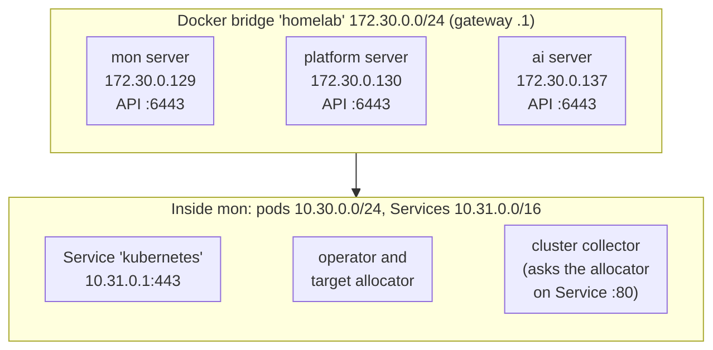
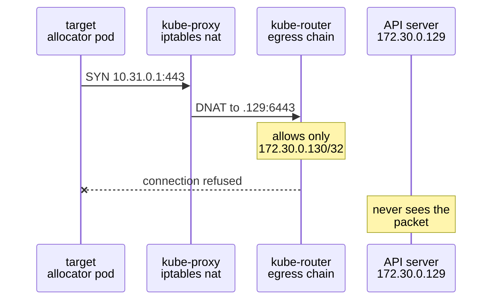
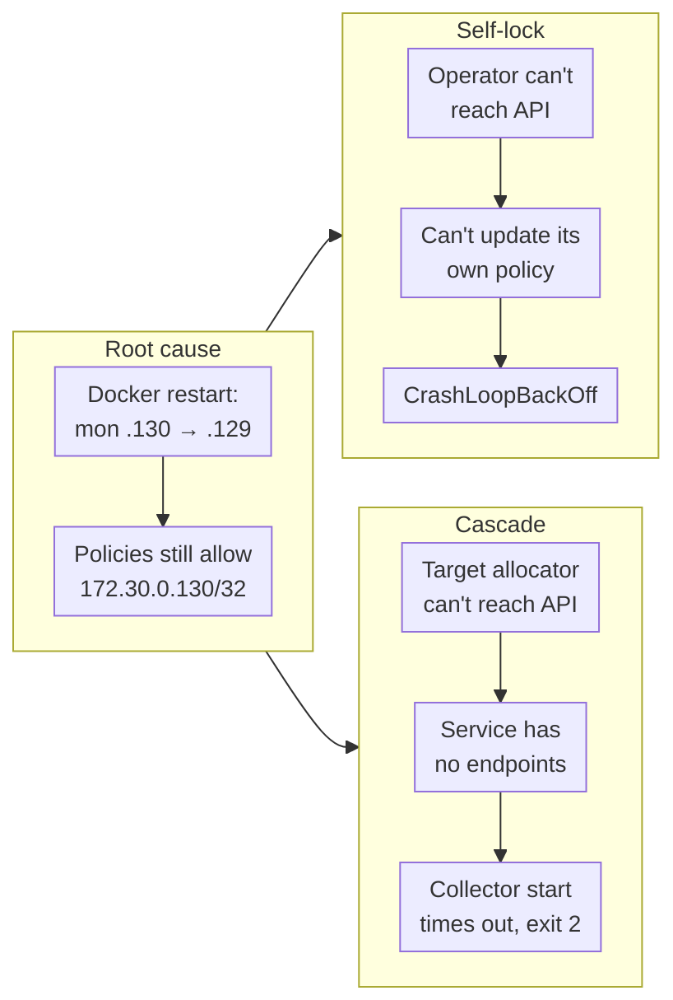
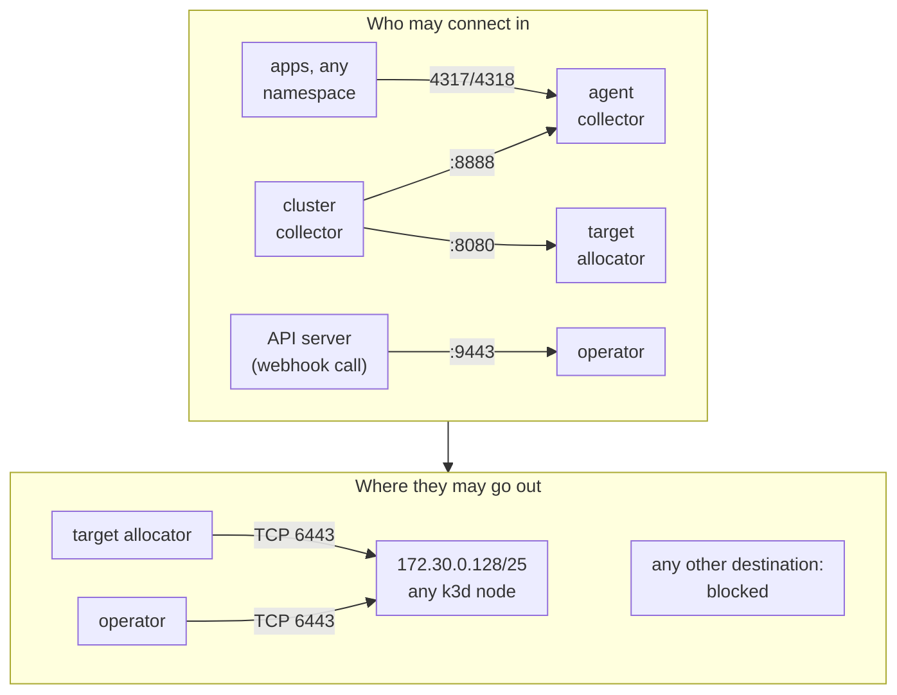
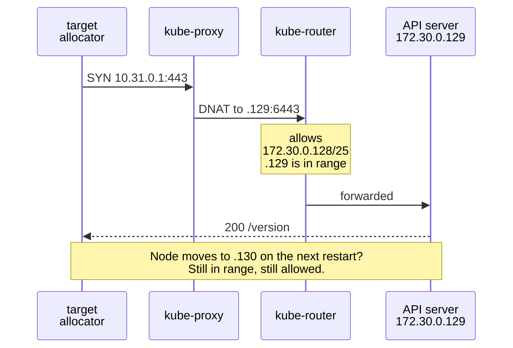
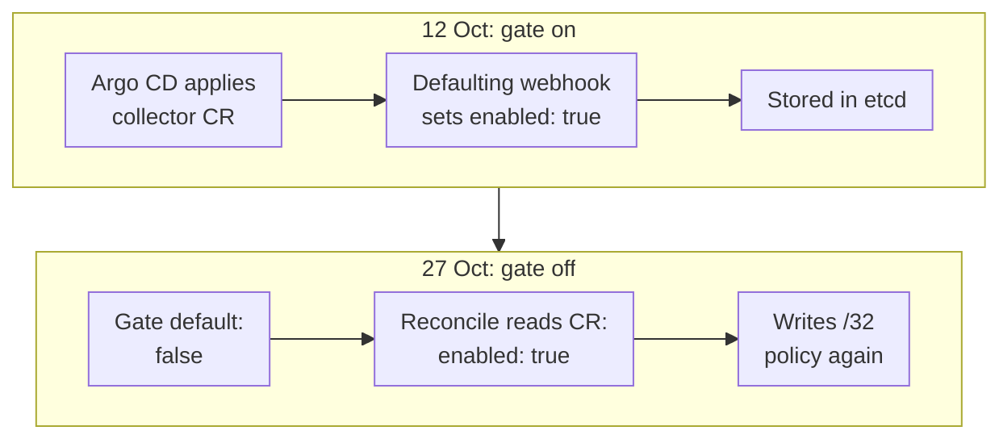

My homelab's cluster collector had restarted 207 times when I looked at it. The pod view said all
there was to say at first glance:

```text
STATE            CrashLoopBackOff
STATE DETAILS    back-off 5m0s restarting failed container=otc-container pod=cluster-collector-0_monitoring
CONTAINER STATE  The container last terminated a minute ago with exit code 2 because of Error.
```

Nothing had been deployed to that cluster for days. No image bump, no config change. What had changed
was the IP address of a Docker container, and a NetworkPolicy that had written the old one down. This
post follows the failure from the collector back to the root cause, three hops away, and then explains
how I fixed it twice: a quick fix to stop the bleeding, and a proper fix that keeps the network
isolation without depending on an IP that can move. At the end I compare it to how you'd handle the
same thing on AKS or EKS, where the API server's IP isn't yours to pin either.

<!-- more -->

## The setup

The homelab runs on a single NVIDIA DGX Spark. It hosts several k3d clusters, each one a k3s server
running in a Docker container. All of them sit on one user-defined Docker bridge network called
`homelab`. The three that matter here are:

- **mon**: Grafana, Mimir, Loki, Tempo and the OTLP gateway.
- **platform**: Argo CD and the platform apps.
- **ai**: model serving.

Every cluster runs the same "monitoring pack", deployed by Argo CD from a GitOps repo:

- the [OpenTelemetry operator](https://github.com/open-telemetry/opentelemetry-operator) (Helm chart
  0.123.1, operator 0.159.0);
- an **agent** collector per node (a DaemonSet);
- a **cluster** collector (a StatefulSet) with a **target allocator** that turns ServiceMonitors and
  PodMonitors into scrape jobs.

k3s enforces NetworkPolicy with an embedded controller built on
[kube-router's netpol library](https://docs.k3s.io/networking/networking-services), which writes iptables
rules on each node. That detail turns out to matter a lot.

Here's the network as it stood on the morning of the incident:



Note what the three k3d server containers have in common. Docker gave them their addresses from the
network's dynamic pool (`IPRange 172.30.0.128/25`), and nothing pins them:


```bash
$ docker network inspect homelab --format '{{json .IPAM.Config}}'
[{"Subnet":"172.30.0.0/24","IPRange":"172.30.0.128/25","Gateway":"172.30.0.1"}]

$ docker inspect k3d-mon-server-0 --format '{{range $k,$v := .NetworkSettings.Networks}}{{$k}}={{$v.IPAddress}} static={{$v.IPAMConfig}}{{end}}'
homelab=172.30.0.129 static=<nil>
```


`static=<nil>` means "whatever was free when the container started". Keep that in mind.

## Following the crash back three hops

### Hop 1: the collector can't reach the target allocator

The first thing I tripped over was the kube context: my current one was `platform`, and the pod there
with the same name was perfectly healthy. The UID in the pod view (`994a286b-…`) didn't match. A quick
loop over the contexts found the crashing one on `mon`:

```bash
for c in k3d-ai k3d-core k3d-mon; do
  kubectl --context=$c -n monitoring get pod cluster-collector-0 \
    -o jsonpath='{.metadata.uid} {.status.containerStatuses[0].restartCount}{"\n"}'
done
```

> When a dashboard or a colleague hands you a pod name, check the UID before you start digging. With
> several clusters running the same stack, `cluster-collector-0` exists everywhere.
{: .prompt-tip }

The previous container's logs were one error, repeated every second for 30 seconds:

```text
error  targetallocator/manager.go:133  Failed to retrieve job list
  {"otelcol.component.id": "prometheus", "error": "Get \"http://cluster-targetallocator:80/scrape_configs\":
   dial tcp 10.31.163.22:80: connect: connection refused"}
```

The Prometheus receiver asks the target allocator for its scrape jobs while it starts, and retries with
a backoff. The container started at 07:15:41 and terminated at 07:16:11. After 30 seconds of refusals
the receiver gives up, the collector fails to start, and the container exits. So the collector itself
was fine. Its dependency wasn't.

### Hop 2: the target allocator can't reach the API server

```bash
$ kubectl --context=k3d-mon -n monitoring get pods
cluster-collector-0                        0/1  CrashLoopBackOff  207 (2m8s ago)   10h
cluster-targetallocator-975fbfbcb-wdm9r    0/1  CrashLoopBackOff  142 (84s ago)    10h
```

The Service `cluster-targetallocator` had no endpoints because its only pod wasn't Ready. Its logs:

```text
WARN  Failed to check CRD availability, assuming CRD is available  resource=servicemonitors
      error="Get \"https://10.31.0.1:443/api?timeout=32s\": dial tcp 10.31.0.1:443: connect: connection refused"
error Can't start the prometheus watcher
      error="Get \"https://10.31.0.1:443/version\": dial tcp 10.31.0.1:443: connect: connection refused"
```

`10.31.0.1:443` is the `kubernetes` Service, the in-cluster address of the API server. A pod that
can't reach it is nearly always looking at one of three things: the API server is down, kube-proxy is
broken, or something is filtering the traffic. The API server was obviously up, because I was talking
to it. And other pods were fine. So: filtering.

### Hop 3: a NetworkPolicy that names the wrong IP

A third pod in another namespace was crash-looping too, the operator itself:

```bash
$ kubectl --context=k3d-mon get pods -A | grep -v Running
opentelemetry-operator  opentelemetry-operator-mon-77d5cf9bd4-vl6fk  0/1  CrashLoopBackOff  124  10h
```

All three crashing pods talk to the API server, and all three had a NetworkPolicy. Here's the
egress rule on the operator's policy, next to where the API server actually was:

```bash
$ kubectl --context=k3d-mon -n opentelemetry-operator get networkpolicy opentelemetry-operator \
    -o jsonpath='{.spec.egress}'
[{"ports":[{"port":6443,"protocol":"TCP"}],"to":[{"ipBlock":{"cidr":"172.30.0.130/32"}}]}]

$ kubectl --context=k3d-mon get endpointslices -l kubernetes.io/service-name=kubernetes \
    -o jsonpath='{.items[0].endpoints[*].addresses}'
["172.30.0.129"]
```

The policy allows `172.30.0.130`. The API server is at `172.30.0.129`. There it is.

## What actually happened

### The IP swap

The policies weren't written by me. Since operator v0.158.0 the
[`operator.networkpolicy` and `operand.networkpolicy` feature gates](https://github.com/open-telemetry/opentelemetry-operator/releases)
are beta and on by default. With them on, the operator creates a NetworkPolicy for itself and for every
collector and target allocator it runs. For components that need the API server, it looks up the
`kubernetes` endpoints **at the time it creates the policy** and writes each address down as a `/32`.

Those policies were created on 12 October. On the morning of the incident the k3d containers restarted,
and Docker handed out IPs from the dynamic pool in whatever order the containers came up. mon and
platform swapped:

| Cluster | API server IP in the operator's policy | Actual API server IP after the restart | Result |
| --- | --- | --- | --- |
| mon | `172.30.0.130/32` | `172.30.0.129` | operator, target allocator and collector crash-looping |
| platform | `172.30.0.135/32` | `172.30.0.130` | operator crash-looping; collector still up only because it hadn't restarted |
| ai | `172.30.0.140/32` | `172.30.0.137` | running, but would break on the next operator restart |

### Why the policy saw the node IP, not the Service IP

The pods connect to `10.31.0.1:443`, but the policy is written for `172.30.0.x:6443`. That only works
because of the order things happen in the node's packet path. kube-proxy's DNAT rewrites the
destination first, and kube-router's policy chains see the packet afterwards. The Kubernetes docs are
explicit that this order
[isn't defined by the API](https://kubernetes.io/docs/concepts/services-networking/network-policies/):
"it is not defined whether this happens before or after NetworkPolicy processing". So it's up to each
CNI. On k3s, it's after.

Here's the broken path, step by step:



### The cascade, and why it couldn't heal itself

The part that turns a stale rule into an outage is who owns the rule. The operator manages the policy
that decides whether the operator can reach the API server. To fix the stale IP it has to talk to the
API server, which the stale IP blocks. That's a deadlock, and every component behind it fails in turn:



## Fix 1: stop the bleeding

The quick fix was to turn both feature gates off on every cluster, in the Argo CD ApplicationSet that
installs the operator. The repo already did this for lab clusters, which run Cilium, for a related
reason (more on that below), so it was a one-condition change:

```yaml
templatePatch: |
  spec:
    source:
      helm:
        # parameters, not valuesObject: a templatePatch can't merge into valuesObject (raw JSON).
        parameters:
          - {name: 'manager.featureGatesMap.operator\.networkpolicy', value: "false"}
          - {name: 'manager.featureGatesMap.operand\.networkpolicy', value: "false"}
```

Turning the gates off doesn't delete the policies already in the cluster, and the operator can't
recover until its own policy is gone. So the stale policies had to be deleted by hand, and the stuck
pods restarted:

```bash
for c in k3d-mon k3d-platform k3d-ai; do
  kubectl --context=$c -n opentelemetry-operator delete networkpolicy opentelemetry-operator
  kubectl --context=$c -n monitoring delete networkpolicy cluster-targetallocator-networkpolicy
  kubectl --context=$c -n opentelemetry-operator delete pod -l app.kubernetes.io/name=opentelemetry-operator
done
```

Everything came back. But was deleting the policies the right answer? Not really. It swapped an outage
for a quieter problem: the operator and target allocator could now reach anything, anywhere. The
policies' ingress rules went too, and those had never been the problem. A port doesn't change when a
container restarts.

The bug was narrower than "NetworkPolicies are bad". It was three things together:

1. The API server was named by a single `/32` IP.
2. That IP was captured once and never refreshed.
3. The component that maintained the rule was itself subject to the rule.

Fix those, and you get the isolation back without the outage.

## How production teams handle "allow the API server"

My first question was whether this was just a homelab problem. It isn't. Pinning the API server's IP
is fragile on managed Kubernetes too:

- **EKS**: the control plane reaches your VPC through network interfaces that AWS creates in the
  subnets you chose. During an upgrade, EKS
  [needs free IPs in those subnets and may create the new interfaces in different subnets](https://docs.aws.amazon.com/eks/latest/userguide/update-cluster.html).
  A `/32` captured before an upgrade can be wrong after it.
- **AKS**: with [API Server VNet Integration](https://learn.microsoft.com/azure/aks/api-server-vnet-integration),
  the API server sits behind an internal load balancer in a delegated subnet (a `/28` at minimum).
  Without it, pods reach the API server through a public endpoint or a private link, depending on the
  cluster type.

Upstream NetworkPolicy has no way to say "the API server". The docs list "targeting of services by
name" among the things it can't do. So teams pick one of these:

| Approach | How it names the API server | Survives IP changes | Trade-off |
| --- | --- | --- | --- |
| CNI entity | Cilium `toEntities: [kube-apiserver]` | Yes, the CNI tracks it | Cilium-specific (works on AKS with Azure CNI powered by Cilium, and EKS with Cilium) |
| Stable range | `ipBlock` for the control-plane subnets (EKS) or the delegated API server subnet (AKS) | Yes, within the range | A little broader than one IP |
| Single `/32`, generated once | What the operator did | No | Breaks on the next move, and can lock out the component that wrote it |

Two practices sit alongside whichever one you pick:

- **Keep these policies in Git.** Write them next to the workload, so your GitOps tool reconciles them
  from outside the cluster component they protect. A component should never own the rule that controls
  its own access to the API.
- **Alert on crash loops.** This collector was down for about ten hours before anyone looked.
  `kube-state-metrics` already exposes the restart count and waiting reason. An alert on
  `kube_pod_container_status_waiting_reason{reason="CrashLoopBackOff"}` would have paged within minutes.

## Fix 2: our own policies, keyed on a range

For the homelab, the "stable range" answer is almost free. Every k3d node takes its IP from the
`homelab` network's dynamic pool, `172.30.0.128/25`. Nodes can swap addresses inside that range as often
as they like. So the policies allow the API server port on the whole range instead of one IP.

### What each component actually needs

Before writing any rules I listed every connection each component makes or accepts, and checked the
list against the live cluster (Service selectors, ServiceMonitors, which ports are scraped by whom):

| Component | Ingress it needs | Egress it needs |
| --- | --- | --- |
| Operator | `9443` admission webhook (from the API server), `8443` metrics | API server `6443` |
| Target allocator | `8080` from the cluster collector only | API server `6443` |
| Cluster collector | `8888` own metrics, from itself | Anything a ServiceMonitor names: can't be listed |
| Agent collector | `4317`/`4318` OTLP from apps in any namespace, `8888` metrics | Kubelet, gateway, API server |

Two observations shaped the design. The cluster collector's egress can't be a short list, because it
scrapes whatever any chart's ServiceMonitor points at, so the collectors get ingress rules only. And
traffic from the pod's own node (kubelet probes, and the API server calling the webhook on k3s) is
[always allowed](https://kubernetes.io/docs/concepts/services-networking/network-policies/), so health
probe ports don't need rules.

Here's the template, trimmed of comments. It lives in the monitoring-pack Helm chart, so Argo CD owns
it, not the operator:

```yaml
{{- if .Values.networkPolicies.enabled }}
apiVersion: networking.k8s.io/v1
kind: NetworkPolicy
metadata:
  name: operator   # not opentelemetry-operator: that's the name of the operator's own
  namespace: opentelemetry-operator
spec:
  podSelector:
    matchLabels: {app.kubernetes.io/name: opentelemetry-operator, app.kubernetes.io/component: controller-manager}
  policyTypes: [Ingress, Egress]
  ingress:
    - ports:
        - {protocol: TCP, port: 9443}
    - from:
        - namespaceSelector:
            matchLabels: {kubernetes.io/metadata.name: {{ .Release.Namespace }}}
      ports:
        - {protocol: TCP, port: 8443}
  egress:
    - to:
        - ipBlock: {cidr: 172.30.0.128/25}   # from .Values.networkPolicies.apiServerCIDRs
      ports:
        - {protocol: TCP, port: 6443}
---
apiVersion: networking.k8s.io/v1
kind: NetworkPolicy
metadata:
  name: target-allocator
spec:
  podSelector:
    matchLabels: {app.kubernetes.io/component: opentelemetry-targetallocator, app.kubernetes.io/instance: monitoring.cluster}
  policyTypes: [Ingress, Egress]
  ingress:
    - from:
        - podSelector:
            matchLabels: {app.kubernetes.io/component: opentelemetry-collector, app.kubernetes.io/instance: monitoring.cluster}
      ports:
        - {protocol: TCP, port: 8080}
  egress:
    - to:
        - ipBlock: {cidr: 172.30.0.128/25}
      ports:
        - {protocol: TCP, port: 6443}
---
apiVersion: networking.k8s.io/v1
kind: NetworkPolicy
metadata:
  name: collectors
spec:
  podSelector:
    matchLabels: {app.kubernetes.io/component: opentelemetry-collector, app.kubernetes.io/managed-by: opentelemetry-operator}
  policyTypes: [Ingress]
  ingress:
    - from:
        - podSelector:
            matchLabels: {app.kubernetes.io/component: opentelemetry-collector, app.kubernetes.io/instance: monitoring.cluster}
      ports:
        - {protocol: TCP, port: 8888}
---
apiVersion: networking.k8s.io/v1
kind: NetworkPolicy
metadata:
  name: agent-otlp
spec:
  podSelector:
    matchLabels: {app.kubernetes.io/component: opentelemetry-collector, app.kubernetes.io/instance: monitoring.agent}
  policyTypes: [Ingress]
  ingress:
    - from:
        - namespaceSelector: {}
      ports:
        - {protocol: TCP, port: 4317}
        - {protocol: TCP, port: 4318}
{{- end }}
```

The range is a chart value (`networkPolicies.apiServerCIDRs`), and the lab clusters set
`networkPolicies.enabled=false`. Labs run Cilium, which identifies the API server as the
`kube-apiserver` entity rather than by IP, so an `ipBlock` rule never matches there. That's exactly
why the operator's policies had already been turned off on labs two weeks earlier. A Cilium-native
variant with `toEntities` is the right answer for them, but I couldn't test it with no lab running, so
I left it out rather than ship something unverified.

### The solution, drawn out



And the same request that failed before, now with the range rule. It passes no matter which `.1xx`
address the node ended up with:



## The gotcha I didn't expect: the CR beats the feature gate

I applied the new policies on mon, deleted every policy the operator had made, and restarted
everything. Within seconds, the operator had re-created all three operand policies, with the old `/32`
in them. The feature gate was definitely off. The operator logged it at startup:

```text
"message":"Feature gates","feature-gates":"-operand.networkpolicy,...,-operator.networkpolicy,..."
```

The operator's own policy didn't come back, so `operator.networkpolicy` was doing its job. The operand
one wasn't. The reason was in the custom resources:

```bash
$ kubectl --context=k3d-mon -n monitoring get otelcol cluster -o jsonpath='{.spec.networkPolicy}'
{"enabled":true}
```

When the collectors were first created, back when the gate was on, the operator's defaulting webhook
wrote `networkPolicy.enabled: true` into each `OpenTelemetryCollector`. The gate only sets the default
for new resources. An explicit value in the CR wins, and the webhook had made it explicit. So the
quick fix had quietly not been a complete fix: the operator would have kept writing `/32` policies for
the collectors and the target allocator.



The fix is to say it explicitly in Git, on both collectors:

```yaml
apiVersion: opentelemetry.io/v1beta1
kind: OpenTelemetryCollector
metadata:
  name: cluster
spec:
  mode: statefulset
  # Ours instead (network-policies.yaml). The operator copies this to the TargetAllocator it makes.
  networkPolicy: {enabled: false}
```

Once that was set, the `TargetAllocator` CR followed (`{"enabled":false}`) and the operator deleted
both collector policies by itself. It left the target allocator's in place, so that one I deleted by
hand. After that, only my four policies remained, and nothing re-created anything.

## Verifying it actually isolates

"All pods Ready" proves the policies allow enough. It doesn't prove they block anything. To check
both, I ran short-lived curl pods carrying the same labels as the real components, so the same
policies applied to them. On this cluster Kyverno enforces the restricted pod profile, so the probes
needed a digest-pinned image, a read-only root, dropped capabilities and resource limits. The first
round of results made no sense: a pod labelled as the target allocator could reach the internet, and a
pod labelled as the collector was blocked from the allocator.

That's kube-router's sync lag. It builds a new pod's firewall chains, and adds the pod's IP to other
policies' ipsets, a few seconds after the pod starts. A probe that curls straight away has no egress
rules yet (so everything is open) and isn't yet in anyone's allow-list (so everything is blocked).
Adding `sleep 30` before the checks gave clean results:

| From (labels of) | To | Result |
| --- | --- | --- |
| target allocator | API via Service `10.31.0.1:443` | open |
| target allocator | API node `172.30.0.129:6443` | open |
| target allocator | another cluster's API, `172.30.0.130:6443` | open (shared range, accepted) |
| target allocator | `1.1.1.1:443`, kube-state-metrics `:8080`, host `:9100`, kube-dns | blocked |
| cluster collector | target allocator `:8080`, agent `:8888` | open |
| unlabelled pod | target allocator `:8080`, agent `:8888`, cluster collector `:8888` | blocked |
| unlabelled pod | agent OTLP `:4318` | open |

The first row is the useful confirmation of the DNAT ordering. A rule that names only the node range
allows a connection the pod made to the Service IP, so kube-router really does match after kube-proxy
rewrites the destination.

The third row is the trade-off, stated honestly. The `/25` covers every k3d node, so a target allocator
on mon can open a TCP connection to platform's API server. It still needs credentials for that cluster
to do anything, and the alternative was "can reach the whole internet". I'll take it.

On the real components: the target allocator synced its ServiceMonitor and PodMonitor caches with no
errors, and the collector logged `Scrape job added` for every job. The collector had one `Failed to
retrieve job list` at startup, while the allocator was still coming up, and none after that. The
operator reconciled the CR change through its webhook on `9443`, which proves that rule works too.

## Common pitfalls

| Pitfall | What it looks like | What to do |
| --- | --- | --- |
| Same pod name on several clusters | You debug a healthy pod | Compare the pod UID before digging |
| API server allowed by a `/32` | `connection refused` to `10.x.0.1:443` after a restart or upgrade | Allow a stable range, or use the CNI's API server entity |
| A component owns its own policy | It can't recover once the rule is wrong | Keep the policy in Git, reconciled from outside |
| Turning off an operator feature gate | The resources come back | Check the CRs for values the defaulting webhook already wrote |
| Disabling gates and stopping there | Old policies stay in the cluster forever | Delete what the operator already created |
| Testing policies with fresh pods | Results that contradict each other | Wait for the CNI to sync (kube-router: ~30s) before checking |

### What I'd do differently

I'd read every NetworkPolicy an operator generates the day I install it, the same way I'd review a
Helm chart's RBAC. A `/32` for the API server in a cluster whose node IPs come from DHCP-style
allocation is a problem you can spot on day one, not on the morning the containers restart in a
different order.

I'd also have alerted on this. The collector was down for ten hours, and I found out because I happened
to open the pod view.

## Conclusion

The collector crash was three hops from the cause. The operator wrote a policy that allowed the API
server by one IP, and that IP moved. The operator couldn't fix the policy because the policy blocked it
from the API server. Deleting the policies got the pods running, but the real fix was to put the rules
back under GitOps, describe the API server by the range its address comes from, and turn the
operator's own policies off in the CRs as well as in the feature gates.

If you run the OpenTelemetry operator 0.158 or later, check right now:

```bash
kubectl get networkpolicy -A -l app.kubernetes.io/managed-by=opentelemetry-operator \
  -o jsonpath='{range .items[*]}{.metadata.namespace}/{.metadata.name} {.spec.egress[*].to[*].ipBlock.cidr}{"\n"}{end}'
kubectl get endpointslices -l kubernetes.io/service-name=kubernetes -o jsonpath='{.items[0].endpoints[*].addresses}'
```

If the first command prints `/32`s that aren't in the second command's list, you've hit this.

For more on how policies select pods and combine, see
[Kubernetes Network Policies](/posts/devops/orchestration/kubernetes/kubernetes-network-policies/).
For another homelab incident on the same mon cluster, see
[Grafana stuck in Init:0/1](/posts/devops/orchestration/kubernetes/grafana-stuck-init-initdashboards-native-sidecar/).

## References

- [Kubernetes: Network Policies](https://kubernetes.io/docs/concepts/services-networking/network-policies/)
- [OpenTelemetry operator releases (v0.158.0: network policy gates promoted to beta)](https://github.com/open-telemetry/opentelemetry-operator/releases)
- [K3s: Networking services (embedded network policy controller)](https://docs.k3s.io/networking/networking-services)
- [Amazon EKS: Update existing cluster to new Kubernetes version](https://docs.aws.amazon.com/eks/latest/userguide/update-cluster.html)
- [AKS: Use API Server VNet Integration](https://learn.microsoft.com/azure/aks/api-server-vnet-integration)
- [Cilium: Policy language, entities](https://docs.cilium.io/en/stable/security/policy/language/)
