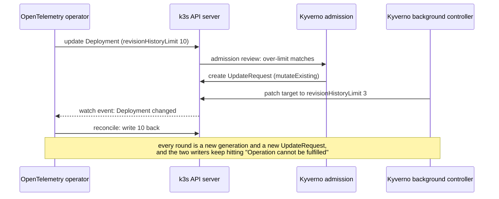

I went looking for memory to free on my homelab PC with a simple plan: find the biggest apps and put the
idle ones behind the KEDA HTTP add-on, the way I already scale my GPU models to zero. The biggest consumer
turned out not to be an app at all. It was the Kubernetes control plane. Each of four k3s servers was
holding 2.5 to 3.4 GiB and burning one to two and a half CPU cores, on clusters where nothing was being
deployed.

<!-- more -->

The cause was a policy I had added eight days earlier to tidy up old ReplicaSets. It was fighting the
OpenTelemetry operator over a single field on a single Deployment, and neither side ever gave up. By the time
I found it, that Deployment's generation counter was past 1.5 million.

This post walks through how I found it, starting from `docker stats`, because none of the usual signals
pointed at it: no alert fired, no pod was unhealthy, and the object counts looked tiny. Then the fix, which
is one CEL expression, and what the numbers looked like after.

## The setup

The homelab PC (x86_64, 91 GiB of RAM, 32 cores) runs five k3d clusters on one Docker bridge. Each cluster is
a single k3s server container:

| Cluster | Runs |
|---|---|
| `core` | OpenBao, Keycloak, cert-manager, PowerDNS, the Zot registry |
| `platform` | Argo CD (managing every cluster), Backstage, CI runners, my own apps |
| `mon` | Grafana, Mimir, Loki, Tempo, the OTLP gateway |
| `ai` | LiteLLM, Postgres, Qdrant, Phoenix |
| `wardens` | An agent framework with Temporal and a few MCP servers |

Every cluster except `core` runs Kyverno, with the same policy chart from Git, and the same monitoring
pack: the OpenTelemetry operator, an `OpenTelemetryCollector` and its target allocator, which the operator
turns into a Deployment called `cluster-targetallocator`. Keep both of those in mind. `core` turns out to
be the control group in this story, because it's the one cluster without Kyverno.

## Step 1: where does the memory go?

`docker stats` gives the size of each node:

```text
k3d-platform-server-0   14.57GiB / 20GiB   72.83%   621.77%
k3d-mon-server-0         8.737GiB / 10GiB  87.37%   226.21%
k3d-ai-server-0          6.823GiB / 16GiB  42.64%   456.57%
k3d-wardens-server-0     6.817GiB / 10GiB  68.17%   503.41%
k3d-core-server-0        2.877GiB / 6GiB   47.95%    10.34%
```

Docker's number includes page cache, which the kernel can reclaim, so I read the node's cgroup
`memory.stat` for the `anon` line (memory processes actually hold) and compared it with the sum of
`kubectl top pods` for the same cluster:

| Cluster | Node `anon` | Sum of pods | Gap |
|---|---|---|---|
| `platform` | 11.7 GiB | 9.4 GiB | 2.3 GiB |
| `mon` | 7.8 GiB | 5.0 GiB | 2.8 GiB |
| `ai` | 6.1 GiB | 3.3 GiB | 2.8 GiB |
| `wardens` | 5.6 GiB | 3.4 GiB | 2.2 GiB |
| `core` | 2.5 GiB | 1.7 GiB | 0.8 GiB |

Something outside the pods was holding 2 to 3 GiB per cluster. Listing the processes inside each node by
RSS named it straight away:

```bash
docker top k3d-ai-server-0 -eo pid,rss,comm | sort -k2 -n -r | head -3
```

```text
    3245 MiB k3s
     759 MiB litellm
     442 MiB python3.13
```

It was `k3s` on every cluster: 3.3 GiB on `platform`, 3.1 on `mon`, 3.2 on `ai`, 2.5 on `wardens`, and 1.0
on `core`. k3s runs the API server, controller manager, scheduler, kubelet and its datastore layer (kine on
SQLite here) in one Go process, so "k3s is big" doesn't tell you which part. Its CPU was the bigger surprise:
measured from `/proc/<pid>/stat` over ten seconds, the four Kyverno clusters' k3s processes used between
113% and 244% each. `core`'s used 5%.

> Read `anon` from the node's cgroup before you trust a container's memory figure. On this host the page
> cache was tens of GiB, all of it reclaimable, and `docker stats` counts it.
{: .prompt-tip }

## Step 2: is it just a big cluster?

My first guess was the usual one: more objects, more CRDs, bigger watch caches. The API server's own
metrics answer that. `kubectl get --raw /metrics` on a k3s server returns the whole process's Go runtime
stats as well as the API server's:

```bash
kubectl --context k3d-platform get --raw /metrics \
  | grep -E '^(go_memstats_heap_inuse_bytes|process_resident_memory_bytes|go_goroutines) '
```

| Cluster | Heap in use | RSS | Goroutines | Objects stored | CRDs |
|---|---|---|---|---|---|
| `platform` | 2,636 MiB | 3,417 MiB | 14,436 | 3,221 | 122 |
| `mon` | 2,260 MiB | 3,209 MiB | 12,714 | 2,269 | 102 |
| `ai` | 2,269 MiB | 3,223 MiB | 13,594 | 2,239 | 115 |
| `wardens` | 1,931 MiB | 2,532 MiB | 12,894 | 2,512 | 102 |
| `core` | 686 MiB | 987 MiB | 9,690 | 764 | 79 |

A few thousand objects can't explain 2 GiB of heap. `core` has a third of the objects and three quarters of
the CRDs, yet a quarter of the heap. The object count is the wrong measure. What matters is how fast those
objects change.

I tried for a heap profile next, and k3s said no:

```bash
kubectl --context k3d-platform get --raw /debug/pprof/heap
# Error from server (NotFound): the server could not find the requested resource
```

Profiling is off unless you start k3s with it, and I didn't want to recreate a cluster for a hunch. So I went
back to `apiserver_storage_objects`, which counts stored objects per resource, and sorted it:

```text
updaterequests.kyverno.io                        1001
events                                            519
customresourcedefinitions.apiextensions.k8s.io    122
clusterroles.rbac.authorization.k8s.io            121
secrets                                           120
```

The same thing topped the list on `mon`, `ai` and `wardens`: about 1,000 Kyverno `UpdateRequest`s each.
`core`, with no Kyverno, had none.

## Step 3: what are a thousand UpdateRequests doing?

Kyverno uses an `UpdateRequest` to hand work from its admission webhook to its background controller: a
generate rule, or a mutation of *existing* resources, which can't happen inside the admission call. A
handful at a time is normal. A steady thousand isn't. I dumped them and grouped them:

```bash
kubectl --context k3d-platform -n kyverno get updaterequests.kyverno.io -o json > ur.json
```

```text
count 1000   json size 19.0 MiB
997  policy=limit-revision-history  type=cel-mutate  state=Pending
target: every one is Deployment monitoring/cluster-targetallocator
oldest 2026-11-13T21:14:09Z   newest 2026-11-14T08:13:13Z
611  failed to update target resource for mpol limit-revision-history:
     Operation cannot be fulfilled on deployments.apps "cluster-targetallocator ...
```

Every pending request came from one policy and pointed at one Deployment. Each was about 19 KiB, because it
carries the whole admission request, including the full Deployment with its `managedFields`. "Operation
cannot be fulfilled" is the API server's optimistic-concurrency error: the object changed between Kyverno
reading it and writing it. Something else was writing to that Deployment at the same time.

The Deployment's generation said how often:

```bash
for c in platform mon ai wardens; do
  kubectl --context k3d-$c -n monitoring get deploy cluster-targetallocator \
    -o jsonpath='{.metadata.generation} rhl={.spec.revisionHistoryLimit} owner={.metadata.ownerReferences[0].kind}{"\n"}'
done
```

```text
1254563 rhl=10 owner=TargetAllocator
1516403 rhl=10 owner=TargetAllocator
1511523 rhl=10 owner=TargetAllocator
1596139 rhl=10 owner=TargetAllocator
```

`metadata.generation` goes up by one each time a Deployment's spec changes. This Deployment was created on
2026-10-28 and had passed 1.25 million on every cluster. Twenty seconds later `platform` had added 18 and
`mon` 34. Over the afternoon it averaged about two spec changes a second on each cluster, around the clock.

The API server's request counters on `platform` showed what that cost:

```text
apiserver_request_total{resource="updaterequests",verb="POST",code="201"}             989492
apiserver_request_total{resource="updaterequests",verb="DELETE",code="200"}           988490
apiserver_request_total{resource="updaterequests",subresource="status",verb="PUT",code="404"} 123486
```

Nearly a million `UpdateRequest`s created and deleted since k3s last started, each about 19 KiB, plus
123,000 status updates for requests that were already gone. Every write goes to kine's SQLite database,
and every change to the Deployment goes out to every watcher: the Deployment controller, Kyverno, Argo
CD, kube-state-metrics. The datastores showed it:

| Cluster | k3s SQLite datastore |
|---|---|
| `platform` | 941 MiB |
| `mon` | 1.5 GiB |
| `ai` | 819 MiB |
| `wardens` | 730 MiB |
| `core` | 37 MiB |

## What was actually happening

The policy is ADR 0090 in my platform's
[decision log](/posts/projects/cloudutsuk-platform/architecture-decision-records/#adr-0090). Every rollout
leaves its old ReplicaSet behind, and most Helm charts keep the API default of 10. I wanted 3 everywhere
without editing twenty charts, so I wrote a Kyverno `MutatingPolicy` that lowers any missing or higher
`revisionHistoryLimit` to 3. It mutates at admission, and with `mutateExisting` it also fixes Deployments
that already exist. Argo CD ignores the field in its diffs, so charts that write 10 don't fight it.

```yaml
apiVersion: policies.kyverno.io/v1
kind: MutatingPolicy
metadata:
  name: limit-revision-history
spec:
  failurePolicy: Ignore
  evaluation:
    admission: {enabled: true}
    mutateExisting: {enabled: true}
  matchConstraints: { ... }          # apps/v1 deployments, CREATE and UPDATE, not kube-system or kyverno
  matchConditions:
    - name: over-limit
      expression: '!has(object.spec.revisionHistoryLimit) || object.spec.revisionHistoryLimit > 3'
  targetMatchConstraints: { ... }    # the same
  targetMatchConditions:
    - name: over-limit
      expression: '!has(object.spec.revisionHistoryLimit) || object.spec.revisionHistoryLimit > 3'
  mutations:
    - patchType: ApplyConfiguration
      applyConfiguration:
        expression: 'Object{spec: Object.spec{revisionHistoryLimit: 3}}'
```

That works for any Deployment whose desired state lives in Git, because Argo CD has been told to leave the
field alone. It doesn't work for a Deployment that an operator owns. The operator builds the Deployment from
its own CR on every reconcile and writes back whatever differs from what it wants, and what it wants is 10.
It doesn't know about Argo CD's ignore rule, and it shouldn't have to.



I didn't trace which side won each individual round; the live value was 10 on three clusters and 3 on `mon`
when I looked. The generation counter is enough: neither side ever stopped, so the loop had run since the
policy's first sync.

Why did nothing tell me? Every piece was "healthy". The policy has `failurePolicy: Ignore`, the conflicts
are retried, the target allocator kept running (the rewrites only touched a field that doesn't restart pods),
and Argo CD showed everything Synced because it ignores that field. The only symptom was resource use on
the control plane, which none of my alerts covered.

## The fix: leave operator-owned objects alone

The target allocator was the only Deployment in any cluster with a controller `ownerReference`. I listed
them with this:

```bash
kubectl get deploy -A -o json | jq -r '.items[]
  | select(.metadata.ownerReferences // [] | any(.controller == true))
  | "\(.metadata.namespace)/\(.metadata.name) owner=\(.metadata.ownerReferences[0].kind) gen=\(.metadata.generation)"'
```

I had a few ways to break the loop:

| Option | Why not |
|---|---|
| Exclude the `monitoring` namespace | Drops the policy for my own Deployments there too, and the next operator in another namespace starts the same fight |
| Exclude `app.kubernetes.io/managed-by: opentelemetry-operator` | Fixes this operator only; every operator labels its objects differently |
| Turn off `mutateExisting` | Old ReplicaSets on existing Deployments stay, and an operator's update at admission would still be mutated against its will |
| Set the value through the operator's CR | Works for this one if the CR has such a field, but it's per operator again, the problem the policy was written to avoid |
| **Skip any Deployment with a controller `ownerReference`** | Generic: whatever an operator owns, the operator decides |

The last option is one more CEL condition, added to both the trigger (`matchConditions`) and the target
(`targetMatchConditions`), because with `mutateExisting` the trigger's conditions don't filter targets:

```yaml
    - name: not-operator-owned
      expression: >-
        !has(object.metadata.ownerReferences) ||
        !object.metadata.ownerReferences.exists(r, has(r.controller) && r.controller)
```

Before merging I rendered the chart and sent the policy to the live API server as a server-side dry run,
which makes Kyverno compile the CEL:

```bash
helm template x apps/kyverno-policies -s templates/limit-revision-history.yaml > lrh.yaml
kubectl --context k3d-platform apply --dry-run=server -f lrh.yaml
# mutatingpolicy.policies.kyverno.io/limit-revision-history configured (server dry run)
```

The trade-off: an operator-owned Deployment keeps its operator's history limit. The target allocator keeps
10, and it has exactly one ReplicaSet, so that costs nothing.

## After the fix

The change went through Git, and Argo CD synced the policy to all five Kyverno clusters. Then I deleted the
backlog, since requests already queued would only retry against a policy that no longer matched:

```bash
kubectl -n kyverno delete updaterequests.kyverno.io --all
```

That removed 3,287 across the four PC clusters. A minute later:

```text
platform  generation 1272227 -> 1272227 (+0 in 60s), UpdateRequests now 0
mon       generation 1541687 -> 1541687 (+0 in 60s), UpdateRequests now 0
ai        generation 1534267 -> 1534267 (+0 in 60s), UpdateRequests now 0
wardens   generation 1619339 -> 1619339 (+0 in 60s), UpdateRequests now 0
```

CPU followed straight away: each k3s server went from 1.1 to 2.4 cores to 14 to 18%. Seven cores came
back.

Memory didn't move. Ten minutes later the servers were still at 2.5 to 3.6 GiB RSS with 1.6 to 2.6 GiB of
heap in use. I didn't have a profile to say exactly why, but the numbers fit a process that had grown its
caches and heap under eight days of churn and had no reason to hand them back yet, sitting on a datastore
that had grown to over a GiB. SQLite doesn't shrink its file when rows are deleted.

So I restarted the four clusters one at a time, with `k3d cluster stop` and `start` (never `docker restart`
on a k3d node: it drops the host aliases k3d injects). I started with the least important cluster, checked
the pods and Argo CD apps, then went on to the next. Before `platform` I checked that no CI job and no
scheduled app run was in progress.

| Cluster | k3s RSS before → after | Node memory before → after | k3s CPU before → after |
|---|---|---|---|
| `wardens` | 2.5 → 1.7 GiB | 6.8 → 5.6 GiB | 1.1 cores → 15% |
| `ai` | 3.1 → 1.7 GiB | 6.8 → 5.0 GiB | about 2 cores → 16% |
| `mon` | 3.1 → 1.7 GiB | 8.7 → 6.4 GiB | about 2 cores → 15% |
| `platform` | 3.6 → 2.25 GiB | 14.6 → 9.8 GiB | 2 cores → 18% |
| `core` (not touched) | 1.0 GiB | 2.9 GiB | 5-11% |

The host went from 43 GiB used to 34 GiB, and from 47 to 56 GiB available. Part of `platform`'s drop is the
restart itself clearing every app's warm caches, which will partly come back. The k3s numbers are the ones
the fix explains. Each server still uses a bit more than `core`'s, which fits clusters that have more CRDs,
more objects and Kyverno watching all of them.

One thing went wrong during the restarts: on `mon`, an hourly job that loads the Alertmanager config
into Mimir ran while Mimir was still starting, and its first pod failed. The Job's retry succeeded a
minute later. Restart the cluster that holds your monitoring last, or expect a few failed probes from it.

## How I'd catch this next time

The loop ran for eight days because nothing measured the write rate. Two queries would have caught it in
minutes. Both are plain Prometheus over metrics I already collect, and I'm adding them as alerts:

```promql
# One object's spec changing over and over (kube-state-metrics)
delta(kube_deployment_metadata_generation[1h]) > 50

# Kyverno queueing background work faster than it should
sum by (cluster) (rate(apiserver_request_total{resource="updaterequests", verb="POST"}[10m])) > 1
```

A Deployment that changes spec 50 times in an hour without a rollout in progress is being fought over, by
anything: a policy and an operator, two operators, Argo CD self-heal against a mutating webhook. The second
query is specific to Kyverno, but every admission controller with a background queue has an equivalent
resource to watch.

And for any cluster where the API server's memory looks high, this is the order I'd check now:

```bash
# 1. Is it the API server process, or the pods? (k3s/k3d: one process per node)
docker top <node> -eo pid,rss,comm | sort -k2 -n -r | head
# 2. Heap and goroutines from the API server itself
kubectl get --raw /metrics | grep -E '^(go_memstats_heap_inuse_bytes|go_goroutines) '
# 3. What is stored, by resource
kubectl get --raw /metrics | grep '^apiserver_storage_objects' | sort -k2 -n -r | head
# 4. What is being written, by resource and verb
kubectl get --raw /metrics | grep '^apiserver_request_total' | grep -E 'verb="(POST|PUT|PATCH|DELETE)"' | sort -k2 -n -r | head
# 5. Objects with absurd generations
kubectl get deploy -A -o custom-columns=NS:.metadata.namespace,NAME:.metadata.name,GEN:.metadata.generation --sort-by=.metadata.generation | tail
```

Step 4 is the one I should have run first. Object counts tell you what's stored; request counters tell you
what's happening.

## Would this happen on a managed cluster?

The loop would, exactly the same way: it's a policy and an operator, and EKS, AKS or GKE runs both of them
unchanged. What you'd see is different. On a managed control plane you can't look at the API server's RSS or
CPU, and the provider absorbs the cost. You'd notice it, if at all, as API latency, throttled requests from
other controllers, a growing etcd database, or a bigger control-plane bill on tiers that charge for it. The
request-rate and generation queries above work the same there, because they only use the API server's own
metrics and kube-state-metrics.

The underlying rule doesn't depend on where the cluster runs: a policy that mutates objects must skip
objects that another controller owns. The owner will undo the change on its next reconcile, every time.

## Conclusion

Four k3s servers were holding about 13 GiB and burning seven cores because a Kyverno `MutatingPolicy` and
the OpenTelemetry operator disagreed about one field on one Deployment, and both were built to keep trying.
Object counts and pod health hid it. Request counters, `metadata.generation` and a pile of Pending
`UpdateRequest`s gave it away. One CEL condition stopped it, and restarting the clusters one at a time gave
the memory back.

If you run Kyverno mutation policies with `mutateExisting`, check right now:

```bash
kubectl -n kyverno get updaterequests.kyverno.io --no-headers | wc -l
kubectl get deploy -A -o custom-columns=NS:.metadata.namespace,NAME:.metadata.name,GEN:.metadata.generation \
  --sort-by=.metadata.generation | tail -3
```

If the first number stays in the hundreds, or a Deployment's generation is in the thousands, something is
fighting over it.

For another incident with the same OpenTelemetry operator and target allocator, see
[OpenTelemetry collector in CrashLoopBackOff](/posts/devops/orchestration/kubernetes/otel-collector-crashloop-networkpolicy-stale-apiserver-ip/).
The platform's other lessons are in [Lessons Learned](/posts/projects/cloudutsuk-platform/lessons-learned/).

## References

- [Kyverno: MutatingPolicy](https://kyverno.io/docs/policy-types/mutating-policy/)
- [Kyverno: Mutate existing resources](https://kyverno.io/docs/policy-types/cluster-policy/mutate/#mutate-existing-resources)
- [Kubernetes: Owners and dependents](https://kubernetes.io/docs/concepts/overview/working-with-objects/owners-dependents/)
- [Kubernetes: Deployment revision history limit](https://kubernetes.io/docs/concepts/workloads/controllers/deployment/#revision-history-limit)
- [Kubernetes API concepts: resource versions and conflicts](https://kubernetes.io/docs/reference/using-api/api-concepts/#resource-versions)
- [K3s: Cluster datastore (kine)](https://docs.k3s.io/datastore)
- [kube-state-metrics: Deployment metrics](https://github.com/kubernetes/kube-state-metrics/blob/main/docs/metrics/workload/deployment-metrics.md)
