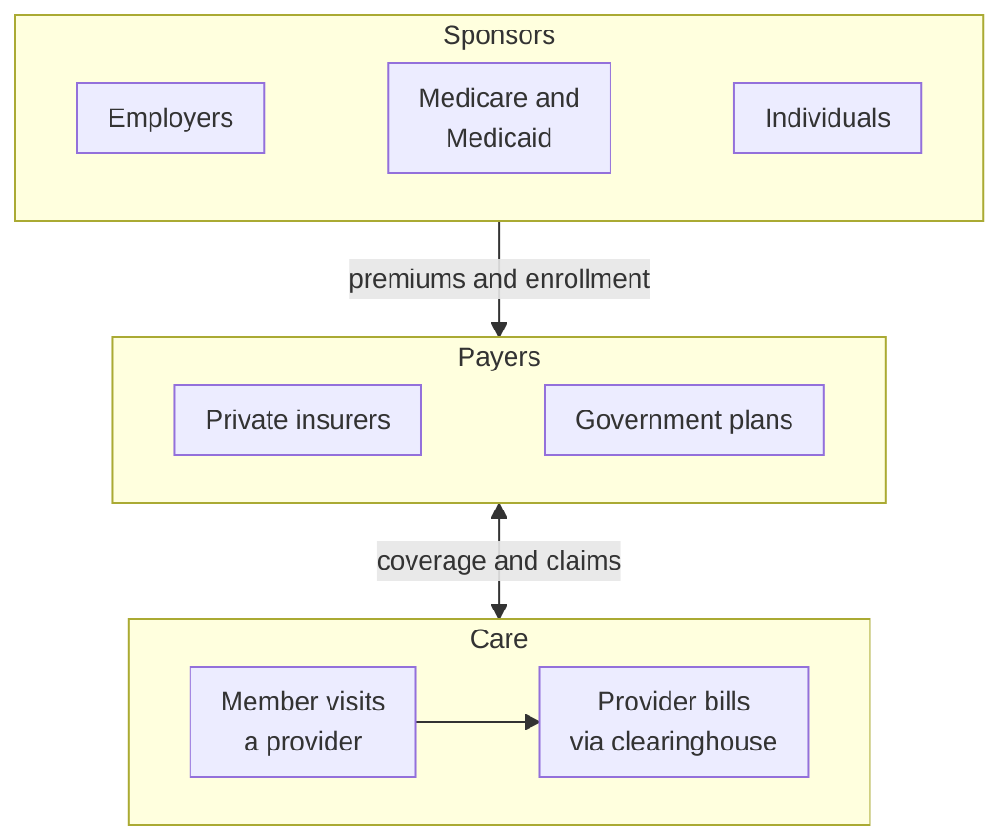

If you come to US healthcare from software, the first surprise is how little of the work is medicine. The doctor's visit is one step. Around it sits a web of companies and agencies that decide who's covered, what the visit is worth, who pays, and how much ends up on the patient's bill. Most of the systems you'll build or support live in that web, so it pays to know who's in it before learning any file format or acronym.

This post walks through the players, how they connect, and the handful of terms you'll hear in every meeting from day one.

<!-- more -->

## The three parties at the centre

Strip everything else away and you're left with three parties.

- **The patient**, who the insurance industry calls a **member**. If they hold the policy themselves they're the **subscriber**. Their spouse or child on the same policy is a **dependent**.
- **The provider**: anyone who delivers care. That's hospitals, clinics, individual doctors, labs, imaging centres, pharmacies and ambulance services.
- **The payer**: whoever funds the care. Usually an insurance company or a government program.

The patient gets care from the provider, the provider bills the payer, and the payer pays the provider and tells the patient what they still owe. Nearly every workflow in this series is a refinement of that loop.

## Who pays the payer?

Payers don't conjure money. They collect **premiums**, a fixed monthly amount paid for coverage whether or not you see a doctor. Who pays the premium depends on how the person got their insurance.

- **Employers** are the biggest sponsor. A company picks a plan, pays most of the premium on behalf of its employees, and the employee usually chips in through payroll. Once premiums start flowing, the employee becomes a subscriber.
- **Individuals** who aren't covered through work can buy a plan directly and pay the premium themselves.
- **The government** funds coverage for groups the private market doesn't serve well: people 65 and over, some people with disabilities, and people on low incomes.

The organisation that pays the premium or decides eligibility is often called the **sponsor**. You'll see that word again when we get to EDI, because sponsors are the ones who send enrollment files to payers.

## Private and government payers

There are two big families of payer.

**Private (commercial) insurers** sell plans to employers and individuals. They design the benefits, build provider networks and process claims.

**Government programs** cover the rest. The two you'll hear about constantly are:

- **Medicare**, a federal program for people aged 65 and over, some younger people with disabilities, and people with end-stage renal disease (ESRD).
- **Medicaid**, which is jointly funded by the federal government and the states, run by each state, and based on need. Eligibility and benefits vary from state to state, and it mainly covers people on low incomes.

The lines blur in practice. Private insurers run Medicare Advantage plans and Medicaid managed care plans on the government's behalf, so a single insurance company can be a commercial payer, a Medicare payer and a Medicaid payer at once. When someone says "the payer", ask which line of business they mean. It changes the rules.

## What the patient still pays

Insurance doesn't mean free. Patients share the cost through:

- a **copay**, a fixed amount per visit (for example $30 for a doctor's office visit);
- a **deductible**, the amount a patient pays each year before the plan starts sharing costs;
- **coinsurance**, a percentage of the cost the patient pays after the deductible is met;
- an **out-of-pocket maximum**, the yearly cap on all of the above.

I've given cost sharing [its own post](/posts/domains/healthcare/insurance/deductible-copay-coinsurance-out-of-pocket/) with a worked example, because it's where most patient confusion (and plenty of billing errors) come from.

## Networks, and the two plan types you'll meet first

Payers sign contracts with providers who agree to accept negotiated rates. Providers under contract are **in-network**; everyone else is **out-of-network**. Network status drives how much a visit costs the patient and how the claim gets priced.

Networks also shape the two plan types that come up in almost every first conversation:

| | HMO | PPO |
|---|---|---|
| Out-of-network care | Not covered (except emergencies) | Covered, at a higher cost |
| Referral from a primary care physician (PCP) | Required to see a specialist | Not required |
| Monthly premium | Lower | Higher |
| Copays and deductibles | Lower | Higher |
| Flexibility | Low | High |

The trade-off is simple once you see it: you pay less for an HMO because you accept the payer's rules about where you get care. The details, plus EPO, POS and high-deductible plans, are in [Health Plan Types](/posts/domains/healthcare/insurance/hmo-ppo-epo-pos-hdhp/).

## The middle layer most people never see

Between providers and payers sits a layer of companies that rarely appear on a patient's radar but show up in almost every integration project.

- **Clearinghouses** receive claims and other electronic transactions from providers, check them for errors, and route them to the right payer. One provider might work with hundreds of payers through a single clearinghouse connection.
- **Third-party administrators (TPAs)** process claims for employers who fund their own plans instead of buying insurance.
- **Repricers** apply negotiated rates to claims, especially for rented networks. I cover them in [Claim Repricing](/posts/domains/healthcare/revenue-cycle/claim-repricing/).
- **Pharmacy benefit managers (PBMs)** run the prescription drug side of a plan.
- **Technology vendors** sell the electronic health records (EHRs), practice management systems and payer claims platforms that everyone else runs on.

## How it fits together

Here's the whole loop on one page:

Sponsors pay premiums and send enrollments to payers. Payers cover members. Members get care, providers send claims back to payers, and payers pay providers. The patient's share comes off the top.

## Where newcomers get tripped up

A few things confuse almost everyone in their first month:

- **"Provider" means organisations too.** A hospital is a provider, and so is a single physician. Claims distinguish between the billing provider and the rendering provider, and they're often different.
- **"Subscriber" and "patient" aren't the same person.** A child on their parent's plan is the patient; the parent is the subscriber. Systems that assume otherwise break the first time a dependent gets care.
- **One company, many lines of business.** The same insurer can apply different rules to commercial, Medicare Advantage and Medicaid members.
- **Coverage isn't the same as payment.** A service can be covered and still not be paid if it wasn't authorised, wasn't medically necessary or was billed wrong.

## Conclusion

US healthcare is three parties (patient, provider and payer) surrounded by sponsors who fund coverage and intermediaries who move the data. Once you can place any company you meet into one of those boxes, the rest of the domain gets much easier to learn.

Next, look at [how money flows](/posts/domains/healthcare/ecosystem/how-money-flows-in-us-healthcare/) through that loop, then at the plan types that decide what a patient pays.

## Further watching

From the [HealthTech Decoded](https://www.youtube.com/@HealthTechDecoded) channel:

- [Healthtech overview: PPO/HMO, in-network and out-of-network providers](https://www.youtube.com/watch?v=S4W1YR0GEQE)

## Where this fits

**Level 1 · Foundations** › [The US healthcare ecosystem](/domains/healthcare/#ecosystem)

- Next: [How Money Flows in US Healthcare](/posts/domains/healthcare/ecosystem/how-money-flows-in-us-healthcare/)
