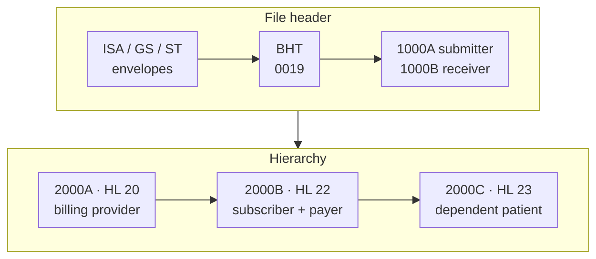

The 837 is the most important X12 transaction in healthcare, and the most complicated. It's the electronic claim: everything the payer needs to decide what to pay, for professional (837P), institutional (837I) and dental (837D) services. Before you can read the clinical and billing detail, you need the frame around it: who sent the file, who receives it, who's billing, who's insured and who's the patient.

This is part 1 of a three-part series, following the structure of the HealthTech Decoded 837 videos. It covers the envelopes and loops 1000A to 2000C, across all three claim types.

<!-- more -->

| Part | Covers |
|---|---|
| **1 (this post)** | Envelopes, BHT, loops 1000A–1000B and 2000A–2000C |
| [2](/posts/domains/healthcare/edi-x12/x12-837-part-2-claim-loop/) | Loop 2300: claim information |
| [3](/posts/domains/healthcare/edi-x12/x12-837-part-3-service-lines/) | Loop 2400: service lines, and the trailers |

## Three claim types, one transaction set

| Variant | Submitted by | Implementation guide (`GS08`) |
|---|---|---|
| 837P | Physicians and other practitioners | `005010X222A1` |
| 837I | Hospitals and other facilities | `005010X223A2` |
| 837D | Dentists | `005010X224A2` |

`GS08` reads as version (`005010`), guide (`X222`) and addendum (`A1`, the first published fix to that guide). All three share the structure covered in this post; they differ mostly in loop 2300 and 2400.

## The envelopes

```text
ISA*00*          *00*          *ZZ*SUBMITTERID    *ZZ*PAYERID        *251020*0930*^*00501*000000001*0*T*:~
GS*HC*SUBMITTERID*PAYERID*20251020*0930*1*X*005010X222A1~
ST*837*0001*005010X222A1~
BHT*0019*00*BATCH0001*20251020*0930*CH~
```

- **ISA:** `ISA05`/`ISA07` are ID qualifiers (`ZZ` means a mutually defined ID) for the sender and receiver IDs in `ISA06`/`ISA08`. `ISA15` marks the file as test (`T`) or production (`P`).
- **GS:** `GS01 = HC` (health care claim) and `GS08`, the guide version.
- **ST:** `ST01 = 837`, `ST02` a control number of your choice, repeated in `SE02`; `ST03` repeats the guide version.
- **BHT:** announces the hierarchy. `BHT01 = 0019` means the file will contain information source, subscriber and dependent levels. `BHT02 = 00` is an original transmission, `BHT03` the batch reference, and `BHT06 = CH` a chargeable claim (vs `RP` for reporting-only encounters).

The [EDI introduction](/posts/domains/healthcare/edi-x12/healthcare-edi-x12-introduction/) explains the envelopes and delimiters in more detail.

## 1000A and 1000B: submitter and receiver

```text
NM1*41*2*ACME BILLING SERVICES*****46*SUB12345~
PER*IC*CLAIMS DESK*TE*5551234567~
NM1*40*2*ACME HEALTH PLAN*****46*PAYERID~
```

- **1000A, the submitter:** `NM101 = 41`. `NM102` is `1` for a person or `2` for a non-person entity. `NM108 = 46` means the ID in `NM109` is an electronic transmitter ID. The **PER** segment gives a contact (`PER01 = IC`, information contact), with `PER03 = TE` marking `PER04` as a phone number.
- **1000B, the receiver:** `NM101 = 40`, usually the payer or the clearinghouse.

These loops are about the *file*, not the claim. The submitter is often a billing company or clearinghouse, not the provider.

## 2000A: the billing provider

```text
HL*1**20*1~
NM1*85*2*CITY MEDICAL GROUP*****XX*1234567893~
N3*100 MAIN STREET~
N4*SPRINGFIELD*IL*627010000~
REF*EI*123456789~
```

The first hierarchical level (`HL03 = 20`, information source) is always the **billing provider**, the entity that will be paid.

- **2010AA, billing provider name:** `NM101 = 85`. `NM108 = XX` says `NM109` is the National Provider Identifier (NPI). **N3** and **N4** hold the address, and in 5010 the ZIP must be nine digits and a street address, not a PO box. `REF*EI` gives the tax ID.
- **2010AB, pay-to address:** `NM101 = 87`, used only when payment should go to a different address from the billing provider's.

## 2000B: the subscriber

```text
HL*2*1*22*1~
SBR*P**GRP1001******CI~
NM1*IL*1*DOE*JOHN****MI*W123456789~
N3*12 OAK AVENUE~
N4*SPRINGFIELD*IL*627040000~
DMG*D8*19800101*M~
NM1*PR*2*ACME HEALTH PLAN*****PI*PAYERID~
```

The second level (`HL03 = 22`) is the **subscriber**, the person who holds the insurance.

**SBR** carries the coverage details:

- `SBR01`: this payer's responsibility for the claim: `P` primary, `S` secondary, `T` tertiary. It matters when a patient has more than one plan.
- `SBR02`: `18` (self) if the subscriber **is** the patient, otherwise blank.
- `SBR03`: the group or policy number.
- `SBR09`: the claim filing indicator, such as `CI` (commercial), `MB` (Medicare Part B) or `MC` (Medicaid).

Then two child loops:

- **2010BA, subscriber name:** `NM101 = IL` (insured). `NM108 = MI` puts the member ID in `NM109`. Address in N3/N4, and **DMG** (date of birth and gender) is required when the subscriber is the patient.
- **2010BB, payer name:** `NM101 = PR`, always `NM102 = 2` because a payer is never a person. `NM108 = PI` puts the payer ID in `NM109`. (`XV` is the CMS national plan ID, which is rarely used in practice.)

A **PAT** segment can also appear in 2000B, but only for specific patient details (such as a date of death or pregnancy indicator) when the subscriber is the patient.

## 2000C: the dependent patient

When the patient isn't the subscriber, a third level appears:

```text
HL*3*2*23*0~
PAT*19~
NM1*QC*1*DOE*EMMA~
N3*12 OAK AVENUE~
N4*SPRINGFIELD*IL*627040000~
DMG*D8*20150315*F~
```

- `HL03 = 23` is the dependent, and `HL02 = 2` points to the subscriber as parent.
- **PAT01** is the relationship to the subscriber: `01` spouse, `19` child, `20` employee, `G8` other relationship.
- **2010CA, patient name:** `NM101 = QC` (patient), `NM102 = 1` because a patient is always a person. Address and DMG follow.

When the subscriber is the patient, there's no 2000C at all: `SBR02 = 18` and the subscriber's HL has `HL04 = 0` (no children).

## Why there's no HL 21

Other transactions, such as the 270 and 278, have an information-receiver level (`HL03 = 21`). The 837 doesn't: the receiver is already in loop 1000B, and the payer in loop 2010BB.

## Putting it together



Below whichever level holds the patient, the claim itself begins with loop 2300.

## Common pitfalls

- **`SBR02 = 18` and a 2000C together.** If the subscriber is the patient, there's no dependent level.
- **The wrong NPI.** The billing provider NPI in 2010AA must be the one enrolled with the payer for this tax ID.
- **PO boxes in the billing address.** 5010 requires a physical address in 2010AA; use 2010AB for a payment address.
- **Short ZIP codes.** The billing provider ZIP needs all nine digits.

## Conclusion

The top of an 837 says who's sending (1000A) and receiving (1000B), then builds the hierarchy: billing provider (2000A, HL 20), subscriber and payer (2000B, HL 22) and, if needed, the dependent patient (2000C, HL 23). `SBR02 = 18` is the quickest tell that the subscriber is the patient.

Continue with [Part 2: The Claim Information Loop (2300)](/posts/domains/healthcare/edi-x12/x12-837-part-2-claim-loop/).

## Further watching

From the [HealthTech Decoded](https://www.youtube.com/@HealthTechDecoded) channel:

- [Chapter 1: How to master X12 837 (loops 1000A-2000C)](https://www.youtube.com/watch?v=rLTtqK4cIag)
- [Chapter 1: X12 837 (short)](https://www.youtube.com/shorts/31c7tQYvQTg)
- [EDI X12 hierarchy: it's not complicated (short)](https://www.youtube.com/shorts/w7jCJucs6Yk)

## References

- [X12: 837 Health Care Claim (transaction set list)](https://x12.org/products/transaction-sets)
- [Stedi: X12 837P reference](https://www.stedi.com/edi/x12-005010/837)

## Where this fits

**Level 3 · Health data exchange** › [Healthcare EDI (ANSI X12)](/domains/healthcare/#edi-x12)

- Previous: [X12 278: Prior Authorization Request and Response](/posts/domains/healthcare/edi-x12/x12-278-prior-authorization/)
- Next: [X12 837 Part 2: The Claim Information Loop (2300)](/posts/domains/healthcare/edi-x12/x12-837-part-2-claim-loop/)
