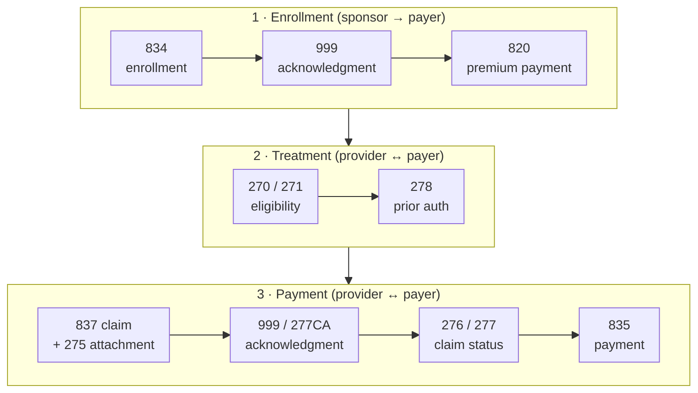

837, 835, 834, 820, 270, 271, 278, 276, 277, 275, 999. If those numbers blur together, you're in good company. The trick is to stop memorising them as a list and see them as a conversation: who's talking to whom, at which step of a patient's journey.

This post maps every core X12 healthcare transaction onto that journey, from enrollment to payment.

<!-- more -->

## The three parties

The workflow involves three kinds of party:

- **Sponsors**: employers, and government agencies such as state Medicaid programs and Medicare, which decide who's eligible and pay premiums;
- **Payers**: insurers and government plans that cover members and pay claims;
- **Providers**: hospitals, clinics, doctors, labs, which deliver care and send bills.

Clearinghouses usually sit between providers and payers, but they pass these same transactions along, so I'll leave them out of the picture.

## The map

## Phase 1: enrollment

Before anyone can be treated, the payer has to know who its members are.

**834: Benefit Enrollment and Maintenance.** The sponsor sends the payer its list of enrollees: new members, changes and terminations. Life events such as a birth or a marriage that add or change a dependent travel as 834 maintenance transactions. For government programs, the agency determines eligibility first (by age, disability, end-stage renal disease or, for Medicaid, MAGI income) and then sends the enrollments.

**999: Implementation Acknowledgment.** The payer confirms receipt and reports whether the file passed the implementation guide's syntax checks. It's not a business approval: it says "the file is well formed", not "every member was accepted".

The payer then updates its **member roster**.

**820: Payroll Deducted and Other Group Premium Payment.** Once members are enrolled, the sponsor pays premiums. The 820 carries the remittance details: which members and which periods the payment covers.

## Phase 2: treatment

The member visits a provider.

**270 / 271: Eligibility, Coverage or Benefit Inquiry and Response.** Before (or at) the visit, the provider sends a 270 asking whether this patient is covered. The payer matches the subscriber and patient, checks coverage dates and the provider's network status, and replies with a 271: coverage status, plan details, remaining deductible, copays and more. It's often done in real time, in seconds. [X12 270/271](/posts/domains/healthcare/edi-x12/x12-270-271-eligibility/) has the details.

**278: Health Care Services Review.** If the planned treatment needs pre-approval, the provider sends a 278 request with diagnoses, the proposed services and dates. The payer replies with a 278 response: approved with an authorisation number, pended or denied. The 278 also covers notifications (such as an admission) and inquiries. See [X12 278](/posts/domains/healthcare/edi-x12/x12-278-prior-authorization/).

## Phase 3: payment

After treatment, whether the patient has been discharged yet or not, billing starts.

**837: Health Care Claim.** The provider sends the claim. There are three variants:

- **837P (professional):** physicians and other practitioners;
- **837I (institutional):** hospitals and other facilities;
- **837D (dental).**

The claim carries the authorisation number from the 278. The 837 is the biggest and most complex transaction, with its own [three-part series](/posts/domains/healthcare/edi-x12/x12-837-part-1-header-loops/).

**275: Additional Information to Support a Health Care Claim or Encounter.** Supporting documents, such as clinical notes, can be sent with or after the claim.

**999 and 277CA: Acknowledgments.** The payer, or the clearinghouse, sends a 999 for file-level syntax and, usually, a **277CA (claim acknowledgment)** that accepts or rejects each claim against front-end business edits. A claim rejected at this stage was never entered for processing; it has to be fixed and resent.

**276 / 277: Claim Status Inquiry and Response.** If the payment hasn't arrived, the provider can ask where the claim stands with a 276. The payer answers with a 277: received, pended, finalised, paid or denied, with status codes. Attachments can be sent again as 275s if the payer asked for more information.

**835: Health Care Claim Payment/Advice.** Finally, the payer pays. The 835 is the electronic remittance advice (ERA): which claims and service lines were paid, how much, and every adjustment with a reason code. The money itself usually moves separately as an EFT (electronic funds transfer), and the 835 carries the trace number that links the two.

## Cheat sheet

| Set | Name | From → to | Phase |
|---|---|---|---|
| 834 | Benefit enrollment and maintenance | Sponsor → payer | Enrollment |
| 820 | Premium payment | Sponsor → payer | Enrollment |
| 270 | Eligibility inquiry | Provider → payer | Treatment |
| 271 | Eligibility response | Payer → provider | Treatment |
| 278 | Services review (prior auth) request and response | Provider ↔ payer | Treatment |
| 837 | Claim (P, I, D) | Provider → payer | Payment |
| 275 | Claim attachments | Provider → payer | Payment |
| 999 | Implementation acknowledgment | Receiver → sender | Any |
| 277CA | Claim acknowledgment | Payer → provider | Payment |
| 276 | Claim status inquiry | Provider → payer | Payment |
| 277 | Claim status response | Payer → provider | Payment |
| 835 | Payment and remittance advice | Payer → provider | Payment |

One way to remember them: **8xx** sets move money and members (834, 820, 835, 837), **27x** sets are questions and answers (270/271, 276/277, 278), and **999** is the receipt for everything.

## Common pitfalls

- **Treating a 999 as acceptance.** It only confirms the file was well formed. Watch for 277CA rejections too.
- **Not reconciling the 835 with the bank deposit.** The EFT and the ERA arrive separately; match them on the trace number.
- **Skipping eligibility.** Most front-end rejections and many denials come down to coverage that wasn't checked.
- **Losing the auth number.** If the 278's authorisation number doesn't make it onto the 837, the claim can be denied even though the service was approved.

## Conclusion

Healthcare EDI is a conversation in three phases. Sponsors enroll members and pay premiums (834, 820). Providers check coverage and get approval (270/271, 278). Providers bill and payers pay (837, 275, 277CA, 276/277, 835), with 999 acknowledging along the way.

If the format itself is new to you, start with the [Introduction to Healthcare EDI and ANSI X12](/posts/domains/healthcare/edi-x12/healthcare-edi-x12-introduction/).

## Further watching

From the [HealthTech Decoded](https://www.youtube.com/@HealthTechDecoded) channel:

- [How EDI X12 transactions are exchanged in the healthcare workflow](https://www.youtube.com/watch?v=sHSLNWORW0Y)
- [How EDI X12 transactions are exchanged (short)](https://www.youtube.com/shorts/8nqeYm8rIUo)

## References

- [X12: Transaction sets](https://x12.org/products/transaction-sets)
- [CMS: Adopted standards and operating rules](https://www.cms.gov/priorities/key-initiatives/burden-reduction/administrative-simplification/hipaa/adopted-standards-operating-rules)

## Where this fits

**Level 3 · Health data exchange** › [Healthcare EDI (ANSI X12)](/domains/healthcare/#edi-x12)

- Previous: [Introduction to Healthcare EDI and ANSI X12](/posts/domains/healthcare/edi-x12/healthcare-edi-x12-introduction/)
- Next: [X12 834 and 820: Enrollment and Premium Payments](/posts/domains/healthcare/edi-x12/x12-834-820-enrollment-premiums/)
