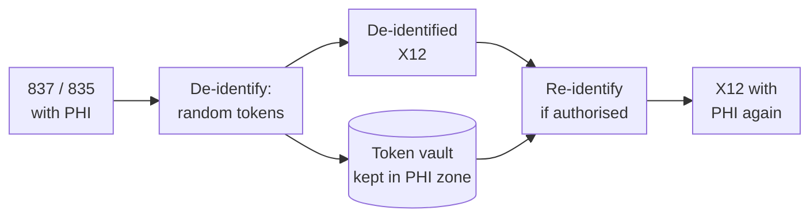

You need realistic claims data for a test environment, an analytics project or an AI model. The real 837 and 835 files are full of names, member IDs, addresses and birth dates, and copying them out of production is exactly the kind of thing that ends in a HIPAA breach report. The answer is **de-identification**: removing or transforming identifiers until the data is no longer PHI.

This post explains HIPAA's two de-identification methods, then builds a small Python tool that de-identifies subscriber and patient data in X12 files and can reverse it under controlled conditions.

<!-- more -->

## Why de-identify

Once data meets HIPAA's de-identification standard, it's no longer PHI and the Privacy Rule no longer restricts it. That opens up:

- test and development environments with realistic data;
- comparative studies, clinical research and life-sciences work;
- training analytics and AI models;
- sharing data with partners who aren't covered by a business associate agreement.

HIPAA's Privacy Rule gives exactly **two** ways to get there.

## Method 1: Expert Determination

A qualified expert, with statistical and scientific knowledge of re-identification, analyses the dataset and concludes that the risk of identifying anyone is very small. The expert:

1. **Looks for links** between the dataset and other data the recipient could access. HHS's guidance gives a classic example: a table without names can still be matched to a public voter list on ZIP code, birth date and gender.
2. **Considers the audience**: who will receive the data, and what else they could combine it with.
3. **Mitigates the risk**, typically with:
   - **suppression**: removing values, or whole records, that stand out;
   - **generalisation**: replacing exact values with ranges, such as age bands instead of birth dates, or 3-digit ZIP codes;
   - **perturbation**: changing values in a controlled way, such as shifting every date by a random offset.
4. **Documents** the methods and the conclusion.

Expert Determination keeps more useful detail, but it needs a real expert and their documented opinion.

## Method 2: Safe Harbor

**Safe Harbor** is the checklist method. You remove 18 kinds of identifiers for the individual and their relatives, employers and household members, including:

- names;
- geographic units smaller than a state, including street address, city and ZIP code (you may keep the first three digits of a ZIP if the area they cover has more than 20,000 people; otherwise use `000`);
- every element of a date related to the person (birth, admission, discharge, service, death) except the year, with ages over 89 grouped as "90 or older";
- phone and fax numbers, email addresses, URLs and IP addresses;
- Social Security numbers, medical record numbers, health plan member IDs, account numbers, and any other unique identifying number or code;
- device identifiers, licence numbers, vehicle identifiers, biometrics and full-face photos.

And you must have **no actual knowledge** that what's left could identify someone.

## Can de-identified data be re-identified?

Yes, if you planned for it. HIPAA (45 CFR 164.514(c)) lets a covered entity assign a **re-identification code** to de-identified records, on two conditions:

- the code is **not derived from** information about the person (so no hashes of the member ID or name), and can't be translated to identify them;
- the code isn't used for any other purpose, and the mechanism for re-identifying (the key) isn't disclosed.

Re-identified data is PHI again. That's useful when, for example, a research finding means a patient's provider should be told about a lab result.

## The approach

The HealthTech Decoded video demonstrates a framework that converts X12 files to XML with the **pyx12** library, masks tags based on rules, and converts them back to X12. Here I'll do the same thing in plain Python, working directly on the X12 segments, so the logic is easy to see. The core is under 70 lines.



The rules:

- In **subscriber** (`NM1*IL`) and **patient** (`NM1*QC`) loops: replace names and member IDs with random tokens, tokenise the street address and city, set the ZIP to `00000`, and reduce the birth date to the year.
- Tokens are **random**, not hashes, so they aren't derived from the PHI, and the same value always gets the same token within a vault, so joins still work.
- The token-to-value mapping lives in a **vault** file, which stays inside the PHI environment.

## The code

```python
"""De-identify (and re-identify) subscriber and patient PHI in an X12 837/835 file."""
import json
import secrets
import sys

PEOPLE = {"IL", "QC"}          # NM101: subscriber/insured, patient
NAME_AND_ID = (3, 4, 5, 9)     # NM103 last, NM104 first, NM105 middle, NM109 member ID


def delimiters(x12):
    # ISA is fixed width: element separator after "ISA", segment terminator at index 105.
    return x12[3], x12[105]


def token(value, vault):
    if value not in vault["forward"]:
        tok = "X" + secrets.token_hex(5).upper()       # random, not derived from the PHI
        vault["forward"][value] = tok
        vault["reverse"][tok] = value
    return vault["forward"][value]


def deidentify(x12, vault):
    elem, term = delimiters(x12)
    out, person = [], False
    for seg in filter(None, (s.strip() for s in x12.split(term))):
        el = seg.split(elem)
        tag = el[0]
        if tag == "NM1":
            person = el[1] in PEOPLE
            if person:
                for i in NAME_AND_ID:
                    if i < len(el) and el[i]:
                        el[i] = token(el[i], vault)
        elif person and tag == "N3":
            el[1:] = [token(v, vault) if v else v for v in el[1:]]
        elif person and tag == "N4":
            el[1] = token(el[1], vault)                  # city
            if len(el) > 3:
                el[3] = "00000"                          # ZIP: generalised, not reversible
        elif person and tag == "DMG" and len(el) > 2:
            el[2] = el[2][:4] + "0101"                   # date of birth: keep the year only
        out.append(elem.join(el))
    return term.join(out) + term


def reidentify(x12, vault):
    elem, term = delimiters(x12)
    out = []
    for seg in filter(None, (s.strip() for s in x12.split(term))):
        out.append(elem.join(vault["reverse"].get(v, v) for v in seg.split(elem)))
    return term.join(out) + term


if __name__ == "__main__":
    mode, src, dst, vault_path = sys.argv[1:5]
    try:
        vault = json.load(open(vault_path))
    except FileNotFoundError:
        vault = {"forward": {}, "reverse": {}}
    data = open(src).read()
    result = deidentify(data, vault) if mode == "deid" else reidentify(data, vault)
    open(dst, "w").write(result.replace("~", "~\n"))
    json.dump(vault, open(vault_path, "w"), indent=2)
```

A few design choices worth calling out:

- **Delimiters come from the ISA**, never hard-coded. The ISA is fixed width, so the element separator is character 4 and the segment terminator is character 106.
- **Context comes from `NM1`.** An `N3`, `N4` or `DMG` belongs to whichever entity the last `NM1` named, so the billing provider's and payer's addresses are left alone.
- **Segment counts don't change**, because no segments are added or removed. `SE01` stays valid.

## Running it

Given a small 837P with a subscriber who is also the patient:

```bash
python3 x12_deid.py deid claim.x12 claim.deid.x12 vault.json
```

The subscriber block goes from this:

```text
NM1*IL*1*DOE*JOHN****MI*W123456789~
N3*12 OAK AVENUE~
N4*JERSEY CITY*NJ*07302~
DMG*D8*19800615*M~
```

to this:

```text
NM1*IL*1*X8DDAB4E29A*XCE134BE012****MI*XC594F69B1E~
N3*X367304C841~
N4*X3E910619B5*NJ*00000~
DMG*D8*19800101*M~
```

And back again:

```bash
python3 x12_deid.py reid claim.deid.x12 claim.reid.x12 vault.json
```

Names, member ID, street and city come back exactly. The ZIP and birth date stay generalised. That's deliberate: they were generalised, not tokenised, so there's nothing to restore. If you need them back, keep the original file inside the PHI environment.

Before and after, validate both files against the implementation guide. **pyx12** (`pip install pyx12`) includes command-line validators for exactly this, and an online tool such as Stedi's EDI Inspector is handy for eyeballing a test file. (Never paste real PHI into an online tool.)

## What this doesn't cover yet

This handles the obvious PHI in the subscriber and patient loops. Full Safe Harbor needs more rules:

- **Dates of service, admission and discharge** (`DTP` segments) must be reduced to the year, or shifted consistently, which is generally better for analytics.
- **Claim and account numbers**, such as `CLM01` and `REF` values, are "other unique identifying numbers".
- **Other people**: other subscribers in loop 2330A, and contact names and phone numbers in `PER` segments.
- **Free text** in `NTE` notes can contain anything.
- **835 files** have their own patient loops (`NM1*QC`, `NM1*IL` under `CLP`), which the same NM1 logic already covers, plus claim and check numbers.

Rules like these are best kept in a separate configuration file (the video's framework uses a masking-rules file), so you can extend them without touching the code.

## Common pitfalls

- **Hashing identifiers.** A hash of a member ID is derived from PHI. It's easy to reverse with a dictionary attack, and it doesn't qualify as a HIPAA re-identification code.
- **Keeping the vault next to the data.** The vault *is* PHI. Store it, encrypt it and control access to it as such.
- **"Perturbing" a ZIP to a nearby one.** Under Safe Harbor, ZIPs are truncated to three digits or zeroed, not swapped for neighbours. Perturbation belongs to Expert Determination.
- **Forgetting dates.** Service dates are identifiers under Safe Harbor, and they're the most commonly missed.

## Conclusion

HIPAA gives two ways to de-identify: Expert Determination (statistical analysis, documented by an expert) and Safe Harbor (remove the 18 identifiers and have no knowledge that the rest identifies anyone). For X12 files, a small tool that works on segments, uses random tokens and keeps a protected vault gets you de-identification with controlled re-identification. Extend the rules to dates, claim numbers and free text before calling the output Safe Harbor compliant.

## Further watching

From the [HealthTech Decoded](https://www.youtube.com/@HealthTechDecoded) channel:

- [How to de-identify PHI in 10 seconds](https://www.youtube.com/watch?v=igJTiU7v3r4)
- [How to de-identify PHI like a pro (short)](https://www.youtube.com/shorts/584tlxkclzg)

## References

- [HHS: Guidance on de-identification of PHI](https://www.hhs.gov/hipaa/for-professionals/special-topics/de-identification/index.html)
- [eCFR: 45 CFR 164.514, other requirements relating to uses and disclosures of PHI](https://www.ecfr.gov/current/title-45/subtitle-A/subchapter-C/part-164/subpart-E/section-164.514)
- [pyx12 on PyPI](https://pypi.org/project/pyx12/)

## Where this fits

**Level 4 · Health tech engineering & strategy** › [Health tech engineering](/domains/healthcare/#healthtech-engineering)

- Previous: [Medical Imaging Systems: DICOM, PACS and RIS](/posts/domains/healthcare/interoperability/dicom-pacs-ris/)
- Next: [Parsing and Validating X12 Files in Code](/posts/domains/healthcare/healthtech-engineering/parsing-and-validating-x12-files/)
