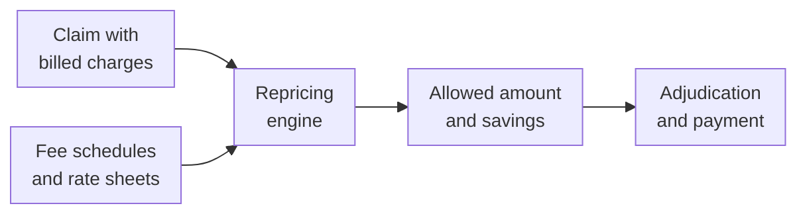

A hospital bills $5,000 for a procedure. The insurer pays its share of $900, the patient pays theirs, and the hospital writes off the rest without complaint. That isn't a discount someone negotiated at the counter. It's **claim repricing**: replacing the provider's billed charges with the price agreed in their contract.

This post explains how repricing works, the pricing methods behind it, and where the results appear in an X12 837 claim.

<!-- more -->

## What repricing does

Every claim arrives with **billed charges**, the provider's list prices. Almost nobody pays those. Repricing applies the contracted rates for the services on the claim and splits the billed amount into two parts:

- the **allowed amount**: what the provider will actually be paid in total, by the plan and the patient together;
- the **savings**: the difference, which the provider writes off.

```text
Billed $5,000  =  Allowed $900  +  Savings $4,100
```

The allowed amount then feeds adjudication. The plan works out the patient's deductible, coinsurance or copay from it, pays the rest, and reports everything back on the [remittance](/posts/domains/healthcare/edi-x12/x12-transaction-sets-map/). The patient's [cost sharing](/posts/domains/healthcare/insurance/deductible-copay-coinsurance-out-of-pocket/) is always calculated on the allowed amount, never on billed charges.

## How a repricing engine works



The engine reads each line's codes (the procedure code and modifiers, the revenue code on hospital claims, and the diagnoses, which matter for inpatient grouping), looks up the provider's contract, and applies the matching rate. The output is the same claim with pricing attached.

## The pricing methods

Contracts use different methods for different services:

| Method | How it prices | Typical use |
|---|---|---|
| Fee schedule | A fixed amount per procedure code | Physician and outpatient services |
| Percent of Medicare | A percentage of what Medicare would pay, e.g. 130% | Many commercial contracts |
| DRG | One amount per inpatient stay, based on the diagnosis-related group | Inpatient hospital stays |
| Per diem | A fixed amount per day | Inpatient, skilled nursing, behavioral health |
| Percent of charges | A percentage of billed charges | Out-of-network or older contracts |
| Case rate / bundle | One price for an episode of care | Surgeries, maternity |

Medicare's own physician fee schedule is based on **RBRVS** (the resource-based relative value scale): each code gets relative value units that are converted to dollars and adjusted by location. Because so many commercial contracts are written as a percentage of Medicare, a change to Medicare rates ripples through the whole market.

## Who does the repricing

Large insurers reprice inside their own claims system against their own contracts. Smaller insurers, self-funded employer plans and third-party administrators often **rent** a provider network instead, and send claims to an external **repricer** that holds those contracts. That makes repricing a separate hop in the claim flow:

1. The provider sends the claim to the payer, usually through a clearinghouse.
2. The payer sends it to the repricer.
3. The repricer returns it with pricing and its own reference numbers.
4. The payer adjudicates and pays.

## Where repricing shows up in the 837

Repricers return results in the claim itself, using the 5010 837's **HCP** segment, at the claim level (loop 2300) and the line level (loop 2400):

| Element | Meaning |
|---|---|
| `HCP01` | Pricing methodology code |
| `HCP02` | Allowed amount |
| `HCP03` | Savings |
| `HCP13` | Reject reason, when the claim couldn't be repriced |

For example:

```text
HCP*02*900*4100~
```

That line says the claim was priced from the standard fee schedule (`02`) with an allowed amount of $900 and savings of $4,100.

When the repricer can't price a claim, conventions vary. Some return the allowed amount equal to billed charges, others return zero allowed and zero savings, and the reason goes in `HCP13`.

Repricers also add reference numbers:

- `REF*9A`: the repriced claim reference number;
- `REF*9C`: the adjusted repriced claim reference number, when a claim is repriced again;
- `REF*9B` and `REF*9D`: the same pair at line level;
- `DTP*050`: the date the repricer received the claim.

If a payer disputes the price and sends the claim back, the payer's new claim carries `REF*F8` with the original claim number, and the repricer returns a new `REF*9A` with the earlier one in `REF*9C`. I walk through those references in [837 Part 2](/posts/domains/healthcare/edi-x12/x12-837-part-2-claim-loop/).

## Common pitfalls

- **Contract loading errors.** A rate sheet loaded with the wrong effective date reprices months of claims incorrectly, and fixing that means reprocessing and adjusting payments.
- **Missing modifiers.** A procedure billed without `26` or `TC` can be priced at the full global rate instead of the component.
- **Unpriceable claims.** New codes, missing contract terms or out-of-network providers can leave a claim unpriced. Handle those deliberately; don't default them silently.
- **Assuming billed charges matter for the patient.** In-network, the patient's share is based on the allowed amount, not the list price.

## Conclusion

Repricing turns a provider's list price into the contracted allowed amount, using fee schedules, percent-of-Medicare rates, DRGs or per diems. The billed amount becomes allowed plus savings, and everything else in the claim's payment, including the patient's bill, is calculated from the allowed amount. In the 837, the result travels in the HCP segment with REF segments for tracking.

Next, see how the [claim lifecycle](/posts/domains/healthcare/revenue-cycle/claim-lifecycle/) fits repricing in with adjudication and payment.

## Further watching

From the [HealthTech Decoded](https://www.youtube.com/@HealthTechDecoded) channel:

- [How your $5,000 hospital bill becomes $900: claims repricing (short)](https://www.youtube.com/shorts/OUN1izJ2RhQ)
- [Chapter 2: How to master X12 837 (loop 2300)](https://www.youtube.com/watch?v=iiIPY1043xI)

## References

- [CMS: Physician Fee Schedule](https://www.cms.gov/medicare/payment/fee-schedules/physician)
- [X12: 837 Health Care Claim: Professional](https://x12.org/products/transaction-sets)

## Where this fits

**Level 2 · Core workflows** › [Revenue cycle, coding and claims](/domains/healthcare/#revenue-cycle)

- Previous: [The Claim Lifecycle: From Submission to Adjudication](/posts/domains/healthcare/revenue-cycle/claim-lifecycle/)
- Next: [Remittance, EOB vs ERA and Payment Posting](/posts/domains/healthcare/revenue-cycle/remittance-eob-era/)
