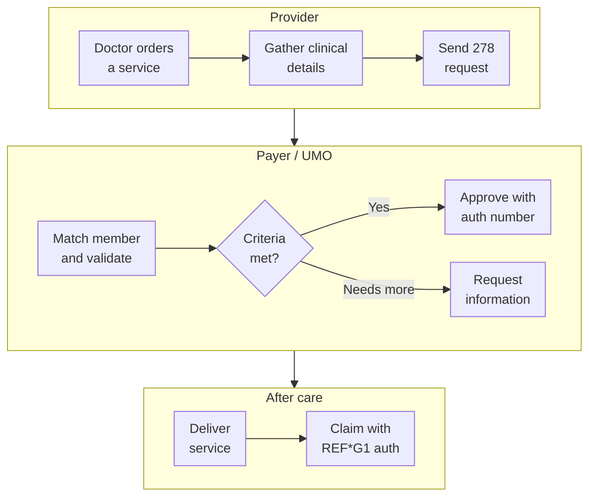

A doctor orders an MRI. The patient calls to book it and hears, "We're waiting on authorisation from your insurance." Days pass. Sometimes the answer is yes, sometimes it's a request for more information, and sometimes the payer overrules the doctor completely. Prior authorisation is one of the most complained-about processes in US healthcare, and also one of the most automated, because of how much paperwork it creates.

This post explains when prior auth is needed, how a request moves between provider and payer, and where X12 transactions fit.

<!-- more -->

## What prior authorisation is

Prior authorisation (also called pre-authorisation, pre-certification or simply "prior auth") is a **prospective review**: the payer approves a service before it's delivered, as part of [utilization management](/posts/domains/healthcare/utilization-management/utilization-management/). It applies to routine and urgent referrals, but **never to emergency admissions**.

The review can happen before or after an admission, but it must finish before the treatment it covers begins.

## Why payers require it

Payers use prior auth to:

- **control cost** on expensive drugs, imaging, therapies and planned surgeries;
- check **medical necessity** against clinical criteria;
- prevent **duplicate services**, such as the same imaging ordered by both a PCP and a specialist;
- reduce **improper payments**.

There are benefits for others too. A durable medical equipment supplier with an approved auth knows it'll be paid. Providers also have to keep complete documentation, because they can be asked for it at any time.

Here's an example of the clinical-criteria side. A patient with rheumatoid arthritis is referred for physical therapy. The payer's criteria might require diagnostic imaging first, and evidence that inflammation is being managed with medication, before therapy is approved. If those prior steps are documented, the request sails through. If not, it's pended or denied.

## The workflow

Step by step:

1. **The order.** A provider decides a service is needed: an MRI, a surgery, a specialty drug.
2. **Check whether auth is needed.** Payers publish lists of services that need prior auth, and an eligibility check may say so too.
3. **Build the request.** It includes subscriber and patient details, the requesting and servicing providers, diagnosis codes, the proposed procedures, dates, and clinical justification.
4. **Submit.** Electronically as an **X12 278 request**, or through a payer portal, fax or phone. Clinical documents can follow as attachments.
5. **Payer review.** The payer matches the member, validates the diagnosis and the proposed treatment against its criteria, and decides.
6. **Decision.** Approved, with an **authorisation number** (and often a date range and number of units); pended for more information; or denied, with reasons.
7. **Deliver the care**, within the approved dates and units.
8. **Bill.** The [837 claim](/posts/domains/healthcare/edi-x12/x12-837-part-2-claim-loop/) carries the auth number in `REF*G1`, and the payer matches it during adjudication.

## The 278 variants

The X12 278 family covers the whole conversation:

| Transaction | Purpose |
|---|---|
| 278 request | Ask for authorisation of a service or admission |
| 278 response | Return the decision: approved, pended or denied |
| 278 notification | Tell the payer about an admission or service (e.g. a notice of admission) |
| 278 inquiry | Ask about the status of an existing authorisation |
| Acknowledgments | Confirm receipt |

The segment-level detail is in [X12 278](/posts/domains/healthcare/edi-x12/x12-278-prior-authorization/).

## How long a decision can take

Since **January 1, 2026**, CMS's Interoperability and Prior Authorization rule (CMS-0057-F) requires Medicare Advantage, Medicaid, CHIP and federal marketplace plans to decide:

- **expedited (urgent)** requests within **72 hours**;
- **standard** requests within **7 calendar days**;

and to give a specific reason for every denial. Those payers also have to publish prior auth metrics, and by **January 1, 2027** offer a FHIR-based prior authorisation API so providers can submit and track requests directly from their systems. Commercial plans follow state rules, which vary.

## Why it's so painful

- **Every payer has its own list** of services that need auth, and the lists change.
- **Criteria aren't always visible** to the provider before submitting.
- **Channels are mixed.** Despite the 278 standard, much prior auth still happens through portals, fax and phone, which adds manual work on both sides.
- **Mismatches cause denials.** If the service delivered doesn't match the auth (different code, dates or units), the claim can still be denied.

## Tips that avoid denials

- Check auth requirements at scheduling, not on the day of the service.
- Send complete clinical documentation with the first request.
- Track the auth number, its date range and approved units, and match them to the claim.
- If the plan changes mid-treatment (say the patient needs more sessions), request an extension before the approved units run out.

## Conclusion

Prior authorisation is utilization management before care starts: the provider sends a request with clinical justification, the payer reviews it against criteria, and an approval comes back with an auth number that has to appear on the claim. The 278 transaction carries the conversation, and CMS rules now set firm decision deadlines and require a FHIR API for many payers.

## Further watching

From the [HealthTech Decoded](https://www.youtube.com/@HealthTechDecoded) channel:

- [Why is prior authorization so complicated? Workflow + EDI 278](https://www.youtube.com/watch?v=uIPBsK4Gtn4)

## References

- [CMS: Interoperability and Prior Authorization Final Rule (CMS-0057-F)](https://www.cms.gov/priorities/key-initiatives/burden-reduction/interoperability/policies-and-regulations/cms-interoperability-and-prior-authorization-final-rule-cms-0057-f)

## Where this fits

**Level 2 · Core workflows** › [Utilization management and prior authorization](/domains/healthcare/#utilization-management)

- Previous: [Utilization Management Explained](/posts/domains/healthcare/utilization-management/utilization-management/)
- Next: [HIPAA Explained: Covered Entities, Business Associates and the Rules](/posts/domains/healthcare/compliance/hipaa-explained/)
