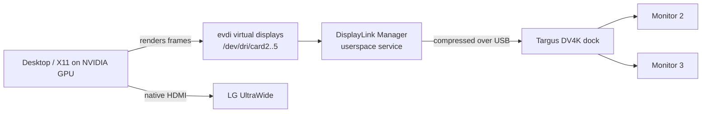

I plugged my Targus docking station into the DGX Spark expecting the usual "it just works" moment. The webcam came alive, the keyboard receiver worked, and my two dock monitors... stayed completely black. What followed was an afternoon of driver downloads, a Secure Boot detour, one config that didn't work, and one that finally did. This post walks through every step: how to tell what's actually wrong, how to install the DisplayLink driver on an ARM64 machine with Secure Boot enabled, and why the NVIDIA-generated `xorg.conf` was quietly ignoring the dock until I gave it an explicit config. If you have a DisplayLink dock and an NVIDIA box running X11, this should save you most of that afternoon.

<!-- more -->

## The setup

Here's what I was working with:

| Component | Details |
|---|---|
| Machine | NVIDIA DGX Spark (`aarch64`) |
| OS | Ubuntu 24.04.4 LTS (DGX OS), kernel `6.17.0-1026-nvidia` |
| GPU driver | NVIDIA 580.x, X11 session under GDM |
| Dock | Targus USB-C DV4K Docking Station 100W (`DOCK182`) |
| Monitors | LG UltraWide on the Spark's HDMI, plus two monitors on the dock |
| Secure Boot | Enabled |

Three monitors in total: one straight into the Spark, two through the dock.

## Step 1: Is the dock even detected?

My first instinct was "the dock isn't recognized." It turned out that was wrong, and `lsusb` showed it right away:

```bash
lsusb
lsusb -t
```

The relevant lines:

```text
Bus 003 Device 004: ID 1048:4015 Targus Group International DOCK182v4
Bus 004 Device 004: ID 17e9:6028 DisplayLink Targus USB-C DV4K Docking Station 100W Power
```

And in the tree view, the DisplayLink device looked like this:

```text
|__ Port 004: Dev 004, If 0, Class=Vendor Specific Class, Driver=[none], 5000M
|__ Port 004: Dev 004, If 1, Class=Application Specific Interface, Driver=[none], 5000M
|__ Port 004: Dev 004, If 2, Class=Audio, Driver=snd-usb-audio, 5000M
...
|__ Port 004: Dev 004, If 5, Class=Communications, Driver=cdc_ncm, 5000M
```

So the dock *was* recognized. Its USB hubs worked, its audio worked, its Ethernet worked (`cdc_ncm`), and the webcam plugged into it worked. The one thing with `Driver=[none]` was the **Vendor Specific** interface, which is the video part.

> The key realization: the Targus DV4K is a **DisplayLink** dock. It doesn't pass native DisplayPort through USB-C like a Thunderbolt dock does. Video is compressed and sent over plain USB, and a userspace driver on the host has to do that work. No driver, no pictures.
{: .prompt-info }

## Step 2: How DisplayLink works on Linux

Before installing anything, it helped me to understand the moving parts. The DisplayLink stack on Linux has two layers:

1. **`evdi`** (Extensible Virtual Display Interface), an open-source kernel module that creates *virtual* display devices (`/dev/dri/cardN`).
2. **DisplayLink Manager**, a closed-source userspace service that takes whatever gets drawn onto those virtual displays, compresses it and streams it to the dock over USB.

On top of that, your display server (X11 in my case) has to actually *use* those virtual displays. That last part is where I got stuck later.



## Step 3: Finding a driver that supports ARM64 and kernel 6.17

Two things made me nervous: the Spark is ARM64, and kernel 6.17 is very new. Many "DisplayLink on Linux" guides assume x86_64.

Synaptics (who own DisplayLink now) publish the Ubuntu driver on their [download page](https://www.synaptics.com/products/displaylink-graphics/downloads/ubuntu). At the time of writing the latest was **6.3.0** (April 2026). The release notes list Ubuntu 24.04 and 26.04 support, and the 6.2 notes before it added "preliminary support for kernel 6.17", so the timing worked out.

> Synaptics also runs an APT repository (`synaptics-repository-keyring.deb`), but when I checked its `arm64` index it only carried the `evdi` package, not the DisplayLink Manager itself. The `.run` installer from the download page is the complete package.
{: .prompt-tip }

After accepting the EULA on the download page, you get a zip:

```bash
cd ~/Downloads
unzip "DisplayLink USB Graphics Software for Ubuntu6.3-EXE.zip"
ls
# displaylink-driver-6.3.0-48.run
# DisplayLink USB Graphics Software for Ubuntu 6.3.0-48-Release Notes.txt
```

You can list what's inside the installer without running it. This is how I confirmed there's an actual ARM64 build:

```bash
sh displaylink-driver-6.3.0-48.run --list | grep DisplayLinkManager
# ./aarch64-linux-gnu/DisplayLinkManager      <-- that's the one
# ./arm-linux-gnueabihf/DisplayLinkManager
# ./x64-ubuntu-1604/DisplayLinkManager
# ./x86-ubuntu-1604/DisplayLinkManager
```

### Test-compile evdi before installing

Since the kernel was so new, I wanted proof that `evdi` would build before running an installer as root. The installer bundles the evdi source, so you can extract it and do a dry-run build as a normal user:

```bash
sh displaylink-driver-6.3.0-48.run --noexec --nox11 --target dlx
mkdir evdi && tar xzf dlx/evdi.tar.gz -C evdi
cd evdi/module
make -C /lib/modules/$(uname -r)/build M=$PWD modules -j$(nproc)
ls -l evdi.ko
```

It built cleanly. The only noise was a harmless `the compiler differs from the one used to build the kernel` warning.

> Use `--nox11` when extracting. Without it, the makeself installer tried to pop open a `gnome-terminal` window on me instead of just extracting.
{: .prompt-warning }

## Step 4: Install the driver

The installer builds `evdi` through DKMS, so DKMS has to be installed first:

```bash
sudo apt install -y dkms linux-headers-$(uname -r)
sudo ./displaylink-driver-6.3.0-48.run
```

### The Secure Boot detour

My Spark has Secure Boot enabled:

```bash
mokutil --sb-state
# SecureBoot enabled
```

With Secure Boot on, the kernel refuses to load unsigned modules, and a freshly compiled `evdi` is unsigned. On Ubuntu, DKMS handles this by generating a local **Machine Owner Key (MOK)**, signing the module with it, and queuing the key for enrollment in the firmware. During the install it asked me to set a one-time password.

Before rebooting, I checked that everything was actually in place:

| What | Where | Status |
|---|---|---|
| Built module | `/lib/modules/6.17.0-1026-nvidia/updates/dkms/evdi.ko.zst` | ✅ |
| Load at boot | `/etc/modules-load.d/evdi.conf` | ✅ |
| Module options | `/etc/modprobe.d/evdi.conf` (`initial_device_count=4`, soft dependency on `nvidia_drm`) | ✅ |
| Service | `/lib/systemd/system/displaylink-driver.service` | ✅ |
| Hotplug rule | `/lib/udev/rules.d/99-displaylink.rules` (matches vendor `17e9`) | ✅ |
| Signing key | `/var/lib/shim-signed/mok/MOK.der` | ✅ |
| Pending enrollment | `MokNew` EFI variable present | ✅ |

Then I rebooted, **with a monitor plugged directly into the Spark's HDMI**. This matters because the MOK enrollment screen appears before any drivers load, so a DisplayLink monitor can't show it.

On the blue **MOK management** screen: *Enroll MOK → Continue → Yes*, enter the password, *Reboot*.

> The MOK screen has a short timeout. If you miss it, nothing breaks, but `evdi` won't load. Queue the key again with `sudo mokutil --import /var/lib/shim-signed/mok/MOK.der` and reboot.
{: .prompt-warning }

### Verifying the driver after reboot

```bash
lsmod | grep evdi
# evdi                   86016  2

modinfo evdi | grep signer
# signer:         spark-0be9 Secure Boot Module Signature key

systemctl is-active displaylink-driver
# active

ls /sys/class/drm/
# card0  card1  card2  card2-DVI-I-1  card3  card3-DVI-I-2  card4 ...
```

The module was loaded and signed, the service was running, and four `evdi` virtual displays existed. Two of them (`DVI-I-1`, `DVI-I-2`) reported **connected**. The driver side was done.

My monitors were still black.

## Step 5: Why the monitors were still black

This was the frustrating part. Everything *below* the desktop was working, but the desktop didn't know the new displays existed:

```bash
xrandr --listproviders
# Providers: number : 1
# Provider 0: ... name:NVIDIA-0
```

Just one provider, the NVIDIA GPU. The DisplayLink outputs weren't there.

> The `USB-C-0` to `USB-C-3` outputs you see in `xrandr` on a Spark are the NVIDIA GPU's own USB-C display ports. They have nothing to do with the dock, so don't let them confuse you like they confused me for a minute.
{: .prompt-info }

I first tried switching to a Wayland session, since GNOME on Wayland handles DisplayLink more gracefully. On this machine, though, the login screen didn't offer a session picker, so X11 it was.

### Attempt 1: an `OutputClass` snippet (didn't work)

The textbook fix is a small drop-in file telling X to use the `modesetting` driver for `evdi` devices:

```text
# /etc/X11/xorg.conf.d/20-displaylink.conf
Section "OutputClass"
    Identifier  "DisplayLink"
    MatchDriver "evdi"
    Driver      "modesetting"
    Option      "AccelMethod" "none"
EndSection
```

I restarted GDM. Still nothing.

The Xorg log for my session (`/var/log/Xorg.1.log`, not `Xorg.0.log`, which belongs to the login screen) explained why:

```text
(II) xfree86: Adding drm device (/dev/dri/card2)
(II) Platform probe for /sys/devices/platform/evdi.0/drm/card2
(II) systemd-logind: got fd for /dev/dri/card2 226:2 fd 16 paused 0
```

X *saw* all four evdi devices, and then did nothing with them. The reason was `/etc/X11/xorg.conf`. DGX OS ships one generated by `nvidia-xconfig`, with a fixed `ServerLayout`, one `Device` section (`Driver "nvidia"`) and one `Screen`. With an explicit config like that, X only loads the drivers named in it, so my `OutputClass` rule never got a chance to apply.

### Attempt 2: declare the DisplayLink devices explicitly (worked)

The fix was to stop hoping X would find the devices on its own and declare them in `xorg.conf`. Two changes:

1. **One `Device` section per evdi display**, using the `modesetting` driver and pointing at the device node through `/dev/dri/by-path/` (those names stay the same across reboots, unlike `cardN` numbers).
2. **`GPUDevice` lines in the existing `Screen` section**, which attach those devices as *secondary GPUs* of the NVIDIA screen.

Everything else in the original file stayed exactly as it was. The additions:

```text
Section "Device"
    # DisplayLink virtual display 0 (evdi)
    Identifier     "DisplayLink0"
    Driver         "modesetting"
    Option         "kmsdev" "/dev/dri/by-path/platform-evdi.0-card"
    Option         "AccelMethod" "none"
EndSection

# ... same for DisplayLink1, DisplayLink2, DisplayLink3 (evdi.1 .. evdi.3)

Section "Screen"
    Identifier     "Screen0"
    Device         "Device0"
    GPUDevice      "DisplayLink0"
    GPUDevice      "DisplayLink1"
    GPUDevice      "DisplayLink2"
    GPUDevice      "DisplayLink3"
    Monitor        "Monitor0"
    DefaultDepth    24
    Option         "AllowEmptyInitialConfiguration" "True"
    SubSection     "Display"
        Depth       24
    EndSubSection
EndSection
```

What each piece does:

- **`Driver "modesetting"`**: the generic KMS driver built into Xorg. evdi exposes a standard DRM/KMS interface, so this is all it needs.
- **`kmsdev`**: tells modesetting exactly which DRM node to open, instead of letting it guess.
- **`AccelMethod "none"`**: evdi has no GPU of its own, so there's nothing to accelerate. The NVIDIA GPU does the rendering.
- **`GPUDevice`**: attaches each DisplayLink device to `Screen0` as an output-only secondary GPU (in RandR terms, a *sink* provider).

Here's how I applied it, with a backup first:

```bash
sudo cp /etc/X11/xorg.conf /etc/X11/xorg.conf.backup
sudo cp xorg.conf.displaylink /etc/X11/xorg.conf
sudo rm -f /etc/X11/xorg.conf.d/20-displaylink.conf   # remove attempt 1
sudo systemctl restart gdm
```

> Restarting GDM logs you out instantly and closes every app. Save your work first. If X fails to start, press **Ctrl+Alt+F3**, log in on the text console and restore the backup: `sudo cp /etc/X11/xorg.conf.backup /etc/X11/xorg.conf && sudo systemctl restart gdm`.
{: .prompt-danger }

### The last piece: linking outputs at login

With the devices loaded, X lists them as `modesetting` providers, but they still need to be told to display frames rendered by the NVIDIA GPU. That's done with `xrandr --setprovideroutputsource`. I put it in a small script that runs at every login:

```bash
#!/bin/sh
# ~/.local/bin/displaylink-xrandr.sh
# Attach DisplayLink outputs to the NVIDIA GPU and turn on connected monitors
sleep 3
for p in $(xrandr --listproviders | awk '/modesetting/ {print $4}'); do
    xrandr --setprovideroutputsource "$p" NVIDIA-0
done
sleep 1
xrandr --auto
# Hide the phantom output from the boot framebuffer (simple-framebuffer)
for o in $(xrandr | awk '/^None-.* connected/ {print $1}'); do xrandr --output "$o" --off; done
```

And a GNOME autostart entry to run it:

```ini
# ~/.config/autostart/displaylink-xrandr.desktop
[Desktop Entry]
Type=Application
Name=DisplayLink outputs
Exec=/home/<you>/.local/bin/displaylink-xrandr.sh
X-GNOME-Autostart-enabled=true
NoDisplay=true
```

I logged back in, and after a couple of seconds both dock monitors lit up. I actually said "finally" out loud.

```text
HDMI-0    connected primary 2560x1080+0+555
DVI-I-3-3 connected 2560x1080+2560+0
DVI-I-4-4 connected 3440x1440+2560+1080
```

## Two surprises worth knowing about

### "Why does it show four monitors when I have three?"

I asked this myself. The **4** comes from `initial_device_count=4` in `/etc/modprobe.d/evdi.conf`: the installer creates four virtual display slots at boot, and DisplayLink Manager uses one per monitor on the dock. Unused slots just sit there as `unknown`/`disconnected`. I declared all four in `xorg.conf` on purpose, because DisplayLink doesn't always put a given monitor in the same slot. (You can see it happened here: after the restart my monitors came up on `DVI-I-3` and `DVI-I-4`, not 1 and 2.)

### The phantom screen

Once modesetting was in play, X also picked up the Spark's basic boot framebuffer (`simple-framebuffer`, `card0`) as a fifth provider. It showed up as a fake `None-5-1` 1920x1080 display parked to the right of my real monitors, where windows and the mouse cursor could wander off. The last loop in the login script turns it off.

## What the final setup looks like

| Piece | Location | Purpose |
|---|---|---|
| DisplayLink 6.3.0 | `/usr/lib/displaylink-driver/` | Userspace manager, started by udev when the dock is plugged in |
| `evdi` (DKMS, MOK-signed) | `/lib/modules/$(uname -r)/updates/dkms/` | Virtual display devices |
| `xorg.conf` | `/etc/X11/xorg.conf` (original in `xorg.conf.backup`) | Loads modesetting for evdi as GPU screens |
| Login script | `~/.local/bin/displaylink-xrandr.sh` + autostart entry | Links outputs to NVIDIA, hides the phantom screen |

## Things to watch in the future

- **Kernel updates**: DKMS should rebuild `evdi` automatically. If the dock monitors go dark after an update, `dkms status` is the first thing to check.
- **NVIDIA driver updates / `nvidia-xconfig`**: either could regenerate `/etc/X11/xorg.conf` and wipe out the DisplayLink sections. Keep a copy of the working file somewhere safe.
- **Performance**: DisplayLink compresses frames on the CPU. It's fine for terminals, browsers and docs. Fast-moving video on the dock monitors won't be as smooth as on the native HDMI.
- **Keep the installer**: store the `.run` file somewhere permanent in case you need to reinstall.

## Conclusion

Looking back, the problem was never "the dock isn't recognized." It was three separate layers, each of which had to be fixed on its own:

1. **Driver**: the DisplayLink/evdi stack isn't in stock Ubuntu, so it had to be installed (and luckily 6.3.0 ships an ARM64 build that handles kernel 6.17).
2. **Secure Boot**: the freshly built kernel module had to be signed and its key enrolled through the MOK screen.
3. **Display server**: NVIDIA's explicit `xorg.conf` meant X ignored the new devices until they were declared as `GPUDevice`s and linked with `xrandr`.

Checking layer by layer (`lsusb -t` → `lsmod`/`modinfo` → `/sys/class/drm` → `xrandr --listproviders` → the *session's* Xorg log) is what turned an afternoon of guessing into a fix I actually understand. I worked through it with Claude Code as a pair, which made digging through logs and generating the config much faster. The reboots and the sudo commands were still mine to run, and I'm fine with that split.

If you're setting up your own Spark homelab, I hope this saves you that afternoon. And if you've got DisplayLink working under Wayland on a Spark, I'd love to hear how in the comments.

## References

- [DisplayLink USB Graphics Software for Ubuntu (Synaptics downloads)](https://www.synaptics.com/products/displaylink-graphics/downloads/ubuntu)
- [DisplayLink Ubuntu 6.3 release notes](https://www.synaptics.com/sites/default/files/release_notes/2026-06/DisplayLink%20USB%20Graphics%20Software%20for%20Ubuntu6.3-Release%20Notes.txt)
- [evdi — Extensible Virtual Display Interface (GitHub)](https://github.com/DisplayLink/evdi)
- [xorg.conf(5) manual — Device, Screen and GPUDevice sections](https://www.x.org/releases/current/doc/man/man5/xorg.conf.5.xhtml)
