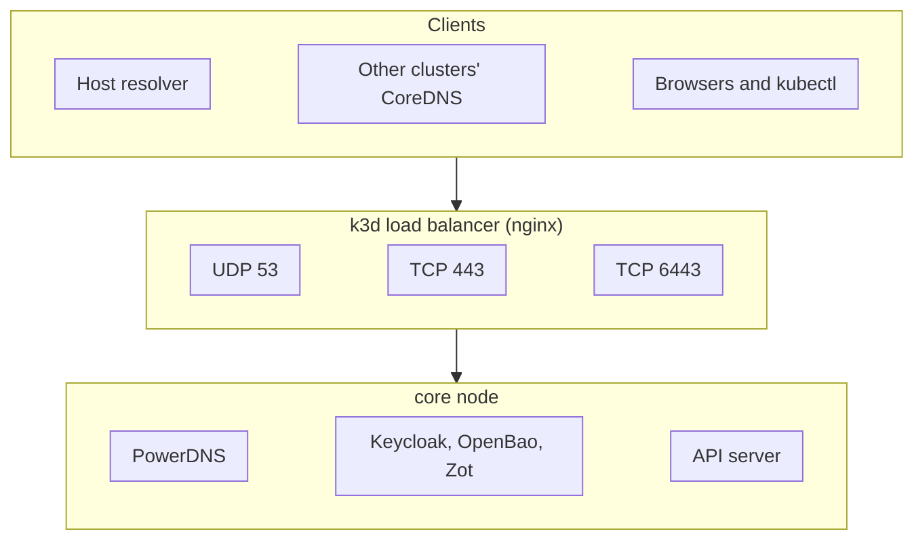

I was refreshing a page of links for my homelab when four tiles went red at once. Keycloak, PowerDNS and
the container registry, all in the same k3d cluster, all failing. The DNS lookups timed out, the HTTPS
connections died mid-handshake, and `kubectl` against that cluster answered with `EOF`. The cluster
itself was fine: its node had plenty of memory, and when I talked to it directly it answered every
request. The thing in front of it had quietly run out of room. This post walks through how I found it,
why less than one DNS query a second is enough to break k3d's load balancer, and the small fix that
keeps it up under more than 300 times that load.

<!-- more -->

## The setup

My homelab runs several k3d clusters on one DGX Spark, all on a shared Docker network. One of them,
`core`, holds the services everything else depends on: Keycloak for sign-in, OpenBao for secrets, a Zot
registry mirror, and PowerDNS for the internal zone `home.cloudutsuk.com`.

k3d puts an nginx container (the "serverlb") in front of every cluster. It's how a host port reaches
the cluster: k3d maps the port on the load balancer, and nginx forwards it to the node. For `core` that
load balancer carries three very different kinds of traffic on the same host address:

- **HTTPS (443)** for Keycloak, OpenBao and the registry
- **The Kubernetes API (6443)** for `kubectl` and the automation
- **DNS (53, UDP and TCP)**: the host resolves the internal zone through it, and so does every other
  cluster's CoreDNS (on a second port, 1053)



That shared middle box is the whole story.

## Symptoms

From the outside it looked like three unrelated failures:

```text
$ curl -s -o /dev/null -w "%{http_code} %{errormsg}\n" https://auth.core.home.cloudutsuk.com/
000 Resolving timed out after 6000 milliseconds

$ curl -s -o /dev/null -w "%{http_code} %{errormsg}\n" https://registry.core.home.cloudutsuk.com/v2/
000 OpenSSL SSL_connect: SSL_ERROR_SYSCALL in connection to registry.core.home.cloudutsuk.com:443

$ kubectl --context k3d-core get pods -A
error: client rate limiter Wait returned an error: context deadline exceeded - error from a previous attempt: EOF
```

A DNS timeout, a TLS connection cut before the handshake, and an API client getting `EOF`. If you start
debugging each of those on its own, you can lose an afternoon. The useful question was: what do all
three have in common? They all go through the same load balancer.

So I went around it. The node has its own address on the Docker network, and from there everything
worked:

```text
direct API: 401          # the API answers (no token sent)
direct 443: 302          # Keycloak answers
```

The node was healthy. The load balancer wasn't.

## The log that explains it

`docker logs` on the load balancer container was full of one line:

```text
[alert] 66#66: *366626 1029 worker_connections are not enough while connecting to upstream,
udp client: 172.30.0.1, server: 0.0.0.0:53, upstream: "172.30.0.128:53"
```

483 of them in two minutes, every one for UDP port 53. nginx had run out of connections, and it was DNS
that had used them up.

That surprised me, because the DNS load isn't large. I measured it from the clusters' CoreDNS: a few
queries a second across everything. That can't fill a thousand connections, unless each one stays open
for a very long time.

## Why a few queries a second fill a thousand slots

Here's the server block k3d generated for DNS over UDP:

```nginx
server {
    listen        53 udp;
    proxy_pass    53_udp;
    proxy_timeout 600;
    proxy_connect_timeout 2s;
}
```

Two things matter here.

First, UDP has no connection to close. nginx's stream module handles UDP as a "session": a client's
datagrams and the upstream's replies, tracked together. Every session holds a connection in the worker,
and for a proxied session that's really two, one to the client and one to the upstream. nginx decides a
UDP session is over in one of two ways: it has received the number of reply datagrams you told it to
expect (`proxy_responses`), or nothing has moved for `proxy_timeout`.

Second, k3d sets neither in a way that suits DNS. The nginx docs on `proxy_responses` say it plainly:
"By default, the number of datagrams is not limited." So nginx never assumes the reply ended the
session. And `proxy_timeout 600` means it waits ten minutes of silence before giving up.

A DNS lookup is one datagram out and one back. Each new query comes from a new source port, so it's a
new session. Put those together:

| | Value |
|---|---|
| Connections per worker (`worker_connections`) | 1029 |
| Connections per DNS session (client and upstream) | 2 |
| How long each DNS session is held | up to 600 s |
| Query rate that fills every connection | about 1029 / (2 × 600) ≈ **0.9 per second** |
| What my clusters and host actually sent | a few per second |

Less than one query a second is nothing. Probes, CoreDNS cache misses and image pulls get there easily,
and they did as I added clusters and labs. It also explains why the failure came and went: when the
query rate dipped, sessions timed out and freed up, and things recovered for a while.

There was a second, quieter limit. When I raised `worker_connections`, nginx warned:

```text
[warn] 4096 worker_connections exceed open file resource limit: 1024
```

The container's soft limit on open files was 1024, and every proxied connection needs two file handles.
So nginx was really capped by the file limit, not by its own setting. The nginx docs mention this too: the number of
connections "cannot exceed the current limit on the maximum number of open files".

And the reason the whole cluster went down rather than just DNS: those connections are shared. Once a
worker is full, it refuses new HTTPS and API connections just as it refuses DNS.

## What k3d lets you change

k3d's load balancer is nginx with a config rendered by [confd](https://github.com/kelseyhightower/confd)
from a template inside the container. The documented knobs are two values, set when you create the
cluster:

```yaml
# k3d config file
options:
  k3d:
    loadbalancer:
      configOverrides:
        - settings.workerConnections=2048
        - settings.defaultProxyTimeout=900
```

Neither fixes this properly. More connections only raise the threshold; at 600 seconds per session the
same thing happens at a slightly higher query rate. And `defaultProxyTimeout` applies to every port. Cut
it to a few seconds and you break the long-lived connections the Kubernetes API relies on, such as
watches that sit idle between events.

What I actually wanted is to tell nginx to expect one reply, and let the session go as soon as it
arrives. That's what `proxy_responses` is for ("the number of datagrams expected from the proxied server
in response to a client datagram... a hint for session termination"), and k3d's template (as of v5.9.0)
has no setting for it.

There was one more constraint. My infrastructure code treats any change to `core`'s cluster settings as
a reason to rebuild `core`, and rebuilding the cluster that holds the secrets and the identity provider
isn't something I do to tune a proxy.

## The fix

Inside the load balancer container, confd runs in watch mode against a values file
(`confd -watch -backend file -file /etc/confd/values.yaml`). When that file changes, confd re-renders
`nginx.conf` from the template, checks it with `nginx -T`, and reloads nginx gracefully. Open
connections finish on the old workers, and new ones go to the new workers.

So the fix is to patch the template once and write the values file:

1. **UDP servers only:** `proxy_responses 1` and `proxy_timeout 10s`. TCP keeps k3d's 600 seconds.
2. **`worker_rlimit_nofile 16384`**, so the connection count is real.
3. **`settings.workerConnections` 4096**, for headroom.

The template change is a small edit around the `proxy_timeout` line:


```text
  server {
    listen        {{ $port }} {{- if (eq $protocol "udp") }} udp{{- end -}};
    proxy_pass    {{ $upstream }};
    {{- if (eq $protocol "udp") }}
    proxy_responses 1;
    proxy_timeout 10s;
    {{- else }}
    proxy_timeout {{ getv "/settings/defaultProxyTimeout" "600" }};
    {{- end }}
    proxy_connect_timeout 2s;
  }
```


I wrapped it in an idempotent script that loops over every k3d load balancer and does the edit inside
each container with `docker exec`. It only patches what isn't patched yet, then rewrites the values file
and waits until `nginx -T` shows the new settings. The rendered result for DNS:

```nginx
server {
    listen        53 udp;
    proxy_pass    53_udp;
    proxy_responses 1;
    proxy_timeout 10s;
    proxy_connect_timeout 2s;
}
```

And a `--check` mode, so I can see the state of every load balancer at a glance:

```text
$ lb-udp.sh --check
k3d-ai-serverlb: worker_connections 4096, worker_rlimit_nofile 16384, UDP servers 0, with proxy_responses 0
k3d-platform-serverlb: worker_connections 4096, worker_rlimit_nofile 16384, UDP servers 0, with proxy_responses 0
k3d-mon-serverlb: worker_connections 4096, worker_rlimit_nofile 16384, UDP servers 0, with proxy_responses 0
k3d-core-serverlb: worker_connections 4096, worker_rlimit_nofile 16384, UDP servers 2, with proxy_responses 1
```

### The race I hit on the first try

My first version rewrote the values file with `cat new > values.yaml`. That truncates the file and then
writes it, and confd noticed the truncation first. It read an empty file, failed with
`key does not exist: /settings/workerConnections`, and never picked up the write that followed. Nothing
broke, because nginx keeps running its last good config when confd fails. But the change didn't apply
either. The script now rewrites the file and checks `nginx -T`, and repeats a few times until the new
config is live.

### Making it stick

A `docker restart` keeps the patched template, because it's the same container. But k3d recreates the
load balancer when you create a cluster or edit its load balancer ports, and a new container starts from
k3d's defaults again. So my boot unit runs the script right after each cluster starts, and the cluster
config carries a comment telling whoever edits the ports to run it afterwards.

> Patching a file inside a container that a tool owns is a workaround, not a configuration. I'm fine with
> it here because it's idempotent, it's checked, and it runs on every boot. If k3d grows a setting for
> UDP sessions, that's the better home for it.
{: .prompt-warning }

## Proving it

I didn't want to trust "the alerts stopped": the failure came and went on its own, so a quiet five
minutes proved nothing. Instead I generated load that the old configuration couldn't survive. A small
Python script sends real DNS queries for an internal name, each from a fresh socket (and so a fresh
source port, a new nginx session), alternating between the two DNS ports, at a fixed rate:

```python
def query(port, name="auth.core.home.cloudutsuk.com"):
    s = socket.socket(socket.AF_INET, socket.SOCK_DGRAM)
    s.settimeout(2)
    qid = random.randint(0, 65535)
    q = (struct.pack(">HHHHHH", qid, 0x0100, 1, 0, 0, 0)
         + b"".join(bytes([len(p)]) + p.encode() for p in name.split("."))
         + b"\0" + struct.pack(">HH", 1, 1))          # type A, class IN
    try:
        s.sendto(q, (DNS_HOST, port))
        reply, _ = s.recvfrom(512)
        return struct.unpack(">H", reply[:2])[0] == qid  # answered, same query ID
    except OSError:
        return False
    finally:
        s.close()
```

At the old 600-second hold, 100 queries a second would fill 1029 connections in about five seconds. The results after the fix:

| Test | Queries | Rate | Answered | Connection alerts | HTTPS during the test |
|---|---|---|---|---|---|
| 1 | 5000 | 100/s | 5000 | 0 after the reload | healthy |
| 2 | 9000 | 300/s | 9000 | 0 | healthy |

Three hundred a second is more than 300 times the rate that used to break it. Keycloak, OpenBao and the
registry answered normally throughout.

## Common pitfalls

- **Debugging the symptoms one by one.** A DNS timeout, a TLS error and an API `EOF` at the same time
  usually share a cause. Find what they pass through, then go around it.
- **Raising the timeout instead of lowering it.** k3d's docs show `defaultProxyTimeout=900` as an
  example override. For DNS over UDP that makes this worse.
- **Lowering the timeout for everything.** A short `proxy_timeout` on TCP cuts idle API watches and
  long-lived HTTPS connections. Set it per protocol.
- **Forgetting the file limit.** `worker_connections` above the open-file limit only produces a warning
  in the log, and the real ceiling stays where it was.
- **Patching once and forgetting.** A recreated container brings the defaults back. Put the fix
  somewhere that runs again (a boot unit, or the step after cluster creation).

## What I'd do differently

I'd have kept DNS off a shared proxy from the start. The cleanest design is to publish DNS from
something whose only job is DNS, so a burst of lookups can never take the identity provider down with
it. I'll make that change the next time I rebuild `core` anyway. Until then, the nginx settings above are
the right ones for proxying DNS, and they're what any UDP-over-nginx setup should have.

## Conclusion

k3d's load balancer is a plain nginx stream proxy, and its defaults suit TCP. For DNS over UDP, a
600-second idle timeout with no expected reply count turns every lookup into a ten-minute reservation of
two connections, and at under one query a second the connections run out for every port behind it. If you run DNS
through a k3d load balancer, check `docker logs` on it for `worker_connections are not enough`, and set
`proxy_responses 1` with a short timeout on the UDP servers.

## References

- [nginx stream proxy module: `proxy_responses`, `proxy_timeout`](https://nginx.org/en/docs/stream/ngx_stream_proxy_module.html)
- [nginx core module: `worker_connections`, `worker_rlimit_nofile`](https://nginx.org/en/docs/ngx_core_module.html)
- [k3d defaults: the load balancer and its config overrides](https://k3d.io/v5.8.3/design/defaults/)
