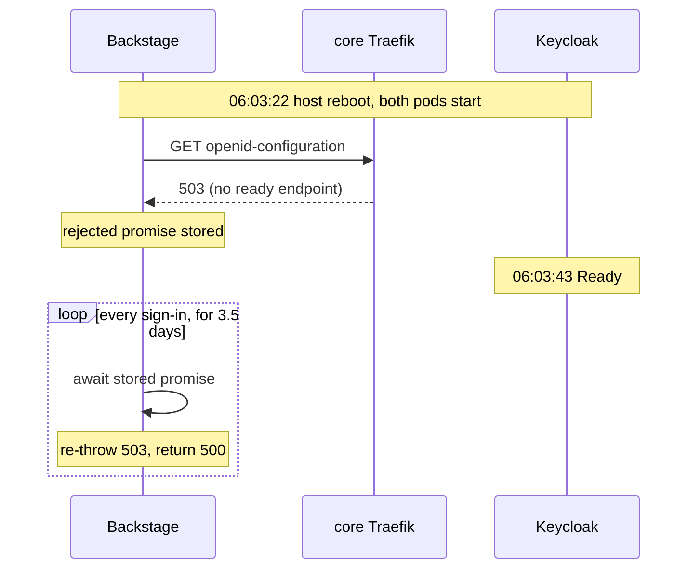

I clicked **Sign in** on my homelab's Backstage portal and the popup came back with this instead of
Keycloak's login page:

```json
{
  "error": {
    "name": "OPError",
    "message": "expected 200 OK, got: 503 Service Unavailable"
  },
  "request": {
    "method": "GET",
    "url": "/keycloak/start?scope=openid%20profile%20email&origin=https%3A%2F%2Fportal.platform.home.cloudutsuk.com&flow=popup&env=production"
  },
  "response": { "statusCode": 500 }
}
```

A 503 from Keycloak sounds like Keycloak is down. It wasn't. Keycloak had been healthy for three and a
half days, every other app was signing in through it fine, and when I fetched the exact same URL from
inside the portal's pod I got a 200 every time. The portal itself was the only thing still seeing a 503,
and it had been seeing the *same* 503 since a reboot on 19 October. This post walks through how I found
that, why Backstage's OIDC provider behaves this way, and the small init container that keeps it from
happening again.

<!-- more -->

## The setup

The portal is [Backstage](/posts/platformengg/backstage/introduction-to-backstage/), running in my
`platform` k3d cluster. Sign-in goes through Keycloak's `homelab` realm, which lives in a different
cluster, `core`, alongside the other shared services. The portal reaches Keycloak by its public name,
`auth.core.home.cloudutsuk.com`, which resolves to the `core` cluster's k3d load balancer on the shared
Docker network. From there it's core's Traefik, then the Keycloak Service.

The Backstage side is a thin custom module that registers the stock OIDC authenticator under the
provider id `keycloak`, plus this config:

```yaml
auth:
  providers:
    keycloak:
      production:
        metadataUrl: https://auth.core.home.cloudutsuk.com/realms/homelab/.well-known/openid-configuration
        clientId: portal
        clientSecret: ${KEYCLOAK_CLIENT_SECRET}
        prompt: auto
```

Nothing exotic. That's part of why this one took a few steps to see.

## Ruling out the obvious

The error says the discovery request got a 503, so I started where the 503 supposedly came from.

**Is Keycloak up?** Yes. One pod, `Ready` since `2026-10-19T06:03:43Z`, no restarts, no probe failures,
memory well under its limit, and its logs showed nothing but the usual expired refresh tokens from other
clients.

**Can the portal pod reach it?** Also yes. I ran a fetch from inside the running portal container:

```bash
kubectl --context k3d-platform -n portal exec deploy/portal -- node -e '
fetch("https://auth.core.home.cloudutsuk.com/realms/homelab/.well-known/openid-configuration")
  .then(r => console.log(r.status))'
# 200
```

Forty in a row, forty 200s. DNS resolved to the right address. So maybe it was a different HTTP client?
Backstage uses `openid-client` under the hood, so I ran its `Issuer.discover()` directly, from the same
pod, against the same URL:

```text
0 ok https://auth.core.home.cloudutsuk.com/realms/homelab
1 ok https://auth.core.home.cloudutsuk.com/realms/homelab
...
9 ok https://auth.core.home.cloudutsuk.com/realms/homelab
```

Ten for ten. At this point I'd been assuming the failures were intermittent: the user (me) hits a bad
moment, the request fails, it works for me a minute later. So I stopped testing *around* the portal and
tested the portal:

```bash
curl -s -o /dev/null -w "%{http_code}\n" \
  "https://portal.platform.home.cloudutsuk.com/api/auth/keycloak/start?scope=openid&origin=https%3A%2F%2Fportal.platform.home.cloudutsuk.com&flow=popup&env=production"
# 500
# 500
# 500
```

Three for three failing, every time, and each one logged the same `OPError ... 503` from the backend.
That's the moment the problem changed shape. It wasn't intermittent at all. A fresh Node process in the
pod got a 200; the long-running Backstage process got a 503, deterministically.

## The 503 that never left the pod

If the backend really was talking to Keycloak and getting a 503, core's Traefik would have counted it.
Traefik exposes Prometheus metrics, so I read its 503 counter, hit `/start` once more, and read it again:

```text
traefik_entrypoint_requests_total{code="503",entrypoint="websecure",...} 4
start=500
traefik_entrypoint_requests_total{code="503",entrypoint="websecure",...} 4
```

The counter didn't move. The portal returned a 500 citing a 503, and no 503 was served anywhere on the
path. I checked the obvious remaining suspects: no `HTTP_PROXY` in the process environment, no unusual
`NODE_OPTIONS`, and no long-lived keep-alive socket to port 443 in `/proc/net/tcp` (only Postgres
connections). The backend wasn't making a request at all.

> When an error is deterministic in one process and impossible to reproduce from a fresh one on the same
> host, stop looking at the network and start looking at state inside the process.
{: .prompt-tip }

## Backstage discovers once and keeps the result

The stack trace pointed at `Issuer.discover` inside `openid-client`, called from Backstage's
`@backstage/plugin-auth-backend-module-oidc-provider`. Its authenticator's `initialize()` looks like
this (trimmed):

```ts
initialize({ callbackUrl, config }) {
  const metadataUrl = config.getString('metadataUrl');
  // ...
  const promise = Issuer.discover(metadataUrl).then(issuer => {
    const client = new issuer.Client({ /* client_id, secret, redirect_uris ... */ });
    // ...
    return { helper, client, strategy };
  });
  return { initializedPrompt, promise, searchParams: startUrlSearchParams };
}
```

And then every handler does `const { helper } = await promise;` (and `refresh` and `logout` do the same
with `ctx.promise`). There's no `.catch`, no retry, nothing that clears the stored promise. That's a
perfectly reasonable design when discovery succeeds: you fetch the OpenID configuration once, at startup,
and never pay for it again. But a JavaScript promise only settles once. If the very first discovery call
rejects, that rejected promise is what every sign-in awaits for the rest of the process's life. Each
click replays the original error, with its original 503, without touching the network. That explains the
Traefik counter perfectly.

So when did the first call fail? The pod start times answered that:

| Pod | Started | Ready |
|---|---|---|
| `portal` (platform cluster) | 2026-10-19 06:03:22 UTC | shortly after |
| `keycloak` (core cluster) | 2026-10-19 06:03:22 UTC | 2026-10-19 06:03:43 UTC |

Same second. The host had rebooted and every k3d cluster came back up together. Backstage boots fast;
Keycloak takes about 21 seconds to become ready. In that window, Traefik on `core` has an Ingress for
`auth.core.home.cloudutsuk.com` but no ready endpoints behind it, and Traefik answers that with exactly
one thing: `503 Service Unavailable`.



Meanwhile Backstage's readiness and liveness probes were green the whole time. They check that the
plugins have started, and the auth plugin *had* started. It was just holding a broken promise. Nothing
in the pod looked unhealthy, so Kubernetes had no reason to restart it.

## The immediate fix

Once the cause is "bad state in a long-running process", the fix is boring:

```bash
kubectl --context k3d-platform -n portal rollout restart deploy/portal
kubectl --context k3d-platform -n portal rollout status deploy/portal
```

The new process ran discovery against a Keycloak that had been up for days, and `/start` went back to
doing its job:

```text
start=302 -> https://auth.core.home.cloudutsuk.com/realms/homelab/protocol/openid-connect/auth?client_id=portal&...
```

That fixes today. It does nothing for the next reboot, which will put the two pods in the same race
again.

## The lasting fix: wait for Keycloak before starting

What I want is simple: don't start the Backstage process until Keycloak's discovery document returns a
200. That's what init containers are for. Kubernetes runs them to completion, one after another, before
any app container starts, and if one fails the kubelet keeps restarting it until it succeeds.

The usual pattern is a `busybox` or `curlimages/curl` container with a shell loop. I didn't want that
here, for a homelab-specific reason: my clusters run Kyverno policies that only admit images from my own
registry, pinned by digest and carrying a Cosign signature. A new third-party image means mirroring and
signing it first. The portal image already has Node 24 with a built-in `fetch`, it's already signed, and
Kustomize's `images:` transformer rewrites the `portal` placeholder in init containers as well as regular
ones. So the init container just reuses it:

```yaml
spec:
  template:
    spec:
      initContainers:
        # Backstage's OIDC provider runs Keycloak's discovery once at startup and keeps the result for the
        # life of the process, a failure included: a portal that starts before Keycloak is ready (a host
        # reboot brings both up together) answers every sign-in with a 500 until it's restarted. So the
        # portal waits for the discovery document here; same image (signed, by digest), no new dependency.
        - name: wait-for-keycloak
          image: portal # set to the same digest as the portal container by kustomization.yaml
          command: [node, -e]
          args:
            - |
              const url = "https://auth.core.home.cloudutsuk.com/realms/homelab/.well-known/openid-configuration";
              (async () => {
                for (;;) {
                  try {
                    const res = await fetch(url, {signal: AbortSignal.timeout(5000)});
                    if (res.ok) { console.log(`Keycloak discovery: ${res.status}`); return; }
                    console.log(`Keycloak discovery: ${res.status}, retrying in 5s`);
                  } catch (e) {
                    console.log(`Keycloak discovery: ${e.cause?.code ?? e.message}, retrying in 5s`);
                  }
                  await new Promise((r) => setTimeout(r, 5000));
                }
              })();
          securityContext:
            allowPrivilegeEscalation: false
            readOnlyRootFilesystem: true
            capabilities: {drop: [ALL]}
          resources:
            requests: {cpu: 10m, memory: 64Mi}
            limits: {memory: 128Mi}
```

A few choices in there are deliberate:

- **It checks the exact URL Backstage uses**, not a Keycloak health endpoint. The thing that has to work
  is "the portal can fetch this document through DNS, the load balancer and Traefik", so that's what the
  check exercises. A `/health/ready` probe against the Keycloak Service would pass while the route in
  front of it was still broken.
- **It loops forever instead of failing.** An exiting init container would also be retried by the
  kubelet, but with exponential back-off, which can leave the portal waiting minutes after Keycloak is
  back. A 5-second loop starts the portal within 5 seconds of Keycloak being ready, and the logs say
  exactly what it's waiting on.
- **Each attempt has a 5-second timeout**, so a black-holed connection can't hang the loop.
- **It satisfies the same security policies** as the main container: non-root (inherited from the pod),
  read-only root filesystem, no capabilities, and requests and limits set.

Before pushing it I checked two things: that the rendered manifest passes admission on the real cluster,
and that the script actually exits on success in the real image.

```bash
kubectl kustomize apps/portal | kubectl --context k3d-platform apply --dry-run=server -f -
# deployment.apps/portal configured (server dry run)

kubectl --context k3d-platform -n portal exec -i deploy/portal -- timeout 20 node - < wait.js
# Keycloak discovery: 200
# exit=0
```

Argo CD rolls it out from git like everything else.

### The trade-off

This makes the portal's startup depend on Keycloak. If Keycloak is down when the portal pod starts, the
portal stays in `Init:0/1` and serves nothing, not even the catalog to anonymous health checks. I'm fine
with that: in this setup a portal nobody can sign in to is useless, and "not started, waiting for
Keycloak" is a far better failure than "running, green, and returning 500 on every sign-in for days".
If your Backstage has guest access or other providers that should work without Keycloak, weigh that
before copying this.

It also only protects startup. If Keycloak disappears *after* the portal has discovered it, the stored
promise is already resolved, so discovery isn't the problem. Token exchanges will fail while Keycloak is
down and recover on their own when it's back.

## Other ways to fix it

An init container isn't the only option. Here's how I'd compare them:

| Approach | Fixes the race? | Cost |
|---|---|---|
| Restart the pod by hand | Only until the next reboot | Someone has to notice first |
| Init container waiting for discovery | Yes, at every start | Portal startup depends on Keycloak |
| Liveness probe that hits `/api/auth/keycloak/start` | Yes, by restarting the pod | A Keycloak outage restart-loops the portal |
| Patch the authenticator to retry discovery | Yes, in the process | A fork of an upstream module to maintain |
| Start order at boot (core before platform) | Mostly | Brittle; any core restart reopens it |

The liveness probe is tempting because it would also catch other kinds of stuck auth state. But it
couples the portal's *liveness* to an external service: every Keycloak restart would turn into portal
restarts, which is the opposite of what liveness probes are for. The real fix belongs upstream, in a
discovery promise that's thrown away when it rejects so the next sign-in tries again. Until then, the
init container is the least surprising option.

## Common pitfalls

- **Trusting the status code in the error.** The 503 was real, but it was three and a half days old. A
  cached rejection carries its original message, so the error you're reading may not describe the world
  as it is now.
- **Testing from a fresh process and concluding "it works".** `node -e`, `curl` and `openid-client` all
  worked from the same pod. Only calling the real endpoint of the real process reproduced it.
- **Assuming green probes mean a working app.** Backstage's readiness endpoint answers "have the plugins
  started", not "can a user sign in". Those are different questions.
- **Reaching for a new image for a five-line wait loop.** In a cluster with registry and signature
  policies, the app's own image is usually the fastest compliant choice, and it's already on the node.

## What I'd do differently

The portal has a post-sync smoke test Job, but it only checked readiness, the frontend and the catalog
API, all of which were fine. A check that calls `/api/auth/keycloak/start` and expects a `302` to Keycloak
would have caught this on the first sync after the reboot instead of three days later when I happened
to sign in. So I added one to the same Job:

```sh
start="/api/auth/keycloak/start?scope=openid&origin=https%3A%2F%2Fportal.platform.home.cloudutsuk.com&flow=popup&env=production"
out=$(curl -s -o /dev/null -w '%{http_code} %{redirect_url}' --max-time 10 "$BASE_URL$start")
case "$out" in
  "302 https://auth.core.home.cloudutsuk.com/realms/homelab/protocol/openid-connect/auth?client_id=portal&"*) ;;
  *) fail "GET /api/auth/keycloak/start returned '$out', expected a 302 to Keycloak's login page" ;;
esac
echo "ok   GET /api/auth/keycloak/start  (302 to Keycloak)"
```

It matches the redirect's realm and `client_id` too, not just the status code, so a portal pointed at
the wrong realm or client fails it as well. It's a good rule in general: smoke-test the sign-in
redirect, not just the pages behind it.

One honest limit: it's a post-sync hook, so it runs when Argo CD syncs, not when a pod restarts after a
reboot with nothing to sync. The init container covers the reboot; the smoke test covers everything a
change can break.

I'd also treat "all clusters restart together" as a normal event rather than a rare one. This is the
second time this month that the shared `core` cluster has sat behind an outage elsewhere (the other was
[k3d's load balancer running out of connections](/posts/homelab/k3d-loadbalancer-udp-dns-worker-connections/)).
Anything on another cluster that depends on `core` should either wait for it explicitly or recover by
itself when it comes back.

## Conclusion

Backstage's OIDC provider fetches the discovery document once and keeps the promise, including a
rejected one. If the portal starts while Keycloak is still coming up, sign-in fails until the pod is
restarted, while every probe stays green and the error keeps quoting a 503 nobody is serving. Restart the
pod to recover. Then add an init container that waits for the exact discovery URL Backstage uses, so the
next reboot can't set the trap again.

If you run Backstage with Keycloak, or any OIDC provider, on a cluster that can start at the same time as
the provider, try it now: restart the provider, then the portal while the provider is still starting,
and see whether sign-in comes back on its own.

## References

- [Backstage OIDC provider authenticator source (`authenticator.ts`)](https://github.com/backstage/backstage/blob/master/plugins/auth-backend-module-oidc-provider/src/authenticator.ts)
- [Kubernetes: Init Containers](https://kubernetes.io/docs/concepts/workloads/pods/init-containers/)
- [MongoDB Compass COMPASS-7605: clearer `Issuer.discover` errors from openid-client](https://jira.mongodb.com/browse/COMPASS-7605)
- [MongoDB DOCS-16434: start with a warning when OIDC discovery is unreachable, retry at authentication](https://jira.mongodb.org/browse/DOCS-16434)
