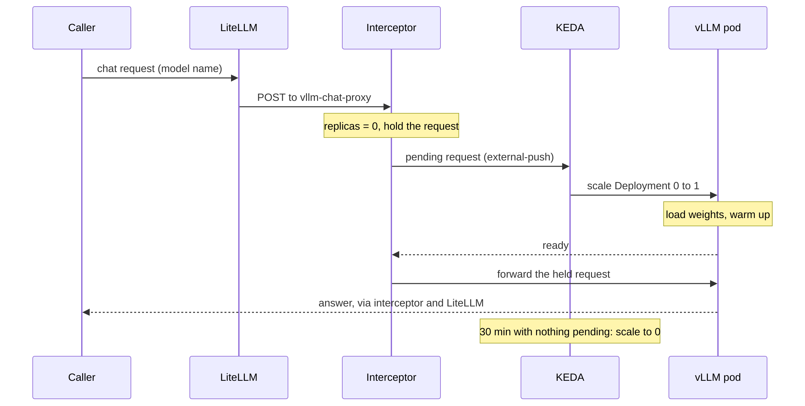

My DGX Spark had started to run warm. The CPU sensors were reading 72 to 78 °C, the load average sat
between 4 and 5, and of its 121 GiB of memory, 87 GiB was in use with another 8.7 GiB pushed out to swap.
On a box that is also my desktop, that's the point where the fans become part of the room.

So I went looking for what was actually running, and the biggest single answer wasn't a process at all:

```text
$ nvidia-smi
|  GPU  ...  Processes                                              GPU Memory |
|    0  ...  C   VLLM::EngineCore                                     42102MiB |
...
| N/A   66C    P0             15W /  N/A  |  ...  |      1%      Default |
```

The chat model's vLLM server was holding 42 GB of the GB10's unified memory while the GPU sat at 1%.
The embeddings model held another 12 GB next to it, and had served zero requests in a day. This post is
how I gave that memory back: KEDA scales each model server to zero when nobody's calling it, and KEDA's
HTTP add-on holds the first request while the model starts again, so the callers never notice anything
except a wait. I'll cover the three Kubernetes objects it takes, the timeouts that will bite you, and the
gotchas I hit on the way.

<!-- more -->

## Why a model server holds memory it isn't using

vLLM doesn't allocate memory per request. At startup it takes a fixed share of the GPU's memory, set by
`--gpu-memory-utilization`, and fills it with the weights, CUDA graphs, activations and as much KV cache as
fits. It keeps all of it until the process exits. That's exactly what you want on a dedicated inference
GPU: no allocation on the hot path, predictable latency.

On a DGX Spark it's a different deal. The GB10 has no separate VRAM. CPU and GPU share one pool of
LPDDR5x, so every gigabyte vLLM reserves is a gigabyte the rest of the machine can't use. My chat model
(Qwen3.5-35B-A3B in FP8) runs with `--gpu-memory-utilization 0.36`, about 44 GB. Embeddings run at `0.1`,
about 12 GB. Together that's the 54 GB in the title, and it doesn't show up in any pod's or container's
memory metrics, because the GPU driver holds it, not the container.

The other half of the picture is how often anyone called them. Over the 25 hours of vLLM metrics I had:

| Model | Requests | Hours with no request | Ready after a restart |
|---|---|---|---|
| `vllm-chat` | 85 | 18 of 25 | about 4 minutes |
| `vllm-embeddings` | 0 | 25 of 25 | about 45 seconds |

The chat model's logs told the same story from another angle: across a full day it generated tokens for
about 70 minutes. The rest of the time it was a 44 GB reservation with a health endpoint.

## The options, and why plain KEDA isn't enough

Everything calls these models through a LiteLLM gateway by model name: my Hermes agent, a job-hunting
agent, and a pipeline that writes scripts for short videos. Nothing talks to vLLM directly. That's useful,
because it gives one place to put something in between.

I looked at four ways to stop paying for idle models:

1. **Keep them always on.** No waiting, ever. Also 54 GB held around the clock for a few dozen requests a day.
2. **KEDA with a Prometheus trigger** on LiteLLM's request metrics. No extra component, but think about
   what happens at zero replicas: the request arrives, LiteLLM forwards it to a Service with no
   endpoints, and the call fails. The failure bumps a metric, KEDA wakes the model, and every caller
   needs minutes of retry logic to survive that.
3. **KEDA's cron scaler**, models up during working hours. Simple, but my agents run on their own
   schedules, including at 5 AM, and a call outside the window just fails.
4. **KEDA plus its HTTP add-on.** The add-on puts an *interceptor* proxy in the request path. At zero
   replicas the interceptor holds the request, tells KEDA there's pending work, and forwards the request
   once a pod is ready.

Option 4 is the only one where the caller doesn't have to know scaling exists. The first call after an
idle period is slow; it isn't an error. That's the trade I wanted.

> Plain KEDA can scale *to* zero on any metric. Scaling *from* zero without losing the first request
> needs something that can hold that request. That's the whole job of the HTTP add-on's interceptor.
{: .prompt-info }

## How the request flows



Three pieces matter:

- **The interceptor** routes by `Host` header. LiteLLM calls `vllm-chat-proxy:8080`, an `ExternalName`
  Service that points at the interceptor, so the `Host` header names the model.
- **The external scaler** reports the interceptor's pending and in-flight requests to KEDA through an
  `external-push` trigger, so KEDA reacts to a request as it arrives, not on the next metrics poll.
- **KEDA** owns the Deployment's replica count: 0 when the route has been quiet for the cooldown period,
  1 as soon as anything is pending.

## The three objects per model

I'm running KEDA 2.21.0 and the HTTP add-on 0.16.0, which uses the `InterceptorRoute` API (`v1beta1`).
If you're coming from older guides, `HTTPScaledObject` is the previous API; 0.14 replaced it.

### 1. The route

```yaml
apiVersion: http.keda.sh/v1beta1
kind: InterceptorRoute
metadata:
  name: vllm-chat
  annotations: {argocd.argoproj.io/sync-wave: "1"}
spec:
  target: {service: vllm-chat, port: 8000}
  rules:
    - hosts:
        - vllm-chat-proxy
        - vllm-chat-proxy.models
        - vllm-chat-proxy.models.svc
        - vllm-chat-proxy.models.svc.cluster.local
  scalingMetric:
    concurrency: {targetValue: 100}   # max 1 replica anyway: any pending request means "one pod"
  timeouts:
    readiness: 8m         # how long a held request waits for a pod to become ready
    responseHeader: 15m   # how long any request waits for the first response header
  coldStart:
    maxPendingRequests: 100
    overflow: Reject
```

List every form of the hostname a client might send. Kubernetes clients don't agree on whether they
use the short name or the FQDN, and a `Host` header the route doesn't match gets a 404 from the
interceptor, which is a confusing thing to debug at 1 AM.

The `coldStart` block is a guardrail: a burst of requests against a cold model gets held up to a limit
and rejected beyond it, instead of piling up in memory inside the interceptor.

### 2. The ScaledObject

```yaml
apiVersion: keda.sh/v1alpha1
kind: ScaledObject
metadata:
  name: vllm-chat
  annotations: {argocd.argoproj.io/sync-wave: "2"}
spec:
  scaleTargetRef: {name: vllm-chat}
  minReplicaCount: 0
  maxReplicaCount: 1        # one GPU slice; the Deployment uses Recreate, never two
  cooldownPeriod: 1800      # 30 minutes without a request before the slice is released
  triggers:
    - type: external-push
      metadata:
        scalerAddress: keda-add-ons-http-external-scaler.keda:9090
        interceptorRoute: vllm-chat
```

The sync waves aren't decoration. When KEDA reconciles a ScaledObject it asks the external scaler for the
route's metric, so the `InterceptorRoute` has to exist first or the first sync fails.

### 3. The name the gateway calls

```yaml
apiVersion: v1
kind: Service
metadata:
  name: vllm-chat-proxy
spec:
  type: ExternalName
  externalName: keda-add-ons-http-interceptor-proxy.keda.svc.cluster.local
  ports:
    - {name: http, port: 8080}
```

And in LiteLLM's config, the only change a caller-facing component sees:

```yaml
  - model_name: qwen3.5-35b-a3b
    litellm_params:
      model: hosted_vllm/qwen3.5-35b-a3b
      api_base: http://vllm-chat-proxy.models.svc.cluster.local:8080/v1
      timeout: 900
```

Finally, the Deployment loses its `replicas:` line. If you deploy with Argo CD, also tell it to ignore
`/spec/replicas`, or Argo CD and KEDA will take turns setting it:

```yaml
spec:
  ignoreDifferences:
    - {group: apps, kind: Deployment, name: vllm-chat, jsonPointers: [/spec/replicas]}
  syncPolicy:
    syncOptions: [RespectIgnoreDifferences=true, SkipDryRunOnMissingResource=true]
```

`SkipDryRunOnMissingResource` covers the first sync on a cluster where KEDA's CRDs aren't installed yet.

## Choosing the cooldown

The cooldown is the knob that trades memory for waiting. Too short, and a model that gets called every
20 minutes cold-starts every time. Too long, and it barely ever releases anything.

Rather than guess, I replayed 48 hours of the chat model's request timestamps against a few cooldowns:

| Cooldown | Cold starts in 48 hours |
|---|---|
| 15 minutes | 15 |
| 30 minutes | 14 |
| 60 minutes | 9 |

The calls come in bursts through the day, and the nights are empty no matter what. Going from 15 to 30
minutes saved one cold start; going to 60 saved five more, but held 44 GB for an extra half hour after
every burst. I picked 30 minutes for chat. Embeddings are cheap to start (about 45 seconds), so they
get 15. An image model I added later with the same pattern gets 10.

## Timeouts: the part that actually breaks

A cold start puts minutes of silence at the front of a request, and every hop between the caller and the
model has an opinion about silence. Before turning scale-to-zero on for chat, I went through each hop:

| Hop | What it waits for | Default or before | Now |
|---|---|---|---|
| Interceptor readiness | a ready pod while the request is held | (per route) | 8 minutes |
| Interceptor response header | the first header from vLLM, warm or cold | (per route) | 15 minutes |
| LiteLLM | the whole upstream call | default | 900 s |
| Job agent (non-streamed) | the whole answer | 300 s | 600 s |
| Hermes agent (streamed) | the next byte of the stream | 120 s read, 180 s stale | 360 s each |
| Video pipeline (streamed) | the first byte | 300 s | unchanged, fits |

Two of these are easy to get wrong.

**The response-header timeout applies to every request**, not just cold ones. With Qwen's thinking mode
on, a non-streamed answer sends no headers until the whole answer is generated, and that can take
minutes on a warm model. A short `responseHeader` here would break long answers that work fine today.

**Streaming clients time out on gaps, not on totals.** Hermes uses a 120-second read timeout between
stream bytes and treats 180 seconds without a chunk as a stale stream. A cold start sends nothing for
about four minutes, so without raising those, the first call after every idle period would fail and
retry. Both are environment variables (`HERMES_STREAM_READ_TIMEOUT`, `HERMES_STREAM_STALE_TIMEOUT`), so
the fix was two lines in the Deployment.

> Before you scale a model to zero, list every caller and find its timeout. The model starting slowly is
> expected; a caller giving up at 120 seconds when the model needs 240 is the actual outage.
{: .prompt-warning }

## What it looked like when it went live

The embeddings model went first, and ran that way for about 13 hours before I touched chat. Then the chat change
merged, and Argo CD synced it, and the first thing that happened was something I hadn't planned for.

KEDA's docs say that when you create a ScaledObject, KEDA immediately scales the target to
`minReplicaCount`. For me that meant the warm chat pod, which had been serving for six days, was killed
the moment the ScaledObject appeared. KEDA scaled it back to 1 five seconds later, and it came back up.
It's a one-time cost per new ScaledObject, but if you're rolling this out while something is using the
model, do it in a quiet moment.

That accidental restart gave me a free measurement. The cold start took **2 minutes 15 seconds** from
container start to ready: 86 seconds loading 35 GB of weights from the shared volume, then 17 seconds
of warmup. The start I'd measured two days earlier took about 4 minutes, and its warmup alone was 105
seconds, 40 of them in `torch.compile`. This time the log said `Directly load AOT compilation` and
`torch.compile took 1.02 s`. I didn't trust it, and I was right not to: the next cold start (below)
compiled for 39 seconds again. Plan for the slow start you've seen, not the fast one you got once.

A warm request through the interceptor added nothing noticeable (0.7 seconds for a short answer). The
real test was the cold path: I waited for the cooldown to expire and the pod to go, then sent one request.

The chat model reached zero at exactly the 30-minute mark. Host memory, measured with `free` because on
unified memory that's what the rest of the machine actually gets:

| | Used | Available |
|---|---|---|
| Chat model running | 89 GB | 31 GB |
| Chat model scaled to zero | 42 to 43 GB | 78 GB |

About **46 GB** came back, and it came back within seconds of the pod going away.

Then the cold call, sent through the same path LiteLLM uses:

```text
cold call start 22:28:34Z
cold call: 200 'ok' 232s
```

A 200 after 3 minutes 52 seconds, with no retry and no error. The pod's own timeline accounts for it:
84 seconds loading weights, 99 seconds of warmup including 39 seconds of `torch.compile`, ready at
3 minutes 50 seconds. The interceptor held the request the whole time and forwarded it the moment the
readiness probe passed. That's comfortably inside the 8-minute readiness timeout and every caller's
limit from the table above.

## Gotchas I'd tell you about over coffee

**Anything that health-checks through the gateway keeps the model awake.** A probe that calls the model
by name through LiteLLM counts as traffic. Prometheus is fine because it scrapes the vLLM pod directly,
and with no pod there's nothing to scrape, which leads to the next one.

**Your dashboards will call it "missing".** My Platform status dashboard has a scrape-coverage table with
every job each cluster should send. A model at zero has no scrape target, so the embeddings model had been
showing as a red **MISSING** since the day it started scaling to zero. I added a fourth state: when the
Deployment wants 0 replicas, the cell shows a blue **SCALED TO ZERO** and counts as healthy. The PromQL is
small:

```promql
min by (cluster, job) (up{cluster="ai", job="vllm-chat"})
  or label_replace(label_replace(
       (max(kube_deployment_spec_replicas{cluster="ai", deployment="vllm-chat"}) == 0) + 2,
       "cluster", "ai", "", ""), "job", "vllm-chat", "", "")
  or label_replace(label_replace(vector(-1), "cluster", "ai", "", ""), "job", "vllm-chat", "", "")
```

`up` wins while the pod exists; otherwise the comparison yields 0 only when replicas are 0, so adding 2
gives the "scaled to zero" value; and `-1` is the genuinely missing case. Alerts need the same thought.
My "vLLM isn't serving" alert already filtered on `kube_deployment_spec_replicas > 0`, so it stays quiet
for a model that's down on purpose.

**Freed memory isn't reserved memory.** When the chat model scales down, those 44 GB go back to the
host, and the host will happily use them. If something else grows into that space, the next cold start
fails because vLLM can't take its 0.36 share of the pool. I watch a "where the memory goes" panel on the
host dashboard that splits memory into processes, containers and the GPU drivers' share.

**Want it up for a demo?** Pause the scaling instead of fighting it:

```bash
kubectl -n models annotate scaledobject vllm-chat autoscaling.keda.sh/paused-replicas=1
# ...and remove the annotation afterwards
kubectl -n models annotate scaledobject vllm-chat autoscaling.keda.sh/paused-replicas-
```

## When it isn't worth it

After this worked, the obvious next question was whether to do the same for everything else that sits
idle, starting with the Backstage portal. I measured before deciding:

| | Memory | CPU |
|---|---|---|
| Backstage portal, always on | ~303 Mi | ~3m |
| KEDA plus the HTTP add-on (6 pods) | ~206 Mi | ~13m |

KEDA can only scale workloads in its own cluster, and the portal lives in a different k3d cluster from
the models. Installing KEDA there just for the portal would save about 100 Mi and *add* CPU, plus a new
hop for every portal request and a smoke test to rework. I skipped it.

That's the honest shape of scale-to-zero: it pays off when the thing you're stopping holds a lot of
memory and sits idle most of the day. A 44 GB model that serves 70 minutes a day is the perfect
candidate. A 300 MB web app usually isn't, unless several of them share one KEDA install.

The same idea works off Kubernetes, too. For two small host tools on the same box (a Headlamp UI and a
link page), I used systemd socket activation instead: a socket holds the port, the first connection starts
the tool through `systemd-socket-proxyd`, and `--exit-idle-time=15min` stops it again. Same pattern, no
cluster required.

## Conclusion

The DGX Spark's unified memory makes idle model servers expensive in a way a discrete GPU hides: every
gigabyte vLLM reserves comes out of the same pool as everything else. KEDA scales the idle ones to zero,
and the HTTP add-on's interceptor turns a cold start from an error into a wait, so the callers keep
calling the gateway by model name and never learn that scaling exists.

If you want to try it, start with your least-used model and a generous cooldown, measure its real cold
start, then walk every caller's timeout before you move on to the expensive one. That walk is where the
work is; the three YAML objects are the easy part.

## References

- [KEDA HTTP Add-on 0.16 documentation](https://keda.sh/http-add-on/0.16/)
- [KEDA HTTP Add-on: how scaling works](https://keda.sh/http-add-on/0.16/concepts/scaling/)
- [KEDA HTTP Add-on: getting started](https://keda.sh/http-add-on/0.16/getting-started)
- [KEDA 2.21: ScaledObject specification](https://keda.sh/docs/2.21/reference/scaledobject-spec/)
- [KEDA 2.21: scaling Deployments, including pausing autoscaling](https://keda.sh/docs/2.21/concepts/scaling-deployments/)
- [KEDA docs source: "When you first create your Deployment, KEDA will immediately scale it to minReplicaCount"](https://github.com/kedacore/keda-docs/blob/master/content/docs/2.0/concepts/scaling-deployments.md)
- [Operations and observability on the Cloudutsuk Platform](/posts/projects/cloudutsuk-platform/14-operations-and-observability/)
- [Cloudutsuk Platform ADR 0051: scale idle model servers to zero with KEDA](/posts/projects/cloudutsuk-platform/architecture-decision-records/#adr-0051)
