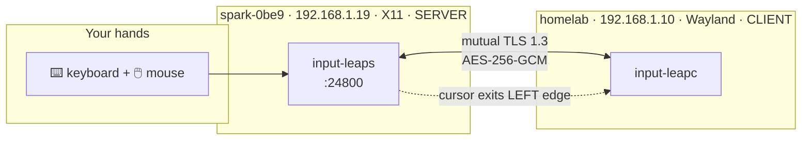

Two machines sat on my desk, each with its own keyboard and mouse, and I was tired of the shuffle. One is an NVIDIA DGX Spark; the other is my homelab desktop. I wanted one keyboard and one mouse to drive both — slide the pointer off the edge of one screen and keep going on the other, with the clipboard following along. That's exactly what a software KVM gives you, and [Input Leap](https://github.com/input-leap/input-leap) (the community fork of Barrier, itself a fork of Synergy) does it well.

This post is the real walkthrough: picking which machine is the *server*, writing the layout config, debugging the TLS handshake that failed on the first try, setting up **mutual-TLS encryption** properly, and wiring it all into systemd so it survives reboots. The twist that cost me the most thought wasn't the networking — it was that one machine runs **X11** and the other runs **Wayland**, and that decides everything.

<!-- more -->

## The setup

Here's what I was working with:

| | Server | Client |
|---|---|---|
| Hostname | `spark-0be9` | `homelab` |
| Machine | NVIDIA DGX Spark (`aarch64`) | Desktop (`x86_64`) |
| OS | Ubuntu 24.04.4 LTS (DGX OS 7.5.0) | Ubuntu 26.04 LTS |
| LAN IP | `192.168.1.19` | `192.168.1.10` |
| Display server | **X11** (GNOME on Xorg, GDM) | **Wayland** (GNOME) |
| Input Leap | `input-leaps` 3.0.3 | `input-leapc` 3.0.2 |

Both run Input Leap 3.x and both speak **protocol 1.6**, so they're compatible across the small version gap.

## Server vs. client: get this right first

Input Leap has two roles, and the names trip people up:

- The **server** (`input-leaps`) is the machine whose **physical keyboard and mouse you actually use**. Its screen is the one you "leave" when you push the pointer past an edge.
- The **client** (`input-leapc`) is the machine that **receives** that input — it's the extra screen your cursor travels *to*.

So "server" is not "the always-on box" or "the more powerful box." It's *where your hands are*. I sit at the Spark, so **the Spark is the server** and the homelab desktop is the client.



### Why the X11/Wayland split decided the roles

This is the part worth internalizing. An Input Leap **server** has to do two privileged things: **globally capture** every keystroke and mouse move, and **warp the cursor** off-screen when you switch machines. Wayland deliberately forbids exactly that for security — a random app can't grab global input or move your pointer. X11 has no such restriction.

My homelab desktop runs Wayland, so making *it* the server would have been a fight. The Spark, luckily, runs a **GNOME-on-Xorg** session (DGX OS defaults there, and DisplayLink docks need it anyway — [that's a separate story]({{ site.baseurl }}/posts/homelab/targus-displaylink-dock-dgx-spark/)). So the X11 machine becoming the server wasn't just convenient, it was the technically correct call.

> Rule of thumb: **put the server on your X11 machine.** If both machines are Wayland, the cleanest fix is to log one of them into an "Ubuntu on Xorg" session (gear icon at the login screen). Input Leap's Wayland support via `libei`/portals is improving but still finicky.
{: .prompt-tip }

You can check which session you're in with:

```bash
echo "$XDG_SESSION_TYPE"   # -> x11 or wayland
```

## Step 1: Install Input Leap

On recent Ubuntu it's a one-liner — the package is in the repos:

```bash
sudo apt update
sudo apt install input-leap
```

That gives you three binaries: `input-leap` (the Qt GUI), `input-leaps` (the server daemon), and `input-leapc` (the client daemon). Confirm the version and, crucially, the **protocol version** — both machines must match:

```bash
input-leaps --version
# input-leaps 3.0.3
# Protocol version 1.6
```

> If your distro's package is too old or missing (common on `aarch64`), build from source following the [Input Leap README](https://github.com/input-leap/input-leap). On my Spark the binaries live in `/usr/local/bin/` from a source build; on the desktop they came from `apt` in `/usr/bin/`. Both interoperate fine.
{: .prompt-info }

## Step 2: Write the server config

The server owns the screen layout. I skipped the GUI and wrote a plain config file on the **server** (the Spark) at `~/.config/InputLeap/input-leap-server.conf`.

The Spark's monitor physically sits to the **right** of the desktop's monitor. So from the Spark I push the cursor off the **left** edge to reach `homelab`, and `homelab`'s **right** edge leads back to the Spark:

```
section: screens
	spark-0be9:
	homelab:
end

section: links
	spark-0be9:
		left = homelab
	homelab:
		right = spark-0be9
end

section: options
	heartbeat = 5000
	switchDelay = 250
	screenSaverSync = true
	clipboardSharing = true
	keystroke(super+shift+l) = switchInDirection(right)
	keystroke(super+shift+h) = switchInDirection(left)
end
```
{: file="~/.config/InputLeap/input-leap-server.conf" }

A few notes:

- **Screen names must match** what each machine reports — by default that's its hostname. `homelab` must call itself `homelab`.
- The `links` section is the geometry. Links are directional, so I declare both directions explicitly.
- `switchDelay = 250` means the pointer has to rest against the edge for 250 ms before it jumps — it stops me from flying onto the other screen by accident.
- The two `keystroke` lines add hotkeys: `Super+Shift+L` jumps to the Spark, `Super+Shift+H` jumps to homelab. Handy when a game or full-screen app swallows the edge.

## Step 3: The first connection — and the TLS wall

With the config in place, I started the server inside the Spark's X11 session. Running it over SSH means handing it the display explicitly:

```bash
DISPLAY=:1 XAUTHORITY=/run/user/1000/gdm/Xauthority \
  input-leaps -f --no-tray --name spark-0be9 \
  -c ~/.config/InputLeap/input-leap-server.conf --address :24800
```

`-f` keeps it in the foreground so I can watch the log; `--address :24800` listens on all interfaces on the default port. The log said:

```text
started server (IPv4/IPv6), waiting for clients
```

Then the client on the desktop:

```bash
DISPLAY=:0 input-leapc -f --no-tray --name homelab spark-0be9.local:24800
```

And it promptly refused to connect:

```text
ERROR: ssl certificate doesn't exist: ~/.config/InputLeap/SSL/InputLeap.pem
ERROR: could not load client certificates
NOTE: peer fingerprint (SHA1): B5:13:F2:01:8F:14:...
NOTE: Fingerprint does not match trusted fingerprint
ERROR: failed to verify server certificate fingerprint
```

Meanwhile the server complained:

```text
ERROR: error:0A0000C7:SSL routines::peer did not return a certificate
ERROR: failed to accept secure socket
```

This is the single most common Input Leap 3.x surprise: **TLS is on by default, and it's mutual.** The server had auto-generated a certificate (the GUI did it on first launch), so it *expected* an encrypted connection and demanded a client certificate back. The freshly-installed client had **no certificate at all** and didn't trust the server's fingerprint. Both ends were right to refuse.

I had two honest choices: turn crypto off everywhere (`--disable-crypto` on both), or do TLS properly. Since this traffic — every keystroke, including passwords — crosses my **WiFi**, plaintext was a non-starter. TLS it is.

> Don't reach for `--disable-crypto` just to make the error go away. It sends every keystroke and clipboard copy across your network in the clear. Setting up TLS is maybe five extra minutes.
{: .prompt-warning }

## Step 4: Set up mutual TLS the right way

Input Leap's TLS model is simple once you see it:

- Each machine has **one** self-signed certificate at `~/.config/InputLeap/SSL/InputLeap.pem` (private key and cert concatenated in that one file).
- Each machine records its **own** fingerprints in `SSL/Fingerprints/Local.txt`.
- Trust is explicit and one file each way: the client lists the servers it trusts in `TrustedServers.txt`; the server lists the clients it trusts in `TrustedClients.txt`.

The server already had a cert (from the GUI). The client needed one. Generate it on the **client** (`homelab`):

```bash
mkdir -p ~/.config/InputLeap/SSL/Fingerprints
cd ~/.config/InputLeap/SSL

openssl req -x509 -nodes -days 3650 -newkey rsa:2048 \
  -subj "/CN=InputLeap" -keyout /tmp/key.pem -out /tmp/cert.pem
cat /tmp/key.pem /tmp/cert.pem > InputLeap.pem   # key + cert in ONE file
rm -f /tmp/key.pem /tmp/cert.pem
chmod 600 InputLeap.pem
```

The fingerprint format Input Leap stores isn't OpenSSL's default colon-hex — it's `v2:sha1:<hex>` and `v2:sha256:<hex>`, lowercase, no colons, computed over the certificate in **DER** form. Compute both and save them as this machine's `Local.txt`:

```bash
SHA1=$(openssl x509 -in InputLeap.pem -outform DER | openssl dgst -sha1   | awk '{print $NF}')
SHA256=$(openssl x509 -in InputLeap.pem -outform DER | sha256sum          | awk '{print $1}')
printf 'v2:sha1:%s\nv2:sha256:%s\n' "$SHA1" "$SHA256" > Fingerprints/Local.txt
cat Fingerprints/Local.txt
# v2:sha1:a54491bbcd89562f2e228541af62b9b17f9c5f66
# v2:sha256:2ebf1e687c74096a898632755c400deb61c295074da7bb1da7dc3495d67784c7
```

> You can read any machine's own fingerprints straight out of `~/.config/InputLeap/SSL/Fingerprints/Local.txt` — that's where the GUI writes them too. That's how I grabbed the Spark's without regenerating anything.
{: .prompt-tip }

Now exchange trust. On the **client** (`homelab`), trust the server by pasting the Spark's two lines into `TrustedServers.txt`:

```bash
cat > ~/.config/InputLeap/SSL/Fingerprints/TrustedServers.txt <<'EOF'
v2:sha1:b513f2018f1481e6ceacf3c975d665bccad0e35e
v2:sha256:be01d95e39e247d978f20bb8da04bd231802869bde39be47047c6dbc9278224c
EOF
```

And on the **server** (`spark-0be9`), trust the client by pasting homelab's two lines into `TrustedClients.txt`:

```bash
cat > ~/.config/InputLeap/SSL/Fingerprints/TrustedClients.txt <<'EOF'
v2:sha1:a54491bbcd89562f2e228541af62b9b17f9c5f66
v2:sha256:2ebf1e687c74096a898632755c400deb61c295074da7bb1da7dc3495d67784c7
EOF
```

> **Verify the fingerprints out-of-band.** The whole point of pinning is defeated if you copy a fingerprint over an untrusted channel. Read it off each machine locally (from `Local.txt`) rather than trusting whatever the other end presents.
{: .prompt-warning }

Restart both ends (crypto is on by default now — no flags needed), and the handshake lands:

```text
# client (homelab)
NOTE: Fingerprint matches trusted fingerprint
INFO: connected to secure socket
INFO: TLS_AES_256_GCM_SHA384  TLSv1.3  Enc=AESGCM(256)  Mac=AEAD
connected to server

# server (spark-0be9)
NOTE: Fingerprint matches trusted fingerprint
INFO: accepted secure socket
NOTE: client "homelab" has connected
```

**TLS 1.3, AES-256-GCM, both sides authenticated.** That's the goal.

## Step 5: Make it survive reboots with systemd

Running the daemons by hand in a terminal is fine for testing, but they die the moment you close the shell. I wanted them to come up automatically. Because both are GUI-session apps (they need a live display), the cleanest home is a **GNOME autostart entry** plus a **systemd `--user`** unit.

On the **server** (`spark-0be9`), the autostart entry for each login:

```ini
[Desktop Entry]
Type=Application
Name=InputLeap Server
Exec=/usr/local/bin/input-leaps -f --no-tray --name spark-0be9 -c /home/sakharam/.config/InputLeap/input-leap-server.conf --address :24800
X-GNOME-Autostart-enabled=true
NoDisplay=true
```
{: file="~/.config/autostart/input-leap-server.desktop" }

To start it **right now** without logging out — detached from the SSH session so it keeps running — I used a transient `systemd --user` unit:

```bash
export XDG_RUNTIME_DIR=/run/user/1000
systemd-run --user --unit=input-leap-server \
  --setenv=DISPLAY=:1 --setenv=XAUTHORITY=/run/user/1000/gdm/Xauthority \
  /usr/local/bin/input-leaps -f --no-tray --name spark-0be9 \
  -c ~/.config/InputLeap/input-leap-server.conf --address :24800
```

On the **client** (`homelab`), the same pattern. The autostart entry:

```ini
[Desktop Entry]
Type=Application
Name=InputLeap Client
Exec=/usr/bin/env DISPLAY=:0 /usr/bin/input-leapc -f --no-tray --name homelab spark-0be9.local:24800
X-GNOME-Autostart-enabled=true
NoDisplay=true
```
{: file="~/.config/autostart/input-leap-client.desktop" }

And to launch it immediately:

```bash
export XDG_RUNTIME_DIR=/run/user/1000
systemd-run --user --unit=input-leap-client --setenv=DISPLAY=:0 \
  /usr/bin/input-leapc -f --no-tray --name homelab spark-0be9.local:24800
```

The client auto-reconnects on its own, so boot order doesn't matter — bring either machine up in any order and they find each other.

> I address the server as `spark-0be9.local` (mDNS/Avahi) rather than a hard-coded IP, so it keeps working if DHCP hands the Spark a new address. If you don't have mDNS, pin the IP in `/etc/hosts` instead.
{: .prompt-info }

## Step 6: Using it

That's it — the KVM is live. Day-to-day:

- **Switch screens:** push the mouse off the Spark's **left** edge; the cursor appears on `homelab`. Push back off homelab's **right** edge to return.
- **Hotkey switch:** `Super+Shift+H` → homelab, `Super+Shift+L` → Spark (from the `keystroke` lines in the config).
- **Shared clipboard:** copy on one machine, paste on the other — `clipboardSharing = true` handles it.
- **Edge resist:** the 250 ms `switchDelay` stops accidental crossings when you slam the mouse to the edge.

## Managing the link

A quick operations cheat-sheet:

```bash
# Status / restart / stop — SERVER (on spark-0be9)
systemctl --user status  input-leap-server
systemctl --user restart input-leap-server
journalctl --user -u input-leap-server -f    # live log

# Status / restart / stop — CLIENT (on homelab)
systemctl --user status  input-leap-client
journalctl --user -u input-leap-client -f

# Reload after editing the server layout config
systemctl --user restart input-leap-server

# Stop it auto-starting at login
rm ~/.config/autostart/input-leap-*.desktop
```

## The Wayland caveat (and the honest limitation)

My client runs Wayland, and the client injects input through **Xwayland** (`DISPLAY=:0`). On GNOME this drives the whole desktop fine for normal work — browsers, terminals, editors, the shell. But a handful of **native-Wayland surfaces** (some games, screen-share prompts, certain sandboxed apps) may ignore synthetic input, because Wayland is doing exactly what it's designed to do.

If you hit that, the fix is the same one from the start of the post: log the client into an **"Ubuntu on Xorg"** session (gear icon at the login screen). Under X11, injection is unconditional. For a dev/ops box that's usually a fine trade; for a daily-driver desktop you may prefer to live with the one or two apps that don't cooperate.

## Wrap-up

What started as "I'm tired of two keyboards" turned into a tidy, encrypted, auto-starting software KVM:

- The **X11 machine is the server** — that single decision avoids most Wayland pain.
- A tiny **layout config** defines the screen geometry and switch hotkeys.
- **Mutual TLS** with pinned fingerprints keeps keystrokes off the wire in plaintext — and the fingerprint format is `v2:sha256:<der-hex>`, not what OpenSSL prints by default.
- **systemd `--user` + autostart** makes it boot-proof and order-independent.

One keyboard, one mouse, two machines, fully encrypted. Exactly what I wanted off my desk.
