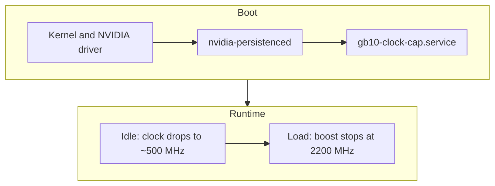

A DGX Spark under sustained LLM load runs hot. The GB10's GPU can reach about 90 °C, and the thermal trip
point is near 95 °C. If the same box is also your desktop, as mine is, the fans become part of the room.
Then I came across a small repo, [agjs/gb10-clock-cap](https://github.com/agjs/gb10-clock-cap), which claims
that one `nvidia-smi` command makes the GPU 12 °C cooler and cuts its power by 36%, while costing about 1.6%
of inference throughput.

That sounded too good, so I read the code, checked it against my own Spark, and installed it. This post
explains what the cap does, why it costs so little for LLM inference, how to make it come back after a
reboot without breaking your GPU containers, and when it isn't worth bothering.

<!-- more -->

## The one command that matters

Strip the repo down and this is what's left:

```bash
sudo nvidia-smi -lgc 0,2200   # --lock-gpu-clocks MIN,MAX in MHz
```

`-lgc` (long form `--lock-gpu-clocks`) sets a minimum and maximum for the GPU core clock. With a minimum of
`0`, the GPU still drops to a few hundred MHz when it's idle. The `2200` is a ceiling: under load the GPU
boosts up to 2200 MHz and stops there. It needs root, and it takes effect immediately, whether or not
something is running on the GPU.

Undoing it is just as simple:

```bash
sudo nvidia-smi -rgc          # --reset-gpu-clocks, back to driver defaults
```

No reboot and no restarting of model servers. That alone made it cheap to try.

The rest of the repo is a measurement harness (`run.sh`) that benchmarks stock against capped on a vLLM
server and writes a verdict to JSON, plus a systemd unit to make the cap persistent. The scripts only call
`nvidia-smi`, `ssh`/`scp` and the local inference API, and I found nothing in them that I wouldn't run.

## Why a 2200 MHz cap costs almost nothing

The spec sheet says the GB10's GPU goes to 3003 MHz, and `nvidia-smi` agrees on my box:

```text
$ nvidia-smi --query-gpu=clocks.max.gr,clocks.applications.gr --format=csv
clocks.max.graphics [MHz], clocks.applications.graphics [MHz]
3003 MHz, 2418 MHz
```

In practice, though, the Spark is power-limited well below that. The repo's author measured about 2455 MHz
under sustained load, so a 2200 cap is roughly a 9% clock reduction, not the 27% the spec number suggests.

Two things make that 9% cheap.

**Power isn't linear in clock speed.** Near the top of the curve, the GPU raises its voltage to reach each
extra MHz, and power grows roughly with frequency times voltage squared. The last few hundred MHz are the
most expensive ones you have. Giving them up removes a big chunk of power and heat for a small loss of
speed.

**Most of LLM inference doesn't care about the clock.** Generating tokens (decode) is limited by memory
bandwidth: for each new token the GPU reads the model's weights from memory, and the cores spend much of
that time waiting. A slower core clock barely changes how fast memory delivers the weights. Reading the
prompt (prefill) is different. It's compute-bound, because the GPU processes thousands of tokens in
parallel, so that's where a clock cap shows up.

The author's numbers, from two GB10 nodes running vLLM with a sustained 8-minute load, show exactly that
split:

| | Stock | Capped at 2200 | Change |
|---|---|---|---|
| Peak GPU temperature | 86–90 °C | 78 °C | −8 to −12 °C |
| Mean GPU power per node | 63 W | 40 W | −36% |
| Thermal throttling | 8.2 s | 0 s | gone |
| Decode | 73.3 tok/s | 72.5 tok/s | −1%, within noise |
| Cold prefill, 35k tokens | 17.96 s | 18.66 s | +3.9% |

They also swept lower clocks. At 2000 MHz, prefill was 8% slower and at 1800 MHz 13% slower, while power
kept dropping. 2200 is the knee of that curve: below it you start paying real prompt latency for each watt
saved.

> These are the repo author's measurements on their hardware, not mine. They're single-stream results. With
> many concurrent requests, decode batches get bigger and more compute-bound, so the cost of a cap can grow.
{: .prompt-info }

I like how carefully the harness was built. It alternates stock and capped runs (A B A B) so slow server
drift doesn't land on one side, cools the GPU to the same temperature before each run, measures temperature
with a sustained soak rather than between requests, and checks that the prefill test didn't hit the prefix
cache. Those are the mistakes that make GPU tuning benchmarks lie, and this repo avoids all of them.

## Check whether your Spark needs it first

Before changing anything, look at what's actually heating the box. My first check was disappointing in a
useful way:

```text
$ nvidia-smi --query-gpu=temperature.gpu,power.draw,clocks.gr --format=csv
temperature.gpu, power.draw [W], clocks.current.graphics [MHz]
56, 8.81 W, 617 MHz
```

The GPU was idle. No model was generating anything, and every busy container on the box (k3s clusters,
Supabase, cloudflared, the monitoring exporters) was running on the CPU. A GPU clock cap does nothing for
CPU heat. If that's your situation all the time, better airflow or
[scaling idle model servers to zero](/posts/homelab/dgx-spark-scale-to-zero-vllm-keda-http-add-on/) will do
more for you than this post.

The second thing to check is whether the GPU is throttling at all. `nvidia-smi` keeps cumulative counters
of how long the clock was held back, and why:

```bash
nvidia-smi -q -d PERFORMANCE | sed -n '/Clocks Event Reasons Counters/,/Sparse/p'
```

```text
    Clocks Event Reasons Counters
        SW Power Capping                               : 2296320 us
        Sync Boost                                     : 0 us
        SW Thermal Slowdown                            : 0 us
        HW Thermal Slowdown                            : 0 us
        HW Power Braking                               : 0 us
```

Mine showed zero thermal slowdown. That reading needs context, though: the box had been up for 8 minutes.
These counters reset at boot, so read them after a long run of real work. The repo's spec makes a related
point well: divide throttle time by time under load, not by uptime. On a host that's idle most of the day,
dividing by uptime makes throttling look about 100 times smaller than it is.

The test that answers the question is to run a real workload for several minutes and watch:

```bash
nvidia-smi --query-gpu=timestamp,temperature.gpu,power.draw,clocks.sm \
  --format=csv -l 2
```

If the temperature climbs into the high 80s and `HW Thermal Slowdown` starts counting, the cap is worth it.
If the GPU stays in the 60s, you're adding a config change that buys nothing.

> Don't judge this from idle readings. An idle GB10 sits around 50 to 56 °C whatever the clock cap is, and
> that tells you nothing about how hot it gets under load.
{: .prompt-warning }

### Why not just lower the power limit?

On a discrete GPU the usual tool is `nvidia-smi -pl` to set a power limit. On the GB10 that option isn't
available:

```text
$ nvidia-smi -q -d POWER | grep -i limit
        Current Power Limit                            : N/A
        Default Power Limit                            : N/A
        Min Power Limit                                : N/A
        Max Power Limit                                : N/A
```

The power budget is managed for the whole Grace Blackwell chip, not exposed as a GPU setting. Locking the
clock is the control you do have.

## Making it survive a reboot

`nvidia-smi -lgc` doesn't persist. A reboot resets it, and persistence mode doesn't keep it either. So you
need something to run it at every boot, and a systemd oneshot unit is the right tool:

```ini
# /etc/systemd/system/gb10-clock-cap.service
[Unit]
Description=Cap GB10 GPU clock at 2200 MHz for thermal and power headroom
After=nvidia-persistenced.service
Wants=nvidia-persistenced.service

[Service]
Type=oneshot
RemainAfterExit=yes
ExecStart=/usr/bin/nvidia-smi -lgc 0,2200
ExecStop=/usr/bin/nvidia-smi -rgc

[Install]
WantedBy=multi-user.target
```

`Type=oneshot` with `RemainAfterExit=yes` means systemd runs the command once and then reports the service
as active, so `systemctl status` tells you the cap was applied. `ExecStop` resets the clocks if you stop the
service, which gives you a clean way to turn it off. Ordering it after `nvidia-persistenced` makes sure the
driver is up before `nvidia-smi` runs.

Here's where it fits in the boot:



### The gotcha: `daemon-reload` and GPU containers

The normal way to install a unit is `systemctl daemon-reload` followed by `systemctl enable --now`. The repo
itself warns that this can break running GPU containers, and NVIDIA's own Container Toolkit troubleshooting
page confirms it. On hosts where systemd manages container cgroups, a `daemon-reload` can make running
containers lose GPU access, and they then fail with:

```text
Failed to initialize NVML: Unknown Error
```

The NVIDIA hook sets up the container's GPU device access without the low-level runtime (runc) knowing
about it. When systemd reloads and re-applies cgroup settings, that access gets dropped. The fix is to
recreate the container, which isn't what you want for a model server that takes minutes to load.

My Spark had four containers with GPU access when I installed this:

```bash
for c in $(docker ps -q); do
  docker inspect -f '{{.Name}} gpus={{json .HostConfig.DeviceRequests}}' "$c"
done | grep -v 'gpus=null'
```

```text
/homelab-gpu-process-memory gpus=[{"Driver":"nvidia",...,"Capabilities":[["utility"]]}]
/buildx_buildkit_sgtest0 gpus=[{"Driver":"",...,"Capabilities":[["gpu"]]}]
/homelab-dcgm-exporter gpus=[{"Driver":"nvidia",...,"Capabilities":[["gpu"]]}]
/k3d-ai-server-0 gpus=[{"Driver":"",...,"Capabilities":[["gpu"]]}]
```

`k3d-ai-server-0` is the node of the k3d cluster that runs my model servers, so recreating it would mean
restarting the AI cluster. And `systemctl enable` triggers a reload on its own, so leaving out the explicit
`daemon-reload` isn't enough.

What I did instead was skip systemd at install time entirely. `enable` mostly just creates a symlink in the
target's `.wants` directory, so I created that symlink myself and applied the cap directly with
`nvidia-smi`. systemd reads the unit at the next boot as usual.

```bash
#!/usr/bin/env bash
# install-gb10-clock-cap.sh: run with sudo
set -euo pipefail
[ "$(id -u)" -eq 0 ] || { echo "run with sudo" >&2; exit 1; }

UNIT=/etc/systemd/system/gb10-clock-cap.service

cat > "$UNIT" <<'EOF'
[Unit]
Description=Cap GB10 GPU clock at 2200 MHz for thermal and power headroom
After=nvidia-persistenced.service
Wants=nvidia-persistenced.service

[Service]
Type=oneshot
RemainAfterExit=yes
ExecStart=/usr/bin/nvidia-smi -lgc 0,2200
ExecStop=/usr/bin/nvidia-smi -rgc

[Install]
WantedBy=multi-user.target
EOF
chmod 644 "$UNIT"

# What `systemctl enable` would do, without reloading systemd
mkdir -p /etc/systemd/system/multi-user.target.wants
ln -sf "$UNIT" /etc/systemd/system/multi-user.target.wants/gb10-clock-cap.service

# Apply the cap now instead of starting the unit
/usr/bin/nvidia-smi -lgc 0,2200
nvidia-smi --query-gpu=clocks.sm,clocks.max.sm,temperature.gpu --format=csv
```

Afterwards both files were in place and the running containers kept their GPU access:

```text
$ ls -l /etc/systemd/system/gb10-clock-cap.service \
        /etc/systemd/system/multi-user.target.wants/gb10-clock-cap.service
-rw-r--r-- 1 root root 307 Oct 27 01:39 /etc/systemd/system/gb10-clock-cap.service
lrwxrwxrwx 1 root root  42 Oct 27 01:39 /etc/systemd/system/multi-user.target.wants/gb10-clock-cap.service -> /etc/systemd/system/gb10-clock-cap.service
```

> This only avoids causing a reload at install time. Package upgrades (`apt upgrade` pulling in a new
> systemd or a service) run `daemon-reload` too, so the NVML problem can still find you later. If it does,
> recreating the affected containers fixes it, and newer runc and NVIDIA driver versions avoid it.
{: .prompt-warning }

If you don't run any GPU containers, skip all of that and use the normal path:

```bash
sudo systemctl daemon-reload
sudo systemctl enable --now gb10-clock-cap.service
```

## Verifying it actually works

Don't trust "enabled" until a reboot proves it. After the next boot:

```bash
systemctl status gb10-clock-cap.service      # should be active (exited)
journalctl -b -u gb10-clock-cap.service      # nvidia-smi's output from this boot
```

`nvidia-smi` doesn't show the locked range in its normal query output, so check what the clock does. At
idle it should still drop to a few hundred MHz (mine sat at 513 MHz right after applying the cap). Under
load, watch `clocks.sm`: it should level off at 2200 MHz or a little under, where before it ran around 2450.
If it climbs past 2200, the cap didn't apply at boot, and the journal will show why.

## Common pitfalls

- **Judging from idle temperatures.** Covered above, and it's the most common mistake. Measure under
  sustained load.
- **Benchmarking only decode.** A decode-only test says the cap is free. Long prompts are where you pay
  (about 4% at 2200 MHz in the author's runs), so measure prefill too if you work with RAG or long context.
- **Running the harness as is on a homelab box.** `run.sh` requires passwordless `sudo nvidia-smi` and
  expects vLLM's `/metrics`. My Spark asks for a sudo password, so the preflight checks would refuse to run.
  On non-vLLM servers it falls back to default prompt sizes that may not match your usage. The single
  command is easy to test by hand.
- **Quoting GPU power as wall power.** `power.draw` is the GPU rail only. On the GB10 that's around 11 W of
  roughly 53 W at the wall when idle. Use a smart plug if you want wall numbers.
- **Going lower "to be safe".** Below 2200 MHz the prefill cost climbs quickly (+8% at 2000, +13% at 1800).
  Only do it if watts matter more to you than prompt latency.

## Conclusion

For a Spark that spends real time generating tokens, a 2200 MHz clock cap is one of the better deals in
GPU tuning: a large drop in GPU power and peak temperature, no thermal throttling, and a cost that mostly
shows up as a few percent of prefill time. It's easy to undo with `nvidia-smi -rgc`, and the systemd unit
makes it permanent.

The next step is the part I still owe my own box: run a long, real workload before and after, watching
`temperature.gpu`, `power.draw` and the throttle counters, and check whether this hardware matches the
author's numbers. If the GPU never gets hot, remove the unit and look at the CPU side instead.

## References

- [agjs/gb10-clock-cap on GitHub](https://github.com/agjs/gb10-clock-cap)
- [NVIDIA Container Toolkit: Troubleshooting (NVML Unknown Error after daemon-reload)](https://docs.nvidia.com/datacenter/cloud-native/container-toolkit/1.20.1/troubleshooting.html)
- [NVIDIA System Management Interface (nvidia-smi) documentation](https://docs.nvidia.com/deploy/nvidia-smi/index.html)
- [How to limit NVIDIA GPU core and memory clocks (DEV Community)](https://dev.to/vast-cow/how-to-limit-nvidia-gpu-core-and-memory-clocks-298n)
