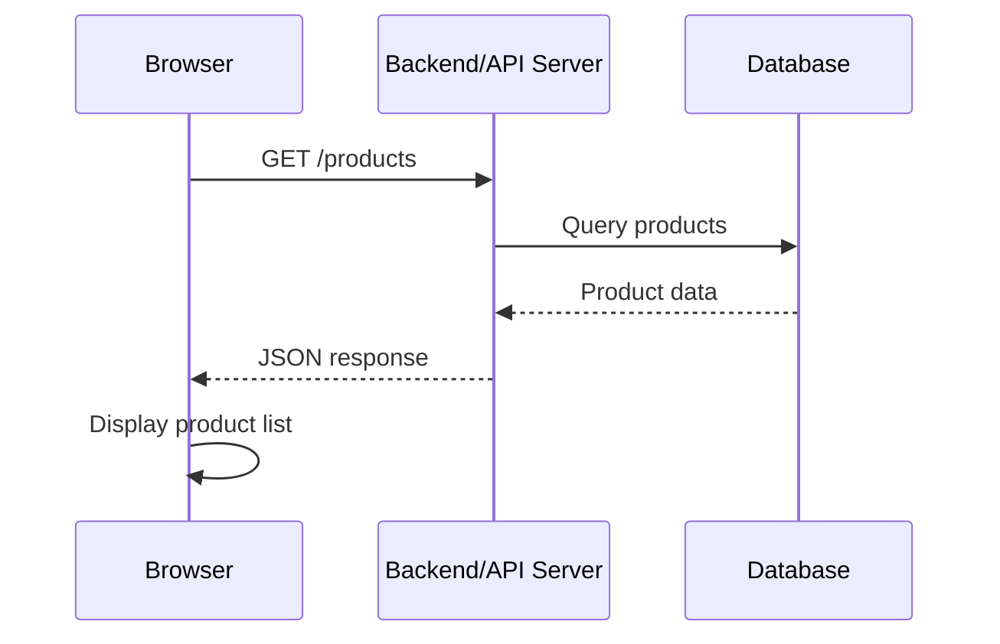
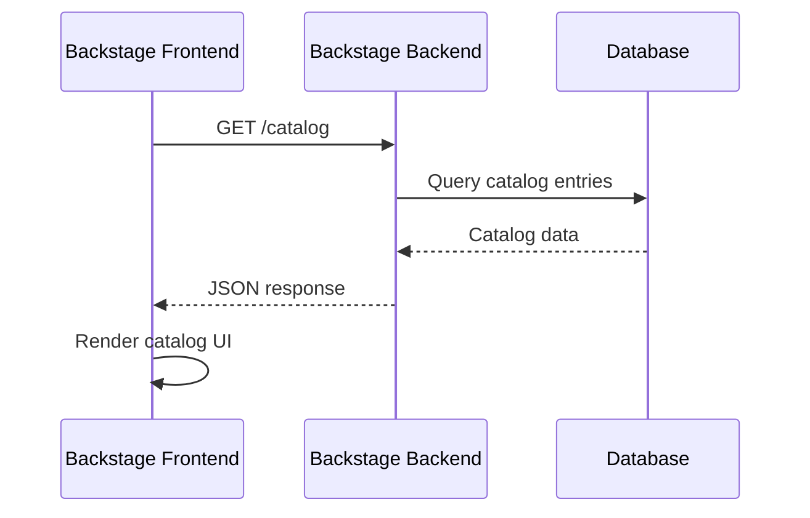
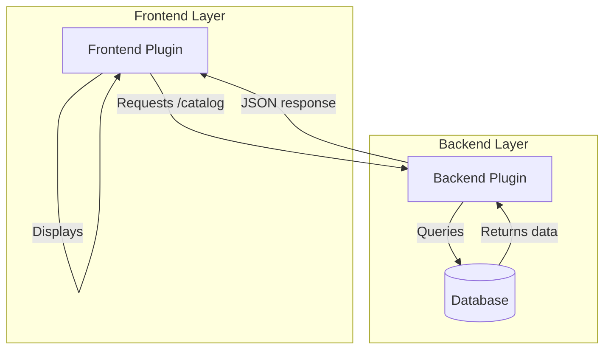
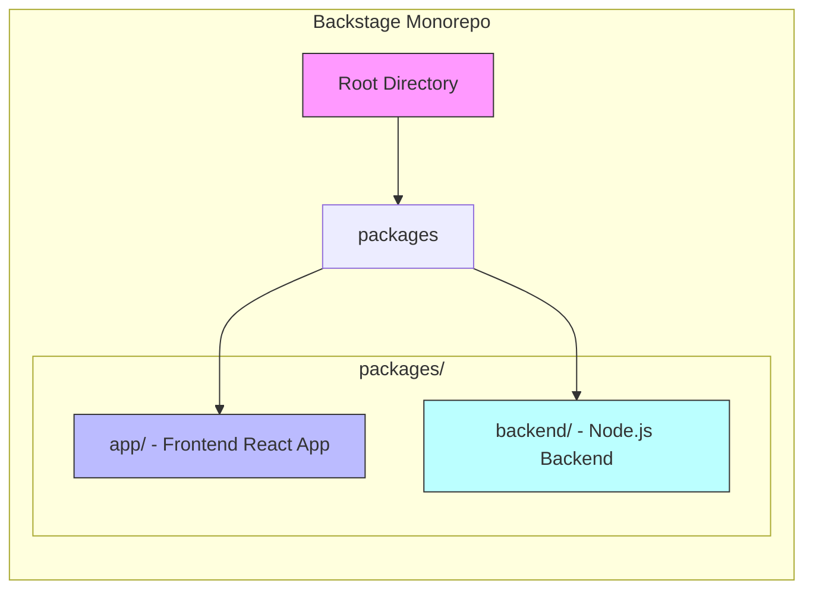

## Introduction

- Backstage uses a three-layers model to explain how a Developer Portal is built using its framework.


### Core

- This is what the Backstage team maintains and releases as open source. 
- Unless you want to contribute to the project, you may not need to wrap your head around this piece from the beginning.

### App

- This app is the Developer Portal that you’ll make available to your developers. 
- While adopting Backstage, you’ll be interacting the most with this piece.

### Plugins

- To extend your instance’s functionality, you can install plugins into it. 
- Even basic functionality is abstracted as plugins, including the Catalog. So you’ll always be working with a handful of plugins.
- There are a few dozen community plugins available to integrate popular services. And you can create your own.

---

## Architecture Overview

This guide explains Backstage's architecture, comparing its frontend, backend, and plugin system to a typical web application.

### Typical Web Architecture

A typical web application follows a client-server model:

- **Frontend**: Runs in the browser, handling UI rendering and user interactions.
- **Backend**: Exposes REST APIs, implements business logic, and communicates with a database.

The flow of a typical request looks like this:



1. Browser requests `/products`
2. API server queries the database
3. Database returns product data
4. API responds with JSON
5. Frontend displays the product list

---

## Backstage Core Architecture

Backstage follows a similar architecture but with its own specific implementation:



The request flow in Backstage:

- Frontend sends a `GET` request to the backend's `/catalog` endpoint
- Backend plugin queries its storage (database)
- Database returns catalog entries
- Backend responds with JSON
- Frontend renders the catalog in the browser

---

## Plugin-Based Extension

Backstage's architecture is built around plugins, which can include both frontend and backend components:



The plugin architecture allows for:

- Frontend requests `/catalog`
- Backend plugin queries its database
- Storage returns catalog entries
- Backend sends JSON response
- Frontend displays the catalog

---

## Plugin URLs and Navigation

Each plugin in Backstage has its own URL path. For example:

- The Catalog plugin is accessible at `/catalog`
- The Lighthouse plugin is accessible at `/lighthouse`

These URLs are defined by the plugin's frontend configuration and are served by the Backstage app.

---

## Monorepo Structure

Backstage uses a monorepo structure to organize its codebase:



The structure includes:

- `packages/app`: Frontend application (React)
- `packages/backend`: Backend service (Node.js)

This monorepo approach allows you to develop, test, and deploy each part independently while keeping both frontend and backend in a single repository for consistent versioning.

---

## Frontend with React

The Backstage frontend is built using React. Here's an example of a simple component:

```tsx
import React from 'react';

export const Button = () => {
  const handleClick = () => {
    alert('Button clicked!');
  };

  return (
    <div>
      <h1>Don't Click The Button!!!</h1>
      <button onClick={handleClick}>
        Click Me
      </button>
    </div>
  );
};
```

And here's how it can be used in another component:

```tsx
import React from 'react';
import { Button } from './Button';

export const MyForm = () => (
  <div>
    <input id="login" type="text" />
    <input id="password" type="password" />
    <Button />
  </div>
);
```

---

## Design System with Material-UI

Backstage uses Material-UI (MUI) as its design system, providing a consistent and component-driven UI experience. This ensures visual consistency across all plugins and features.

---

## Summary

Key takeaways about Backstage's architecture:

- Backstage features are implemented as modular plugins (frontend + optional backend)
- The project is organized as a monorepo with `app` and `backend` packages
- The frontend leverages React and Material-UI for a consistent, component-driven UI
- The architecture follows a client-server model with clear separation between frontend and backend
- Plugins can extend functionality without modifying the core system

---

## Links and References

- [Backstage Documentation](https://backstage.io/docs)
- [Backstage Plugin Development](https://backstage.io/docs/plugins)
- [React Official Site](https://react.dev)
- [Material-UI Documentation](https://mui.com)
