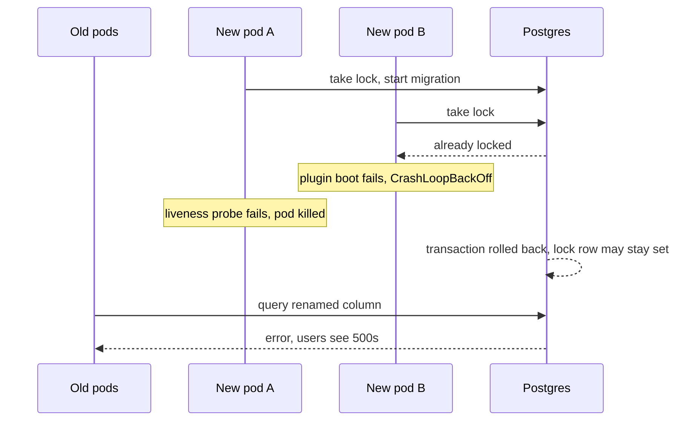
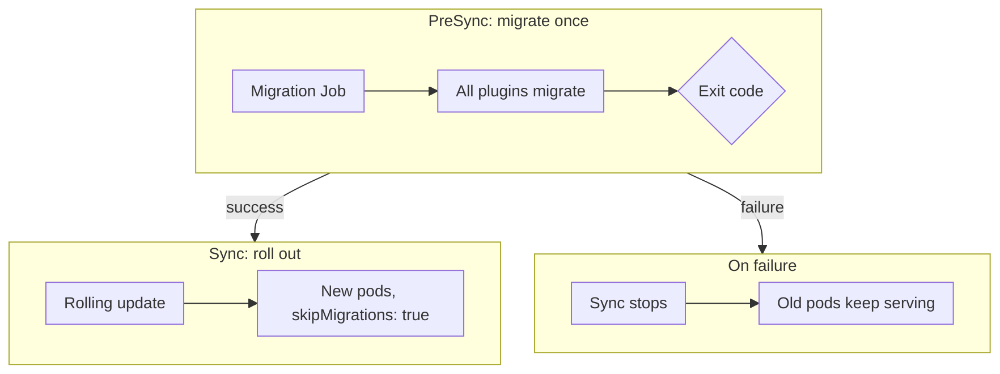

Your Backstage deploy went out, one pod is `Running`, the other is in `CrashLoopBackOff`, and its last log
line says `Migration table is already locked`. Ten minutes later both pods are stuck, the portal returns
502s, and nobody touched the database. If that sounds familiar, the cause is almost always the same:
Backstage runs its database migrations inside every pod at startup, and on Kubernetes that means several
pods, old and new, racing over one schema. In this post I'll walk through a realistic failure, how to
troubleshoot it step by step, and how to fix it for good by running migrations once, in a Job, before the
Deployment rolls.

<!-- more -->

If you're new to how the backend is put together, the
[Backstage architecture post](/posts/platformengg/backstage/backstage-architecture/) is a good primer.
Everything below assumes the new backend system (`createBackend()`), PostgreSQL, and Kubernetes.

## How Backstage migrates by default

Every backend plugin that stores data owns its own schema and ships its own [Knex](https://knexjs.org/)
migration files. The catalog, scaffolder, search, notifications, your in-house plugins: each one calls
something like this while it initialises:

```ts
const client = await database.getClient();
if (!database.migrations?.skip) {
  await client.migrate.latest({ directory: migrationsDir });
}
```

That's the catalog's real code path, more or less. A few details matter here:

- With the default `pluginDivisionMode: database`, each plugin gets its own Postgres database
  (`backstage_plugin_catalog`, `backstage_plugin_scaffolder`, and so on), each with its own
  `knex_migrations` and `knex_migrations_lock` tables.
- Knex takes a lock (a row in `knex_migrations_lock` with `is_locked = 1`) before migrating, so two
  processes can't apply the same migration twice.
- Plugin init runs before the HTTP server reports ready. The pod can't serve traffic until every plugin's
  migrations finish.
- By default a plugin that fails to boot aborts the whole backend
  (`backend.startup.default.onPluginBootFailure: abort`).

On a laptop with one process this is fine. On Kubernetes with two or more replicas and a rolling update,
each of those details turns into a way to fail.

## The failure: a routine upgrade goes sideways

Picture this. A team runs Backstage with 2 replicas behind a Service, `RollingUpdate` strategy, liveness
and readiness probes on the health endpoint, and Postgres in a managed service. They bump Backstage a few
minor versions and add a column to one of their own plugins. The catalog upgrade brings a migration that
rewrites an index on a large table.

Here's how the next twenty minutes go:

1. The Deployment creates **new pod A**. It starts migrating: takes the catalog lock, starts building the
   index. With a few hundred thousand entities that takes a while.
2. Kubernetes doesn't wait. Because of `maxSurge`, **new pod B** starts too. It tries to take the same lock,
   waits, and hits Knex's lock error: `Migration table is already locked`. The catalog plugin fails to boot,
   `onPluginBootFailure: abort` kills the process, and B goes into `CrashLoopBackOff`.
3. Pod A is still migrating, so it isn't ready. Its **liveness probe** fails, and the kubelet kills it in
   the middle of the migration.
4. Postgres rolls back A's open transaction, so the schema is fine. But depending on timing, the
   lock row can be left at `is_locked = 1`. Every pod after this one waits on a lock nobody holds.
5. Meanwhile the **old pods** are still serving. Your own plugin's migration already committed (it was
   quick) and renamed a column. The old code still queries the old column name, so some pages start
   returning 500s.

Now the old version is half broken, the new version can't start, and a rollback won't help, because the
old image runs against a schema it doesn't understand.



None of these steps is a bug on its own. The design of "every replica migrates at startup" is the bug.

## Troubleshooting it step by step

When you're in the middle of this, here's the order I'd check things in.

### 1. Find which plugin is stuck

```bash
kubectl -n backstage get pods -l app=backstage
kubectl -n backstage logs deploy/backstage --all-containers --tail=200 | grep -iE "migrat|lock|boot"
# the crashed container's previous run often has the real error
kubectl -n backstage logs <pod-b> --previous | tail -50
```

You're looking for the plugin id next to the error, for example
`Plugin 'catalog' startup failed; caused by Error: Migration table is already locked`.

### 2. Check whether the probes killed a pod mid-migration

```bash
kubectl -n backstage describe pod <pod-a> | sed -n '/Events/,$p'
```

`Liveness probe failed` followed by `Killing` while the logs show `Performing database migration` is the
smoking gun. A liveness probe that's tighter than your slowest migration will eventually kill one.

### 3. Look at the lock and migration tables

Connect to the plugin's database (with the default division mode it's `backstage_plugin_<pluginId>`):

```sql
-- is a lock held?
SELECT * FROM knex_migrations_lock;

-- what ran last, and when?
SELECT name, migration_time FROM knex_migrations ORDER BY id DESC LIMIT 5;
```

If you need a refresher on connecting with `psql`, see the
[Postgres CLI cheatsheet](/posts/cloud/aws/postgres-cli-commands-cheatsheet/).

### 4. Check whether anything is really migrating

```sql
SELECT pid, datname, state, now() - query_start AS running_for, left(query, 80) AS query
FROM pg_stat_activity
WHERE datname LIKE 'backstage_plugin_%' AND state <> 'idle'
ORDER BY query_start;
```

If an `ALTER TABLE` or `CREATE INDEX` is still running, leave it alone and let it finish. If nothing is
running and the lock still says `is_locked = 1`, the lock is stale.

### 5. Only then, release a stale lock

```sql
UPDATE knex_migrations_lock SET is_locked = 0;
```

> Never release the lock while a migration is still running. You'll get two processes applying the same
> migration, and that's how you end up with half-created tables.
{: .prompt-danger }

### 6. Check the old pods against the new schema

If the old pods are throwing errors, compare the last migration names from step 3 with what the old
release expects. If a migration renamed or dropped something, rolling back the image won't fix it. You'll
need to roll forward, or restore the schema.

Once the lock is clear and the probes are loosened, the rollout usually goes through. But the next release
can hit the same race, so the real fix is structural.

## The fix: migrate once, before the rollout

The pattern is common in Kubernetes setups, and Backstage supports it with an official config option:

1. **Application pods never migrate.** They start with `backend.database.skipMigrations: true`.
2. **A one-off Job migrates.** It uses the same image and the same config, with migrations enabled, and
   exits when every plugin has initialised.
3. **The Job runs before the Deployment changes**, as an ArgoCD `PreSync` hook or a Helm `pre-upgrade`
   hook. If it fails, the Deployment isn't touched and the old pods keep serving.



### Step 1: turn migrations off in the pods

Add a config overlay that only the Deployment loads:

```yaml
# app-config.deployed.yaml
backend:
  database:
    skipMigrations: true
```

And load it in the Deployment's command:

```yaml
command:
  - node
  - packages/backend
  - --config
  - app-config.yaml
  - --config
  - app-config.production.yaml
  - --config
  - app-config.deployed.yaml
```

`skipMigrations` has been in `@backstage/backend-defaults` since Backstage 1.31. You can set it globally,
as above, or per plugin under `backend.database.plugin.<pluginId>.skipMigrations`. Backstage's own
[catalog read/write-split guide](https://github.com/backstage/backstage/tree/master/contrib/catalog/read-write-split)
uses the same setting so that only one deployment ever migrates.

> The flag only works for plugins that check it. All core plugins do. Your own plugins need the
> `if (!database.migrations?.skip)` guard from the snippet at the top of this post. Grep your repo for
> `migrate.latest` and make sure every call has that guard, or that plugin will keep migrating in every pod.
{: .prompt-warning }

### Step 2: build a migration Job from the same image

Backstage has no built-in "migrate and exit" command, but you don't need one. When the backend finishes
initialising every plugin (which is when migrations run), the
[root health service](https://backstage.io/docs/backend-system/core-services/root-health) starts
returning 200 on `/.backstage/health/v1/readiness`. So the Job can start the backend, wait for ready, and
stop it:

```sh
#!/bin/sh
# migrate.sh: run all plugin migrations, then exit
set -eu
node packages/backend --config app-config.yaml --config app-config.production.yaml \
  --config app-config.migrate.yaml &
pid=$!

for i in $(seq 1 180); do
  if ! kill -0 "$pid" 2>/dev/null; then
    wait "$pid" || true
    echo "Backend exited before it became ready: migration failed" >&2
    exit 1
  fi
  if node -e "fetch('http://127.0.0.1:7007/.backstage/health/v1/readiness').then(r=>process.exit(r.ok?0:1)).catch(()=>process.exit(1))"; then
    echo "All plugins initialised, migrations complete"
    kill -TERM "$pid"; wait "$pid" || true
    exit 0
  fi
  sleep 5
done
echo "Timed out waiting for readiness" >&2
kill -TERM "$pid"; exit 1
```

Since the default `onPluginBootFailure` is `abort`, a failed migration in any plugin makes the backend
exit, and the script turns that into a failed Job. Keep that default for the Job, even if your pods use
`continue`.

The Job is a real backend for a minute or so, so keep it quiet with a small overlay:

```yaml
# app-config.migrate.yaml
backend:
  database:
    skipMigrations: false
catalog:
  processingInterval: false   # don't start the processing loop
```

Disable anything else that does work on startup in your instance (entity providers that fetch on boot,
search indexers). Nothing routes traffic to the Job, because no Service selects its pod.

> If you'd rather not run a shell loop, the cleaner version is a small backend module, loaded only when an
> environment variable like `BACKSTAGE_MIGRATE_ONLY=true` is set, that registers a root lifecycle startup
> hook and shuts the process down. It's more code, but it exits as soon as initialisation completes.
{: .prompt-tip }

### Step 3: run it before the Deployment

With ArgoCD, make the Job a `PreSync` hook. ArgoCD runs it to completion before applying anything else,
and stops the sync if it fails:

```yaml
apiVersion: batch/v1
kind: Job
metadata:
  name: backstage-migrations
  annotations:
    argocd.argoproj.io/hook: PreSync
    argocd.argoproj.io/hook-delete-policy: BeforeHookCreation,HookSucceeded
spec:
  backoffLimit: 0                 # never retry a half-understood failure
  activeDeadlineSeconds: 900      # longer than your slowest migration
  template:
    spec:
      restartPolicy: Never
      automountServiceAccountToken: false
      containers:
        - name: migrate
          image: ghcr.io/example/backstage:1.42.0   # same tag as the Deployment
          command: ["/bin/sh", "/app/migrate.sh"]
          envFrom:
            - secretRef:
                name: backstage-secrets           # same DB credentials as the pods
          resources:
            requests: { cpu: 500m, memory: 1Gi }
            limits: { memory: 2Gi }
```

With Helm alone, the same Job with `"helm.sh/hook": pre-install,pre-upgrade` and
`"helm.sh/hook-delete-policy": before-hook-creation,hook-succeeded` does the job. See the
[ArgoCD architecture post](/posts/devops/cicd/gitops/argocd/argocd-architecture/) for how sync phases fit
together.

A few deliberate choices in that spec:

- **No probes.** Nothing should kill this pod for being slow. `activeDeadlineSeconds` is the only timeout.
- **`backoffLimit: 0`.** A retry after a partial failure hides the real error. Fail, look at the logs,
  decide.
- **Its own resources.** Pods sized for steady-state traffic are often too small for a migration that
  rebuilds an index.

## Why a failed Job doesn't take the old pods down

This is the question that matters most: "if the migration fails, what happens to the running version?"

Knex's `migrate.latest()` runs all of a plugin's pending migrations **inside one transaction**, unless one
of them opts out. PostgreSQL can roll back schema changes (MySQL can't). So if the third of three new
catalog migrations fails, the first two are undone as well, and that plugin's schema is exactly where it
was before. The Job fails, ArgoCD stops the sync, the Deployment is never updated, and the old pods carry
on.

There are four exceptions:

| Case | What happens | What to do |
|---|---|---|
| One plugin migrates, another fails | Each plugin migrates separately, so plugin A's changes can stay committed while plugin B's roll back | Fine if A only added things (see the next section) |
| A migration with `config.transaction: false` (e.g. `CREATE INDEX CONCURRENTLY`) | Not rolled back; can leave changes half applied | Keep these rare and safe to re-run (`IF NOT EXISTS`) |
| A migration succeeds but breaks old code (rename or drop) | Nothing fails, but the old pods start erroring | Expand/contract, below |
| The Job is killed mid-run | The transaction rolls back, but the lock row can stay set | Alert on Job failure; check the lock before the next run |

## Keep migrations backward compatible

The Job removes the race between replicas. It doesn't remove the overlap where the old code runs against
the new schema, because the old pods keep serving while the Job runs and during the rolling update. So
the other half of the fix is a rule for whoever writes migrations: **a release may only add to the
schema. Removing things waits for a later release.** This is usually called expand/contract.

Take a column rename from `alert_state` to `state`. Done in one migration, it breaks every old pod the
instant it commits. Spread over three releases, it never breaks anything:

| Release | Migration | Code |
|---|---|---|
| 1 (expand) | Add `state`, copy the values from `alert_state` | Writes both, reads `state` |
| 2 | none | Uses only `state` |
| 3 (contract) | Drop `alert_state` | unchanged |

The same idea covers the other common changes:

| Change | Safe in one release? | How to make it safe |
|---|---|---|
| Add a table, a nullable column, or a column with a constant default | Yes | Nothing to do |
| Add a `NOT NULL` column without a default | No | Add it nullable or with a default, tighten it later |
| Rename or drop a column or table | No | Expand/contract across releases |
| Change a column type | No | New column, backfill, switch, drop the old one |
| Narrow a `CHECK` constraint | No | Old code may still write the removed values; widen only |
| Add an index on a big table | Yes, but it blocks writes | `CREATE INDEX CONCURRENTLY` in a non-transactional migration |

And because old pods keep serving during the migration, also watch out for locks. Most `ALTER TABLE`
statements take an `ACCESS EXCLUSIVE` lock. An instant `ALTER` that has to wait behind a long-running
query blocks every query on that table queued behind it. Put `SET LOCAL lock_timeout = '5s'` at the top
of migrations that alter busy tables, so the Job fails cleanly instead of freezing the app.

## Common pitfalls

**Selective syncs skip hooks.** If someone syncs only the Deployment in the ArgoCD UI, or the app uses
`ApplyOutOfSyncOnly` and only the Deployment changed, the `PreSync` hook doesn't run. The new image
starts with `skipMigrations: true` against an old schema. Make full syncs the norm for this app, and
consider an init container that refuses to start if the schema is behind.

**A tight liveness probe on the migration Job.** Don't copy the Deployment's probes into the Job. That's
the exact failure from the scenario, just moved to a different pod.

**Plugins that don't honour the flag.** Third-party plugins from npm are easy to forget. Check their
source for `migrate.latest` and whether it's guarded by `migrations.skip`. If one isn't, it keeps
migrating in every pod and you keep the race for that plugin.

**Mixing up the config overlays.** If the Deployment loads `app-config.migrate.yaml`, or the Job loads
`app-config.deployed.yaml`, you're back to square one. Name them clearly and render the manifests in CI to
check which pod loads which file.

**Stopping the app "to be safe".** It's tempting to scale the Deployment to zero before the Job runs, so
nothing can see a half-migrated schema. It works, but every deploy becomes an outage, including deploys
with no migrations at all. And when the migration fails, you're left with zero replicas instead of
working old ones. I'd keep that as an opt-in for the rare release that truly can't be made backward
compatible, not as the default.

## Conclusion

The startup race in Backstage isn't something you tune your way out of with longer probes or fewer
replicas. Run migrations once, in a Job that runs before the Deployment changes. Set
`backend.database.skipMigrations: true` everywhere else, and keep migrations additive so the old pods
survive the overlap. A failed migration then becomes a failed sync with the old version still serving,
rather than an outage.

If you want a first step for this week: grep your backend for `migrate.latest`, make sure every call
checks `database.migrations?.skip`, and add the `skipMigrations` overlay to a non-production environment.
The Job and the hook are an afternoon's work after that.

## References

- [Backstage PR #26175: add config options to skip database migrations](https://github.com/backstage/backstage/pull/26175)
- [Backstage `backend-defaults` config schema (`skipMigrations`, `pluginDivisionMode`)](https://github.com/backstage/backstage/blob/master/packages/backend-defaults/config.d.ts)
- [Backstage `backend-app-api` config schema (`onPluginBootFailure`)](https://github.com/backstage/backstage/blob/master/packages/backend-app-api/config.d.ts)
- [Backstage docs: Root Health service](https://backstage.io/docs/backend-system/core-services/root-health)
- [Backstage contrib: catalog read/write split](https://github.com/backstage/backstage/tree/master/contrib/catalog/read-write-split)
- [Knex migrator source (single transaction for a batch)](https://github.com/knex/knex/blob/master/lib/migrations/migrate/Migrator.js)
- [Red Hat Developer Hub: RHIDP-3642](https://issues.redhat.com/browse/RHIDP-3642)
- [Andrew Lock: running database migrations using Jobs and init containers](https://andrewlock.net/deploying-asp-net-core-applications-to-kubernetes-part-8-running-database-migrations-using-jobs-and-init-containers)
- [ITNEXT: database migrations on Kubernetes using Helm hooks](https://itnext.io/database-migrations-on-kubernetes-using-helm-hooks-fb80c0d97805)
- [ArgoCD: resource hooks](https://argo-cd.readthedocs.io/en/stable/user-guide/resource_hooks/)
